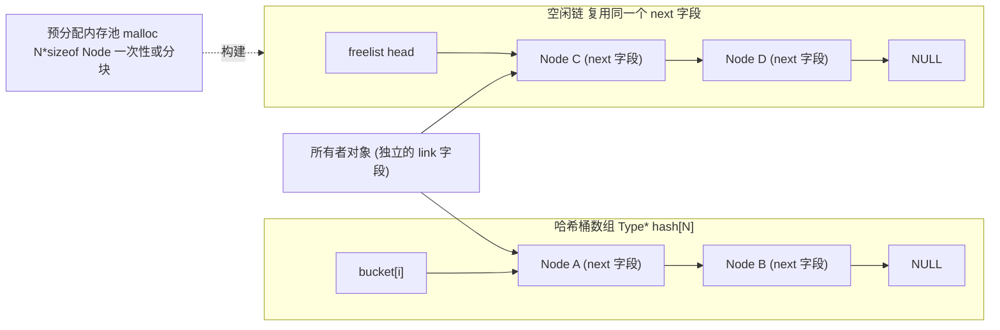

# C 语言 Hash-based Alloc/Free/Lookup 模式手册

本文件夹是一份**完全独立、不依赖任何外部代码仓库**的 C 语言模式手册。内容来自对一类嵌入式/实时系统（典型代表：DOCSIS CMTS 控制面数据库）里反复出现的"基于哈希表的对象生命周期管理"代码的观察与提炼——这类代码几十年来在 Plan 9 风格的 C 代码库（`nil`、返回类型独占一行、tab 缩进）里长期演化，形成了一套非常稳定的实现套路。

手册只保留**抽象出来的通用技巧和心智模型**，所有示例代码都是围绕"订单""会话""设备""策略""端口"等通用场景重新设计的原创代码，可以直接用标准 C 编译运行，不引用、不复制任何现有工程的头文件或实现。

## 目录

- [核心场景](#核心场景)
- [12 类实现技巧](#12-类实现技巧)
- [10 条心智模型](#10-条心智模型)
- [架构示意图](#架构示意图)
- [7 个示例速查表](#7-个示例速查表)
- [如何编译运行](#如何编译运行)

## 核心场景

这类代码要解决的问题几乎总是同一个模子刻出来的：

> 系统里有成千上万个"实体"（一个 CM、一个服务流、一个分类器、一条 MAC 绑定……），运行时要能够：
> **按某个 key 在 O(1) 时间内创建它、销毁它、找到它**，并且**不能用堆内存的动态增长拖慢或拖垮一个 7x24 跑着的控制面进程**。

对应到实现上，几乎所有这类模块都会长成同一副骨架：

```c
Type *hashtab[N];              /* N 个桶头指针，N 是 2 的幂 */

Type *xxxalloc(key)  { ... }   /* 分配一个新对象，插入哈希表 */
int   xxxfree(Type*) { ... }   /* 把对象从哈希表摘除，回收内存/放回 freelist */
Type *xxxlook(key)   { ... }   /* 按 key 在哈希表里找到对象 */
```

本手册要讲的，就是这副骨架之上叠加的各种"骨科手术"技巧。

## 12 类实现技巧

1. **桶数组即哈希表（no bucket object）**：`Type *hash[N]`，`N` 取 2 的幂，用 `key & (N-1)` 代替 `key % N`。桶数组的下标本身就是哈希函数的值域，不需要额外的 `struct Bucket`。
2. **侵入式单链表（intrusive singly-linked list）**：链表的 "next" 指针就是实体结构体里的一个普通字段（例如 `next`/`hash`/`link`），插入/删除都是纯指针操作，不需要为链表节点单独分配内存。
3. **头插法（LIFO 插入）**：新对象总是插到桶链表的最前面——`obj->next = bucket; bucket = obj;`——O(1) 插入，查找时"最近插入的先被看到"。
4. **二级指针删除惯用法（`Type **pp`）**：遍历时用一个指向"上一个 next 字段"的指针，删除目标节点时统一写成 `*pp = target->next;`，不需要对"目标是不是头节点"做特判分支。
5. **freelist 复用同一个链表字段**：一个对象在其生命周期里只可能处于"空闲（在 freelist 上）"或"使用中（在 hash 桶链上）"两种互斥状态，因此可以让这两条链表共用同一个指针字段，省下一个字段的内存。
6. **内存池 + 分块扩容**：不逐个 `malloc`，而是一次性 `malloc(N * sizeof(Type))` 拿到一大块内存，切成 N 个节点串成 freelist；freelist 耗尽时再整块申请下一批，而不是退化成逐个 malloc。
7. **静态定长池（fixed-capacity pool）**：初始化时一次性分配好worst-case 数量的对象（例如 `NCLASSIFIER` 个），运行期绝不再向系统要内存，是实时系统里"内存预算提前锁死"思维的直接体现。
8. **多重从属关系 = 多个独立链表字段**：当一个对象需要同时被"全局哈希表（按 ID 快速查找）"和"某个所有者的私有链表（表达归属关系）"两种方式组织时，需要两个独立的链表字段，不能像技巧 5 那样合并，因为两条链表可能同时存在。
9. **状态位 + 软删除（tombstone）**：查找时除了比较 key，还要检查一个 `state`/`active` 标志位；"停用"一个条目只是翻转标志位，而不做真正的物理摘链，方便审计、延迟清理或者防止和另一个正在进行的遍历冲突。
10. **复合 key 哈希 + 全表扫描兜底**：把多个字段打包压缩成一个整数再取哈希，可以按"主 key"快速定位；但如果查询条件是任意字段组合（不是建表时选定的那个 key），哈希表帮不上忙，必须显式提供一个遍历所有桶、逐条比较字段的线性兜底函数。
11. **查找即创建（get-or-create / 幂等分配）**：把"look 一下，没有就 alloc"这个高频调用序列收编进同一个函数签名（例如 `lookup(key, create_flag)`），减少调用方样板代码，也避免"look 和 alloc 中间被切走"的竞态窗口。
12. **游标式有序遍历 + 级联释放 + 指针算术还原下标**：三个经常结伴出现的技巧——(a) 直接对定长数组按下标升序扫描、配合 filter 参数实现"GetNext"语义，这与哈希查找是两条独立的访问路径；(b) 释放一个"聚合根"对象前，必须先递归/遍历释放它名下的所有子对象，防止任何子哈希表里留下悬挂指针；(c) 用 `obj - pool_base` 这种指针算术直接算出对象在池数组里的下标，把这个下标当作零成本、天然稳定的整数 ID 使用。

## 10 条心智模型

以上技巧背后，是几种反复出现的思维方式：

1. **"数组下标即哈希桶"**：不要把哈希表想象成一个需要额外分配"桶对象"的复杂数据结构——它往往就是一个普通数组，下标就是哈希函数的输出。
2. **对象自带链表指针（intrusive over external）**：C 语言里"侵入式"数据结构（链表指针是结构体自身的字段）几乎总是优于"外部"数据结构（用单独节点包裹用户数据），因为它省掉了一次额外分配和一次额外的指针跳转，对缓存更友好。
3. **生命周期状态互斥 ⇒ 内存可复用（poor man's union）**：如果能证明"对象在任意时刻只可能处于状态 A 或状态 B 之一"，就可以让 A、B 各自需要的链表字段共用同一块内存——这是没有 tagged union 语法糖时，C 程序员用状态机保证内存安全复用的手工技巧。
4. **所有权（ownership）与索引（indexing）是两个正交的概念**：所有权决定对象什么时候该被释放（父对象死了，子对象也该死）；索引决定对象能不能被快速找到（挂在哪个哈希表上）。一个对象完全可以同时拥有一个所有者、又被一个和所有者无关的全局哈希表索引——这时就需要两个独立的链表字段，不能混用。
5. **静态内存预算（budget everything up front）**：实时/嵌入式系统不信任"运行时按需向 OS 要内存"这件事，宁愿在启动时就把 worst-case 容量的内存一次性锁死，用固定大小的池 + freelist 换取"永不会在关键路径上 OOM 或产生堆碎片"的确定性。
6. **删除是一个"无特例"的统一操作**：好的链表删除实现应该让"删除头节点"和"删除中间节点"走同一段代码，二级指针（`Type **pp`）正是为了消灭这种特例分支而存在的经典技巧。
7. **软删除 ≠ 物理删除**：很多业务语义上的"删除"（停用、下线、失效）并不要求立刻释放内存或摘链，反而更适合"保留条目、翻转状态位、查找时过滤"——这样可以延迟真正的资源回收，或者保留历史痕迹用于审计。
8. **哈希只加速"建表用的那个 key"**：一个哈希表只能让"按建表时选定的那个 key 查找"变快；任何其它维度的查询（按属性组合、按范围）天然需要退化为线性扫描，除非额外建一张索引表。工程上要坦然接受"某些查询就是 O(N)"，而不是强行把不适合的 key 也哈希进去。
9. **"查找即创建"是一种意图声明**：把 look 和 alloc 合并成一个带 flag 的函数，本质上是把"调用方到底想不想在找不到时创建一个新对象"这个意图，显式地放进了函数签名里，而不是让调用方自己拼接两个调用、还要处理中间的空档。
10. **让内存布局本身承载身份（identity-from-layout）**：与其额外维护一个 ID 分配器，不如利用"对象来自一个定长数组池"这个事实，直接用指针相减得到下标——这个下标零成本、永久稳定，还天然支持按下标升序做 GetNext 式遍历。

## 架构示意图



上图里 `Owner` 到 `NodeA`/`NodeC` 的箭头，示意的是技巧 8（多重从属关系）：同一个节点可能同时挂在"全局哈希桶链"和"所有者私有链表"上，两条链各自用独立的字段维护，互不影响。

## 7 个示例速查表

| 文件 | 场景 | 对应技巧 | 对应心智模型 |
| --- | --- | --- | --- |
| `01_basic_chaining.c` | 按订单 ID 查找订单 | 1,2,3,4 | 1,2,6 |
| `02_pool_freelist_reuse.c` | 会话对象池，按 session id 索引 | 5,6 | 3 |
| `03_dual_membership_pool.c` | 设备拥有端口，端口同时被全局哈希索引 | 7,8 | 4,5 |
| `04_tombstone_registry.c` | 按名字注册的策略表，可停用 | 9 | 7 |
| `05_composite_key_scan.c` | 按 (类型,优先级) 复合 key 查找 + 属性扫描 | 10 | 8 |
| `06_lookup_or_create.c` | 设备注册表，查找或按需创建 | 11 | 9 |
| `07_ordered_walk_and_cascade_free.c` | 会话表 GetNext 遍历 + 级联释放连接 | 12 | 8,6(顺序释放),10 |

(说明：上表用列表化的 Markdown 表格仅用于速查索引，每个示例文件内部都有更详细的场景说明和心智模型总结注释块，不依赖这张表格即可独立阅读。)

## 如何编译运行

本文件夹不依赖任何工作区代码，只需要一个标准 C11 编译器（`gcc`/`clang`）：

```bash
cd hash-alloc-patterns
make            # 编译全部 7 个示例
make run        # 编译并依次运行全部 7 个示例（每个示例内部用 assert 自检）
make clean      # 清理编译产物
```

也可以单独编译某一个示例，例如：

```bash
gcc -std=c11 -Wall -Wextra -O2 -o /tmp/ex1 examples/01_basic_chaining.c
/tmp/ex1
```

每个示例都会在 `main()` 里打印执行过程，并用 `assert()` 校验关键行为（分配成功/失败、查找命中/未命中、删除后确实找不到了等），进程以非 0 状态退出即代表该示例的自检失败。
