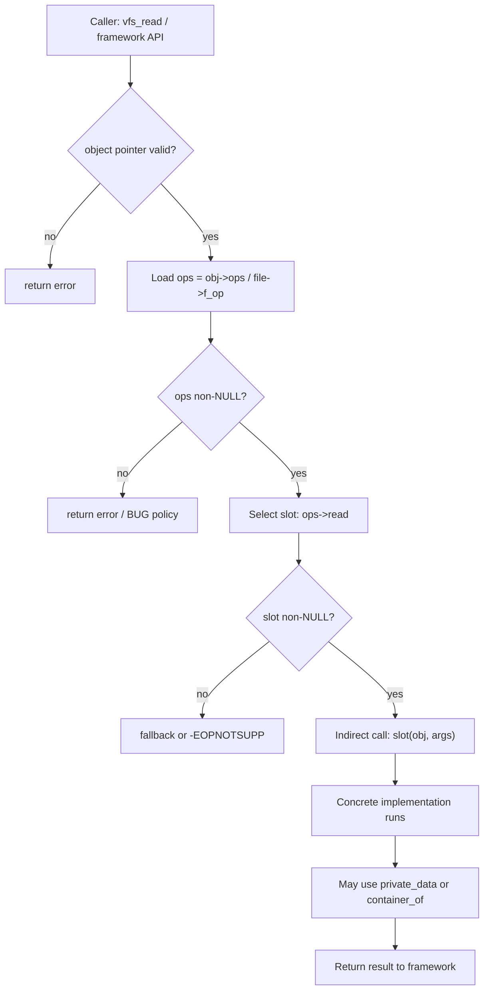

# 第二部分：第二支柱 —— Function Pointer 就是 Method / Virtual Function

> **核心断言**：内核没有 `virtual` 关键字，但有完整的动态分派。`ops` 表里的函数指针，同时扮演 Method、Virtual Function、Interface、Strategy 与 Callback 五种角色。理解它们，等于理解内核几乎所有子系统的扩展点。

第一支柱给出了「对象是什么」。第二支柱回答：**对象如何行动，且行动如何在运行时替换。**

---

## 3.1 函数指针的五种身份

同一个语言机制——「指向函数的指针」——在内核设计中至少有五种语义身份。它们不是互斥分类，而是同一工具在不同设计意图下的投影。

| 身份 | 设计意图 | 典型落点 |
|------|----------|----------|
| **Method** | 某对象上的操作，通常显式传入对象指针作 `this` | `file->f_op->read(file, ...)` |
| **Virtual Function** | 同一调用点，按对象真实类型/驱动绑定到不同实现 | `driver->probe` / `remove` / `shutdown` |
| **Interface** | 一组必须/可选操作的契约（接口类型） | `file_operations`、`proto_ops` |
| **Strategy** | 可替换算法家族，框架固定调用点 | `sched_class.enqueue_task` |
| **Callback** | 「事件发生时请调用我」的反向依赖 | IRQ handler、notifier、completion |

教学上先记住一句：

> **ops 表 = 接口类型的一份实现；函数指针槽位 = 虚函数槽位；调用时传入的对象指针 = 显式 `this`。**

### 五种身份如何同时成立（同一张表的多棱镜）

以 `file_operations` 为例，不必发明五张不同的表：

1. 对某个 `struct file` 而言，`f_op->read` 是它的 **Method**。  
2. 对 VFS 固定调用点而言，不同文件类型填入不同函数，于是每个槽位是 **Virtual Function**。  
3. 整张 `file_operations` 定义了「文件对象应支持哪些操作」，因而是 **Interface**。  
4. 若关注「读写策略可替换」（普通文件 / pipe / socket），同一接口下的不同实现构成 **Strategy** 族。  
5. 若从「用户发起 read 系统调用 → 内核回调到具体实现」的方向看，它又像注册给框架的 **Callback**。

初学者常问：「到底该叫虚函数还是回调？」——答案是：**按你当前分析的设计意图选择称呼**；机制都是函数指针，语义角色随架构对话切换。成熟读者能在评审里说清「这里我们依赖的是接口稳定性，还是策略可插拔，还是事件反转」。

### 与「普通函数指针参数」的差别

不是每个函数指针都配称为 ops/vtable：

| 形态 | 特征 | OO 浓度 |
|------|------|---------|
| 一次性回调参数 | 调用后即忘，不构成对象长期行为 | 低 |
| 对象上的稳定 ops 表 | 伴随对象生命周期，定义其行为族 | 高 |
| 全局策略表 | 系统级可替换算法，不必然绑定单实例 | 中高（Strategy） |

本支柱聚焦 **稳定挂接在对象或类型描述符上的 ops 表**，因为那才是内核 OO 的主干神经。

---

## 3.2 Ops Table 心智模型：以 `file_operations` 为例

把 VFS 的文件对象想象成：

```
+---------------------+          +----------------------+
| struct file         |          | file_operations      |
|  ...                |  f_op    |  (*read)(...)        |
|  f_op -------------+---------->|  (*write)(...)       |
|  private_data       |          |  (*open)(...)        |
|  ...                |          |  (*release)(...)     |
+---------------------+          |  ...                 |
                                 +----------------------+
                                          |
                                          | points to
                                          v
                                 concrete implementations
                                 (ext4 / pipe / sock / ...)
```

`file` 是对象（支柱一）；`file_operations` 是 **接口/虚表**；每个文件系统或特殊文件类型提供一份 ops 实例。

概念伪代码（非内核源码拷贝）：

```
pseudocode

struct file_operations {
    ssize_t (*read)(struct file *file, char *buf, size_t len, loff_t *pos);
    ssize_t (*write)(struct file *file, const char *buf, size_t len, loff_t *pos);
    int     (*open)(struct inode *inode, struct file *file);
    int     (*release)(struct inode *inode, struct file *file);
};

struct file {
    const struct file_operations *f_op;
    void *private_data;
    loff_t f_pos;
    /* ... */
};
```

关键观察：

1. **方法不属于 C 语法上的「类型成员函数」**，而属于一张表。
2. **表可以按对象实例挂接**（`file->f_op`），也可以挂在类型描述符上再被实例共享。
3. **第一个参数几乎总是对象指针**——这就是显式 `this`/`self`。

---

## 3.3 为什么 `file->f_op->read(file, ...)` ≈ `file.read()`

逐步拆开一次读调用。

### 步骤 1：拿到对象

```
file  -->  struct file instance   // 支柱一：对象身份 = 地址
```

### 步骤 2：拿到行为表

```
ops = file->f_op
```

这相当于读取「该对象当前绑定的方法表」。不同文件可以有不同 `f_op`。

### 步骤 3：选取槽位（虚函数索引的手工版）

```
fn = ops->read
```

若 `fn == NULL`，框架必须定义回退策略（返回 `-EINVAL`、走默认实现、或 BUG）。这是显式世界的代价与优点：没有编译器偷偷插入。

### 步骤 4：调用，并显式传入 self

```
result = fn(file, buf, len, &file->f_pos)
```

对比 C++：

```
C++:   file.read(buf, len)
C:     file->f_op->read(file, buf, len, &pos)
         |        |     |
         |        |     +-- explicit this/self
         |        +-- vtable slot
         +-- object
```

所以近似等式是：

```
file.read(args...)  ≈  file->f_op->read(file, args...)
```

差别不在能力，而在 **可见性**：内核把 `this`、vtable 查找、空指针策略全部摊在源码里。

### 步骤 5：实现侧再解释 self

具体 `read` 实现内部，常会从 `file` 走到私有状态：

```
pseudocode

ssize_t my_read(struct file *file, char *buf, size_t len, loff_t *pos)
{
    struct my_obj *obj = file->private_data;  /* or container_of path */
    /* use obj state */
}
```

到这里，支柱一（对象状态）与支柱二（方法分派）会合；若私有状态是嵌入布局，还会请出支柱三。

---

## 3.4 为什么 `probe` / `remove` / `shutdown` 是 Virtual Functions

驱动模型里，总线/框架持有通用的 `device` / `device_driver` 视图，但真实行为因驱动而异：

```
+---------------------+
| device_driver       |
|  name               |
|  (*probe)()         |  <-- virtual: bind device to driver
|  (*remove)()        |  <-- virtual: teardown
|  (*shutdown)()      |  <-- virtual: system shutdown path
+---------------------+
```

框架侧伪代码：

```
pseudocode

int bind_device(struct device *dev, struct device_driver *drv)
{
    /* match succeeded earlier */
    if (drv->probe)
        return drv->probe(dev);
    return 0;
}
```

为何称为虚函数，而不是普通回调？

1. **调用点在框架，实现点在派生/具体驱动** —— 经典 Open-Closed。
2. **同一调用点服务异构实现** —— `probe` 对网卡、USB gadget、平台设备含义统一、身体各异。
3. **绑定发生在运行时** —— 设备与驱动匹配后才确定调用哪份函数。

Callback 强调「事件通知」；Virtual Function 强调「类型族上的可覆盖操作」。`probe/remove` 两者皆有，但在对象模型课里，应优先按 **虚函数** 理解。

---

## 3.5 Runtime Dispatch / Dynamic Binding / Late Binding：精确区分

这三个词常被混用。内核教学建议如下界定：

| 术语 | 精确含义 | 内核例子 |
|------|----------|----------|
| **Dynamic Binding（动态绑定）** | 方法实现与调用点的关联不在编译期钉死到唯一函数 | `f_op` 在 open 路径被赋值 |
| **Late Binding（迟绑定）** | 具体函数地址在「尽可能晚」的时刻才确定 | 直到真正 `read` 才通过指针调用 |
| **Runtime Dispatch（运行时分派）** | 执行期根据对象状态/类型表选择目标函数并跳转 | `file->f_op->read(...)` 那一次间接调用 |

关系：

```
Dynamic Binding  (association can change / isn't unique at compile time)
        |
        v
Late Binding     (decision deferred)
        |
        v
Runtime Dispatch (actual indirect call happens)
```

对比静态调用：

```
direct:   call my_ext4_read          // compile-time known target
indirect: call *file->f_op->read     // runtime dispatch
```

内核大量使用间接调用，是为了 **稳定框架 + 可插拔实现**。成本是预测性与优化难度；收益是子系统可扩展而不改核心。

### 绑定发生在何时？三条常见时间线

理解动态绑定，关键是抓住 **「ops 指针何时被写入」**：

```
Timeline A: open-time bind
  open() 成功时 file->f_op = &foo_ops
  之后 read/write 只做分派，不再改表

Timeline B: type-descriptor bind
  对象创建时从 inode/socket 类型描述符继承 ops
  实例共享同一张只读表

Timeline C: rare rebinding
  特殊层（如包装、切换后端）在受控窗口替换 f_op
  必须证明无并发读者或使用发布规则
```

大多数子系统活在 A/B；C 是高级且危险的技巧。评审若看到运行时改 ops，应立刻要求并发证明——这不是风格偏好，而是正确性门槛。

### 为什么「显式 this」比语法糖更适合内核

C++ 的 `obj.method()` 隐藏了 this 传递与异常/重载等语义。内核选择显式 `ops->method(obj, ...)`，换来：

1. **grep 友好**：所有调用点可见「谁被当作 self」。  
2. **上下文友好**：self 从哪来、持有什么锁，可在调用前就地检查。  
3. **失败友好**：NULL 槽位与错误返回码是一等公民，而不是异常表。  
4. **ABI 友好**：函数类型签名就是契约；没有 name mangling。

因此，不要把显式 this 看成「C 的简陋」，要看成 **可审计对象运行时的必要代价**。

---

## 3.6 ASCII 对比：C Ops Table vs C++ vptr/vtable

### C++ 典型布局（概念）

```
+------------------+
| C++ object       |
+------------------+
| vptr*            |----+
| field_a          |    |
| field_b          |    |
+------------------+    |
                        v
                 +------------------+
                 | vtable           |
                 |  &Type::read     |
                 |  &Type::write    |
                 |  &Type::open     |
                 +------------------+
```

特点：`vptr` 常由编译器隐式插入；槽位布局由 ABI/编译器约定；`this` 隐式传递。

### Kernel C 典型布局（概念）

```
+------------------+
| struct file      |
+------------------+
| fields...        |
| f_op*            |----+
| private_data     |    |
+------------------+    |
                        v
                 +------------------+
                 | file_operations  |
                 |  (*read)         |
                 |  (*write)        |
                 |  (*open)         |
                 |  (*release)      |
                 +------------------+
```

特点：

- **没有隐藏 vptr**：ops 指针是普通字段，名字可见。
- **表可共享**：成千上万 `file` 可指向同一份 `ext4_file_operations`。
- **表可替换**：特殊文件、叠加层、包装器可以换 `f_op`（必须遵守生命周期与并发规则）。
- **`this` 显式**：第一个参数就是对象。

等价关系：

```
C++: obj.vptr->vtable[slot](obj, args)
C:   obj->ops->slot(obj, args)
```

内核选择手工 vtable，是为了 **布局可控、语义显式、失败路径可见**（见第一章）。

---

## 3.7 分派伪代码

```
pseudocode: generic ops dispatch

typedef int (*op_fn)(struct object *self, int arg);

struct object_ops {
    op_fn start;
    op_fn stop;
    op_fn ioctl;
};

struct object {
    const struct object_ops *ops;
    int state;
};

int object_start(struct object *self, int arg)
{
    const struct object_ops *ops;

    if (!self)
        return -EINVAL;

    ops = self->ops;
    if (!ops || !ops->start)
        return -EOPNOTSUPP;

    return ops->start(self, arg);   /* runtime dispatch */
}
```

注意框架职责：

1. 校验对象与 ops 非空  
2. 校验具体槽位是否实现  
3. 才执行间接调用  
4. 统一错误码语义  

这比「盲调函数指针」更接近成熟的对象运行时。

---

## 3.8 Mermaid：分派流程



读图时抓住主链：**对象 → ops → 槽位 → 间接调用 → 具体实现**。这就是第二支柱的完整闭环。

### 实现侧如何「再面向对象一层」

分派到达具体函数后，故事没有结束。优秀实现通常立刻把通用 `file *` / `device *` 转成私有对象：

```
pseudocode

ssize_t pipe_read(struct file *file, ...)
{
    struct pipe_obj *pipe = file->private_data;
    /* lock pipe, consume data, unlock */
}

int my_pci_probe(struct device *dev)
{
    struct my_drv *d = to_my_drv(dev);  /* often via container_of */
    /* allocate irq, map bars, register netdev... */
}
```

于是一次完整的 OO 路径是：

```
framework API
   -> runtime dispatch via ops          (pillar 2)
   -> concrete method
   -> recover private/derived object    (pillar 1 state / pillar 3)
   -> mutate state under lock
```

把这四步看成固定剧本，读任何驱动都会快很多：你总是在找「分派点」和「恢复点」。

### open / release 与构造 / 析构的类比（及限度）

教学上常把：

- `open` ≈ 对象对某消费者变得可用时的钩子  
- `release` ≈ 最后消费者离开时的清理钩子  

类比有用，但必须知道限度：文件对象本身可能在 `open` 之前已存在；`release` 也不等于 `kfree(file)`。更准确的说法是：

> **ops 中的 open/release 管理的是「对象与某类使用关系」的生命周期侧面，不一定等于对象内存的出生与死亡。**

混淆这一点，会把引用计数算错。支柱二处理行为分派；内存寿命仍归支柱一的 ownership 协议。

---

## 3.9 设计原则

1. **先定接口表，再写实现**  
   ops 结构是契约；字段增删要当 ABI/子系统 API 变更管理。

2. **方法参数以对象指针为第一公民**  
   没有隐式 `this`，就不要假装方法与对象无关。

3. **NULL 槽位是合法设计空间**  
   可选操作留空，框架定义清晰回退；不要让调用方猜测。

4. **ops 对象尽量放在只读寿命区**  
   静态 `const` 表最常见；运行时拼表要极度谨慎。

5. **分派入口集中化**  
   让 `object_start()` 这类包装函数统一做校验，避免每个调用点复制空指针检查。

6. **Strategy 与 Interface 分开想**  
   Interface 描述「能力集合」；Strategy 描述「算法可替换」。很多 ops 两者兼具，但评审时要说清动机。

---

## 3.10 常见陷阱

| 陷阱 | 为何危险 |
|------|----------|
| **错误地改写正在使用的 ops 指针** | 并发读者可能看到半更新，或调用到已卸载模块的文本 |
| **模块卸载后仍有对象指向模块内 ops** | 经典「ops 指向已释放代码」；必须保证无引用后再 unload |
| **调用前不检查 NULL ops/slot** | Oops；或更糟的静默错误路径 |
| **把回调写成「无 self」却偷偷用全局状态** | 破坏可重入与多实例 |
| **在原子上下文调用可能睡眠的 ops 实现** | 死锁/调度违规；契约要写清上下文 |
| **误以为函数指针调用是免费的** | 间接调用有成本；热路径需克制与测量 |
| **一张上帝 ops 表塞入所有可选操作** | 接口膨胀、实现负担、版本噩梦 |

特别强调「mutating ops pointer wrongly」：

```
pseudocode: unsafe pattern

obj->ops = &new_ops;   /* writer */
fn = obj->ops->read;   /* concurrent reader may tear / mismatch */
fn(obj, ...);
```

若必须热替换，需要发布规则（RCU、世代、冻结对象、或只允许在无并发窗口替换）。多数子系统选择更简单的纪律：**对象创建时绑定 ops，生命周期内不变。**

### 陷阱深挖：NULL ops 与「半注册」对象

两类空指针问题要分开治：

1. **`obj->ops == NULL`**：对象尚未绑定行为，或已被刻意剥夺行为（拆除中）。  
2. **`obj->ops->slot == NULL`**：接口允许可选操作未实现。

框架若用同一错误码吞掉两者，调试会很痛苦。更清晰的策略是：

- 创建完成后，ops 指针必须非空（可指向「全空槽位的默认表」）。  
- 可选槽位允许 NULL，并映射到明确的 `-EOPNOTSUPP` / 默认行为。  
- 拆除路径先使对象不可达，再等待宽限期，再释放——避免「ops 已空但仍被调用」。

### 陷阱深挖：跨模块函数文本的寿命

ops 表里的函数地址属于某个内核模块的文本段。对象若比模块活得更久，下一次分派就会跳进已卸载映射。防御模式只有几类：

- 模块 `get/put` 与对象引用绑定；  
- 禁止卸载（少见，但真实存在于某些关键驱动策略）；  
- 确保所有持有该 ops 的对象在 `module_exit` 前消灭。

这再次证明：支柱二不能脱离支柱一——**行为表的寿命必须嵌在对象寿命协议里。**

---

## 3.11 本章小结，并回到三大支柱

第二支柱的结论：

> **Function pointer（尤其是 ops 表）就是内核的 Method / Virtual Function 系统。**  
> 它提供 Interface 契约、Strategy 可替换性、Callback 反转，以及 Runtime Dispatch。

与另外两柱对齐：

```
+------------------+     +------------------+     +------------------+
| struct           |     | ops table        |     | container_of     |
| Object / State   |---->| Method / Virtual |---->| Inheritance view |
+------------------+     +------------------+     +------------------+
```

- 没有 `struct`，ops 的 `self` 无处安放。  
- 没有 ops，`struct` 只是数据块，难成可扩展子系统。  
- 没有 `container_of`，具体实现往往只能靠 `void *private` 凑合，难以表达「is-a 嵌入继承」。

下一章进入第三支柱：为什么从嵌入的 `struct device *` 能安全回到 `struct pci_dev *`，以及为何这就是 Kernel 版 inheritance。
