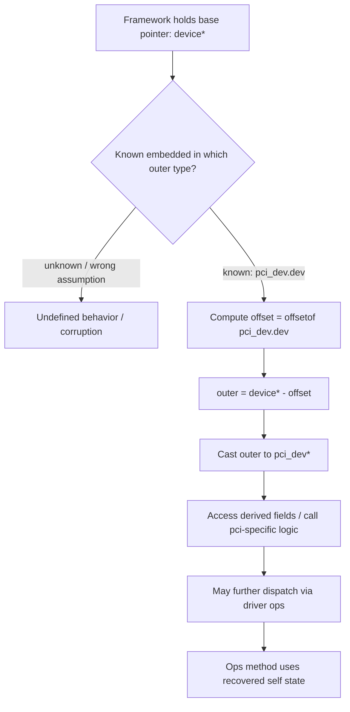

# 第二部分：第三支柱 —— container_of 是 Kernel OO 的灵魂

> **核心断言**：内核用「结构体嵌入」表达继承，用 `container_of` 完成从基类视图回到派生对象的类型恢复。没有它，ops 分派往往停在通用对象；有了它，通用框架才能操作具体驱动对象——这是 Kernel OO 的灵魂手术刀。

第一支柱给出对象；第二支柱给出虚调用。第三支柱回答：**当框架只看见基类指针时，实现如何找回完整的派生对象？**

---

## 4.1 从 `offsetof` 出发

若结构体在内存中是按字段顺序排布的线性块，那么任一成员相对结构体起始地址都有一个 **常量字节偏移**。

概念定义：

```
offsetof(TYPE, MEMBER) = 字节距离( TYPE 的起始, MEMBER 的起始 )
```

教学推导（直觉版）：

1. 假设有一个 `TYPE` 实例从地址 `0` 开始（仅用于计算，不真的解引用空指针）。  
2. 取 `&(((TYPE *)0)->MEMBER)` 的「地址值」。  
3. 该值就是 `MEMBER` 的偏移。

于是：

```
container_address = member_address - offsetof(TYPE, MEMBER)
```

这就是 `container_of` 的代数本质：**已知成员指针，减偏移，得到容器（完整对象）指针。**

伪代码：

```
pseudocode

size_t my_offsetof(type, member):
    return address_of((type *)0)->member   # compile-time constant

type *container_of(member_ptr, type, member):
    char *p = (char *)member_ptr
    return (type *)(p - my_offsetof(type, member))
```

要点：

- 偏移在 **编译期** 可确定（对标准布局的嵌入成员）。  
- 运行时通常只是一次指针减法，不是搜索、不是反射。  
- 正确性完全依赖：**member 真的嵌入在 type 里，且你传入了正确的 type/member 对。**

### 为什么「减法」能表达「继承恢复」

面向对象语言里的 downcast，语义是：「我知道这个基类引用背后的真实动态类型，请把它当作派生类型。」内核没有动态类型标签时，靠的是更强的静态约定：

> **凡是从某条框架路径传来的这个 `device *`，其地址必然等于某个 `pci_dev` 内嵌 `dev` 成员的地址。**

约定成立，则减法合法；约定被破坏，则任何语言的 cast 也救不了你。因此 `container_of` 的安全性来自 **架构不变量**，不是来自运行时检查。这也解释了为何它是「灵魂」：它把类型系统做不到的跨层恢复，压缩成一句程序员必须维护的布局契约。

### 与「把指针存进 private」对比

另一种找回派生状态的方法是 `dev->driver_data = my_ptr`。它有效，但语义不同：

| 手法 | 表达的关系 | 代价 |
|------|------------|------|
| `driver_data` / `private` | 关联到外部对象（has-a / side table） | 额外指针、额外分配、生命周期易分叉 |
| 嵌入 + `container_of` | 派生对象包含基类（is-a 布局） | 布局耦合，但同生共死更自然 |

内核两者都用。当你发现「基类字段与派生字段总是一起出生、一起死亡、一起锁」时，嵌入几乎总是更干净的模型；`container_of` 就是打开这个模型的钥匙。

---

## 4.2 内存布局：`pci_dev` 嵌入 `device`

驱动模型常把通用设备对象嵌在总线相关设备对象内部。教学布局如下（字段裁剪、仅示意）：

```
struct pci_dev (derived / outer object)
+------------------------------------------------------+
| ... pci-specific fields ...                          |
| vendor, device, ...                                  |
|                                                      |
| struct device dev;   <--- embedded base object       |
| +----------------------------------------------+     |
| | parent, name, driver, ...                    |     |
| | ...                                          |     |
| +----------------------------------------------+     |
|                                                      |
| ... more pci-specific fields ...                     |
+------------------------------------------------------+
```

更对称的「地址标尺」视图：

```
Address growth downward

P + 0x0000  +---------------------------+
            | pci_dev.head_fields...    |
P + OFF_DEV +---------------------------+  <-- &pdev->dev
            | device (embedded)         |
            |  fields...                |
            +---------------------------+
            | pci_dev.tail_fields...    |
            +---------------------------+
```

其中：

```
OFF_DEV = offsetof(struct pci_dev, dev)
```

若某框架函数拿到的是 `struct device *devp`，且已知该 device 嵌入在某个 `pci_dev` 中，则可恢复：

```
pdev = (struct pci_dev *)( (char *)devp - OFF_DEV )
```

---

## 4.3 逐步：`device *` → 减偏移 → `pci_dev *`

### 步骤 1：框架持有基类视图

```
devp ----> (device fields inside some larger object)
```

框架只依赖 `device` 的通用字段与通用 API。这保持总线核心稳定。

### 步骤 2：实现知道真实布局

PCI 子系统「知道」：我的 device 不是独立堆对象，而是 `pci_dev` 的嵌入成员。

### 步骤 3：应用 container_of

```
pseudocode

struct pci_dev *to_pci_dev(struct device *devp)
{
    return container_of(devp, struct pci_dev, dev);
}
```

展开：

```
1) member_addr = (char *)devp
2) offset      = offsetof(struct pci_dev, dev)
3) outer_addr  = member_addr - offset
4) return (struct pci_dev *)outer_addr
```

### 步骤 4：使用派生状态

```
pseudocode

int pci_probe_wrap(struct device *devp)
{
    struct pci_dev *pdev = to_pci_dev(devp);
    /* now access pdev->vendor, BARs, etc. */
}
```

这与 C++ 里「基类指针转派生指针」的意图同类，但机制完全显式：不是 RTTI，不是 `dynamic_cast`，而是 **布局算术**。

---

## 4.4 为什么这是 Inheritance by Embedding

C++ 继承（简化单继承）往往表现为：

```
Derived object layout
+------------------+
| Base subobject   |
+------------------+
| Derived fields   |
+------------------+
```

内核嵌入：

```
outer/derived object
+------------------+
| ...              |
| Base embedded    |
| ...              |
+------------------+
```

差异：

- C++ 由语言保证子对象与隐式转换。  
- Kernel 由程序员保证嵌入关系，并用 `container_of` 手工做「向上/向外」恢复。

共同点：

- 派生对象 **物理包含** 基类状态。  
- 可把派生对象当作基类对象使用（取嵌入成员地址）。  
- 可从基类视图回到派生视图（`container_of` / 强制转换在已知真实类型时）。

因此术语上称：

> **Inheritance by Embedding（嵌入式继承）**

它不是语法继承，而是 **布局继承 + 显式恢复**。

### 「向上转换」几乎免费，「向下恢复」靠契约

嵌入模型里，两种方向不对称：

```
Upcast (always local, hard to get wrong):

  pdev  --->  &pdev->dev     // take address of embedded member


Downcast / recover (powerful, assumes invariant):

  devp  --->  container_of(devp, pci_dev, dev)
```

Upcast 只是取成员地址，编译器可做类型检查。  
Downcast 把「我相信布局」写成算术；宏参数写错时，编译器往往帮不上大忙（现代内核宏会尽量加类型检查，见第 12 章）。

因此工程纪律是：

1. **尽量把 container_of 收敛到少数 `to_xxx()` 辅助函数。**  
2. **只在框架保证传入嵌入成员地址的路径上使用。**  
3. **不要对「可能是别的总线设备」的 `device *` 盲目 to_pci_dev。**

最后一点等价于 C++ 里避免错误的 `static_cast`；内核只是把风险从语言运行时挪到了代码审查。

### 多嵌入与「角色对象」

真实对象可能嵌入多个基类式成员（教学示意）：

```
+--------------------------------------+
| my_complex_obj                       |
|  struct device   dev;                |
|  struct kobject  kobj;               |
|  struct list_head node;              |
|  int priv;                           |
+--------------------------------------+
```

每个嵌入成员提供一个 **角色视图**：

- 从 `device *` 恢复 → 设备模型角色  
- 从 `kobject *` 恢复 → 系谱/uevent 角色  
- 从 `list_head *` 恢复 → 某条侵入式链表中的节点角色  

这不是多重继承的完整 C++ 语义，但在对象模型课上非常接近「一个对象、多个基类子对象」。`container_of` 让每个角色视图都能回到同一 outer。读代码时先问：**我现在手上的指针是哪个角色？** 再选对应的 member 名去做恢复。

---

## 4.5 术语表：Base / Derived / Parent / Embedded

为避免中英混用造成误解，本 Cookbook 固定如下：

| 术语 | 含义 |
|------|------|
| **Derived Object / Outer Object** | 完整对象，如 `pci_dev` |
| **Base Object / Embedded Object** | 嵌在内部的通用子对象，如 `device` |
| **Parent Object**（在 container_of 语境） | 常等同 Outer——「包含该成员的容器对象」；勿与设备树 parent 混淆 |
| **Member pointer** | 指向嵌入成员的指针，如 `struct device *` |
| **Upcast（教学说法）** | `&pdev->dev`：派生 → 基类视图 |
| **Downcast / Recovery** | `container_of`：基类视图 → 派生对象 |

注意命名冲突：

- 设备模型里 `dev->parent` 是拓扑父设备。  
- `container_of` 文档里的 parent 常指 **容器结构体**。  

阅读时必须靠语境切换，不要把两套「parent」焊死成一个意思。

---

## 4.6 Embedding vs Pointer Composition：is-a vs has-a

```
Embedding (is-a / "behaves as base"):

+----------------------+
| pci_dev              |
|  device dev;         |  // pci_dev *is-a* device (in model)
+----------------------+


Pointer composition (has-a):

+----------------------+
| pci_dev              |
|  device *dev;        |  // has a separately allocated device
+----------------------+
        |
        v
+----------------------+
| device (elsewhere)   |
+----------------------+
```

| 维度 | Embedding | Pointer composition |
|------|-----------|---------------------|
| 关系 | 偏 is-a | 偏 has-a |
| 生命周期 | 通常同生共死 | 可分离；需明确 ownership |
| 恢复 | `container_of` 自然 | 不能对「别处对象」做 container_of |
| 缓存局部性 | 更好（同块内存） | 多一次间接 |
| 适用 | 真正的类型分层 | 聚合、可选部件、共享部件 |

**致命误用**：对「通过指针指向的外部对象」做 `container_of`，等于假设错误布局，结果是随机内存解释——典型内核灾难。

口诀：

> **只有「成员真正嵌在结构体里」才能 container_of。**  
> 指针字段保存的是别的对象的地址，不是嵌入偏移关系。

---

## 4.7 迷你 `container_of` 伪代码实现

```
pseudocode: mini container_of

/* compile-time offset */
#define OFFSET_OF(type, member) \
    ((size_t)&((type *)0)->member)

/* type-check sugar in real kernels uses compiler builtins;
   here we show the arithmetic core only */
#define CONTAINER_OF(ptr, type, member) \
    ((type *)( (char *)(ptr) - OFFSET_OF(type, member) ))
```

### `OFFSET_OF` 在算什么：两种需求，不是「先解引用再取回地址」

初学者看到 `&((type *)0)->member`，容易把它拆成：

1. 先对空指针做 `->member`（读内存）  
2. 再对读到的东西做 `&`

这是错的。`&` 与 `->` 组合时，编译器面对的是两种完全不同的**需求**，不是同一条「先取值、再取址」流水线。

```
((Foo *)0)->y                      &((Foo *)0)->y
----------------------------       ----------------------------
需求：我要 y 的值                   需求：我要 y 的地址
        |                                  |
必须访问内存                         只需要计算
        |                                  |
LOAD [0 + offset]                    address = base + offset
        |                                  |
崩溃（UB）                           0 + offset = 得到 offset
```

左边像「打开 0 号楼里 y 房间的抽屉，把里面的东西拿出来」——门牌都不存在，一碰内存就炸。  
右边像「问 0 号楼里 y 房间的门牌号是多少」——只做加法，不进房间。

所以 `OFFSET_OF` 要的是**地址算术的结果**，不是成员的值。把基址假装成 `0`，算出来的「地址」在数值上恰好等于偏移。

**这是编译器的实现方式，不是 C 标准保证的语义。**

标准仍然把 `((Foo *)0)->member` 看作涉及空指针解引用，因此整个表达式属于未定义行为。只是主流编译器识别了 `&((type *)0)->member` 这种模式，把它收成纯粹的地址计算——不发射 `LOAD`。这样就把两件事分开了：

| 层次 | 说法 |
|------|------|
| 语言语义（ISO C） | 对空指针形成成员左值，通常已是 UB |
| 实际机器代码（主流编译器） | 识别该模式，只做 `0 + offset`，不访问内存 |

第 4 章用经典写法讲几何直觉；现代内核与可移植代码应使用 `__builtin_offsetof`。第 12 章会把这条「编译器合同」讲完整。

> **`&` 在这里表达的是「我只要地址」；编译器用加法满足你。标准并不保证这条路合法——合法的合同界面是 `__builtin_offsetof`。**

```
example usage:

struct log_device {
    int id;
    struct device dev;     /* embedded */
    int pci_bar;
};

struct device *as_dev(struct log_device *ld)
{
    return &ld->dev;       /* upcast */
}

struct log_device *as_ld(struct device *dev)
{
    return CONTAINER_OF(dev, struct log_device, dev);  /* recover */
}
```

手工演算：

```
Assume:
  ld @ 0x1000
  offsetof(log_device, id)      = 0
  offsetof(log_device, dev)     = 4
  offsetof(log_device, pci_bar) = 4 + sizeof(device)

If devp = 0x1004
Then CONTAINER_OF -> 0x1004 - 4 = 0x1000 = ld
```

这就是「灵魂」所在：用 **已知静态布局** 换取 **零运行时类型信息** 的继承恢复。

### 把算术说成人话

你可以把嵌入成员想成「大门牌号旁边的单元号」：

- 框架给你的是单元地址（`device *`）。  
- 你知道单元相对整栋楼（`pci_dev`）的固定门牌偏移。  
- 往回走固定步数，就站到整栋楼门口。

没有中央「对象注册中心」告诉你楼盘类型——你的子系统文档与类型约定就是地籍册。地籍册错了，走回去会进错楼；地籍册对了，走路成本可忽略。

### 与侵入式链表的同一家族

若你熟悉 `list_entry` / `list_for_each_entry`，其实已经用过同一灵魂：

```
pseudocode

struct node_obj {
    int value;
    struct list_head link;   /* embedded */
};

/* given &obj->link, recover obj */
obj = container_of(link_ptr, struct node_obj, link)
```

链表 API 之所以能遍历「对象」而不是「裸 list_head」，正是因为嵌入 + container_of。第三支柱不是驱动模型私有技巧，而是贯穿内核容器、设备、文件系统对象的通用几何学。

---

## 4.8 Mermaid：继承恢复流



主链再压缩成一句话：

> **基类指针 − 嵌入偏移 = 派生对象指针。**

---

## 4.9 设计原则

1. **先设计嵌入关系，再写 ops**  
   想清楚谁是 base、谁是 outer，恢复路径才稳定。

2. **为常见恢复提供命名包装**  
   如 `to_pci_dev(dev)`，避免到处手写宏参数，减少「写错 member 名」。

3. **嵌入成员的位置变更是 ABI/协议变更**  
   `offsetof` 会变；所有假设该布局的代码必须同版本。

4. **is-a 用嵌入，has-a 用指针**  
   不要用嵌入假装聚合，也不要用指针假装继承。

5. **恢复前保证指针确实指向嵌入成员**  
   来源必须可信：框架回调传入的就是那个嵌入字段的地址。

6. **与 refcount 规则一起设计**  
   你恢复到 outer 后，增减引用的是哪一层对象？必须单一真相。

---

## 4.10 常见陷阱

| 陷阱 | 说明 |
|------|------|
| **Wrong member** | `container_of(ptr, type, wrong_field)` 偏移全错，静默毁掉对象解释 |
| **Non-embedded member** | ptr 实际指向独立分配对象，却按嵌入假设回退 —— 必炸 |
| **Type 写错** | member 名字碰巧存在于另一 struct，编译可能过，语义全错 |
| **以为有昂贵运行时代价** | 正常情况下是编译期常量偏移 + 指针减法；不是反射 |
| **在对象尚未完成构造时恢复并使用** | 布局在，状态不在；一样 UAF/半初始化 |
| **混淆设备树 parent 与 container parent** | 审代码审错边 |
| **对含灵活数组成员/编译器特殊布局的结构想当然** | 先确认成员确实是常规嵌入 |

关于「runtime cost」的正确表述：

```
cost ≈ pointer subtract of a compile-time constant
```

真正的成本通常在：**错误使用导致的调试成本**，而不是 CPU 周期。第 12 章会深入讨论与 UB、`__builtin_offsetof`、类型检查增强相关的细节。

### 陷阱深挖：member 名字「碰巧编译通过」

假设两个结构体都有名为 `dev` 的成员，但布局完全不同。你把 `type` 写成另一个结构体，宏展开仍可能通过编译——因为成员名存在——然后偏移按错误类型计算。结果是：指针看起来「很像」有效，字段解读全错，Bug 极晚才爆。

防御：

- 使用子系统提供的 `to_xxx()`，不要散落裸宏；  
- Code review 时核对 **指针来源路径** 与 **type/member 对**；  
- 在调试版可以加 magic / type id 做断言（若子系统已有此类基础设施）。

### 陷阱深挖：「先恢复，后确认对象仍活着」

`container_of` 只做地址变换，不延长寿命。正确顺序永远是：

1. 在锁或 RCU 读锁下拿到成员指针；  
2. 恢复 outer；  
3. 如需跨越临界区，对 outer 做正确的 get；  
4. 再解锁 / 离开 RCU；  
5. 使用对象；  
6. put。

把 1/2 与 3 颠倒，等于在没有持有引用时相信地址算术——这是经典 UAF 配方。支柱三服务类型恢复，不替代支柱一的生命周期协议。

---

## 4.11 预告：第 12 章会更深

本章建立代数与对象模型位置。仍未展开的硬核议题包括：

- 空指针箭头在 `offsetof` 推导中的历史写法与严格别名/UB 边界  
- `__builtin_offsetof` 为何成为首选  
- 内核 `container_of` 如何尽量做类型检查  
- 哪些写法在 C 标准下不该照搬到可移植用户代码  

请把它记成阅读承诺：

> **先掌握「为什么这是继承恢复」，再进入「如何在不踩 UB 的前提下把宏写硬」。**

---

## 4.12 本章小结：三大支柱合龙

第三支柱的结论：

> **`container_of` + 嵌入式 struct = Kernel 的 Inheritance 机制。**  
> 它让通用框架能在基类视图上工作，同时允许具体实现回到派生对象。

三支柱总图：

```
+---------------------+
| 1. struct           |
|    Object / State / |
|    Lifecycle / Graph|
+----------+----------+
           |
           v
+---------------------+
| 2. function pointer |
|    Method / Virtual |
|    Interface / Ops  |
+----------+----------+
           |
           | self often needs recovery
           v
+---------------------+
| 3. container_of     |
|    Embedding = is-a |
|    Recover derived  |
+---------------------+
           |
           v
   Kernel Object Model
```

闭环例句（建议背诵）：

1. **`struct` 定义对象。**  
2. **`ops` 定义可替换行为，并通过显式 `self` 调用。**  
3. **`container_of` 在嵌入继承中把 `self` 从基类视图恢复为完整对象。**

当你在源码里同时看到这三者——某个 `struct`、一张 ops 表、一次 `container_of`——你往往正站在某个子系统最正宗的 OO 枢纽上。从下一章开始，我们将把三支柱组装成完整的 Kernel Object Model 总览。
