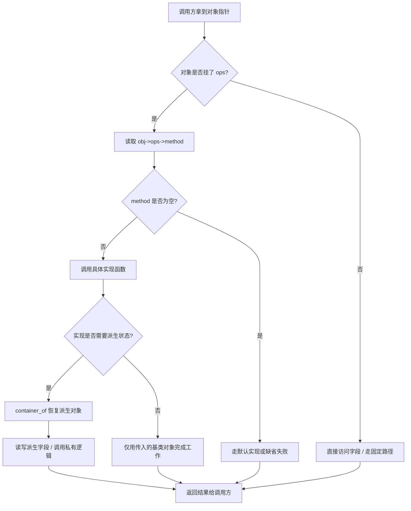

# 第三部分：Kernel OO Design 总体架构

读完三大支柱后，你已经分别认识了：

| 支柱 | 角色 | 内核里的典型形态 |
|------|------|------------------|
| `struct` | Object（状态 + 身份 + 生命周期） | `inode`、`sock`、`device`、`task_struct` |
| function pointer / ops | Method（行为 + 接口 + 多态） | `file_operations`、`net_device_ops`、`sched_class` |
| `container_of` | Inheritance（嵌入式基类 → 派生类恢复） | `to_usb_device()`、`container_of(work, …)` |

本章把三者合成为一张 **Kernel Object Model**：不是语言特性，而是一套可重复套用的设计配方。理解这张总图之后，后文所有案例都只是同一配方在不同子系统中的投影，不再引入新的「第四支柱」。

---

## 5.1 一句话总览

> **对象用 struct 承载；接口用 ops 表声明；派生关系用嵌入 + `container_of` 恢复。**

内核几乎所有「看起来像 OOP」的子系统，都在重复这三步：

1. 定义 **状态对象**（`struct foo`）——解决「谁拥有状态、谁管理生命周期」
2. 挂上 **行为表**（`const struct foo_ops *ops`）——解决「公共路径如何调用可变行为」
3. 若存在 **基类嵌入**，在回调里用 `container_of` 回到具体对象——解决「接口视角如何回到实现视角」

这不是偶然风格，而是在「无 RTTI、无虚表自动生成、无异常、布局必须可控」约束下，唯一既足够表达力、又足够可预测的对象模型。C++ 把这三件事藏进编译器；Kernel 把这三件事写成显式数据。

---

## 5.2 ASCII：对象层次与分发路径

```
+---------------------------+
|      Kernel Subsystem     |
|  (VFS / Net / Driver /..) |
+-------------+-------------+
              |
              v
+---------------------------+
|     Object Instance       |
|  struct inode / sock /..  |
|  +-------------------+    |
|  | embedded base     |    |
|  | (list_head/kobj)  |    |
|  +-------------------+    |
|  | *ops -------------+----+----> +------------------+
|  | other fields...   |    |      |  ops table       |
|  +-------------------+    |      |  .open / .read   |
+---------------------------+      |  .start_xmit ... |
                                   +--------+---------+
                                            |
                     call ops->method()     v
                                   +------------------+
                                   | concrete handler |
                                   | (ext4_file_open) |
                                   +--------+---------+
                                            |
                          container_of()    v
                                   +------------------+
                                   | derived object   |
                                   | (ext4_inode_info)|
                                   +------------------+
```

读图口诀：

- **向右看**：多态分发（同一调用点，不同 ops 实现）
- **向下看**：类型恢复（回调拿到基类指针，回到派生对象）
- **向内看**：封装（子系统只碰公开字段与 ops，不碰文件系统私有布局）
- **向上看**：框架/公共路径永远不依赖派生类型名——这是可扩展性的根源

---

## 5.3 Mermaid：一次典型调用的完整生命周期



这条路径在 VFS 的 `vfs_read()`、网络的 `dev_queue_xmit()`、驱动模型的 `probe()`、调度器的 `pick_next_task()` 里反复出现。**学会这张图，就学会了读内核对象代码的通用方法**：先找调用点，再找 ops 安装点，最后找派生恢复点。

---

## 5.4 三大支柱如何互相补位

### 5.4.1 只有 struct：有对象，无多态

你可以做出 `struct inode`，但若所有行为都写死在调用方，文件系统扩展会爆炸：每个 `if (sb->s_type == EXT4)` 都会污染公共路径。对象有了，却没有「对行为的抽象边界」。

### 5.4.2 只有 ops：有接口，无身份恢复

你可以做出完美的虚表，但回调只拿到「接口视角」的指针时，实现无法安全访问私有扩展字段。缺少 `container_of`，派生状态要么泄漏到公共结构（破坏封装），要么只能靠平行数组/全局哈希硬查（破坏局部性与类型关系）。

### 5.4.3 只有 container_of：有继承姿势，无契约

嵌入 + 宏恢复解决了「基类指针 → 派生对象」，但若没有稳定的 ops 契约，调用方仍不知道该调什么、何时调、失败语义是什么。继承解决身份，不能替代接口。

因此三者是 **正交且缺一不可**：

```
struct          =  "我是谁、我有什么状态"
ops             =  "我能做什么、别人如何调用我"
container_of    =  "回调里如何从公共视角回到我自己"
```

### 5.4.4 两条常见的「派生恢复通道」

内核里回到派生对象，通常只有两条路，后文案例会反复交替出现：

1. **嵌入恢复**：公共对象是派生结构的一个字段 → `container_of` / `to_xxx()`
2. **私有指针**：`private_data` / `drvdata` / `s_fs_info` / `netdev_priv` → 直接取附属状态

二者目标相同：让公共框架继续只认识基类，让实现侧安全持有私有状态。读代码时先判断走的是哪条通道，再追字段生命周期。

---

## 5.5 两种「类」与「实例」

Kernel 不仅有实例对象，还有 **类型级对象**（Class Object）：

| 层级 | 例子 | 职责 |
|------|------|------|
| 类型级 | `file_system_type`、`rtnl_link_ops`、`bus_type`、`sched_class` | 注册、匹配、工厂、策略选择 |
| 实例级 | `super_block`、`net_device`、`device`、`task_struct` | 运行状态、引用计数、实例 ops |

很多新手只看见实例上的 `f_op`，却漏掉类型对象上的注册表与工厂方法。完整对象模型 = **类对象决定如何创造/匹配，实例对象决定如何运行**。

---

## 5.6 设计配方：写一个内核式对象的四步

1. **定义对象**：`struct my_obj { ...; const struct my_ops *ops; };`
2. **定义接口**：`struct my_ops { int (*start)(struct my_obj *); ... };`
3. **实现具体类**：静态 `const struct my_ops xxx_ops = { .start = xxx_start };`
4. **需要私有扩展时**：把公共对象 **嵌入** 派生结构，在 `xxx_start` 里 `container_of` 回来；或在注册/open/probe 时写入 `private_data`

可选增强：

5. **类型对象**：再做一张「注册/匹配/创建」ops，把工厂从实例行为中拆出  
6. **多接口**：同一实例挂多张 ops（如 `netdev_ops` + `ethtool_ops`），模拟多接口继承

这套配方对应后文所有案例的共同骨架。第 6–9 章不会引入新理论，只是把配方套进 VFS、网络、驱动、调度/中断/LSM。

---

## 5.7 读源码 Checklist（进入案例前先背下来）

遇到任何 `*_ops` / `*_operations`，按顺序问：

1. **谁拥有这份 ops？**（哪个 object 的字段指向它）
2. **谁安装这份 ops？**（初始化、注册、挂载、probe）
3. **谁调用这份 ops？**（公共路径 / 框架代码）
4. **回调第一个参数是什么类型？**（通常是「基类视角」）
5. **实现里有没有 `container_of` / `to_xxx()` / `*_priv()`？**（有 → 存在派生对象）
6. **空指针怎么办？**（可选方法、默认 ops、返回 `-EOPNOTSUPP`、`BUG_ON`）
7. **这是类型级 ops 还是实例级 ops？**（工厂/匹配 vs 运行行为）

能答完这七问，这个对象模型就算读懂了。

---

## 5.8 与后文章节的映射

```
+------------------+     套用配方      +---------------------+
| 三大支柱总架构    |------------------>| 06 VFS / MM 案例     |
| (本章)           |------------------>| 07 Net 案例          |
|                  |------------------>| 08 Driver Model 案例 |
|                  |------------------>| 09 Core 案例         |
+------------------+                   +---------------------+
```

你可以用同一张检查表横扫完全不同的子系统：若某段代码「看起来很 OO」，它几乎一定能被映射回 struct / ops / container_of 三者之一或其组合。

---

## 5.9 本章结论

Kernel OO Design 不是「在 C 里模拟 C++ 语法」，而是：

> **用可控的数据布局（struct）+ 显式的虚表（ops）+ 显式的向上/向下转换（embedding + container_of），在无语言运行时支持的前提下，构建可扩展、可替换、可组合的对象系统。**

下一章起，我们用真实子系统证明：同一配方如何在完全不同的领域里反复胜利。每读一个案例，请强制自己用一句话回答——**这里的对象、接口、派生恢复分别是谁？**
