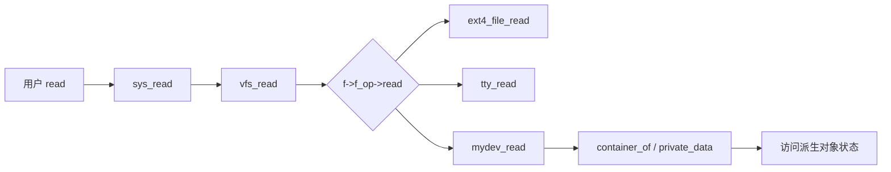
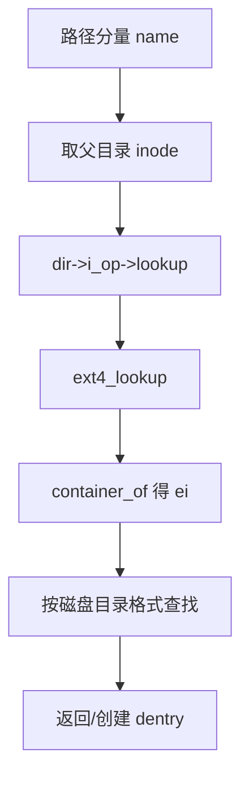
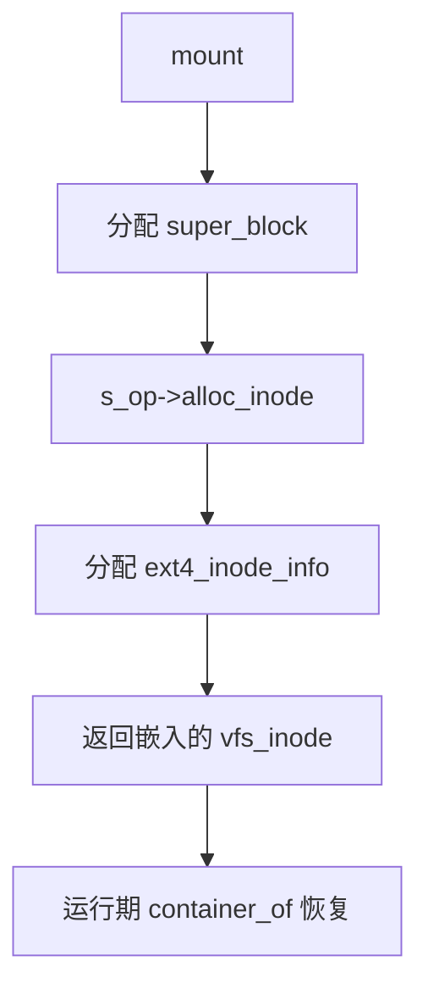
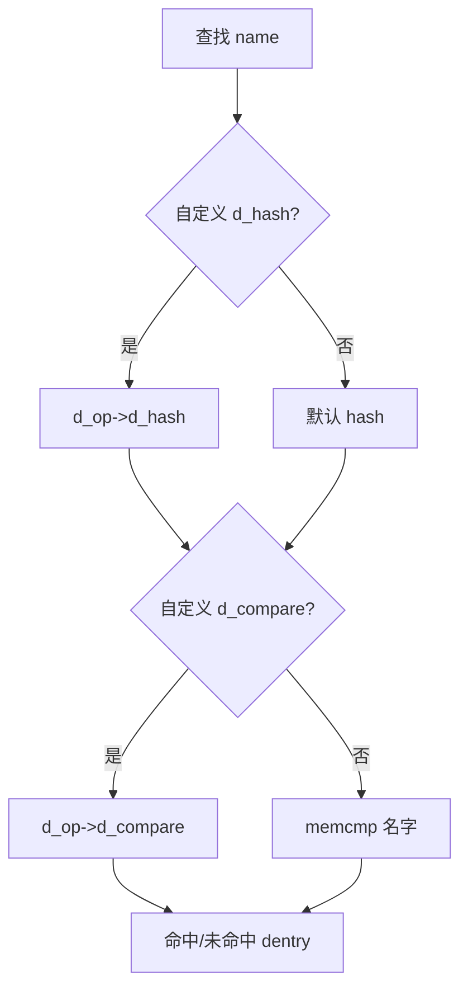
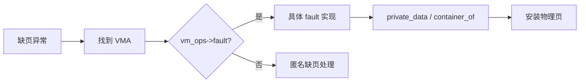
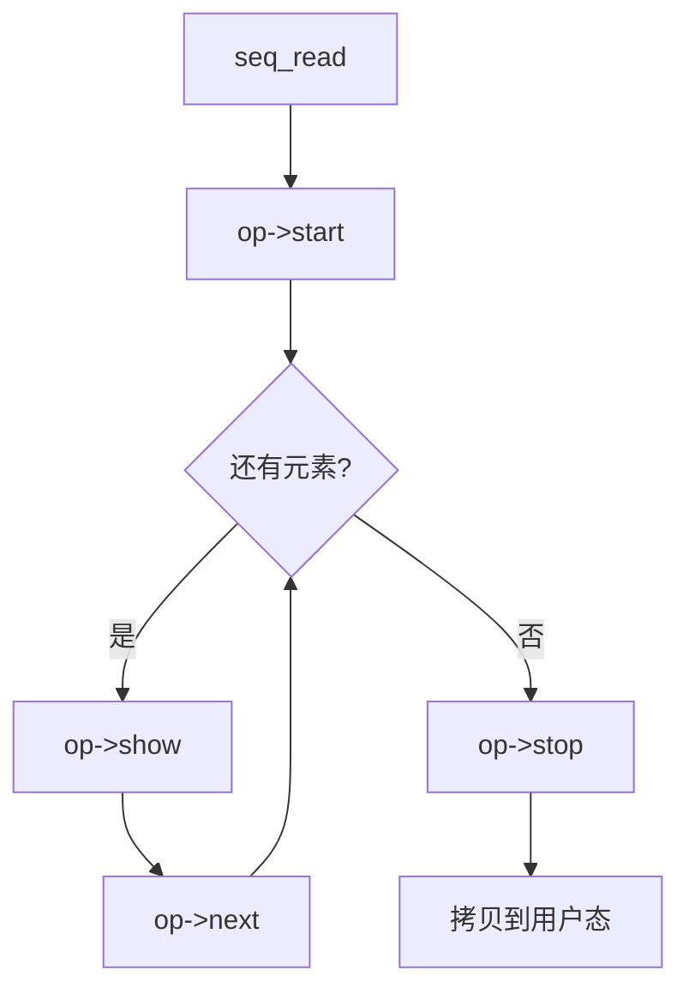

# 第四部分（A）：VFS 与内存管理真实案例

本章用七个经典 ops 表，证明三大支柱如何在文件系统与内存管理中协同工作。每个案例都回到同一公式：

> **struct 承载对象 → ops 提供多态接口 → container_of 在回调中恢复派生状态。**

---

## Case 1：`file_operations`

### ① 场景

用户态 `read()` / `write()` / `ioctl()` 最终进入内核的 VFS 公共路径。VFS 不知道打开的是普通文件、字符设备、管道还是 socket，它只认识 `struct file`，并通过其上的 `f_op` 把调用分发到具体实现。这是内核里最典型的「统一入口、多样实现」多态现场。


从对象模型角度看，`file` 是「一次打开会话」的运行时实例：它不负责持久元数据，只负责当前偏移、访问模式、以及绑定哪一张行为表。VFS 公共路径因此可以保持算法稳定——权限、锁、事件通知留在框架，真正的字节搬运交给 `f_op`。这正是支柱一与支柱二的分工：struct 管身份与会话状态，ops 管可变行为。
### ② 对象关系

```
+-------------+      f_op       +-------------------+
| struct file |---------------> | file_operations   |
|  f_inode    |                 | .read / .write    |
|  f_path     |                 | .mmap / .ioctl    |
|  private_data                 +---------+---------+
+------+------+                           |
       |                                  v
       v                         +------------------+
+-------------+                  | ext4_file_ops /  |
| struct inode|                  | tty_fops / ...   |
+-------------+                  +------------------+
```

`file` 是打开实例；`inode` 是持久文件对象；`file_operations` 是该打开实例的行为接口。字符设备常把设备私有数据放在 `file->private_data`。


对象关系上还有一条隐线：`file` 通过 `f_inode` 连回持久对象，通过 `f_mapping` 连回页缓存对象。一次 read 可能同时触发 file ops、address_space ops，说明内核对象网是协作网，不是单表宇宙。阅读时要会沿着指针把协作对象串起来，而不是只盯着一张 `file_operations`。
### ③ 核心 struct

- `struct file`：一次 open 的运行时对象（位置、标志、引用计数、`f_op`）。
- `struct inode`：文件系统对象身份（权限、大小、映射）。
- 具体文件系统的派生对象（如 `ext4_inode_info`）通过嵌入 `inode` 扩展状态。


围绕 `struct file`，阅读字段时先区分「框架拥有的公共状态」与「实现拥有的私有状态」。公共状态决定对象如何被链表、哈希、引用计数与调试工具看见；私有状态决定功能如何完成。二者边界清晰，封装才成立。
### ④ 核心 function pointer

`file_operations` 中的 `.read` / `.write` / `.unlocked_ioctl` / `.mmap` / `.release` 等。VFS 调用 `file->f_op->read(...)`，不关心背后是 ext4 还是 `/dev/null`。


`file_operations` 的每个函数指针都应被理解成接口契约：参数含义、睡眠能力、锁前提、失败码语义。可选指针为 NULL 时的回退策略，也是契约的一部分。三大支柱在此表现为：file 是对象，f_op 是虚表，private_data/container_of 恢复派生。
### ⑤ 是否使用 container_of

**是（常见于驱动与文件系统私有对象）。**  
例如字符设备在 `open` 里把派生对象指针存入 `private_data`，或从嵌入的 `cdev` / `inode` 用 `container_of` 找回 `struct my_dev`。文件系统侧读路径也可能从 `inode` 恢复 `ext4_inode_info`。


判断是否需要 `container_of` 的经验法则：若实现只靠 `file` 公共字段就能完成，则不必；一旦出现设备环形缓冲、inode 私有磁盘号、驱动私有锁，就必然出现恢复。`private_data` 是开放式附件通道；嵌入式 `cdev`/`inode` 是结构化继承通道。二者都服务于支柱三。
### ⑥ 为什么这样设计

- **稳定公共 API**：POSIX 文件语义由 VFS 统一，厂商/子系统只填 ops。
- **热路径可控**：函数指针调用开销可接受，换来巨大的解耦收益。
- **可选方法**：某些指针可为 NULL，VFS 提供默认行为或返回 `-EINVAL`。
- **生命周期分离**：`file` 可关可再开；`inode` 可缓存；ops 表通常是静态常量，只读共享。


若把设备专有字段塞进通用 `file`，所有打开路径都会被污染；若不用 ops 而用类型开关，每新增一种特殊文件都要改 VFS。于是设计收敛为：公共对象极瘦，行为外置为函数指针表，派生状态走 `private_data` 或从关联 inode/cdev 做 `container_of`。三支柱在此同时出现：对象、接口、恢复缺一不可。
### ⑦ 对应 C++ 会怎么写

```cpp
struct File {
    virtual ssize_t read(char *buf, size_t len) = 0;
    virtual int release() = 0;
    // ...
};
struct Ext4File : File { ssize_t read(...) override; };
```

内核用 `file` + `file_operations` 手工模拟虚表；用嵌入/`private_data` 模拟派生成员。

### ⑧ 核心伪代码（10~30行）

```
/* VFS 公共路径 */
ssize_t vfs_read(file *f, buf, len)
{
    if (!f->f_op || !f->f_op->read)
        return -EINVAL;
    return f->f_op->read(f, buf, len, &f->f_pos);
}

/* 具体实现：字符设备 */
ssize_t mydev_read(file *f, buf, len, ppos)
{
    my_dev *dev = f->private_data;          /* 或 container_of */
    /* 使用派生状态拷贝数据 */
    return copy_to_user(buf, dev->ring + *ppos, n);
}

const file_operations mydev_fops = {
    .read    = mydev_read,
    .release = mydev_release,
};
```

### ⑨ Mermaid 图



### ⑩ 最终总结一句

这里体现了 OO Design 的 **多态（Polymorphism）**：同一 `vfs_read` 调用点，按对象绑定的 ops 动态分发到不同实现。

---

## Case 2：`inode_operations`

### ① 场景

目录查找、创建文件、符号链接、rename 等「命名空间操作」不走 `file_operations`，而走挂在 `inode` 上的 `inode_operations`。VFS 的路径解析（`lookup`）必须对所有文件系统保持同一算法，差异全部下沉到 `i_op`。


`inode_operations` 处理的是命名空间语义，而不是文件内容读写。路径解析是内核最昂贵、也最需要统一的算法之一：挂载点跨越、权限、符号链接、目录缓存都必须集中处理。因此 VFS 把「如何在目录中找名字」下沉为 `i_op->lookup`，自己只编排流程。支柱二在这里表现为目录对象的虚方法表。
### ② 对象关系

```
+---------------+   i_op    +---------------------+
| struct inode  |---------->| inode_operations    |
|  i_sb         |           | .lookup / .create   |
|  i_mode       |           | .unlink / .rename   |
+-------+-------+           +----------+----------+
        |                              |
        | 嵌入                         v
        v                    +---------------------+
+------------------+         | ext4_dir_inode_ops  |
| ext4_inode_info  |         | 或 nfs_file_inode_ops|
+------------------+         +---------------------+
```

目录 inode 与普通文件 inode 可挂不同 `i_op`，这是「同类对象、不同角色」的接口替换。


目录 inode 与普通文件 inode 可以挂不同 `i_op`，甚至同一文件系统内部也按模式切换。这意味着「类」可以在运行期替换行为表，而不改变对象内存地址——动态绑定的直接证据。
### ③ 核心 struct

- `struct inode`：文件系统对象核心。
- `struct dentry`：目录项缓存，lookup 的输入/输出。
- 派生：`ext4_inode_info` 等嵌入 `vfs_inode`。


围绕 `struct inode`，阅读字段时先区分「框架拥有的公共状态」与「实现拥有的私有状态」。公共状态决定对象如何被链表、哈希、引用计数与调试工具看见；私有状态决定功能如何完成。二者边界清晰，封装才成立。
### ④ 核心 function pointer

`.lookup`、`.create`、`.mkdir`、`.symlink`、`.unlink`、`.rename`、`.permission` 等。路径行走时，父目录 inode 的 `.lookup` 决定子 dentry 如何解析。


`inode_operations` 的每个函数指针都应被理解成接口契约：参数含义、睡眠能力、锁前提、失败码语义。可选指针为 NULL 时的回退策略，也是契约的一部分。命名空间操作全部虚调用，派生 inode 信息经嵌入恢复——继承与多态同时在场。
### ⑤ 是否使用 container_of

**是，非常典型。**  
几乎所有本地文件系统都在 `inode` 回调里：

`ei = container_of(inode, struct ext4_inode_info, vfs_inode);`

这是「基类视角进回调、派生视角干活」的教科书。


几乎每个 FS 都有 `EXT4_I(inode)` 一类包装，本质全是 `container_of`。若有人把派生字段塞进通用 `inode`，所有文件系统头文件将互相污染；嵌入继承正是为了阻止这件事。
### ⑥ 为什么这样设计

- **路径解析算法集中**：缓存、挂载点、权限检查留在 VFS。
- **文件系统只实现语义差异**：磁盘布局、目录格式、远程协议。
- **嵌入继承**：公共 `inode` 字段给 VFS 用；私有字段给具体 FS 用，布局仍可控。


本地文件系统几乎一律把更大的派生结构嵌入 `vfs_inode`：公共字段给 VFS 缓存与权限使用，私有字段给磁盘布局使用。回调入口类型永远是 `struct inode *`，实现第一行往往就是 `container_of`。这是支柱三最干净的形态——嵌入式继承，而不是平行指针。
### ⑦ 对应 C++ 会怎么写

```cpp
struct Inode {
    virtual Dentry* lookup(const char *name) = 0;
    virtual int create(...) = 0;
};
struct Ext4Inode : Inode { /* 额外磁盘号、extent 树 */ };
```

内核没有虚继承，用「嵌入 `vfs_inode` + 静态 ops 表」达到同等效果。

### ⑧ 核心伪代码（10~30行）

```
dentry *vfs_lookup(parent_dentry, name)
{
    inode *dir = parent_dentry->d_inode;
    if (!dir->i_op->lookup)
        return ERR_PTR(-ENOTDIR);
    return dir->i_op->lookup(dir, child_dentry, flags);
}

dentry *ext4_lookup(inode *dir, dentry *dentry, flags)
{
    ext4_inode_info *ei =
        container_of(dir, ext4_inode_info, vfs_inode);
    /* 用 ei 的私有信息在目录中搜索 name */
    inode *found = ext4_find_entry(ei, dentry->d_name);
    return d_splice_alias(found, dentry);
}
```

### ⑨ Mermaid 图



### ⑩ 最终总结一句

这里体现了 OO Design 的 **继承 + 多态**：公共 `inode` 是基类接口对象，具体 FS 通过嵌入扩展，并用 `i_op` 覆盖命名空间行为。

---

## Case 3：`address_space_operations`

### ① 场景

页缓存（page cache）把文件内容缓存在内存页中。当缺页、写回、直接 I/O 发生时，内核需要知道「这个映射背后的存储如何读/写」。差异不在 `file`，而在 `inode->i_mapping` 指向的 `address_space` 及其 `a_ops`。


页缓存把「文件内容的内存镜像」对象化成 `address_space`。缺页、写回、失效、直写都围绕它展开。内存管理子系统不能理解 ext4 extent 或 NFS 布局，于是用 `a_ops` 定义存储后端契约。这里的对象边界非常清晰：MM 拥有页面生命周期，FS 拥有填充与写回的含义。
### ② 对象关系

```
+-------------+   i_mapping   +------------------+
| struct inode|-------------->| address_space    |
+-------------+               |  host (inode*)   |
                              |  a_ops --------+ |
                              +----------------|-+
                                               |
                                               v
                              +------------------------+
                              | address_space_operations|
                              | .readpage / .writepage  |
                              | .write_begin/end        |
                              +------------------------+
```

同一套 page cache 基础设施工件（radix tree / xarray、写回线程）服务所有文件系统；`a_ops` 是它们与具体存储的契约。


`address_space` 还连接 radix/xarray 页树、writeback 标记与错误状态，是 MM 与 FS 的契约面。同一文件的多个 `file` 共享一份 mapping，体现对象共享与引用关系。
### ③ 核心 struct

- `struct address_space`：某个 inode 的页缓存对象。
- `struct page` / folio：缓存单元。
- 派生状态仍常挂在 `inode` 的嵌入结构上，经 `mapping->host` 找回。


围绕 `address_space`，阅读字段时先区分「框架拥有的公共状态」与「实现拥有的私有状态」。公共状态决定对象如何被链表、哈希、引用计数与调试工具看见；私有状态决定功能如何完成。二者边界清晰，封装才成立。
### ④ 核心 function pointer

`.read_folio` / `.writepage` / `.write_begin` / `.write_end` / `.dirty_folio` / `.invalidate_folio` 等。缺页路径最终会调到这些方法把页填满或写回。


`address_space_operations` 的每个函数指针都应被理解成接口契约：参数含义、睡眠能力、锁前提、失败码语义。可选指针为 NULL 时的回退策略，也是契约的一部分。MM 只依赖抽象后端，FS 用 container_of 取回磁盘映射能力。
### ⑤ 是否使用 container_of

**是（间接但常见）。**  
`a_ops` 回调通常先拿到 `address_space *` 或 page，再经 `mapping->host` 得到 `inode`，然后 `container_of` 到 FS 私有 inode 信息，以定位磁盘块号。


两跳恢复（mapping→inode→ei）看起来啰嗦，却保持了每层对象的单一职责：mapping 不知磁盘，inode 公共层不知 extent，派生层才知。这是良好 OO 分解。
### ⑥ 为什么这样设计

- **内存管理与文件系统解耦**：MM 不懂 ext4 extent；ext4 不懂 LRU 细节。
- **统一写回与回收策略**：pdflush/writeback 只认 `a_ops`。
- **对象边界清晰**：`address_space` 是「文件内容在内存中的对象」，ops 是其存储后端接口。


为什么不把读写函数直接挂在 inode 上？因为同一个 inode 还要参与目录操作、权限、xattr；内容缓存是一条横切关注点，值得独立成 `address_space` 对象。派生恢复通常经 `mapping->host` 回到 inode，再 `container_of` 到 FS 私有信息，形成两跳但仍类型明确的继承链。

回到三大支柱做一次强制对照：若删掉 struct，行为无处附着；若删掉 ops，公共路径只能写死分支；若删掉 container_of/私有指针，回调便无法安全持有实现状态。三者共同定义了内核式对象。把本案例的「对象 / 接口 / 恢复」各用一句话写下来，你就已经完成了一次可迁移的阅读训练：下一处陌生的 `*_ops` 也可以用同一张对照表拆开。
### ⑦ 对应 C++ 会怎么写

```cpp
struct AddressSpace {
    Inode *host;
    virtual int read_folio(Folio *f) = 0;
    virtual int writepage(Page *p) = 0;
};
```

### ⑧ 核心伪代码（10~30行）

此外请注意：伪代码只保留对象协作骨架，故意省略错误处理与锁细节，目的是让 struct、函数指针与类型恢复三条线同时可见；你在真实源码中见到的繁杂分支，大多是在这个骨架之外叠加的工程约束。

```
int filemap_fault(vm_fault *vmf)
{
    address_space *mapping = vmf->vma->vm_file->f_mapping;
    /* 找页；若缺失则 */
    return mapping->a_ops->read_folio(mapping->host, folio);
}

int ext4_read_folio(inode *inode, folio *folio)
{
    ext4_inode_info *ei =
        container_of(inode, ext4_inode_info, vfs_inode);
    block = ext4_map_blocks(ei, folio_index(folio));
    return submit_bio_fill(folio, block);
}
```

### ⑨ Mermaid 图


### ⑩ 最终总结一句

这里体现了 OO Design 的 **抽象（Abstraction）**：MM 只依赖 `address_space_operations` 契约，不依赖任何具体文件系统实现。

---

## Case 4：`super_operations`

### ① 场景

超级块 `super_block` 代表一次挂载实例。分配 inode、写超级块、同步文件系统、卸载清理等「整文件系统级」操作，通过 `s_op`（`super_operations`）分发。VFS 挂载框架因此可以同时支持本地盘、网络 FS、伪 FS（proc/sysfs）。


`super_block` 是一次挂载的根对象：它连接文件系统类型、根 dentry、块设备（若有）、以及整 FS 级操作。分配多大的 inode、如何写回超级块、卸载时释放什么，都属于挂载实例的行为，故集中在 `s_op`。没有这张表，VFS 就无法在同一套挂载框架下容纳 proc、tmpfs、ext4、NFS。
### ② 对象关系

```
+----------------+   s_op    +-------------------+
| super_block    |---------->| super_operations  |
|  s_fs_info ----+--+        | .alloc_inode      |
|  s_root        |  |        | .write_inode      |
+----------------+  |        | .put_super        |
                    |        +-------------------+
                    v
           +------------------+
           | ext4_sb_info     |
           | (派生超级块状态) |
           +------------------+
```

注意：许多 FS 不用嵌入 `super_block`，而用 `s_fs_info` 指针挂私有对象——这是「组合」变体，但回调里仍要回到派生状态。


`s_fs_info` 指针式组合与嵌入式 inode 分配常同时存在：超级块私有用指针，inode 私有用嵌入。说明内核不教条，只选「生命周期与分配方最匹配」的恢复通道。
### ③ 核心 struct

- `struct super_block`：挂载实例对象。
- `struct file_system_type`：文件系统类型（工厂），负责 `mount`。
- 私有：`ext4_sb_info` 等。


围绕 `super_block`，阅读字段时先区分「框架拥有的公共状态」与「实现拥有的私有状态」。公共状态决定对象如何被链表、哈希、引用计数与调试工具看见；私有状态决定功能如何完成。二者边界清晰，封装才成立。
### ④ 核心 function pointer

`.alloc_inode` / `.destroy_inode` / `.write_inode` / `.sync_fs` / `.statfs` / `.put_super` 等。其中 `.alloc_inode` 尤其关键：它决定 inode 对象的真实分配大小（往往直接分配「派生 inode」整块内存）。


`super_operations` 的每个函数指针都应被理解成接口契约：参数含义、睡眠能力、锁前提、失败码语义。可选指针为 NULL 时的回退策略，也是契约的一部分。挂载实例对象 + 工厂方法 alloc_inode，是类职责在实例生命周期上的延伸。
### ⑤ 是否使用 container_of

**是。**  
`.alloc_inode` 常分配包含嵌入 `vfs_inode` 的大结构，返回 `&ei->vfs_inode`；之后所有路径用 `container_of` 反向找回。`s_fs_info` 路径则是指针式组合，等价目标相同。


读 `.alloc_inode`/`.destroy_inode` 配对时，等于在读构造/析构；中间所有 VFS 代码都假装自己只拥有基类，这正是多态赖以成立的幻觉与纪律。
### ⑥ 为什么这样设计

- **对象工厂可替换**：不同 FS 的 inode 尺寸不同，必须由 FS 自己分配。
- **挂载生命周期清晰**：`put_super` 统一卸载清理入口。
- **VFS 保持通用**：缓存、lru、shrinker 只操作 `super_block` / `inode` 公共部分。


`.alloc_inode` 尤其体现工厂与继承的结合：具体 FS 分配「派生 inode 整块内存」，却把嵌入的 `vfs_inode` 地址交还 VFS。此后全世界都拿基类指针工作，只有 FS 自己知道如何 `container_of` 回来。这是「由派生类决定对象真实大小」的经典 OO 手法在 C 中的落地。

回到三大支柱做一次强制对照：若删掉 struct，行为无处附着；若删掉 ops，公共路径只能写死分支；若删掉 container_of/私有指针，回调便无法安全持有实现状态。三者共同定义了内核式对象。把本案例的「对象 / 接口 / 恢复」各用一句话写下来，你就已经完成了一次可迁移的阅读训练：下一处陌生的 `*_ops` 也可以用同一张对照表拆开。
### ⑦ 对应 C++ 会怎么写

```cpp
struct SuperBlock {
    virtual Inode* alloc_inode() = 0;
    virtual void put_super() = 0;
};
struct Ext4Super : SuperBlock {
    Ext4SbInfo info;
    Inode* alloc_inode() override { return new Ext4Inode; }
};
```

### ⑧ 核心伪代码（10~30行）

```
inode *new_inode(super_block *sb)
{
    inode *inode = sb->s_op->alloc_inode(sb);
    /* 初始化公共 inode 字段 */
    return inode;
}

inode *ext4_alloc_inode(super_block *sb)
{
    ext4_inode_info *ei = kmem_cache_alloc(ext4_inode_cachep);
    /* ei->vfs_inode 被嵌入；返回其地址给 VFS */
    return &ei->vfs_inode;
}

/* 稍后任意回调 */
ei = container_of(inode, ext4_inode_info, vfs_inode);
```

### ⑨ Mermaid 图



### ⑩ 最终总结一句

这里体现了 OO Design 的 **工厂方法 + 继承**：用 ops 定制对象创建，用嵌入布局保持基类/派生共存。

---

## Case 5：`dentry_operations`

### ① 场景

`dentry` 是路径分量的缓存对象。多数文件系统使用 VFS 默认 dentry 行为即可；但网络 FS、大小写不敏感 FS、或需要特殊 revalidate 的场景，会挂自定义 `d_op`（`dentry_operations`），介入哈希、比较、校验与释放。


dentry 缓存决定路径查找快慢与正确性。默认的哈希与字符串比较覆盖绝大多数本地 FS；但网络 FS 需要确认远程仍有效，VFAT 需要大小写折叠比较——这些差异若写进 VFS 核心会变成灾难。于是 `d_op` 把「名字等价性」与「有效性校验」变成可替换策略，挂在 dentry 对象上。
### ② 对象关系

```
+--------------+   d_op    +---------------------+
| struct dentry|---------->| dentry_operations   |
|  d_inode     |           | .d_hash / .d_compare|
|  d_parent    |           | .d_revalidate       |
|  d_name      |           | .d_release          |
+--------------+           +---------------------+
```

`dentry` 与 `inode` 松耦合：负向 dentry 可无 inode；`d_op` 常来自父目录或超级块策略。


负向 dentry、哈希冲突链、RCU 查找，使 dentry 成为高并发对象；ops 必须极短且常在 RCU 下可运行。对象模型不仅表达功能，也表达并发约束。
### ③ 核心 struct

- `struct dentry`：目录缓存项。
- `struct qstr`：名字及其哈希。
- 可选私有指针/`d_fsdata` 保存 FS 附加状态。


围绕 `dentry`，阅读字段时先区分「框架拥有的公共状态」与「实现拥有的私有状态」。公共状态决定对象如何被链表、哈希、引用计数与调试工具看见；私有状态决定功能如何完成。二者边界清晰，封装才成立。
### ④ 核心 function pointer

`.d_hash`、`.d_compare`、`.d_revalidate`、`.d_delete`、`.d_release`、`.d_dname` 等。路径查找在哈希桶中定位 dentry 时会调用它们。


`dentry_operations` 的每个函数指针都应被理解成接口契约：参数含义、睡眠能力、锁前提、失败码语义。可选指针为 NULL 时的回退策略，也是契约的一部分。策略型 ops 展示：即便轻量使用继承，多态接口依然独立有价值。
### ⑤ 是否使用 container_of

**有时使用。**  
若 FS 在 dentry 上挂嵌入式私有对象或通过 `d_fsdata` 指向派生结构，回调里会转换回来；许多实现只读 `dentry` 公共字段与超级块私有信息，不一定每次都 `container_of`。


若自定义比较需要私有折叠规则表，规则表会挂到超级块私有对象，经 dentry 找到 sb 再恢复——仍是「公共对象导航 + 派生恢复」套路。
### ⑥ 为什么这样设计

- **默认足够好**：本地大小写敏感 FS 零成本用默认比较。
- **策略可替换**：NFS 需要 revalidate；VFAT 需要特殊比较——不必改 VFS 核心。
- **缓存正确性**：把「名字相等性」变成可插拔策略，避免错误命中。


该案例提醒我们：不是每个对象都必须重度使用 `container_of`；当策略只依赖公共字段与超级块信息时，ops 单独也能完成多态。但一旦 dentry 携带 FS 私有附带状态，恢复通道会立刻回到 `d_fsdata` 或嵌入结构——支柱三仍待命。

回到三大支柱做一次强制对照：若删掉 struct，行为无处附着；若删掉 ops，公共路径只能写死分支；若删掉 container_of/私有指针，回调便无法安全持有实现状态。三者共同定义了内核式对象。把本案例的「对象 / 接口 / 恢复」各用一句话写下来，你就已经完成了一次可迁移的阅读训练：下一处陌生的 `*_ops` 也可以用同一张对照表拆开。
### ⑦ 对应 C++ 会怎么写

```cpp
struct Dentry {
    virtual unsigned int hash(const Qstr &name);
    virtual bool compare(const Qstr &a, const Qstr &b);
    virtual bool revalidate();
};
```

### ⑧ 核心伪代码（10~30行）

```
dentry *d_lookup(parent, name)
{
    hash = parent->d_op && parent->d_op->d_hash
         ? parent->d_op->d_hash(parent, name)
         : full_name_hash(name);
    for (d in bucket[hash]) {
        if (parent->d_op && parent->d_op->d_compare)
            eq = parent->d_op->d_compare(d, name);
        else
            eq = default_strcmp(d, name);
        if (eq) return d;
    }
    return NULL;
}
```

### ⑨ Mermaid 图



### ⑩ 最终总结一句

这里体现了 OO Design 的 **策略模式（可替换算法）**：同一 dentry 对象，名字哈希/比较策略可按文件系统替换。

---

## Case 6：`vm_operations_struct`

### ① 场景

`mmap` 之后，用户访问映射页触发缺页异常。内核根据 VMA（`vm_area_struct`）上的 `vm_ops` 决定如何处理 fault、close、page 迁移等。文件映射、匿名映射、驱动 remap_pfn_range 映射，行为完全不同，但缺页入口统一。


进程地址空间由一组 VMA 对象拼接而成。缺页异常先定位 VMA，再问它「这段映射如何取页」。文件映射、匿名页、设备 mmap、巨型页，各自逻辑迥异，却共享同一 fault 入口。`vm_ops` 让 MM 核心保持稳定，同时允许驱动定义特殊用户映射语义。
### ② 对象关系

```
+------------------+  vm_ops  +----------------------+
| vm_area_struct   |--------->| vm_operations_struct |
|  vm_file         |          | .fault / .open       |
|  vm_start/end    |          | .close / .mmap_pages |
|  vm_private_data |          +----------------------+
+------------------+
```

VMA 是「进程地址空间中的一段对象」；`vm_ops` 是该段的行为接口。


VMA 还可在 fork 时复制，`vm_ops->open` 让驱动跟踪额外引用；这是对象复制构造语义的回调化。设备映射若忽略它，会在进程创建后出现悬空 DMA 引用。
### ③ 核心 struct

- `struct vm_area_struct`：地址空间区间对象。
- `struct mm_struct`：进程内存描述符。
- 驱动私有数据常放 `vm_private_data`。


围绕 `vm_area_struct`，阅读字段时先区分「框架拥有的公共状态」与「实现拥有的私有状态」。公共状态决定对象如何被链表、哈希、引用计数与调试工具看见；私有状态决定功能如何完成。二者边界清晰，封装才成立。
### ④ 核心 function pointer

`.fault` / `.huge_fault` / `.page_mkwrite` / `.close` / `.mmap` 相关回调等。现代路径里 filemap 也有标准 `vm_ops`。


`vm_operations_struct` 的每个函数指针都应被理解成接口契约：参数含义、睡眠能力、锁前提、失败码语义。可选指针为 NULL 时的回退策略，也是契约的一部分。地址空间区间对象化后，缺页路径成为稳定的多态分发点。
### ⑤ 是否使用 container_of

**常用 `vm_private_data`，也可用 container_of。**  
驱动在 `mmap` 里设置 `vma->vm_ops = &my_vm_ops`，并把派生设备对象放入 `vm_private_data`；`.fault` 中取回。若私有结构嵌入了某种基类节点，也可能 `container_of`。


`vm_private_data` 与 file 的 `private_data` 同构；有时驱动也会从 `vma->vm_file` 回到设备对象。多通道恢复并存时，要在 open/mmap 路径确认初始化顺序，避免回调早于赋值。
### ⑥ 为什么这样设计

- **MMU 通用路径不绑文件类型**：匿名、文件、设备、特殊映射共用 fault 框架。
- **驱动可定制用户映射语义**：DMA 缓冲、帧缓冲、加速器共享内存。
- **生命周期挂钩**：`.open`/`.close` 跟踪 VMA 复制与释放（fork 等）。


驱动在 `mmap` 时安装 `vm_ops` 与 `vm_private_data`，相当于完成「构造函数里绑定虚表与派生状态」。之后 fork 复制 VMA、munmap 关闭映射，都会回调到同一张表上的 `.open`/`.close`，生命周期挂钩完整。这再次证明：内核 OO 不只服务文件系统，也服务内存与驱动交叉地带。

回到三大支柱做一次强制对照：若删掉 struct，行为无处附着；若删掉 ops，公共路径只能写死分支；若删掉 container_of/私有指针，回调便无法安全持有实现状态。三者共同定义了内核式对象。把本案例的「对象 / 接口 / 恢复」各用一句话写下来，你就已经完成了一次可迁移的阅读训练：下一处陌生的 `*_ops` 也可以用同一张对照表拆开。
### ⑦ 对应 C++ 会怎么写

```cpp
struct Vma {
    virtual int fault(FaultInfo &info) = 0;
    virtual void close() = 0;
};
```

### ⑧ 核心伪代码（10~30行）

```
int handle_mm_fault(vma, address)
{
    if (vma->vm_ops && vma->vm_ops->fault)
        return vma->vm_ops->fault(vma, address);
    return fallback_anonymous_fault(vma, address);
}

int mydrv_vma_fault(vma, address)
{
    my_dev *dev = vma->vm_private_data;
    page = dev_get_page(dev, vma_offset(address));
    return vm_insert_page(vma, address, page);
}

const vm_operations_struct mydrv_vm_ops = {
    .fault = mydrv_vma_fault,
    .close = mydrv_vma_close,
};
```

### ⑨ Mermaid 图



### ⑩ 最终总结一句

这里体现了 OO Design 的 **接口隔离的多态**：地址空间框架只认 `vm_ops`，具体映射策略对 MM 核心完全透明。

---

## Case 7：`seq_operations`

### ① 场景

`/proc`、`/sys` 等文本接口常要输出可变长、多记录信息。内核用 seq_file 框架：把「迭代器式读取」抽象成 `seq_operations`，让每个 proc 文件只实现 start/next/stop/show，而文件的 `file_operations` 由 seq_file 通用实现接管。


seq_file 解决一类反复出现的需求：把内核对象集合格式化成可分页的文本。若每个 `/proc` 文件手写 `read` 状态机，缓冲溢出与续读位置会错误百出。框架于是固定算法骨架（模板方法），把迭代与打印变成 `seq_operations` 四个钩子。
### ② 对象关系

```
+----------+  f_op   +------------------+
| file     |-------->| seq_read/llseek  |  (通用)
+----+-----+         +--------+---------+
     |                        |
     | private                v 调用
     v               +------------------+
+----------+         | seq_operations   |
| seq_file |-------->| .start / .next   |
+----------+         | .stop / .show    |
                     +------------------+
```

这是「框架 ops + 插件 ops」双层对象模型：外层对 VFS 多态，内层对 seq_file 多态。


seq_file 会话对象活在 `file->private_data` 里，一次 open 对应一次迭代会话。这再次区分「文件对象」与「读取会话对象」——同一 inode 可有多个并发 seq 读者。
### ③ 核心 struct

- `struct seq_file`：一次 seq 读取会话对象（缓冲、位置、私有指针）。
- 业务私有迭代状态可放在 `seq->private`。


围绕 `seq_file`，阅读字段时先区分「框架拥有的公共状态」与「实现拥有的私有状态」。公共状态决定对象如何被链表、哈希、引用计数与调试工具看见；私有状态决定功能如何完成。二者边界清晰，封装才成立。
### ④ 核心 function pointer

`.start`、`.next`、`.stop`、`.show`。语义类似迭代器：`start` 定位首元素，`next` 前进，`show` 格式化一行，`stop` 收尾。


`seq_operations` 的每个函数指针都应被理解成接口契约：参数含义、睡眠能力、锁前提、失败码语义。可选指针为 NULL 时的回退策略，也是契约的一部分。模板方法骨架固定，迭代对象上的 container_of 找回业务实体。
### ⑤ 是否使用 container_of

**视私有状态组织而定，经常配合 private 指针。**  
若迭代对象嵌入 list/node，`show` 里可能 `container_of(pos, struct my_item, node)`。这再次展示：ops 回调拿到的是「迭代游标」，派生对象靠宏恢复。


当 `show` 打印的对象来自 RCU/链表时，`start/stop` 还承担锁与临界区职责。接口四函数不仅是迭代器，也是资源获取/释放协议，接近 OO 中的外部迭代器模式。
### ⑥ 为什么这样设计

- **避免每个 proc 文件手写复杂 read 状态机**。
- **统一分页与缓冲**：seq_file 处理 overflow、多次 read 续传。
- **业务只关心「如何枚举 + 如何打印」**——完美的单一职责。


外层对 VFS 仍是 `file_operations`（`seq_read` 等），内层再对业务多态——双层 ops。迭代游标常常是链表节点指针，`show` 里 `container_of` 回业务对象，三大支柱在「小框架」里完整复现。读内核时看到 start/next/stop/show，就应立刻想起：这是对象迭代器接口，不是随便四个函数。

回到三大支柱做一次强制对照：若删掉 struct，行为无处附着；若删掉 ops，公共路径只能写死分支；若删掉 container_of/私有指针，回调便无法安全持有实现状态。三者共同定义了内核式对象。把本案例的「对象 / 接口 / 恢复」各用一句话写下来，你就已经完成了一次可迁移的阅读训练：下一处陌生的 `*_ops` 也可以用同一张对照表拆开。
### ⑦ 对应 C++ 会怎么写

```cpp
struct SeqOps {
    virtual void* start(loff_t *pos) = 0;
    virtual void* next(void *v, loff_t *pos) = 0;
    virtual void stop(void *v) = 0;
    virtual int show(void *v) = 0;
};
```

### ⑧ 核心伪代码（10~30行）

```
ssize_t seq_read(file *f, buf, len, ppos)
{
    seq_file *m = f->private_data;
    v = m->op->start(m, &pos);
    while (v) {
        m->op->show(m, v);
        v = m->op->next(m, v, &pos);
    }
    m->op->stop(m, v);
    return copy_buffer_to_user(...);
}

void *my_start(seq_file *m, loff_t *pos) { return seq_list_start(...); }
void *my_next(seq_file *m, void *v, loff_t *pos) { return seq_list_next(...); }
int my_show(seq_file *m, void *v)
{
    my_item *it = container_of(v, my_item, link);
    return seq_printf(m, "%s %d\n", it->name, it->val);
}
```

### ⑨ Mermaid 图



### ⑩ 最终总结一句

这里体现了 OO Design 的 **模板方法（Template Method）**：框架固定读写算法骨架，具体序列内容由 `seq_operations` 钩子填充。

---

## 本章收束

七个案例共享同一骨架：

| 案例 | 对象 struct | 行为 ops | 派生恢复 |
|------|-------------|----------|----------|
| file_operations | `file` | `f_op` | `private_data` / container_of |
| inode_operations | `inode` | `i_op` | 嵌入 `vfs_inode` |
| address_space_operations | `address_space` | `a_ops` | 经 `host` 再 container_of |
| super_operations | `super_block` | `s_op` | `s_fs_info` / 嵌入分配 |
| dentry_operations | `dentry` | `d_op` | `d_fsdata`（可选） |
| vm_operations_struct | `vm_area_struct` | `vm_ops` | `vm_private_data` |
| seq_operations | `seq_file` | `seq_operations` | 迭代子上的 container_of |

下一章把同一配方带到网络栈。
