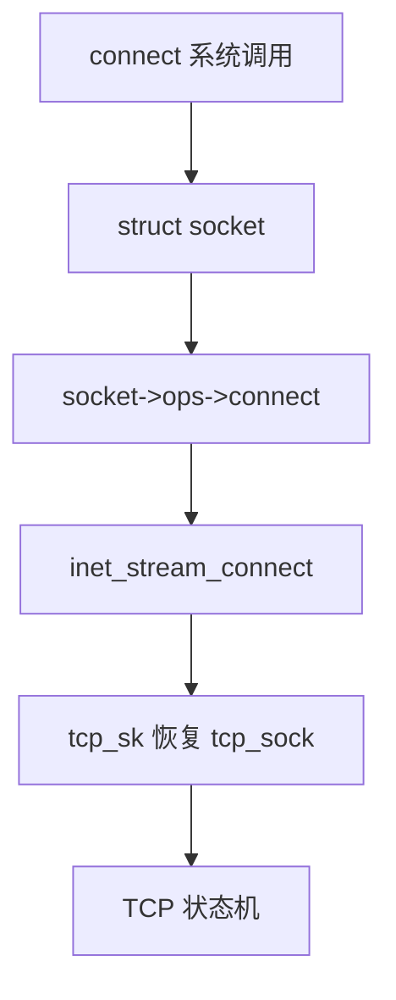
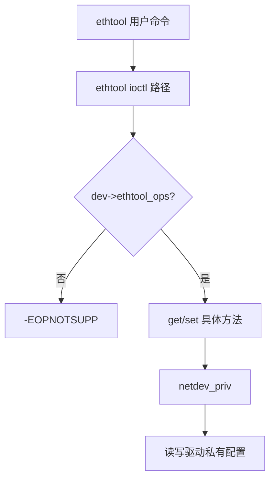
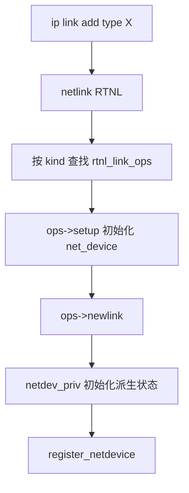

# 第四部分（B）：网络栈真实案例

网络子系统把「协议族、设备、调优、链路种类」全部对象化。本章四个案例继续验证：

> **struct 是对象，ops 是虚表，container_of / priv 指针完成派生恢复。**

---

## Case 1：`proto_ops`

### ① 场景

用户态 `socket()` / `bind()` / `connect()` / `sendmsg()` 进入套接字层后，内核必须按协议族（AF_INET、AF_UNIX、AF_NETLINK…）与类型（STREAM/DGRAM）分发。`struct socket` 上的 `ops`（类型为 `proto_ops`）就是套接字对象的「系统调用方法表」。


套接字层的关键约束是：系统调用入口必须唯一，协议实现必须可替换。`struct socket` 面向用户 API，`struct sock` 面向协议状态机；`proto_ops` 挂在前者，把 bind/connect/sendmsg 动态绑定到协议族实现。用户只需 `socket(AF_INET, SOCK_STREAM, 0)`，对象模型在内核里自动选对行为表。
### ② 对象关系

```
+--------------+   ops    +------------------+
| struct socket|--------->| proto_ops        |
|  sk ---------+--+       | .bind / .connect |
|  type/state  |  |       | .sendmsg/recvmsg |
+--------------+  |       | .release / .poll |
                  |       +------------------+
                  v
           +-------------+
           | struct sock |  (协议相关套接字对象)
           +-------------+
```

`socket` 偏用户接口对象；`sock` 偏协议栈对象。二者协作，ops 挂在 `socket` 上对外呈现统一系统调用语义。


`proto_ops` 与更底层的 `struct proto`（协议实现注册）分工不同：前者偏套接字系统调用，后者偏传输协议方法。阅读时不要混为一谈，但两者都是函数指针对象化的结果。
### ③ 核心 struct

- `struct socket`：用户可见套接字的内核对象。
- `struct sock`：协议控制块（PCB）核心。
- 派生：`tcp_sock`、`udp_sock` 等嵌入 `sock` 或经协议私有布局扩展。


围绕 `socket`/`sock`，阅读字段时先区分「框架拥有的公共状态」与「实现拥有的私有状态」。公共状态决定对象如何被链表、哈希、引用计数与调试工具看见；私有状态决定功能如何完成。二者边界清晰，封装才成立。
### ④ 核心 function pointer

`.release`、`.bind`、`.connect`、`.listen`、`.accept`、`.sendmsg`、`.recvmsg`、`.poll`、`.ioctl`、`.mmap`、`.sendpage` 等。`inet_stream_ops` 与 `unix_dgram_ops` 是两套完全不同的实现表。


`proto_ops` 的每个函数指针都应被理解成接口契约：参数含义、睡眠能力、锁前提、失败码语义。可选指针为 NULL 时的回退策略，也是契约的一部分。系统调用入口统一，协议差异与传输派生状态都被对象模型吸收。
### ⑤ 是否使用 container_of

**是（在协议实现内部极常见）。**  
`sendmsg` 从 `socket` 走到 `sock`，再进入 TCP 时经常：

`tcp_sk(sk)` 本质是类型恢复（有的实现是强制转换约定，有的路径配合嵌入宏）。UDP/TCP 私有字段都建立在「`sock` 为公共头部」的继承约定上。


若没有向下转型，TCP 只能把所有字段塞进通用 `sock`，内存与缓存行为都会变差。嵌入派生让热路径字段紧凑，同时让 UDP/ICMP 不负担 TCP 状态——继承换来空间特化。
### ⑥ 为什么这样设计

- **系统调用入口唯一**：`sys_bind` 不写死 TCP。
- **协议可模块化注册**：新协议族注册自己的 `net_proto_family` 与 `proto_ops`。
- **分层清晰**：POSIX 套接字语义 vs 传输协议状态机分离。


进入 TCP 后，公共 `sock` 不足以表达拥塞窗口等状态，于是有 `tcp_sock` 派生布局。实现侧通过 `tcp_sk(sk)` 一类转换回到派生对象——语义上就是继承向下转型。因此网络套接字是「实例 ops + 嵌入式协议派生」的双复合物。

回到三大支柱做一次强制对照：若删掉 struct，行为无处附着；若删掉 ops，公共路径只能写死分支；若删掉 container_of/私有指针，回调便无法安全持有实现状态。三者共同定义了内核式对象。把本案例的「对象 / 接口 / 恢复」各用一句话写下来，你就已经完成了一次可迁移的阅读训练：下一处陌生的 `*_ops` 也可以用同一张对照表拆开。
### ⑦ 对应 C++ 会怎么写

```cpp
struct Socket {
    virtual int bind(const sockaddr *, int) = 0;
    virtual int connect(const sockaddr *, int) = 0;
    virtual ssize_t sendmsg(MsgHdr &) = 0;
};
struct TcpSocket : Socket { /* tcp_sock 状态 */ };
```

### ⑧ 核心伪代码（10~30行）

```
int sys_connect(fd, addr, len)
{
    socket *sock = sockfd_lookup(fd);
    if (!sock->ops || !sock->ops->connect)
        return -EOPNOTSUPP;
    return sock->ops->connect(sock, addr, len, flags);
}

int inet_stream_connect(socket *sock, addr, len, flags)
{
    sock *sk = sock->sk;
    tcp_sock *tp = tcp_sk(sk);     /* 派生恢复 */
    /* 发起 TCP 三次握手状态迁移 */
    return tcp_connect(sk);
}

const proto_ops inet_stream_ops = {
    .connect = inet_stream_connect,
    .sendmsg = inet_sendmsg,
    .recvmsg = inet_recvmsg,
};
```

### ⑨ Mermaid 图



### ⑩ 最终总结一句

这里体现了 OO Design 的 **接口多态**：同一套接字系统调用，按 `proto_ops` 绑定到不同协议实现。

---

## Case 2：`net_device_ops`

### ① 场景

网卡（或虚拟设备）对协议栈暴露为 `struct net_device`。发送、打开/关闭队列、设置 MAC、换 MTU 等动作，通过 `netdev_ops`（`net_device_ops`）分发。协议栈核心只调用 `dev_queue_xmit()` 等通用 API，不硬编码 e1000 或 virtio-net。


`net_device` 是协议栈看到的唯一设备对象：队列、特性、统计、名字空间归属都在这里。发送热路径不能出现驱动类型开关，所以 `.ndo_start_xmit` 必须是函数指针。打开、停队列、改 MAC、改 MTU 同样通过 `netdev_ops` 统一，使核心与驱动二进制边界清晰。
### ② 对象关系

```
+----------------+  netdev_ops  +---------------------+
| struct net_device|----------->| net_device_ops        |
|  name / mtu    |              | .ndo_start_xmit     |
|  features      |              | .ndo_open / .stop   |
|  *priv ------+ |              | .ndo_set_mac_address|
+--------------|-+              +---------------------+
               v
        +--------------+
        | driver priv  |
        | (嵌入或尾部) |
        +--------------+
```

历史上常用 `netdev_priv(dev)` 取设备私有区（布局约定）；私有结构里也可再嵌入其他对象。


虚拟设备（veth、bridge）与物理 NIC 共用 `net_device` 对象，差异只在 ops 与 priv。对象模型使「一切皆 netdev」成为可能，用户空间工具也因此统一。
### ③ 核心 struct

- `struct net_device`：网络设备对象（队列、统计、特性标志）。
- 驱动私有结构（如 `struct my_nic`）存放硬件环、DMA、锁。


围绕 `net_device`，阅读字段时先区分「框架拥有的公共状态」与「实现拥有的私有状态」。公共状态决定对象如何被链表、哈希、引用计数与调试工具看见；私有状态决定功能如何完成。二者边界清晰，封装才成立。
### ④ 核心 function pointer

`.ndo_open`、`.ndo_stop`、`.ndo_start_xmit`、`.ndo_set_rx_mode`、`.ndo_change_mtu`、`.ndo_get_stats64`、`.ndo_tx_timeout` 等。其中 `.ndo_start_xmit` 是转发面热点。


`net_device_ops` 的每个函数指针都应被理解成接口契约：参数含义、睡眠能力、锁前提、失败码语义。可选指针为 NULL 时的回退策略，也是契约的一部分。转发面热路径虚调用 + netdev_priv 派生布局，是性能与扩展的折中典范。
### ⑤ 是否使用 container_of

**是 / 等价物是。**  
`netdev_priv()` 按固定偏移取私有区；若私有结构嵌了 `net_device`（较少见的反向嵌入）则用 `container_of`。许多驱动：

`priv = netdev_priv(dev);` 后访问环形缓冲区。目标与 `container_of` 相同：**从公共设备对象回到驱动派生状态**。


NAPI、多队列、XDP 等后续扩展，大多仍绕着同一设备对象加字段与可选回调，说明稳定对象中心 + 可选 ops 是长期演化的友好形态。
### ⑥ 为什么这样设计

- **协议栈与驱动解耦**：IP/TCP 不关心 PCIe 细节。
- **热插拔与模块化**：驱动注册 `register_netdev()` 即可接入。
- **特性协商对象化**：`features` + ops 组合表达能力差异。


`netdev_priv` 按分配时保留的尾部空间取私有区，效果等同于「派生对象紧跟基类」的布局约定。它与 `container_of` 是同一思想的两种写法：一个靠尾部分配，一个靠字段嵌入。理解这一点，就能在网卡驱动与 USB/平台驱动之间自由切换阅读视角。

回到三大支柱做一次强制对照：若删掉 struct，行为无处附着；若删掉 ops，公共路径只能写死分支；若删掉 container_of/私有指针，回调便无法安全持有实现状态。三者共同定义了内核式对象。把本案例的「对象 / 接口 / 恢复」各用一句话写下来，你就已经完成了一次可迁移的阅读训练：下一处陌生的 `*_ops` 也可以用同一张对照表拆开。
### ⑦ 对应 C++ 会怎么写

```cpp
struct NetDevice {
    virtual netdev_tx_t start_xmit(Skb *skb) = 0;
    virtual int open() = 0;
    virtual int stop() = 0;
};
struct VirtioNet : NetDevice { /* 队列与 virtqueue */ };
```

### ⑧ 核心伪代码（10~30行）

```
int dev_queue_xmit(skb)
{
    net_device *dev = skb->dev;
    /* 入队、流量控制后 */
    return dev->netdev_ops->ndo_start_xmit(skb, dev);
}

netdev_tx_t mynic_start_xmit(skb, dev)
{
    mynic_priv *p = netdev_priv(dev);   /* 派生恢复 */
    if (ring_full(p->tx)) {
        netif_stop_queue(dev);
        return NETDEV_TX_BUSY;
    }
    dma_map_and_kick(p, skb);
    return NETDEV_TX_OK;
}

const net_device_ops mynic_ops = {
    .ndo_open       = mynic_open,
    .ndo_stop       = mynic_stop,
    .ndo_start_xmit = mynic_start_xmit,
};
```

### ⑨ Mermaid 图


### ⑩ 最终总结一句

这里体现了 OO Design 的 **封装 + 多态**：设备公共对象稳定，驱动行为与私有状态被 ops 与 priv 布局封装在实现侧。

---

## Case 3：`ethtool_ops`

### ① 场景

用户态 `ethtool` 查询/设置链路速度、聚合、RSS、寄存器 dump 等。内核用 `ethtool_ops` 挂在 `net_device` 上，把「诊断与调优接口」从数据面 `netdev_ops` 中拆出，避免主发送路径接口膨胀。


若把 ethtool 的上百个查询入口塞进 `netdev_ops`，转发面头文件与缓存脚印都会恶化。内核选择第二张表 `ethtool_ops`：同一设备对象，多个接口角色。这在 OO 里对应「一个类实现多个 interface」；在 C 里对应「一个 struct 挂多张 ops 指针」。
### ② 对象关系

```
+--------------+  ethtool_ops  +------------------+
| net_device   |-------------->| ethtool_ops      |
| netdev_ops   |               | .get_link_ksettings
| features     |               | .get_drvinfo     |
+--------------+               | .set_ringparam   |
                               +------------------+
```

同一 `net_device` 对象挂两张（或多张）ops 表：**多接口角色**，类似 C++ 一个类实现多个 interface。


多 ops 表也会出现在无线、DCB、UDP tunnel offload 等扩展，思想相同：热点接口与冷接口分离，避免单表无穷膨胀。
### ③ 核心 struct

- 仍以 `net_device` 为中心对象。
- 驱动 priv 保存可调参数镜像（环长、聚合阈值等）。


围绕 同一 `net_device`，阅读字段时先区分「框架拥有的公共状态」与「实现拥有的私有状态」。公共状态决定对象如何被链表、哈希、引用计数与调试工具看见；私有状态决定功能如何完成。二者边界清晰，封装才成立。
### ④ 核心 function pointer

`.get_drvinfo`、`.get_link_ksettings`、`.set_link_ksettings`、`.get_ringparam`、`.set_coalesce`、`.get_strings` / `.get_ethtool_stats` 等。大量可选指针，驱动按能力填充。


`ethtool_ops` 的每个函数指针都应被理解成接口契约：参数含义、睡眠能力、锁前提、失败码语义。可选指针为 NULL 时的回退策略，也是契约的一部分。第二张 ops 表完成角色分离，不削弱派生恢复需求。
### ⑤ 是否使用 container_of

**是（经 netdev_priv）。**  
所有 ethtool 回调第一个相关对象仍是 `net_device *`，实现里立刻取 priv，可能再碰 PCI 配置空间。


对驱动作者而言，实现 ethtool 不是另起炉灶，而是给既有派生对象再暴露一个角色接口。OO 上这叫角色分离；工程上这叫让头文件与文档可读。
### ⑥ 为什么这样设计

- **接口分离（ISP）**：转发面 ops 保持精简；管理面 ops 可庞大且冷。
- **能力发现**：NULL 方法表示不支持，用户工具可探测。
- **统一用户体验**：不同网卡共用同一 ethtool 命令语法。


管理面路径冷、可选方法多，NULL 即表示不支持，用户工具可优雅降级。回调里依旧 `netdev_priv` 回到驱动派生状态，说明多接口并不改变支柱三的恢复需求。设计课：接口膨胀时，优先拆表，而不是让一张虚表承担所有生命周期。

回到三大支柱做一次强制对照：若删掉 struct，行为无处附着；若删掉 ops，公共路径只能写死分支；若删掉 container_of/私有指针，回调便无法安全持有实现状态。三者共同定义了内核式对象。把本案例的「对象 / 接口 / 恢复」各用一句话写下来，你就已经完成了一次可迁移的阅读训练：下一处陌生的 `*_ops` 也可以用同一张对照表拆开。
### ⑦ 对应 C++ 会怎么写

```cpp
struct Ethtoolable {
    virtual void get_drvinfo(DrvInfo &out) = 0;
    virtual int set_ringparam(const RingParam &) = 0;
};
struct Nic : NetDevice, Ethtoolable { ... };
```

内核用「第二张函数指针表」模拟多接口继承。

### ⑧ 核心伪代码（10~30行）

```
int ethtool_get_settings(net_device *dev, cmd)
{
    if (!dev->ethtool_ops || !dev->ethtool_ops->get_link_ksettings)
        return -EOPNOTSUPP;
    return dev->ethtool_ops->get_link_ksettings(dev, cmd);
}

int mynic_get_link_ksettings(net_device *dev, cmd)
{
    mynic_priv *p = netdev_priv(dev);
    cmd->base.speed  = p->link_speed;
    cmd->base.duplex = p->duplex;
    return 0;
}
```

### ⑨ Mermaid 图



### ⑩ 最终总结一句

这里体现了 OO Design 的 **多接口组合**：一个对象通过多张 ops 表扮演数据面与管理面等不同角色。

---

## Case 4：`rtnl_link_ops`

### ① 场景

创建/销毁/配置链路设备（vlan、bridge、veth、macvlan、wireguard…）走 netlink（RTNL）。`rtnl_link_ops` 描述「一类虚拟/逻辑链路」的对象工厂与属性策略：叫什么名字、如何 `newlink`/`dellink`、如何填充 netlink 属性。


`rtnl_link_ops` 描述的是链路「种类」，不是某块已经存在的网卡。`ip link add type vlan` 这类命令需要：校验属性、分配设备、初始化私有区、注册到协议栈。把这些职责放进类型级对象，实例级 `netdev_ops` 才能专注运行期收发。
### ② 对象关系

```
+------------------+     +-------------------+
| rtnl_link_ops    |---->| kind = "veth"     |
|  .setup          |     | .newlink/.dellink |
|  .newlink        |     | .policy (属性校验)|
|  .priv_size      |     +-------------------+
+--------+---------+
         | 注册到全局链表
         v
+------------------+
| 创建 net_device |
|  + driver priv   |
+------------------+
```

这是典型的 **类对象（Class Object）**：`rtnl_link_ops` 描述类型本身，而 `net_device` 是实例。


类型对象还会提供 `policy` 描述 netlink 属性 schema，相当于类的静态元数据。实例被创建后，立即安装自己的 `netdev_ops`，完成从类到实例的交接。
### ③ 核心 struct

- `struct rtnl_link_ops`：链路种类的元数据/虚表。
- 实例仍是 `net_device` + `priv_size` 私有区。
- 配置信息来自 netlink 属性。


围绕 `rtnl_link_ops`（类对象），阅读字段时先区分「框架拥有的公共状态」与「实现拥有的私有状态」。公共状态决定对象如何被链表、哈希、引用计数与调试工具看见；私有状态决定功能如何完成。二者边界清晰，封装才成立。
### ④ 核心 function pointer

`.setup`、`.newlink`、`.changelink`、`.dellink`、`.validate`、`.fill_info`、`.get_size` 等。`setup` 类似构造函数骨架；`newlink` 完成实例化与配对（如 veth 双端）。


newlink/setup 等工厂方法 的每个函数指针都应被理解成接口契约：参数含义、睡眠能力、锁前提、失败码语义。可选指针为 NULL 时的回退策略，也是契约的一部分。先有类型对象，后有 net_device 实例，类/实例支柱齐全。
### ⑤ 是否使用 container_of

**是（实例侧）。**  
ops 本身通常是静态全局「类对象」，不一定需要 container_of；但 `newlink` 创建出的设备私有数据，后续用 `netdev_priv` / `container_of` 恢复。若私有结构嵌入 list 节点，也会用宏。


模块卸载时注销 `rtnl_link_ops`，等于卸载一个类；仍存活的实例必须先被删掉。类/实例生命周期纪律，与面向对象语言中的类型卸载问题同构。
### ⑥ 为什么这样设计

- **用户空间统一入口**：`ip link add type veth ...`。
- **类型可插拔**：模块注册/注销一种 `kind`。
- **把「类」与「实例」分开**：类级 ops 管创建策略，实例级 `netdev_ops` 管运行行为。


这是 Kernel 里非常明确的 Class/Instance 分离：类对象负责工厂与 schema，实例对象负责行为与状态。阅读 netlink 相关代码时，先问「这是在操作类型还是操作实例」，不会再被两张 ops 表绕晕。派生恢复发生在实例创建之后：`priv_size` 预留空间，`netdev_priv` 取回。

回到三大支柱做一次强制对照：若删掉 struct，行为无处附着；若删掉 ops，公共路径只能写死分支；若删掉 container_of/私有指针，回调便无法安全持有实现状态。三者共同定义了内核式对象。把本案例的「对象 / 接口 / 恢复」各用一句话写下来，你就已经完成了一次可迁移的阅读训练：下一处陌生的 `*_ops` 也可以用同一张对照表拆开。
### ⑦ 对应 C++ 会怎么写

```cpp
struct LinkType {  // 类似反射/工厂
    virtual NetDevice* newlink(const Attrs &) = 0;
    virtual void dellink(NetDevice *) = 0;
};
struct VethType : LinkType { ... };
```

### ⑧ 核心伪代码（10~30行）

```
int rtnl_newlink(msg)
{
    ops = rtnl_link_ops_get(msg.kind);   /* 找到类对象 */
    if (ops->validate && ops->validate(msg) < 0)
        return -EINVAL;
    dev = alloc_netdev(ops->priv_size, name, ops->setup);
    return ops->newlink(src_net, dev, msg, extack);
}

int veth_newlink(..., dev, msg, ...)
{
    veth_priv *p = netdev_priv(dev);
    peer = create_peer_device(msg);
    p->peer = peer;
    return register_netdevice(dev);
}

const rtnl_link_ops veth_link_ops = {
    .kind     = "veth",
    .priv_size= sizeof(veth_priv),
    .setup    = veth_setup,
    .newlink  = veth_newlink,
    .dellink  = veth_dellink,
};
```

### ⑨ Mermaid 图



### ⑩ 最终总结一句

这里体现了 OO Design 的 **类对象 / 工厂模式**：`rtnl_link_ops` 代表类型级行为，负责生产与销毁 `net_device` 实例。

---

## 本章收束

| 案例 | 对象 | ops | 三大支柱怎么合 |
|------|------|-----|----------------|
| proto_ops | `socket`/`sock` | 系统调用分发 | 嵌入/tcp_sk 恢复传输派生态 |
| net_device_ops | `net_device` | 数据面行为 | `netdev_priv` ≡ 派生恢复 |
| ethtool_ops | 同一 `net_device` | 管理面行为 | 多 ops 表 = 多接口 |
| rtnl_link_ops | 类型元对象 | 创建/配置工厂 | 类级 ops + 实例 priv |

网络栈把「实例虚表」和「类型工厂」同时用满——这正是内核对象模型成熟的标志。下一章进入驱动模型。
