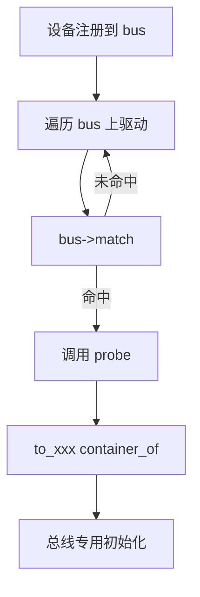
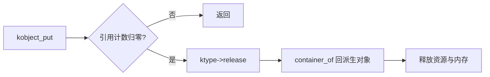
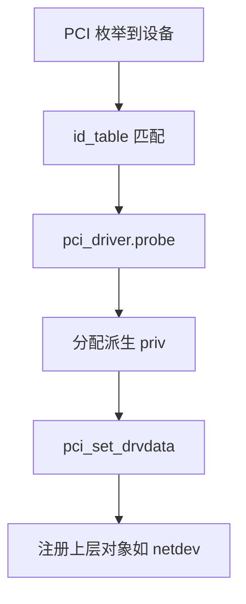
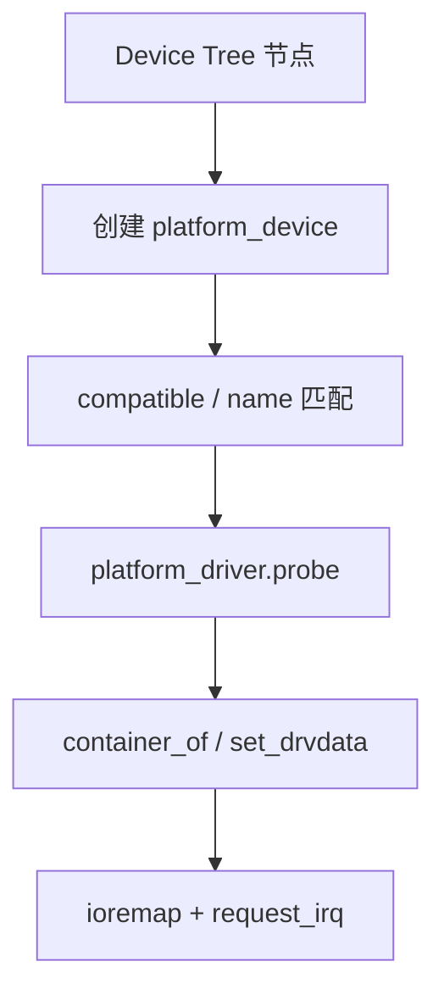
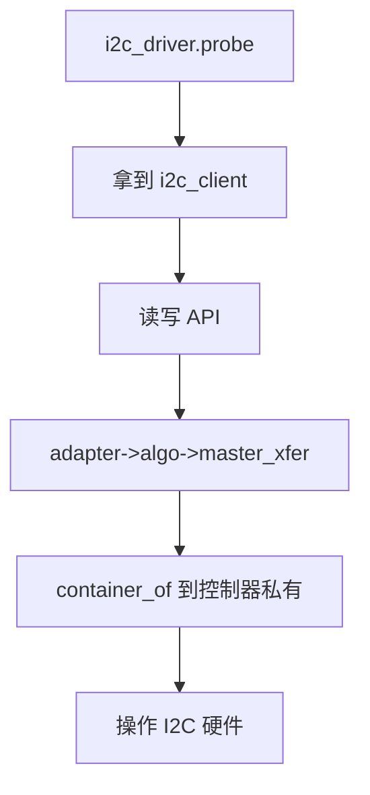
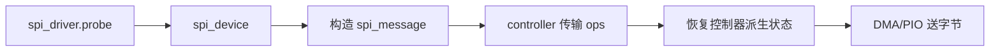

# 第四部分（C）：驱动模型真实案例

Linux 驱动模型（Driver Model）把「总线、设备、驱动、sysfs 对象」全部纳入统一对象体系。本章七个案例展示：同一三大支柱如何支撑从 PCI 到 SPI 的整棵设备树。

---

## Case 1：`bus_type`

### ① 场景

内核有多条总线：PCI、USB、I2C、SPI、platform…。每条总线要定义「设备与驱动如何匹配、如何 probe/remove、如何做电源管理」。`struct bus_type` 就是总线这个 **类型级对象** 的描述符，内含匹配与迭代等方法指针。


驱动模型的核心难题是：PCI、USB、I2C、platform 匹配规则完全不同，却要共享绑定状态机、sysfs、PM。`bus_type` 把「如何 match / probe」变成总线策略对象，核心只遍历设备与驱动并调用策略。这是策略模式：算法骨架固定，变化点注入为函数指针。
### ② 对象关系

```
+--------------+   match/probe 相关回调
| bus_type     |----------------------------------+
|  name        |                                  |
|  .match      |                                  v
|  .probe      |                         +----------------+
|  .remove     |                         | device <->     |
|  .uevent     |                         | driver 绑定流程|
+--------------+                         +----------------+
        ^
        |  注册
+-------+--------+
| pci_bus_type   |
| usb_bus_type   |
+----------------+
```

`bus_type` 不描述某一个具体设备，而描述一类总线的策略——再次出现「类对象」。


总线还可以提供 `uevent` 与 PM 回调，使策略对象同时服务热插拔通知与电源状态迁移。一个 `bus_type` 因此不仅是 matcher，也是横切服务入口。
### ③ 核心 struct

- `struct bus_type`：总线类型。
- `struct device`：设备基类对象。
- `struct device_driver`：驱动基类对象。


围绕 `bus_type`，阅读字段时先区分「框架拥有的公共状态」与「实现拥有的私有状态」。公共状态决定对象如何被链表、哈希、引用计数与调试工具看见；私有状态决定功能如何完成。二者边界清晰，封装才成立。
### ④ 核心 function pointer

`.match`、`.probe`、`.remove`、`.shutdown`、`.uevent`、以及 PM 相关回调。核心绑定逻辑在 driver core：匹配成功后调用 probe。


match/probe 策略 的每个函数指针都应被理解成接口契约：参数含义、睡眠能力、锁前提、失败码语义。可选指针为 NULL 时的回退策略，也是契约的一部分。总线策略对象让驱动核心保持通用，派生转换发生在总线边界。
### ⑤ 是否使用 container_of

**是（在总线/驱动实现中）。**  
通用核心操作 `device` / `device_driver`；PCI 实现里：

`to_pci_dev(dev)` / `to_pci_driver(drv)` 均为 `container_of` 封装，把基类指针变回总线专用派生对象。


当 match 在总线，probe 在驱动时，责任被切开：总线懂身份规则，驱动懂初始化。`container_of` 出现在两侧边界上，是继承层次穿越的记号。
### ⑥ 为什么这样设计

- **一套绑定状态机服务所有总线**。
- **匹配策略可替换**：PCI 按 ID 表；platform 按名字；I2C 按 id/of_match。
- **sysfs 与电源管理横切复用**。


通用核心只认识 `device`/`device_driver`；总线代码用 `to_pci_dev` 等宏回到派生对象。因此总线既是策略提供者，也是继承层次的分界线——公共基类之上开始出现总线特有字段。

回到三大支柱做一次强制对照：若删掉 struct，行为无处附着；若删掉 ops，公共路径只能写死分支；若删掉 container_of/私有指针，回调便无法安全持有实现状态。三者共同定义了内核式对象。把本案例的「对象 / 接口 / 恢复」各用一句话写下来，你就已经完成了一次可迁移的阅读训练：下一处陌生的 `*_ops` 也可以用同一张对照表拆开。
### ⑦ 对应 C++ 会怎么写

```cpp
struct BusType {
    virtual int match(Device *, Driver *) = 0;
    virtual int probe(Device *) = 0;
};
struct PciBus : BusType { ... };
```

### ⑧ 核心伪代码（10~30行）

此外请注意：伪代码只保留对象协作骨架，故意省略错误处理与锁细节，目的是让 struct、函数指针与类型恢复三条线同时可见；你在真实源码中见到的繁杂分支，大多是在这个骨架之外叠加的工程约束。

```
int device_bind(device *dev, device_driver *drv)
{
    bus_type *bus = dev->bus;
    if (bus->match && !bus->match(dev, drv))
        return -ENODEV;
    if (bus->probe)
        return bus->probe(dev);      /* 或 drv->probe */
    return drv->probe(dev);
}

int pci_bus_match(device *dev, device_driver *drv)
{
    pci_dev *pdev = to_pci_dev(dev);           /* container_of */
    pci_driver *pdrv = to_pci_driver(drv);
    return pci_match_id(pdrv->id_table, pdev) != NULL;
}
```

### ⑨ Mermaid 图



### ⑩ 最终总结一句

这里体现了 OO Design 的 **策略模式 + 继承**：总线策略可替换，设备/驱动在通用基类上派生。

---

## Case 2：`kobj_type`

### ① 场景

`kobject` 是驱动模型与 sysfs 的根基对象：引用计数、父子层次、uevent、属性展示。不同类型的 kobject 需要不同的释放函数与默认属性集，于是引入 `kobj_type`（含 `sysfs_ops`）作为该类型的方法表。


`kobject` 是引用计数、层次与 sysfs 的最小基类对象。几乎所有可见设备模型对象都嵌入它。问题随之而来：基类指针上的最后一次 `kobject_put` 必须释放「外层完整对象」，不能只释放 kobject 字段。于是 `kobj_type.release` 成为析构虚函数，`container_of` 成为向下转型。
### ② 对象关系

```
+-----------+   ktype   +--------------+
| kobject   |---------->| kobj_type    |
|  name     |           | .release     |
|  parent   |           | .sysfs_ops   |
|  sd       |           | .default_attrs|
+-----+-----+           +--------------+
      ^ 嵌入
      |
+-----+--------+
| struct cdev  |
| struct device|
+--------------+
```

几乎所有更高层对象都 **嵌入** `kobject`，析构时必须 `container_of` 回到外层再释放整块内存。


sysfs 属性 show/store 同样经 `sysfs_ops` 分发，属性文件成为对象反射面。用户空间看到的设备树，本质是 kobject 层次的物化。
### ③ 核心 struct

- `struct kobject`：基类对象。
- `struct kobj_type`：类型虚表。
- `struct sysfs_ops`：属性 show/store。


围绕 `kobject`，阅读字段时先区分「框架拥有的公共状态」与「实现拥有的私有状态」。公共状态决定对象如何被链表、哈希、引用计数与调试工具看见；私有状态决定功能如何完成。二者边界清晰，封装才成立。
### ④ 核心 function pointer

`kobj_type.release`；`sysfs_ops.show` / `.store`。release 是析构函数的内核等价物。


`kobj_type.release` 的每个函数指针都应被理解成接口契约：参数含义、睡眠能力、锁前提、失败码语义。可选指针为 NULL 时的回退策略，也是契约的一部分。析构虚函数 + container_of 是嵌入式继承的生命周期课本。
### ⑤ 是否使用 container_of

**必须使用，且是教学样板。**  
`release(struct kobject *kobj)` 里：

`container_of(kobj, struct my_obj, kobj)`  
然后 `kfree(my_obj)`。漏做或偏移错误 = use-after-free / 内存泄漏。


release 与 show 都可能需要回到派生对象：前者释放，后者读字段。同一套向下转型服务生命周期与可观测性，体现基类嵌入的杠杆效应。
### ⑥ 为什么这样设计

- **统一生命周期与 sysfs 呈现**。
- **真正的嵌入式继承**：外层对象「是一个」kobject。
- **类型化析构**：不同对象释放资源方式不同，必须虚调用。


漏写 release 或算错成员偏移，会变成最难查的泄漏与内存破坏。把这一案吃透，就等于吃透了内核嵌入式继承的生命周期契约。

回到三大支柱做一次强制对照：若删掉 struct，行为无处附着；若删掉 ops，公共路径只能写死分支；若删掉 container_of/私有指针，回调便无法安全持有实现状态。三者共同定义了内核式对象。把本案例的「对象 / 接口 / 恢复」各用一句话写下来，你就已经完成了一次可迁移的阅读训练：下一处陌生的 `*_ops` 也可以用同一张对照表拆开。
### ⑦ 对应 C++ 会怎么写

```cpp
struct Kobject {
    virtual ~Kobject() = 0;
};
struct Device : Kobject {
    ~Device() override;
};
```

内核把析构函数显式写成 `ktype->release`。

### ⑧ 核心伪代码（10~30行）

此外请注意：伪代码只保留对象协作骨架，故意省略错误处理与锁细节，目的是让 struct、函数指针与类型恢复三条线同时可见；你在真实源码中见到的繁杂分支，大多是在这个骨架之外叠加的工程约束。

```
void kobject_put(kobject *kobj)
{
    if (refcount_dec_and_test(&kobj->kref)) {
        if (kobj->ktype && kobj->ktype->release)
            kobj->ktype->release(kobj);
    }
}

void mydev_release(kobject *kobj)
{
    my_dev *d = container_of(kobj, my_dev, kobj);
    free_irq(d->irq, d);
    kfree(d);
}

const kobj_type mydev_ktype = {
    .release   = mydev_release,
    .sysfs_ops = &mydev_sysfs_ops,
};
```

### ⑨ Mermaid 图



### ⑩ 最终总结一句

这里体现了 OO Design 的 **析构多态 + 嵌入式继承**：基类指针生命周期结束时，必须虚分发到派生释放逻辑。

---

## Case 3：`pci_driver`

### ① 场景

PCI/PCIe 驱动通过 `struct pci_driver` 注册到 PCI 总线：提供 ID 表、probe/remove、错误恢复、PM 回调。driver core 与 `pci_bus_type` 协作完成枚举设备与驱动的绑定。


PCI 枚举发现的是硬件身份（vendor/device/class），驱动用 `id_table` 声明自己能服务谁。匹配成功后，`pci_driver.probe` 获得 `pci_dev`，完成 bar 映射、中断申请，并常常再注册更上层对象（netdev、DRM…）。对象链从总线设备延伸到功能子系统，每一环都可能再挂新的 ops。
### ② 对象关系

```
+---------------+  嵌入  +----------------+
| pci_driver    |------->| device_driver  |
|  id_table     |        |  name / bus    |
|  probe/remove |        +----------------+
+---------------+
        |
        | 匹配
        v
+---------------+  嵌入  +--------+
| pci_dev       |------->| device |
|  vendor/device|        +--------+
+---------------+
```

两端都是「总线专用派生 = 嵌入通用基类」。


错误恢复 `err_handler`、SR-IOV、电源管理回调继续挂在同一 `pci_driver` 对象上，使一张驱动描述符成为 PCI 功能的完整策略集。
### ③ 核心 struct

- `struct pci_driver` / `struct pci_dev`
- 基类：`device_driver` / `device`
- 驱动私有：`pci_set_drvdata(pdev, priv)`


围绕 `pci_dev`/`pci_driver`，阅读字段时先区分「框架拥有的公共状态」与「实现拥有的私有状态」。公共状态决定对象如何被链表、哈希、引用计数与调试工具看见；私有状态决定功能如何完成。二者边界清晰，封装才成立。
### ④ 核心 function pointer

`pci_driver.probe`、`.remove`、`.suspend`、`.resume`、`.err_handler` 等。绑定成功后核心回调 `drv->probe(dev)`，PCI 层再转到 `pci_driver.probe(pdev, id)`。


probe/remove 等 的每个函数指针都应被理解成接口契约：参数含义、睡眠能力、锁前提、失败码语义。可选指针为 NULL 时的回退策略，也是契约的一部分。ID 表声明式匹配，to_pci_* 完成基类到总线派生的穿越。
### ⑤ 是否使用 container_of

**是。**  
`to_pci_dev` / `to_pci_driver`；probe 后把 priv 存 drvdata，后续中断里取回。形成「基类转换 + 私有指针」双通道。


probe 失败路径必须与成功路径对称释放——对象构造失败时的强异常安全，在内核里靠显式 goto 完成，但对象边界仍然帮助人推理「谁拥有 bar/irq/netdev」。
### ⑥ 为什么这样设计

- **复用设备模型**：sysfs、PM、绑定日志统一。
- **ID 表声明式匹配**：数据驱动的多态选择。
- **热插拔安全**：remove 路径标准。


`to_pci_dev`/`to_pci_driver` 保证从通用 probe 签名回到 PCI 世界；`pci_set_drvdata` 则把驱动私有对象挂上，供中断与 remove 使用。继承转换 + drvdata，是驱动模型最常见的双通道恢复。

回到三大支柱做一次强制对照：若删掉 struct，行为无处附着；若删掉 ops，公共路径只能写死分支；若删掉 container_of/私有指针，回调便无法安全持有实现状态。三者共同定义了内核式对象。把本案例的「对象 / 接口 / 恢复」各用一句话写下来，你就已经完成了一次可迁移的阅读训练：下一处陌生的 `*_ops` 也可以用同一张对照表拆开。
### ⑦ 对应 C++ 会怎么写

```cpp
struct PciDriver : DeviceDriver {
    virtual int probe(PciDev *, const PciId *) = 0;
};
```

### ⑧ 核心伪代码（10~30行）

此外请注意：伪代码只保留对象协作骨架，故意省略错误处理与锁细节，目的是让 struct、函数指针与类型恢复三条线同时可见；你在真实源码中见到的繁杂分支，大多是在这个骨架之外叠加的工程约束。

```
int pci_device_probe(device *dev)
{
    pci_dev *pdev = to_pci_dev(dev);
    pci_driver *pdrv = to_pci_driver(dev->driver);
    id = pci_match_id(pdrv->id_table, pdev);
    return pdrv->probe(pdev, id);
}

int mynic_probe(pci_dev *pdev, const pci_device_id *id)
{
    mynic *n = kzalloc(sizeof(*n));
    n->pdev = pdev;
    pci_set_drvdata(pdev, n);
    /* 申请 bar、irq，注册 net_device */
    return 0;
}
```

### ⑨ Mermaid 图



### ⑨.1 三大支柱回看

从教学法上看，本案例值得反复对照 C++ 心智模型：把 ops 表想成虚表，把嵌入想成基类子对象，把 `container_of` 想成 `static_cast` 回派生类。差别在于内核把这些机制写成可见数据与宏，从而满足 ABI 稳定、无隐藏控制流、可在中断/原子上下文推理的约束。一旦你能在本案例中指出「谁是对象、谁是接口、谁在恢复类型」，你就已经具备了阅读相邻百个 `*_ops` 定义的迁移能力。这也是本 Cookbook 坚持每个案例都回到三大支柱的原因：知识要可复用，而不是只记住一个子系统名词。


### ⑩ 最终总结一句

这里体现了 OO Design 的 **继承层次**：总线专用驱动/设备在通用驱动模型基类上特化。

---

## Case 4：`usb_driver`

### ① 场景

USB 驱动面向接口（interface）而非裸设备：`usb_driver` 提供 `id_table`、`probe`/`disconnect`，以及可选的挂起/复位回调。USB core 负责枚举配置、创建 `usb_interface`，再与驱动匹配。


USB 更细：一个物理设备可有多个 interface，驱动通常绑定 interface。这迫使对象模型出现 `usb_device` 与 `usb_interface` 两层，匹配与 disconnect 以 interface 为粒度。热插拔下，disconnect 可能在任意时刻到来，对象析构顺序必须严格。
### ② 对象关系

```
+--------------+   嵌入   +----------------+
| usb_driver   |--------->| device_driver  |
|  id_table    |          +----------------+
|  probe       |
+--------------+
        |
        v 匹配
+----------------+  嵌入  +--------+
| usb_interface  |------->| device |
|  cur_altsetting|        +--------+
+----------------+
        |
        v
+----------------+
| usb_device     |
+----------------+
```

对象图比 PCI 多一层：device → interface → driver。


USB 配置选择、altsetting 切换会改变 interface 含义，对象字段随之更新，驱动或需重新绑定。动态重配置是对象模型必须面对的真实世界，不是静态 UML。
### ③ 核心 struct

- `usb_driver`、`usb_interface`、`usb_device`、`usb_host_endpoint`
- 转换宏：`to_usb_driver`、`to_usb_interface`


围绕 `usb_interface`，阅读字段时先区分「框架拥有的公共状态」与「实现拥有的私有状态」。公共状态决定对象如何被链表、哈希、引用计数与调试工具看见；私有状态决定功能如何完成。二者边界清晰，封装才成立。
### ④ 核心 function pointer

`.probe`、`.disconnect`、`.suspend`、`.resume`、`.pre_reset`、`.post_reset`、`.unlocked_ioctl`。热插拔下 `disconnect` 必须能随时拆掉正在使用的资源。


`usb_driver` 回调 的每个函数指针都应被理解成接口契约：参数含义、睡眠能力、锁前提、失败码语义。可选指针为 NULL 时的回退策略，也是契约的一部分。更细绑定粒度仍复用 device 基类，热插拔强化析构纪律。
### ⑤ 是否使用 container_of

**是。**  
probe 参数常是 `usb_interface *`；从 `interface_to_usbdev(intf)` 找设备；私有数据 `usb_set_intfdata`。基类 `device` 路径一律 `container_of`。


`usb_set_intfdata` 与 disconnect 清 NULL 是生命周期基本功；任何 urb 完成回调都要能容忍接口正在拆除——派生对象的存在性要有引用或状态机保护。
### ⑥ 为什么这样设计

- **USB 组合设备**：一个 device 多 interface，需要更细绑定粒度。
- **与驱动模型对齐**：仍然享受 sysfs/PM。
- **声明式 ID 匹配**：vendor/product/class/protocol。


尽管如此，它仍嵌入通用 `device`，复用同一套驱动核心。差异被限制在 USB 核心与 `usb_driver` ops 内，正是封装的胜利。

回到三大支柱做一次强制对照：若删掉 struct，行为无处附着；若删掉 ops，公共路径只能写死分支；若删掉 container_of/私有指针，回调便无法安全持有实现状态。三者共同定义了内核式对象。把本案例的「对象 / 接口 / 恢复」各用一句话写下来，你就已经完成了一次可迁移的阅读训练：下一处陌生的 `*_ops` 也可以用同一张对照表拆开。
### ⑦ 对应 C++ 会怎么写

```cpp
struct UsbDriver : DeviceDriver {
    virtual int probe(UsbInterface *, const UsbId *) = 0;
    virtual void disconnect(UsbInterface *) = 0;
};
```

### ⑧ 核心伪代码（10~30行）

此外请注意：伪代码只保留对象协作骨架，故意省略错误处理与锁细节，目的是让 struct、函数指针与类型恢复三条线同时可见；你在真实源码中见到的繁杂分支，大多是在这个骨架之外叠加的工程约束。

```
int usb_probe_interface(device *dev)
{
    usb_interface *intf = to_usb_interface(dev);
    usb_driver *udrv = to_usb_driver(dev->driver);
    id = usb_match_id(intf, udrv->id_table);
    return udrv->probe(intf, id);
}

int myusb_probe(usb_interface *intf, const usb_device_id *id)
{
    myusb *u = kzalloc(sizeof(*u));
    u->udev = interface_to_usbdev(intf);
    usb_set_intfdata(intf, u);
    /* 提交 urb 等 */
    return 0;
}
```

### ⑨ Mermaid 图


### ⑨.1 三大支柱回看

从教学法上看，本案例值得反复对照 C++ 心智模型：把 ops 表想成虚表，把嵌入想成基类子对象，把 `container_of` 想成 `static_cast` 回派生类。差别在于内核把这些机制写成可见数据与宏，从而满足 ABI 稳定、无隐藏控制流、可在中断/原子上下文推理的约束。一旦你能在本案例中指出「谁是对象、谁是接口、谁在恢复类型」，你就已经具备了阅读相邻百个 `*_ops` 定义的迁移能力。这也是本 Cookbook 坚持每个案例都回到三大支柱的原因：知识要可复用，而不是只记住一个子系统名词。


### ⑩ 最终总结一句

这里体现了 OO Design 的 **细粒度对象绑定**：在通用设备模型上特化出 interface 级多态挂载点。

---

## Case 5：`platform_driver`

### ① 场景

SoC 内部外设、伪设备、无自发发现能力的硬件，常用 platform 总线。设备树（Device Tree）或 ACPI 创建 `platform_device`，驱动以名字/`of_match_table` 匹配。`platform_driver` 是嵌入 `device_driver` 的派生驱动对象。


平台设备补齐「不能自举枚举」的那类硬件：SoC 外设、板级器件、虚拟装置。设备树 `compatible` 字符串成为类型标签，`platform_driver` 用匹配表认领设备，再领取资源。资源（MMIO、IRQ、时钟）成为对象属性，而不是编译期全局地址宏。
### ② 对象关系

```
+------------------+  嵌入  +----------------+
| platform_driver  |------->| device_driver  |
|  probe/remove    |        |  of_match_table|
+------------------+        +----------------+
         ^
         | match by name / DT compatible
         v
+------------------+  嵌入  +--------+
| platform_device  |------->| device |
|  resource[]      |        +--------+
+------------------+
```


`devm_*` 托管资源把「派生对象分配」与「设备生命周期」绑定，减少 remove 遗漏。这是对象析构职责的框架化，不改变三大支柱，但强化了支柱一的生命周期含义。
### ③ 核心 struct

- `platform_device`：资源（MMIO、IRQ）数组。
- `platform_driver`：probe 中领取资源。


围绕 `platform_device`，阅读字段时先区分「框架拥有的公共状态」与「实现拥有的私有状态」。公共状态决定对象如何被链表、哈希、引用计数与调试工具看见；私有状态决定功能如何完成。二者边界清晰，封装才成立。
### ④ 核心 function pointer

`.probe`、`.remove`、`.shutdown`，以及 PM ops。现代内核常经 `platform_probe` 包装调用驱动 probe。


`platform_driver.probe` 的每个函数指针都应被理解成接口契约：参数含义、睡眠能力、锁前提、失败码语义。可选指针为 NULL 时的回退策略，也是契约的一部分。DT 实例化 + 资源对象化，把板级世界适配进统一模型。
### ⑤ 是否使用 container_of

**是。**  
`to_platform_device` / `to_platform_driver`；也可用 `dev_get_drvdata`。资源获取 API 屏蔽了总线细节，但类型恢复仍必要。


平台驱动经常再注册子设备或时钟提供者，形成对象图；probe 只是根对象构造函数，真正系统是一棵设备对象树。
### ⑥ 为什么这样设计

- **让不可枚举硬件进入统一模型**。
- **DT compatible 即类型标签**：数据驱动匹配。
- **资源对象化**：IRQ/MEM 作为设备属性而非全局宏。


从 OO 视角，platform 总线是一次适配：把异构板级世界适配进统一 device/driver 接口。读 DT 绑定文档时，其实是在读「对象如何被实例化」的说明书。

回到三大支柱做一次强制对照：若删掉 struct，行为无处附着；若删掉 ops，公共路径只能写死分支；若删掉 container_of/私有指针，回调便无法安全持有实现状态。三者共同定义了内核式对象。把本案例的「对象 / 接口 / 恢复」各用一句话写下来，你就已经完成了一次可迁移的阅读训练：下一处陌生的 `*_ops` 也可以用同一张对照表拆开。
### ⑦ 对应 C++ 会怎么写

```cpp
struct PlatformDriver : DeviceDriver {
    virtual int probe(PlatformDevice *) = 0;
};
```

### ⑧ 核心伪代码（10~30行）

此外请注意：伪代码只保留对象协作骨架，故意省略错误处理与锁细节，目的是让 struct、函数指针与类型恢复三条线同时可见；你在真实源码中见到的繁杂分支，大多是在这个骨架之外叠加的工程约束。

```
int platform_drv_probe(device *dev)
{
    platform_driver *drv = to_platform_driver(dev->driver);
    platform_device *pdev = to_platform_device(dev);
    return drv->probe(pdev);
}

int mypinctrl_probe(platform_device *pdev)
{
    my_pinctrl *p = devm_kzalloc(&pdev->dev, sizeof(*p));
    p->base = devm_platform_ioremap_resource(pdev, 0);
    p->irq  = platform_get_irq(pdev, 0);
    platform_set_drvdata(pdev, p);
    return 0;
}
```

### ⑨ Mermaid 图



### ⑨.1 三大支柱回看

从教学法上看，本案例值得反复对照 C++ 心智模型：把 ops 表想成虚表，把嵌入想成基类子对象，把 `container_of` 想成 `static_cast` 回派生类。差别在于内核把这些机制写成可见数据与宏，从而满足 ABI 稳定、无隐藏控制流、可在中断/原子上下文推理的约束。一旦你能在本案例中指出「谁是对象、谁是接口、谁在恢复类型」，你就已经具备了阅读相邻百个 `*_ops` 定义的迁移能力。这也是本 Cookbook 坚持每个案例都回到三大支柱的原因：知识要可复用，而不是只记住一个子系统名词。


### ⑩ 最终总结一句

这里体现了 OO Design 的 **适配**：把 SoC 外设适配进通用 device/driver 对象体系。

---

## Case 6：`i2c_driver`

### ① 场景

I2C 客户端设备（传感器、EEPROM、PMIC）由适配器枚举或 DT 实例化。`i2c_driver` 提供匹配表与 probe；真正的消息传输通过 `i2c_adapter` 的算法 ops 完成——又是「设备驱动 ops + 总线适配器 ops」双层结构。


I2C 展示双层多态：客户端驱动实现传感/电源等业务；适配器驱动实现主机控制器传输。中间对象 `i2c_client`/`i2c_adapter` 稳定后，两边可独立演进。`master_xfer` 是控制器虚表，`i2c_driver.probe` 是客户端虚表。
### ② 对象关系

```
+--------------+  嵌入  +----------------+
| i2c_driver   |------->| device_driver  |
|  id_table    |        +----------------+
|  probe       |
+--------------+
       |
       v
+--------------+  嵌入  +--------+
| i2c_client   |------->| device |
|  addr        |        +--------+
|  adapter ----+--+
+--------------+  |
                  v
           +--------------+
           | i2c_adapter  |
           |  algo->master_xfer |
           +--------------+
```


探测（detect）类驱动与声明式 DT 客户端并存，匹配策略多样，但最终都落到同一 `i2c_client` 对象。对象身份统一后，传输 API 才能稳定。
### ③ 核心 struct

- `i2c_driver`、`i2c_client`、`i2c_adapter`、`i2c_algorithm`


围绕 `i2c_client`/`i2c_adapter`，阅读字段时先区分「框架拥有的公共状态」与「实现拥有的私有状态」。公共状态决定对象如何被链表、哈希、引用计数与调试工具看见；私有状态决定功能如何完成。二者边界清晰，封装才成立。
### ④ 核心 function pointer

驱动侧：`i2c_driver.probe` / `.remove` / `.detect`。  
适配器侧：`i2c_algorithm.master_xfer` / `.functionality`——控制器驱动的虚表。


driver.probe 与 algo.xfer 的每个函数指针都应被理解成接口契约：参数含义、睡眠能力、锁前提、失败码语义。可选指针为 NULL 时的回退策略，也是契约的一部分。双层多态依赖中间对象稳定抽象。
### ⑤ 是否使用 container_of

**是。**  
`to_i2c_driver`、`to_i2c_client`、`to_i2c_adapter`；控制器私有数据常嵌入/挂在 adapter 上，xfer 回调里恢复。


控制器侧 `container_of(adap, …)` 与客户端侧 `clientdata` 同时存在，证明同一条总线上至少有两种派生恢复：主机私有与从设备私有。
### ⑥ 为什么这样设计

- **客户端与控制器解耦**：传感器驱动不写死主机控制器。
- **统一 `i2c_transfer` API**：多态落在 adapter.algo。
- **多地址/多客户端**：一总线多对象实例。


传感器驱动调用 `i2c_transfer`，并不知道控制器是设计仓库里的哪一款 IP。这是依赖倒置：高层依赖抽象传输接口，低层实现抽象。

回到三大支柱做一次强制对照：若删掉 struct，行为无处附着；若删掉 ops，公共路径只能写死分支；若删掉 container_of/私有指针，回调便无法安全持有实现状态。三者共同定义了内核式对象。把本案例的「对象 / 接口 / 恢复」各用一句话写下来，你就已经完成了一次可迁移的阅读训练：下一处陌生的 `*_ops` 也可以用同一张对照表拆开。
### ⑦ 对应 C++ 会怎么写

```cpp
struct I2cDriver : DeviceDriver {
    virtual int probe(I2cClient *) = 0;
};
struct I2cAlgo {
    virtual int master_xfer(I2cAdapter *, I2cMsg *, int) = 0;
};
```

### ⑧ 核心伪代码（10~30行）

此外请注意：伪代码只保留对象协作骨架，故意省略错误处理与锁细节，目的是让 struct、函数指针与类型恢复三条线同时可见；你在真实源码中见到的繁杂分支，大多是在这个骨架之外叠加的工程约束。

```
int i2c_device_probe(device *dev)
{
    i2c_client *client = to_i2c_client(dev);
    i2c_driver *drv = to_i2c_driver(dev->driver);
    return drv->probe(client, ...);
}

int mypmic_probe(i2c_client *client)
{
    mypmic *p = devm_kzalloc(...);
    i2c_set_clientdata(client, p);
    return i2c_smbus_read_byte_data(client, REG_ID);
}

/* 适配器侧 */
int myctrl_xfer(i2c_adapter *adap, msgs, num)
{
    myctrl *c = container_of(adap, myctrl, adap);
    return hw_do_transfer(c, msgs, num);
}
```

### ⑨ Mermaid 图



### ⑨.1 三大支柱回看

从教学法上看，本案例值得反复对照 C++ 心智模型：把 ops 表想成虚表，把嵌入想成基类子对象，把 `container_of` 想成 `static_cast` 回派生类。差别在于内核把这些机制写成可见数据与宏，从而满足 ABI 稳定、无隐藏控制流、可在中断/原子上下文推理的约束。一旦你能在本案例中指出「谁是对象、谁是接口、谁在恢复类型」，你就已经具备了阅读相邻百个 `*_ops` 定义的迁移能力。这也是本 Cookbook 坚持每个案例都回到三大支柱的原因：知识要可复用，而不是只记住一个子系统名词。


### ⑩ 最终总结一句

这里体现了 OO Design 的 **双层多态**：客户端驱动与主机控制器各自用 ops/嵌入继承，经稳定中间对象协作。

---

## Case 7：`spi_driver`

### ① 场景

SPI 与 I2C 同构：`spi_driver` 绑定 `spi_device`；控制器用 `spi_controller`（原 `spi_master`）的传输方法把消息送上总线。闪光灯、面板、射频前端等大量使用此模型。


SPI 与 I2C 同构，强化「学会一种总线模型，就能迁移」的对象课。差异主要在消息对象（`spi_message`/`spi_transfer`）与控制器回调形状，不在整体 OO 骨架。框架负责排队与完成，控制器只提供 transfer 原语，设备驱动只提供协议序列。
### ② 对象关系

```
+-------------+  嵌入  +----------------+
| spi_driver  |------->| device_driver  |
+-------------+        +----------------+
       |
       v
+-------------+  嵌入  +--------+
| spi_device  |------->| device |
|  chip_select|        +--------+
|  controller-+--+
+-------------+  |
                 v
          +------------------+
          | spi_controller   |
          |  .transfer_one   |
          +------------------+
```


SPI 控制器常嵌入到更大数据结构（含 DMA 引擎、锁、完成量），transfer 回调是典型基类入口。消息完成后的回调再次进入驱动对象世界。
### ③ 核心 struct

- `spi_driver`、`spi_device`、`spi_controller`、`spi_message` / `spi_transfer`


围绕 `spi_device`/`spi_controller`，阅读字段时先区分「框架拥有的公共状态」与「实现拥有的私有状态」。公共状态决定对象如何被链表、哈希、引用计数与调试工具看见；私有状态决定功能如何完成。二者边界清晰，封装才成立。
### ④ 核心 function pointer

驱动：`.probe` / `.remove`。  
控制器：`.transfer_one`、`.set_cs`、`.prepare_message` 等——控制器对象的 ops 风格字段。


probe 与 transfer_one 的每个函数指针都应被理解成接口契约：参数含义、睡眠能力、锁前提、失败码语义。可选指针为 NULL 时的回退策略，也是契约的一部分。与 I2C 同构的对象骨架，便于迁移学习。
### ⑤ 是否使用 container_of

**是。**  
标准 `container_of` 转换宏；控制器驱动在 transfer 回调中恢复私有 DMA 引擎状态。


把 SPI 与 I2C 对照阅读，是训练「看见对象骨架、忽略业务细节」的最快方法之一：名字变了，三大支柱的位置几乎不变。
### ⑥ 为什么这样设计

- **与 I2C/platform 保持同构心智模型**，降低驱动作者负担。
- **消息对象化**：一次传输是 `spi_message` 对象，可异步完成。
- **核心调度队列**：框架处理队列与完成回调，控制器只填传输原语。


三者各是一类对象：框架对象、控制器对象、设备对象，靠 ops 与嵌入转换协作。若你能独立画出这三层，SPI/I2C/MDIO 同类子系统都会变得可读。

回到三大支柱做一次强制对照：若删掉 struct，行为无处附着；若删掉 ops，公共路径只能写死分支；若删掉 container_of/私有指针，回调便无法安全持有实现状态。三者共同定义了内核式对象。把本案例的「对象 / 接口 / 恢复」各用一句话写下来，你就已经完成了一次可迁移的阅读训练：下一处陌生的 `*_ops` 也可以用同一张对照表拆开。
### ⑦ 对应 C++ 会怎么写

```cpp
struct SpiDriver : DeviceDriver {
    virtual int probe(SpiDevice *) = 0;
};
struct SpiController {
    virtual int transfer_one(SpiDevice *, SpiTransfer *) = 0;
};
```

### ⑧ 核心伪代码（10~30行）

此外请注意：伪代码只保留对象协作骨架，故意省略错误处理与锁细节，目的是让 struct、函数指针与类型恢复三条线同时可见；你在真实源码中见到的繁杂分支，大多是在这个骨架之外叠加的工程约束。

```
int spi_drv_probe(device *dev)
{
    spi_device *spi = to_spi_device(dev);
    spi_driver *drv = to_spi_driver(dev->driver);
    return drv->probe(spi);
}

int myflash_probe(spi_device *spi)
{
    myflash *f = devm_kzalloc(...);
    spi_set_drvdata(spi, f);
    return spi_write_then_read(spi, cmd, ..., resp, ...);
}

int myctl_transfer_one(spi_controller *ctlr, spi, xfer)
{
    myctl *m = spi_controller_get_devdata(ctlr);
    /* 或 container_of */
    return kick_dma(m, xfer->tx_buf, xfer->rx_buf, xfer->len);
}
```

### ⑨ Mermaid 图



### ⑩ 最终总结一句

这里体现了 OO Design 的 **框架与插件分离**：SPI 核心定算法骨架，device 驱动与 controller 驱动分别插拔实现。

---

## 本章收束

| 案例 | 基类对象 | 特化对象 | ops / 虚行为 | 派生恢复 |
|------|----------|----------|--------------|----------|
| bus_type | — | 总线类对象 | match/probe | to_xxx(dev) |
| kobj_type | kobject | 各子系统对象 | release/sysfs | **经典 container_of** |
| pci_driver | device_driver | pci_driver | probe/remove | to_pci_* |
| usb_driver | device_driver | usb_driver | probe/disconnect | to_usb_* |
| platform_driver | device_driver | platform_driver | probe | to_platform_* |
| i2c_driver | device_driver | i2c_driver + algo | probe/xfer | to_i2c_* |
| spi_driver | device_driver | spi_driver + controller | probe/transfer | to_spi_* |

驱动模型把三大支柱用到了极致：**嵌入基类统一生命周期，ops/回调表统一绑定，container_of 统一类型恢复。** 下一章看调度、块层、TTY、中断、异步与 LSM。
