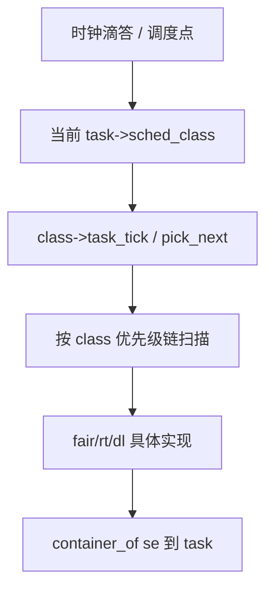
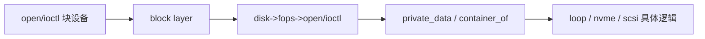
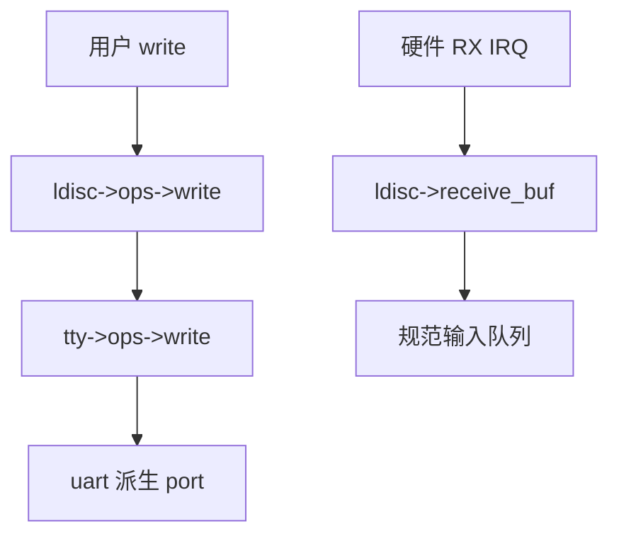
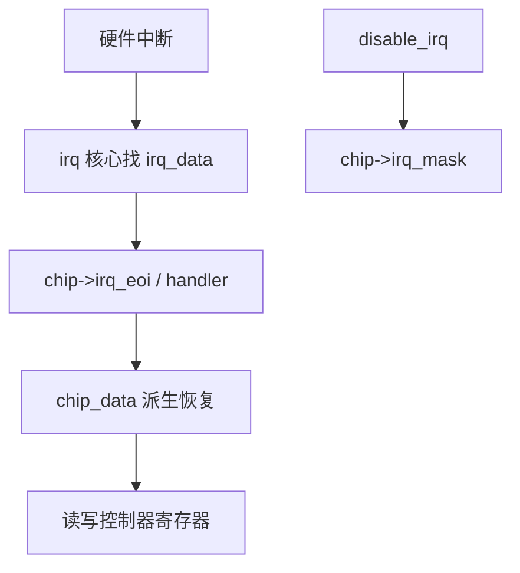
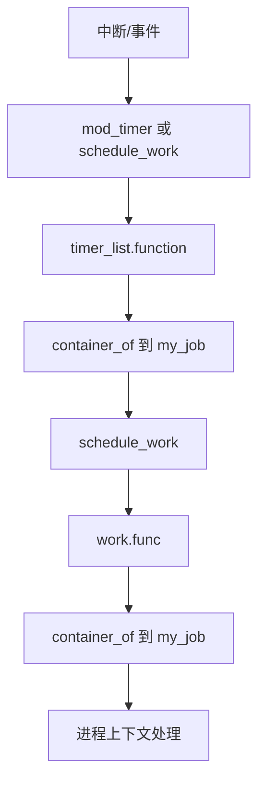
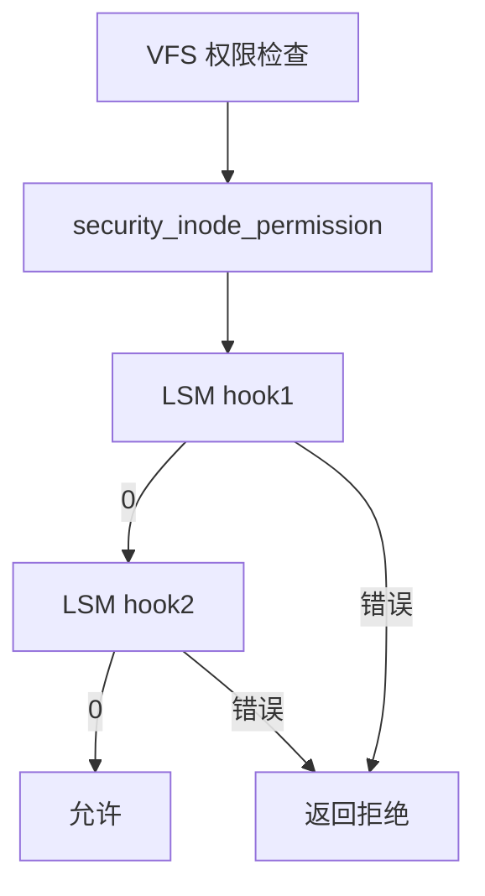

# 第四部分（D）：调度 / 块层 / TTY / 中断 / 异步 / LSM 真实案例

本章覆盖内核最「核心」的几组对象。它们未必是设备驱动，但同样严格遵循三大支柱——有时甚至更纯粹，因为热路径上的多态必须既快又明确。

---

## Case 1：`sched_class`

### ① 场景

Linux 调度器支持多种调度策略：CFS（完全公平）、RT（实时）、DL（截止时间）、idle、stop 等。每个 runnable task 归属某一调度类。调度核心在选下一个任务、入队/出队、定时滴答时，通过 `sched_class` 函数指针表分发，而不把所有策略写进巨型 `if/else`。


调度器必须在持锁、关抢占的极端约束下做决策，但仍拒绝把 CFS/RT/DL 写死成巨型分支。`sched_class` 把策略做成可链接的策略对象，核心按优先级链询问「谁有任务可跑」。task 通过指针绑定当前策略，策略切换即改指针——运行时多态。
### ② 对象关系

```
+--------------+   sched_class   +------------------+
| task_struct  |---------------->| sched_class      |
|  policy      |                 | .enqueue_task    |
|  se / rt /dl |                 | .dequeue_task    |
+--------------+                 | .pick_next_task  |
                                 | .task_tick       |
                                 +--------+---------+
                                          |
                     单向链表优先级        v
                                 +------------------+
                                 | stop -> dl -> rt |
                                 | -> fair -> idle  |
                                 +------------------+
```

`sched_class` 实例通常是全局静态「策略对象」；`task_struct` 持有指向它的指针。


调度类还与负载均衡、迁移、组调度交互，方法表远不止 enqueue/pick。对象模型让这些横切行为仍有统一挂载点。
### ③ 核心 struct

- `struct task_struct`：任务对象（嵌入 `sched_entity` 等）。
- `struct sched_class`：调度策略虚表。
- 各策略私有运行队列统计挂在 `rq` 上。


围绕 `task_struct`/`sched_entity`，阅读字段时先区分「框架拥有的公共状态」与「实现拥有的私有状态」。公共状态决定对象如何被链表、哈希、引用计数与调试工具看见；私有状态决定功能如何完成。二者边界清晰，封装才成立。
### ④ 核心 function pointer

`.enqueue_task`、`.dequeue_task`、`.pick_next_task`、`.put_prev_task`、`.task_tick`、`.yield_task`、`.select_task_rq` 等。选路时按 class 优先级链向下寻找第一个有任务的类。


`sched_class` 的每个函数指针都应被理解成接口契约：参数含义、睡眠能力、锁前提、失败码语义。可选指针为 NULL 时的回退策略，也是契约的一部分。策略对象链 + 实体嵌入恢复，热路径仍坚持显式 OO。
### ⑤ 是否使用 container_of

**是（在实体与任务之间）。**  
例如从 `sched_entity *se` 回到 `task_struct`：

`task = container_of(se, struct task_struct, se);`

调度类回调经常在 rq/实体层游走，必须能恢复 task 对象。


从 `se` 回 `task` 的转换在公平调度红黑树操作中极频繁，必须是 O(1) 且类型安全——`container_of` 满足这两点，而哈希查找做不到。
### ⑥ 为什么这样设计

- **策略可扩展**：曾引入 deadline class，无需推翻核心。
- **热路径分支预测友好**：函数指针目标相对稳定。
- **统一 rq 锁语义**：核心控制并发，类只填策略。


实体（`sched_entity`）常作为树节点嵌入 task，回调里 `container_of` 回任务对象。这说明即使在最热路径，内核仍坚持显式对象模型，而不是牺牲结构换一点短分支。

回到三大支柱做一次强制对照：若删掉 struct，行为无处附着；若删掉 ops，公共路径只能写死分支；若删掉 container_of/私有指针，回调便无法安全持有实现状态。三者共同定义了内核式对象。把本案例的「对象 / 接口 / 恢复」各用一句话写下来，你就已经完成了一次可迁移的阅读训练：下一处陌生的 `*_ops` 也可以用同一张对照表拆开。
### ⑦ 对应 C++ 会怎么写

```cpp
struct SchedClass {
    virtual void enqueue(RQ &, Task &, int flags) = 0;
    virtual Task* pick_next(RQ &) = 0;
};
struct FairSchedClass : SchedClass { ... };
```

### ⑧ 核心伪代码（10~30行）

此外请注意：伪代码只保留对象协作骨架，故意省略错误处理与锁细节，目的是让 struct、函数指针与类型恢复三条线同时可见；你在真实源码中见到的繁杂分支，大多是在这个骨架之外叠加的工程约束。

```
task *pick_next_task(rq *rq)
{
    const sched_class *class;
    for (class = &stop_sched_class; class; class = class->next) {
        task *p = class->pick_next_task(rq);
        if (p)
            return p;
    }
    return rq->idle;   /* idle class 保底 */
}

void fair_enqueue_task(rq *rq, task *p, int flags)
{
    sched_entity *se = &p->se;
    /* 更新 vruntime，插入红黑树 */
}

task *entity_to_task(sched_entity *se)
{
    return container_of(se, task_struct, se);
}
```

### ⑨ Mermaid 图



### ⑩ 最终总结一句

这里体现了 OO Design 的 **策略模式**：调度核心固定，调度行为由可替换的 `sched_class` 对象提供。

---

## Case 2：`block_device_operations`

### ① 场景

块设备（磁盘、loop、ramdisk、NVMe 命名空间等）对上呈现代文件/分区语义，对下对接 request queue / blk-mq。`block_device_operations` 挂在 `gendisk` / `block_device` 上，处理 open/release/ioctl/事件等控制面行为；数据面则更多走队列与 `request_queue` 相关 ops。


块层要同时服务机械盘、SSD、NVMe、loop、device-mapper。数据面追求合并、调度与多队列；控制面处理 open/ioctl/事件。`block_device_operations` 主要承接控制面对象方法，使通用块层不必理解 NVMe admin 命令细节。
### ② 对象关系

```
+--------------+   fops    +--------------------------+
| gendisk      |---------->| block_device_operations  |
|  queue       |           | .open / .release         |
|  private_data|           | .ioctl / .getgeo         |
+--------------+           | .submit_bio (视版本)     |
                           +--------------------------+
```

用户 `open("/dev/sda")` 最终可进到这些回调；分区扫描、介质变更事件也经此对象模型挂钩。


blk-mq 时代，硬件队列与 CPU 映射也是对象；磁盘 ops 只是入口之一。不要期望一张 `block_device_operations` 解释全部块层，但它仍是控制面 OO 的主门面。
### ③ 核心 struct

- `struct gendisk`、`struct block_device`
- `struct request_queue` / `struct blk_mq_tag_set`（数据面）
- 驱动 priv：磁盘对象私有状态


围绕 `gendisk`/`block_device`，阅读字段时先区分「框架拥有的公共状态」与「实现拥有的私有状态」。公共状态决定对象如何被链表、哈希、引用计数与调试工具看见；私有状态决定功能如何完成。二者边界清晰，封装才成立。
### ④ 核心 function pointer

`.open`、`.release`、`.ioctl`、`.compat_ioctl`、`.check_events`、`.pr_ops` 等。不同内核版本还可能把 bio 提交路径与磁盘 ops 更紧耦合——阅读时以「磁盘对象的方法表」理解即可。


`block_device_operations` 的每个函数指针都应被理解成接口契约：参数含义、睡眠能力、锁前提、失败码语义。可选指针为 NULL 时的回退策略，也是契约的一部分。控制面方法表与数据面队列回调分工，避免单表承担一切。
### ⑤ 是否使用 container_of

**是。**  
从 `block_device` / `gendisk` 取 `private_data`，或从嵌入的队列/标签集结构 `container_of` 回驱动主对象（NVMe、SCSI 磁盘实例）。


ioctl 常作为厂商扩展通道，对象模型允许通用层放行到派生实现，同时用能力检查与模式位约束危险操作。
### ⑥ 为什么这样设计

- **块层通用**：缓存、调度、合并、IO 记账集中。
- **设备差异下沉**：SCSI/NVMe/loop 只填自己的 ops 与队列回调。
- **控制面与数据面分离**：open/ioctl vs 高吞吐 I/O 路径。


磁盘私有对象经 `private_data` 恢复；队列与 tagset 上也可能嵌入驱动状态。阅读块设备驱动时，先分清「控制面 ops」与「请求完成回调」两条多态链。

回到三大支柱做一次强制对照：若删掉 struct，行为无处附着；若删掉 ops，公共路径只能写死分支；若删掉 container_of/私有指针，回调便无法安全持有实现状态。三者共同定义了内核式对象。把本案例的「对象 / 接口 / 恢复」各用一句话写下来，你就已经完成了一次可迁移的阅读训练：下一处陌生的 `*_ops` 也可以用同一张对照表拆开。
### ⑦ 对应 C++ 会怎么写

```cpp
struct BlockDevice {
    virtual int open(Mode) = 0;
    virtual int ioctl(unsigned cmd, unsigned long arg) = 0;
};
```

### ⑧ 核心伪代码（10~30行）

此外请注意：伪代码只保留对象协作骨架，故意省略错误处理与锁细节，目的是让 struct、函数指针与类型恢复三条线同时可见；你在真实源码中见到的繁杂分支，大多是在这个骨架之外叠加的工程约束。

```
int blkdev_open(bdev, mode)
{
    gendisk *disk = bdev->bd_disk;
    if (disk->fops && disk->fops->open)
        return disk->fops->open(bdev, mode);
    return 0;
}

int loop_open(block_device *bdev, mode)
{
    loop_device *lo = bdev->bd_disk->private_data;
    /* 检查后端文件、只读标志等 */
    return 0;
}

int nvme_ioctl(block_device *bdev, mode, cmd, arg)
{
    nvme_ns *ns = bdev->bd_disk->private_data;
    return nvme_ns_ioctl(ns, cmd, arg);
}
```

### ⑨ Mermaid 图



### ⑨.1 三大支柱回看

从教学法上看，本案例值得反复对照 C++ 心智模型：把 ops 表想成虚表，把嵌入想成基类子对象，把 `container_of` 想成 `static_cast` 回派生类。差别在于内核把这些机制写成可见数据与宏，从而满足 ABI 稳定、无隐藏控制流、可在中断/原子上下文推理的约束。一旦你能在本案例中指出「谁是对象、谁是接口、谁在恢复类型」，你就已经具备了阅读相邻百个 `*_ops` 定义的迁移能力。这也是本 Cookbook 坚持每个案例都回到三大支柱的原因：知识要可复用，而不是只记住一个子系统名词。


### ⑩ 最终总结一句

这里体现了 OO Design 的 **分层抽象**：块层定义设备对象契约，具体存储技术用 ops 接入。

---

## Case 3：`tty_operations`

### ① 场景

TTY 子系统连接用户态终端 I/O 与底层硬件（串口、PTY、控制台）。`tty_struct` 代表一个 TTY 设备实例，其 `ops`（`tty_operations`）定义 install/open/close/write/ioctl/throttle 等。线路规程（line discipline）又是另一张 ops 表，形成嵌套对象。


TTY 把终端语义（行编辑、信号、窗口大小）与字节搬运分离。`tty_operations` 对接下层硬件或 PTY；`tty_ldisc_ops` 对接线路规程。数据可从上往下（write）或从下往上（receive_buf）穿越两层 ops，形成责任链。
### ② 对象关系

```
+-------------+   ops   +------------------+
| tty_struct  |-------->| tty_operations   |
|  ldisc -----+--+      | .open / .close   |
|  driver     |  |      | .write / .ioctl  |
+-------------+  |      | .throttle        |
                 |      +------------------+
                 v
          +------------------+
          | tty_ldisc_ops    |
          | .receive_buf     |
          +------------------+
```

驱动层 ops 与 ldisc ops 叠在同一对象上，类似装饰器/管道。


PTY 成对对象、console 重定向、hangup 状态机，使 tty 对象生命周期异常丰富。ops 回调必须处处检查 hung up 与关闭竞态。
### ③ 核心 struct

- `tty_struct`、`tty_driver`、`tty_port`
- `tty_ldisc` + `tty_ldisc_ops`


围绕 `tty_struct`，阅读字段时先区分「框架拥有的公共状态」与「实现拥有的私有状态」。公共状态决定对象如何被链表、哈希、引用计数与调试工具看见；私有状态决定功能如何完成。二者边界清晰，封装才成立。
### ④ 核心 function pointer

`tty_operations`：`.install`、`.open`、`.close`、`.write`、`.put_char`、`.flush_chars`、`.ioctl`、`.set_termios`、`.throttle` / `.unthrottle`。  
ldisc：`.read`、`.write`、`.receive_buf`。


tty_operations 与 ldisc ops 的每个函数指针都应被理解成接口契约：参数含义、睡眠能力、锁前提、失败码语义。可选指针为 NULL 时的回退策略，也是契约的一部分。分层装饰使终端语义与硬件搬运解耦。
### ⑤ 是否使用 container_of

**是。**  
串口驱动常把 `uart_state` / `uart_port` 与 tty 关联；回调从 `tty_struct` 找回 port：

`container_of` 或 `tty->driver_data`。PTY、USB-serial 同理。


line discipline 可在运行期切换，相当于替换装饰器对象；切换过程本身也是一次对象交接，需要缓冲刷写与引用处理。
### ⑥ 为什么这样设计

- **终端语义复杂且稳定**：规范的 termios 留在 TTY 核心。
- **硬件可替换**：UART、virtio-console、USB ACM 只填 ops。
- **ldisc 可插拔**：N_TTY、N_PPP、N_GSM 等变换协议。


串口驱动的 port 对象经 `driver_data`/`container_of` 与 tty 关联。终端子系统证明：复杂领域更需要分层对象，而不是单个巨结构塞进所有字段。

回到三大支柱做一次强制对照：若删掉 struct，行为无处附着；若删掉 ops，公共路径只能写死分支；若删掉 container_of/私有指针，回调便无法安全持有实现状态。三者共同定义了内核式对象。把本案例的「对象 / 接口 / 恢复」各用一句话写下来，你就已经完成了一次可迁移的阅读训练：下一处陌生的 `*_ops` 也可以用同一张对照表拆开。
### ⑦ 对应 C++ 会怎么写

```cpp
struct TtyOps {
    virtual int open(Tty &) = 0;
    virtual ssize_t write(Tty &, const char *, size_t) = 0;
};
struct Ldisc {
    virtual void receive_buf(Tty &, const char *, int) = 0;
};
```

### ⑧ 核心伪代码（10~30行）

此外请注意：伪代码只保留对象协作骨架，故意省略错误处理与锁细节，目的是让 struct、函数指针与类型恢复三条线同时可见；你在真实源码中见到的繁杂分支，大多是在这个骨架之外叠加的工程约束。

```
ssize_t tty_write(file *f, buf, n, ppos)
{
    tty_struct *tty = f->private_data;
    /* 先经 ldisc 处理 */
    return tty->ldisc->ops->write(tty, buf, n);
}

int uart_tty_open(tty_struct *tty, file *f)
{
    uart_state *state = tty->driver_data;
    uart_port *port = state->uart_port;
    return uart_startup(port);
}

void uart_rx_irq(uart_port *port)
{
    tty_struct *tty = port->state->port.tty;
    ch = read_rx_reg(port);
    tty->ldisc->ops->receive_buf(tty, &ch, 1);
}
```

### ⑨ Mermaid 图



### ⑨.1 三大支柱回看

从教学法上看，本案例值得反复对照 C++ 心智模型：把 ops 表想成虚表，把嵌入想成基类子对象，把 `container_of` 想成 `static_cast` 回派生类。差别在于内核把这些机制写成可见数据与宏，从而满足 ABI 稳定、无隐藏控制流、可在中断/原子上下文推理的约束。一旦你能在本案例中指出「谁是对象、谁是接口、谁在恢复类型」，你就已经具备了阅读相邻百个 `*_ops` 定义的迁移能力。这也是本 Cookbook 坚持每个案例都回到三大支柱的原因：知识要可复用，而不是只记住一个子系统名词。


### ⑩ 最终总结一句

这里体现了 OO Design 的 **装饰器 / 责任链**：TTY 驱动 ops 与 line discipline ops 分层叠加同一数据流。

---

## Case 4：`irq_chip`

### ① 场景

不同中断控制器（APIC、GIC、PLIC、GPIO cascade…）屏蔽、应答、设类型的方式不同。内核用 `irq_chip` 描述「一种中断控制器的操作」，用 `irq_domain` / `irq_data` 描述映射后的中断对象。通用 `irq_chip` 回调让中断核心与驱动/总线代码复用同一套 request/free API。


中断是计算机最硬的抽象边界之一：CPU 只看到向量，板级却有多种控制器级联。`irq_chip` 把 mask/unmask/eoi/set_type 变成控制器对象的方法；`irq_data` 是某个中断线的实例对象。irqdomain 再把层次化硬件拓扑映射为 Linux 统一 IRQ 号。
### ② 对象关系

```
+-------------+   chip   +------------------+
| irq_data    |--------->| irq_chip         |
|  hwirq      |          | .irq_mask        |
|  domain     |          | .irq_unmask      |
+-------------+          | .irq_eoi         |
                         | .irq_set_type    |
                         +------------------+
                                ^
                                | 嵌入或指针
                         +------------------+
                         | 具体 controller  |
                         | 私有寄存器状态   |
                         +------------------+
```


层次化 irqdomain 让「一种 chip 服务一组 hwirq」的对象边界可递归组合。MSI 与 GPIO 中断扩展都建立在这套组合上。
### ③ 核心 struct

- `struct irq_chip`：控制器方法表（常静态）。
- `struct irq_data`：某个 IRQ 的运行对象。
- `struct irq_domain`：HW IRQ ↔ Linux IRQ 映射。


围绕 `irq_data`，阅读字段时先区分「框架拥有的公共状态」与「实现拥有的私有状态」。公共状态决定对象如何被链表、哈希、引用计数与调试工具看见；私有状态决定功能如何完成。二者边界清晰，封装才成立。
### ④ 核心 function pointer

`.irq_mask`、`.irq_unmask`、`.irq_ack`、`.irq_eoi`、`.irq_set_affinity`、`.irq_set_type`、`.irq_bus_lock` 等。流控与嵌套中断模型依赖这些原语的正确组合。


`irq_chip` 的每个函数指针都应被理解成接口契约：参数含义、睡眠能力、锁前提、失败码语义。可选指针为 NULL 时的回退策略，也是契约的一部分。中断 HAL 多态让 request_irq 世界观统一。
### ⑤ 是否使用 container_of

**是。**  
`irq_data_get_irq_chip_data()` 取私有指针；控制器结构若嵌入 `irq_chip` 以外的节点，也会 `container_of`。级联 GPIO irqchip 尤其典型。


chip 方法里对寄存器的访问模式（MMIO、慢总线需 bus_lock）也被纳入对象职责，说明 ops 不仅定义功能，也定义同步与上下文要求。
### ⑥ 为什么这样设计

- **中断子系统极度通用**：同一 `request_irq` API。
- **层次化 irqdomain**：MSI、GPIO、主板级联可组合。
- **芯片差异局部化**：只影响 chip 方法实现。


GPIO 扩展中断时，芯片数据里再次 `container_of` 回控制器私有结构。整条链是 HAL 多态的范本：核心 API 百年稳定，底下 chip 实现可无限换。

回到三大支柱做一次强制对照：若删掉 struct，行为无处附着；若删掉 ops，公共路径只能写死分支；若删掉 container_of/私有指针，回调便无法安全持有实现状态。三者共同定义了内核式对象。把本案例的「对象 / 接口 / 恢复」各用一句话写下来，你就已经完成了一次可迁移的阅读训练：下一处陌生的 `*_ops` 也可以用同一张对照表拆开。
### ⑦ 对应 C++ 会怎么写

```cpp
struct IrqChip {
    virtual void mask(IrqData &) = 0;
    virtual void unmask(IrqData &) = 0;
    virtual void eoi(IrqData &) = 0;
};
```

### ⑧ 核心伪代码（10~30行）

此外请注意：伪代码只保留对象协作骨架，故意省略错误处理与锁细节，目的是让 struct、函数指针与类型恢复三条线同时可见；你在真实源码中见到的繁杂分支，大多是在这个骨架之外叠加的工程约束。

```
void mask_irq(irq_data *data)
{
    if (data->chip && data->chip->irq_mask)
        data->chip->irq_mask(data);
}

void gic_mask_irq(irq_data *data)
{
    gic_chip_data *gic = irq_data_get_irq_chip_data(data);
    write_reg(gic->dist_base + MASK, data->hwirq);
}

void gpio_irq_mask(irq_data *data)
{
    gpio_chip *gc = irq_data_get_irq_chip_data(data);
    my_gpio *g = container_of(gc, my_gpio, gc);
    clear_bit(g->irq_mask_reg, data->hwirq);
}
```

### ⑨ Mermaid 图



### ⑨.1 三大支柱回看

从教学法上看，本案例值得反复对照 C++ 心智模型：把 ops 表想成虚表，把嵌入想成基类子对象，把 `container_of` 想成 `static_cast` 回派生类。差别在于内核把这些机制写成可见数据与宏，从而满足 ABI 稳定、无隐藏控制流、可在中断/原子上下文推理的约束。一旦你能在本案例中指出「谁是对象、谁是接口、谁在恢复类型」，你就已经具备了阅读相邻百个 `*_ops` 定义的迁移能力。这也是本 Cookbook 坚持每个案例都回到三大支柱的原因：知识要可复用，而不是只记住一个子系统名词。


### ⑩ 最终总结一句

这里体现了 OO Design 的 **硬件抽象层（HAL）多态**：中断核心只依赖 `irq_chip` 契约，不依赖具体控制器。

---

## Case 5：`work_struct` + `timer_list`（合并）

### ① 场景

内核常把「延迟到进程上下文」与「延迟到未来时间点」对象化：`work_struct` 挂到 workqueue，`timer_list` 挂到定时器轮。二者都是 **嵌入式异步对象**：真正的工作项结构把它们嵌在内部，回调里必须 `container_of` 回完整对象。这是支柱三最密集的练习场。


`work_struct` 与 `timer_list` 故意把回调参数设计成「嵌入子对象指针」，逼迫使用者嵌入并 `container_of`。这不是别扭 API，而是在没有继承语法时，用类型系统约定表达「is-a 异步节点」。中断上下文只能登记工作，进程上下文才能睡眠——对象边界同时表达执行上下文约束。
### ② 对象关系

```
+---------------------+
| struct my_job       |
|  ... 业务字段 ...   |
|  work_struct work   | -----.func----> my_job_workfn
|  timer_list  timer  | -----.function> my_job_timerfn
+---------------------+
         ^
         | container_of
         +------------------- 回调参数 &work / &timer
```


工作队列还有有序/无界/延迟等变体，但嵌入 + `container_of` 的对象课不变。计时器同样有 base 迁移与 deferrable 变体，回调签名仍逼你做类型恢复。
### ③ 核心 struct

- `struct work_struct`：延迟工作基类对象（列表节点 + func）。
- `struct delayed_work`：嵌入 work + timer 的组合对象。
- `struct timer_list`：定时器对象（expires + function + base）。


围绕 嵌入的 work/timer 节点，阅读字段时先区分「框架拥有的公共状态」与「实现拥有的私有状态」。公共状态决定对象如何被链表、哈希、引用计数与调试工具看见；私有状态决定功能如何完成。二者边界清晰，封装才成立。
### ④ 核心 function pointer

- `work_struct.func(struct work_struct *work)`
- `timer_list.function(struct timer_list *t)`  
签名只接收嵌入子对象指针——逼你使用 `container_of`，这是刻意设计。


func/function 回调 的每个函数指针都应被理解成接口契约：参数含义、睡眠能力、锁前提、失败码语义。可选指针为 NULL 时的回退策略，也是契约的一部分。回调签名强迫 container_of，是支柱三的强制练习。
### ⑤ 是否使用 container_of

**几乎总是，且不可省略。**  
这是内核教学里最标准的：

`container_of(work, struct my_job, work)`  
`container_of(t, struct my_job, timer)`

`delayed_work` 还有 `to_delayed_work(work)` 辅助宏。


写这类代码时的第一纪律：初始化宏与回调宏必须指向同一成员名；成员改名却忘改 `container_of` 第三参数，是经典事故。
### ⑥ 为什么这样设计

- **零额外分配**：异步节点嵌入业务对象，cache 友好。
- **类型安全靠约定**：回调原型统一，恢复靠宏与编译期 `typeof`。
- **组合优于多重继承**：需要「可延时 work」就嵌入 `delayed_work`。
- **上下文转换**：硬中断里只能 `schedule_work` / `mod_timer`，真正干活在可睡眠上下文。


二者常组合：timer 到期后 `schedule_work`，完成硬中断 → softirqs/timer → workqueue 的降级链。`delayed_work` 则直接把两种嵌入式基类组合进一个对象，展示「组合优于多重继承」。

回到三大支柱做一次强制对照：若删掉 struct，行为无处附着；若删掉 ops，公共路径只能写死分支；若删掉 container_of/私有指针，回调便无法安全持有实现状态。三者共同定义了内核式对象。把本案例的「对象 / 接口 / 恢复」各用一句话写下来，你就已经完成了一次可迁移的阅读训练：下一处陌生的 `*_ops` 也可以用同一张对照表拆开。
### ⑦ 对应 C++ 会怎么写

```cpp
struct MyJob {
    void work_fn();
    void timer_fn();
    // 基类回调里 static_cast 回 MyJob* —— 与 container_of 同构
};
```

### ⑧ 核心伪代码（10~30行）

```
struct my_job {
    int state;
    work_struct work;
    timer_list timer;
};

void my_job_workfn(work_struct *work)
{
    my_job *j = container_of(work, my_job, work);
    /* 可睡眠：分配内存、拿互斥锁、与用户交互 */
    process(j);
}

void my_job_timerfn(timer_list *t)
{
    my_job *j = container_of(t, my_job, timer);
    schedule_work(&j->work);   /* 定时器上下文 -> workqueue */
}

void my_job_start(my_job *j, unsigned long delay)
{
    INIT_WORK(&j->work, my_job_workfn);
    timer_setup(&j->timer, my_job_timerfn, 0);
    mod_timer(&j->timer, jiffies + delay);
}
```

### ⑨ Mermaid 图



### ⑩ 最终总结一句

这里体现了 OO Design 的 **嵌入式继承 + 回调多态**：统一异步节点类型嵌入派生对象，用 `container_of` 恢复完整状态。

---

## Case 6：`security_hook_list`（LSM）

### ① 场景

Linux Security Module（LSM）框架允许 SELinux、AppArmor、Capability、Landlock 等安全模块挂接在关键安全检查点（inode 权限、任务创建、socket 等）。现代内核用 `security_hook_list` / hook 头把函数指针注册进全局 hook 链表；安全检查点迭代调用，实现 **可组合的安全策略多态**。


LSM 要在不改动各子系统主体算法的前提下，插入安全决策。做法是在稳定检查点放置 hook 头，模块把函数指针链进去，形成可叠加的责任链多态。inode/task/cred 等对象可挂安全 blob，作为模块派生状态。
### ② 对象关系

```
+--------------------+
| security_hook_heads|
|  inode_permission -+--> hook1 -> hook2 -> NULL
|  task_alloc -------+--> ...
|  socket_connect ---+--> ...
+--------------------+
          ^
          | 注册
+---------+----------+
| security_hook_list |
|  head / hook.func  |
|  lsmid             |
+--------------------+
```

每个 hook 点是一条函数指针链——类似多播虚调用或责任链。


堆叠 LSM 下，责任链顺序与独占 hook 会影响语义；框架用列表组织函数指针对象。这比单一 `security_ops` 大表更利于共存。
### ③ 核心 struct

- `union security_list_options` / hook 函数指针集合
- `struct security_hook_list`：挂入某个 hook head 的节点
- 模块私有安全 blob 挂在 `inode`/`task`/`cred` 等对象上


围绕 被检查的 inode/task 等，阅读字段时先区分「框架拥有的公共状态」与「实现拥有的私有状态」。公共状态决定对象如何被链表、哈希、引用计数与调试工具看见；私有状态决定功能如何完成。二者边界清晰，封装才成立。
### ④ 核心 function pointer

大量细粒度 hooks：如 `inode_permission`、`file_open`、`task_kill`、`socket_bind`、`bprm_creds_for_exec`…。调用点形如 `call_int_hook(inode_permission, ...)` 宏展开为链表遍历。


security hook 链 的每个函数指针都应被理解成接口契约：参数含义、睡眠能力、锁前提、失败码语义。可选指针为 NULL 时的回退策略，也是契约的一部分。横切安全策略用函数指针链表达，派生 blob 依附对象生命周期。
### ⑤ 是否使用 container_of

**视 blob 组织而定，常用。**  
安全模块在对象上挂 `void *security` / 专用字段；高级模块用自己的派生结构，回调里转换回来。hook 节点本身也是嵌入/链表节点风格的对象。


安全 blob 的分配点（inode 分配、cred 准备）必须与释放点配对，又是一次「派生状态依附基类生命周期」的 OO 练习——和 inode 嵌入如出一辙。
### ⑥ 为什么这样设计

- **安全策略可插拔且可叠加**（stacked LSM）。
- **主线业务不 `#ifdef` 某一模块**：检查点稳定。
- **失败短路径**：任一 hook 拒绝即可返回错误（策略组合语义明确）。
- **与 OO 三大支柱一致**：hook 表是行为，inode/task 是对象，blob 是派生状态。


这与 VFS ops 不同：不是「一个对象一张表」，而是「一个检查点多模块广播」。但仍完全落在三大支柱内：对象（被检查者）、函数指针（hook）、派生状态恢复（blob）。安全框架证明：OO 配方也能表达横切策略，而不仅是设备与协议插件。
### ⑦ 对应 C++ 会怎么写

```cpp
struct LsmHooks {
    virtual int inode_permission(Inode &, Mask) { return 0; }
};
vector<LsmHooks*> hooks;
int check(Inode &i, Mask m) {
    for (auto *h : hooks) if (int r = h->inode_permission(i, m)) return r;
    return 0;
}
```

### ⑧ 核心伪代码（10~30行）

```
int security_inode_permission(inode *inode, int mask)
{
    security_hook_list *P;
    list_for_each_entry(P, &security_hook_heads.inode_permission, list) {
        int err = P->hook.inode_permission(inode, mask);
        if (err)
            return err;    /* 拒绝则短路 */
    }
    return 0;
}

int mylsm_inode_permission(inode *inode, int mask)
{
    my_inode_sec *isec = inode->i_security;  /* 或转换宏 */
    if (!allowed(isec, current_cred(), mask))
        return -EACCES;
    return 0;
}

/* 模块初始化 */
security_add_hooks(mylsm_hooks, ARRAY_SIZE(mylsm_hooks), "mylsm");
```

### ⑨ Mermaid 图



### ⑩ 最终总结一句

这里体现了 OO Design 的 **责任链 / 插件式多态**：稳定检查点上挂接多模块函数指针，组合出安全策略而不改动主体算法。

---

## 本章收束

| 案例 | 对象 | 行为表 | container_of 角色 |
|------|------|--------|-------------------|
| sched_class | `task_struct` / `sched_entity` | 调度策略虚表 | se → task |
| block_device_operations | `gendisk`/`bdev` | 块设备控制面 | private_data 恢复 |
| tty_operations | `tty_struct` | 驱动 + ldisc 双表 | driver_data / port |
| irq_chip | `irq_data` | 中断控制器 HAL | chip_data 恢复 |
| work + timer | 嵌入式异步节点 | func/function 回调 | **最经典恢复** |
| security_hook_list | inode/task/cred + hook 链 | 多播安全检查 | security blob |

至此，VFS、网络、驱动模型、核心子系统都证明了同一结论：

> **Linux Kernel 的面向对象，不是语法糖，而是 struct + ops + container_of 在工程约束下的必然形态。**

后续章节将用用户空间可编译示例，把这三大支柱从「能看懂」推进到「能写出来」。
