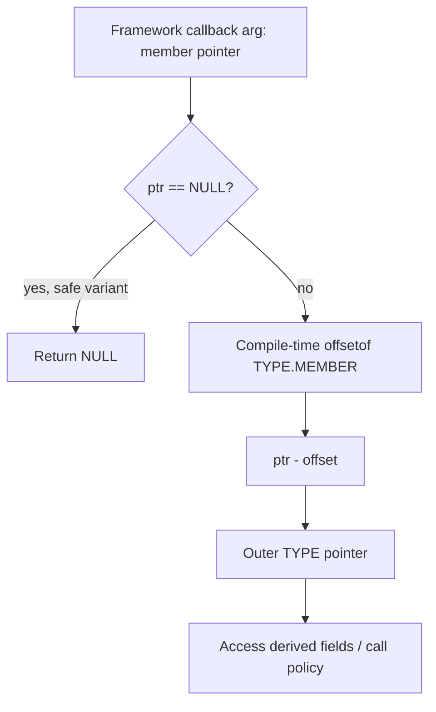

# 第六部分：深入理解 container_of

> **本章目标**：把 `container_of` 从「会用的宏」升级为「能推导、能质疑、能安全手写」的对象模型核心工具。  
> 读完后你应能诚实回答三件事：它为什么是 Kernel OO 最重要的宏；经典零地址写法为何在严格 ISO C 下是 UB；现代内核为何仍能在实践中安全使用它。

第 4 章建立了代数直觉。本章做一次彻底推导：从内存布局到 `offsetof`，从 GNU 扩展到类型检查，从历史技巧到 `__builtin_offsetof`，再到 `container_of_const` / `container_of_safe` 的演化动机。

---

## 12.1 为什么说它是 Kernel OO 最重要的宏

Kernel 的三大支柱里：

- `struct` 人人会写；
- 函数指针人人会挂；
- 唯独 **从基类成员指针回到完整派生对象** 这件事，没有语言级 downcast，必须靠约定 + 地址算术。

`container_of` 正是把这条约定压缩成一行可审查的表达式。没有它：

- 通用框架只能看见 `device` / `list_head` / `work_struct`；
- 具体驱动状态要么塞进 `void *private`（关联，而非继承），要么散落在全局表；
- 「嵌入即 is-a」的继承模型无法闭环。

因此它不是语法糖，而是 **继承恢复协议的可执行形式**。说它是最重要的 OO 宏，不是修辞，而是因为：ops 解决「调谁」，`container_of` 解决「调到之后 `self` 是谁」。

把视野放到整个 Kernel Object Model 上会更清楚：第一支柱让你「有一个对象」；第二支柱让你「对对象做虚调用」；但如果回调入口类型永远是基类指针，实现方就无法触及派生字段。此时若没有第三支柱，整个 OO 配方会在「多态调用刚刚发生」的那一刻断裂。`container_of` 正好补上断裂点——它让框架继续保持对派生类型无知，同时让驱动在自己的翻译单元里安全地回到完整对象。这种「无知框架 + 知情实现」正是大规模插件化的前提。

再对比两条常见替代路径，更能看出它的不可替代性。路径 A：把派生指针塞进 `void *private`。有效，但是 **关联**，需要额外存储、额外约定，生命周期容易与基类对象分叉。路径 B：在框架里写 `switch (type)` 认出派生类型。有效，但是 **反插件化**，每多一种实现就改核心。嵌入 + `container_of` 同时避开这两条路：布局上是 is-a，恢复上是减法，扩展上是加模块。

```
Framework path sees:     &obj->base
Implementation needs:    &obj
Bridge:                  container_of(&obj->base, typeof(obj), base)
```

还可以用「两个世界」来记：

```
Framework world:  only base view + ops contract
Driver world:     full derived object + private policy
Portal between:   container_of at callback entry
```

没有这座门户，两个世界只能靠 `void *` 偷渡；有了这座门户，继承关系被写进内存布局本身，审查者可以直接从结构体定义验证 is-a，而不必相信某份口头约定。

---

## 12.2 从内存布局逐步推导 offsetof

假设教学结构体（字段宽度仅示意，真实对齐由 ABI 决定）：

```
struct derived {
    int   id;       /* offset 0,  size 4 */
    char  tag;      /* offset 4,  size 1 */
    /* pad to align base if needed */
    struct base b;  /* offset 8 (example) */
    long  priv;     /* after base */
};
```

地址标尺（假设 `derived` 起始于 `P`）：

```
P + 0x00  +------------------+
          | id               |
P + 0x04  +------------------+
          | tag              |
P + 0x05  +------------------+
          | padding...       |
P + 0x08  +------------------+  <-- &d->b   = P + offsetof(derived, b)
          | struct base b    |
          |   ...fields...   |
P + 0x20  +------------------+  <-- example end of b
          | priv             |
P + 0x28  +------------------+
```

定义：

```
offsetof(TYPE, MEMBER) = (byte address of MEMBER) - (byte address of TYPE instance)
```

对任意合法实例 `d`：

```
&d->b  ==  (char *)&d  +  offsetof(struct derived, b)
```

移项即得恢复公式：

```
(char *)&d  ==  (char *)&d->b  -  offsetof(struct derived, b)
```

把 `&d->b` 换成任意「指向嵌入成员」的指针 `ptr`，就得到 `container_of`：

```
container = (TYPE *)( (char *)ptr - offsetof(TYPE, MEMBER) )
```

关键性质：

- 偏移是 **编译期常量**（标准布局、固定嵌入成员）；
- 运行时通常只是一次指针减法；
- 正确性依赖 **ptr 真的指向 TYPE 内的 MEMBER**，不是运行时类型检查。

逐步推导请按这五步在纸上自己算一遍（教学训练比背宏重要）：

1. 选定一个具体 `TYPE` 与 `MEMBER`，画出字段顺序与对齐填充。  
2. 假设实例基址为 `P`，标出 `&obj->MEMBER = P + OFF`。  
3. 写出恒等式 `(char *)obj + OFF == (char *)member_ptr`。  
4. 移项得到 `obj == member_ptr - OFF`。  
5. 把 `OFF` 替换成 `offsetof(TYPE, MEMBER)`，就得到宏的代数核。

对齐与填充不会破坏公式，只会改变 `OFF` 的具体数值。真正会破坏公式的是：位域、编译器特殊布局属性、或者你对「看起来像成员、其实是独立对象」的指针误用。也正因为偏移由布局决定，**同一源码在不同 ABI/对齐选项下 OFF 可能不同**，但只要编译器对 TYPE 的布局自洽，该编译单元内的 `container_of` 仍然正确——这再次说明它依赖的是编译期布局合同，不是运行期魔法。

若成员位于结构体开头（offset 为 0），恢复在数值上等于强制类型转换；这是特例，不是一般方法。Kernel 大量嵌入并不在偏移 0（例如中间的 `list_head`、尾部附近的 `work_struct`），所以必须掌握一般的减法形式，而不是依赖「基类碰巧在开头」。

---

## 12.3 typeof 与 GNU 扩展扮演的角色

手写时你需要：

1. 知道 `ptr` 的静态类型，以便与 `TYPE.MEMBER` 比对；
2. 在宏里生成临时变量，避免对 `ptr` 副作用求值两次；
3. 在不依赖 C11 `_Generic` 的老代码路径上做类型检查。

GNU C 的 `typeof(expr)`（以及内核封装的 `__typeof__`）让宏可以：

```
pseudocode

#define container_of(ptr, type, member)
    ({
        typeof( ((type *)0)->member ) *__mptr = (ptr);
        (type *)( (char *)__mptr - offsetof(type, member) );
    })
```

要点：

- `typeof( ((type *)0)->member )` 只取 **成员类型**，用于声明 `__mptr`；
- 赋值 `__mptr = (ptr)` 若类型不兼容，编译器会告警/报错——这是轻量类型检查；
- GNU statement-expression `({ ... })` 让宏返回值，并限制临时变量作用域。

这不是「炫技」，而是把 **继承恢复** 从「程序员心算」提升为「编译器可协助核对」的契约。

---

## 12.4 零地址技巧：((TYPE *)0)->member

历史教学写法：

```
pseudocode

offset = (size_t)&( ((TYPE *)0)->member )
```

人们常说：「这并不解引用空指针。」直觉依据是：

1. 表达式的顶层操作是 **取地址** `&(...)`，而不是读取成员的值；
2. 编译器在常量折叠阶段把「零基址 + 成员偏移」算成整数常量；
3. 目标代码里通常 **不会** 出现对地址 0 的 load/store。

用 ASCII 表达「编译器眼里发生的事」：

```
Source view:     &(((TYPE *)0)->member)
                      |
                      v
Abstract:        address_of( member_at(base=0, offset=OFF) )
                      |
                      v
Folded:          constant OFF
                      |
                      v
No runtime null load in typical codegen
```

所以「不解引用」指的是：**意图与常见代码生成路径上没有对 null 对象的值读取**。它是对编译器行为的经验描述，不是 ISO C 语义定理。

为了把争论说清楚，请区分三个层次：

1. **程序员意图层**：我只要偏移，不要读内存。  
2. **代码生成层**：优化后通常确实没有 null load。  
3. **语言标准层**：形成 `((TYPE *)0)->member` 这种成员左值，本身就可能已经踏入未定义行为；标准并不因为「你后来取了地址」就自动赦免。

很多人把第 2 层误当成第 3 层。教学上可以继续用零地址帮助建立直觉，但工程结论必须升到：用编译器提供的、专门用于求偏移的原语。另一个常见误解是：「既然取地址，就一定安全。」并非如此。C 的未定义行为讨论的是抽象机语义是否允许该表达式；它不是「最终机器码有没有 crash」的同义词。某次编译碰巧生成了你想要的常量，并不能证明下一次优化、另一个编译器、另一种清洗选项仍然如此。

---

## 12.5 诚实的真相：严格 ISO C 下这是 Undefined Behavior

必须把话说死：

> 在严格 ISO C 语义里，对空指针指向的对象形成左值并取成员，通常落入 **Undefined Behavior（UB）** 范畴。  
> 「我们只是算地址、没有 load」并不能 magically 让标准保证其定义。

它之所以几十年「能用」，是因为：

- GCC/Clang 把这种写法当作 **偏移计算的既成合同**；
- 内核与编译器工具链长期共同维护这条合同；
- 实际代码生成符合程序员预期。

但这不等于「标准允许」。可移植用户代码若照搬，在另一个严格解释的编译器上可能被合法地「优化坏」或直接拒绝。诚实的工程师应当同时握住两句话：第一句，**历史技巧解释了宏的几何直觉**；第二句，**现代代码应以 `__builtin_offsetof` 为合同界面**。只背第一句会把 UB 美化成标准特性；只背第二句又会丢掉「为什么减法等于继承恢复」的几何图像。本章坚持两句一起讲。

现代 Linux Kernel 的正确态度是：

```
Do not rely on classic zero-address offsetof as a portable language rule.
Use the compiler intrinsic: __builtin_offsetof(TYPE, MEMBER)
```

`__builtin_offsetof` 的意义：

- 把「求成员偏移」提升为 **编译器内建原语**；
- 语义由实现定义并保证可用于常量上下文；
- 避开「我对 null 做了什么」的标准灰色地带。
- 让 `container_of` 的正确性论证从「我们赌编译器传统」转为「我们调用实现保证的偏移原语」。

教学伪代码：

```
pseudocode

/* historical intuition (do not treat as ISO-proof) */
old_offsetof(type, member):
    return (size_t)&(((type *)0)->member)

/* modern contract */
offsetof(type, member):
    return __builtin_offsetof(type, member)

container_of(ptr, type, member):
    return (type *)((char *)(ptr) - offsetof(type, member))
```

---

## 12.6 为什么实践中 container_of 仍然可以安全使用

「经典 offsetof 写法有 UB 阴影」与「`container_of` 在内核里不安全」是两件不同的事。

实践安全来自四层合同叠加：

1. **偏移原语现代化**：偏移由 `__builtin_offsetof` 提供，不再依赖零地址算术的标准辩护。  
2. **布局合同**：嵌入成员的布局由 ABI 与结构体定义固定；恢复公式是纯地址变换。  
3. **架构不变量**：框架保证「传给你的 `list_head *` / `device *` 一定来自某类对象的嵌入成员」。  
4. **生命周期协议**：在持有正确锁/引用期间使用恢复后的指针；宏本身不延长寿命。

因此：

```
Safe in practice  =  builtin offsetof
                  +  true embedding
                  +  correct type/member pair
                  +  valid object lifetime
```

不安全的通常不是宏，而是：**对非嵌入指针做恢复、写错 type/member、在对象已释放后仍用结果**。

### 合同分层检查清单

把「可以安全使用」拆成可勾选条款，避免变成信仰：

- **条款 A：偏移原语合法** —— 使用 `__builtin_offsetof`，不要在新代码里手写零地址技巧冒充可移植。  
- **条款 B：嵌入关系真实** —— `MEMBER` 必须是 `TYPE` 的真实字段，且运行时指针确实指向该字段。  
- **条款 C：类型对匹配** —— 三元组与数据出身路径一致；优先走 `to_xxx()` 包装。  
- **条款 D：对象仍活着** —— 恢复前已有锁/RCU/引用保护；跨临界区必须按协议 `get`。  
- **条款 E：const / NULL 语义被尊重** —— 只读路径保留 const；可能为空时用 safe 变体。

与 C++ `static_cast` 对照：二者往往都是编译期偏移调整；Kernel 把它写成可见宏，且都不提供 RTTI 式动态确认。故 `container_of` 是 **基于布局合同的 static downcast**，不是 `dynamic_cast`。

---

## 12.7 手写带类型检查的 container_of（__same_type 风格）

教学版（表达意图，非拷贝内核源码）：

```
pseudocode

/* same-type check: compile-time compatibility probe */
same_type(a, b):
    return __builtin_types_compatible_p(typeof(a), typeof(b))

BUILD_BUG_ON_MSG(cond, msg):
    if cond is true at compile time: fail build with msg

container_of(ptr, type, member):
    ({
        void *__mptr = (void *)(ptr);
        BUILD_BUG_ON_MSG(
            !same_type(*(ptr), ((type *)0)->member) &&
            !same_type(*(ptr), void),
            "pointer type mismatch in container_of()"
        );
        ((type *)(__mptr - offsetof(type, member)));
    })
```

设计意图拆解：

- 用 `typeof(*(ptr))` 与 `typeof(((type *)0)->member)` 做兼容性检查；
- 允许 `void *` 作为宽松入口（某些通用回调只有无类型指针）；
- 不匹配则 **编译失败**，把本该在运行期炸的布局错误前移；
- 真正算术仍是：`ptr - offsetof`。

心智模型：

```
+------------------+     type check      +------------------+
| caller ptr type  |-------------------> | member field type|
+--------+---------+                     +--------+---------+
         |                                         |
         | ok                                      |
         v                                         v
   subtract offsetof(type, member) ------> typed outer pointer
```

注意：即使有 `__same_type` 风格检查，也 **挡不住**「ptr 指向另一对象里碰巧同名同类型的成员」。类型检查验证的是静态类型一致性，不是动态出身证明。出身证明仍靠子系统不变量。

---

## 12.8 container_of_const 与 container_of_safe：演化与动机

### container_of_const：保留 const 资格

经典 `container_of` 若粗暴写成非 const `type *`，会把 `const` 成员指针「洗成」可变外层指针，破坏 const 正确性。

动机：

- 从 `const struct base *` 恢复时，结果应是 `const struct derived *`；
- 从可变基类恢复时，结果仍是可变派生指针；
- const 应随输入传播，而不是被宏吞掉。

概念行为：

```
input:  const member *  -> output: const type *
input:        member *  -> output:       type *
```

这让「只读路径」与「可写路径」在类型系统上可区分，减少通过恢复宏绕过 const 的后门。

### container_of_safe：空指针友好的恢复

动机来自真实代码模式：回调或查找可能得到 `NULL` 成员指针。经典宏对 `NULL` 做减法会得到「非空但无意义」的伪对象指针，极危险。

`container_of_safe` 的概念语义：

```
pseudocode

container_of_safe(ptr, type, member):
    if ptr == NULL:
        return NULL
    else:
        return container_of(ptr, type, member)
```

它不是新的继承理论，而是 **把空值传播变成显式、可审查的约定**：  
「没有成员指针，就没有外层对象视图」。

演化总结：

```
container_of
    |-- correctness of address math
    |
    +--> + type check     (catch static mismatch early)
    |
    +--> + const-aware    (container_of_const)
    |
    +--> + NULL-aware     (container_of_safe)
```

---

## 12.9 完整心智模型与示例

### 心智模型一句话

> **嵌入建立 is-a 布局；offsetof 给出编译期距离；container_of 用减法恢复派生对象；类型检查与 const/NULL 变体只是让契约更硬、更不易误用。**

### 教学示例：work 回调回到设备对象

```
pseudocode

struct my_dev {
    int power;
    struct work_struct work;   /* embedded */
};

void my_work_fn(struct work_struct *work):
    struct my_dev *d = container_of(work, struct my_dev, work)
    /* use d->power ... */

/* registration path embeds work inside my_dev;
 * framework only ever queues &d->work */
```

ASCII：

```
+---------------------------+
| struct my_dev             |
|  power                    |
|  work  <------------------+---- framework holds this pointer
|    .func = my_work_fn     |
+---------------------------+
              |
   container_of(work, my_dev, work)
              v
        full my_dev *
```

### Mermaid：从成员指针到派生对象



---

## 12.10 陷阱清单（必须刻意练习）

1. **对非嵌入成员使用**  
   `ptr` 指向独立分配的对象，却按嵌入假设回退——结果是随机地址解释。

2. **type / member 写错**  
   同名成员存在于另一结构体时，类型检查也可能放过；偏移按错误类型计算。

3. **以为有昂贵运行时代价**  
   正常路径是常量偏移 + 指针减法；成本在错误使用后的调试，不在 CPU。

4. **恢复后忘记生命周期**  
   宏不做 get/put。在 RCU/锁外继续用恢复指针，是 UAF 配方。

5. **把零地址 offsetof 当标准真理**  
   教学可讲，可移植代码与现代内核应依赖 `__builtin_offsetof`。

6. **丢失 const**  
   只读路径被洗成可写外层指针，制造 const 漏洞。

7. **对 NULL 盲目 container_of**  
   得到非空野指针；需要空值传播时用 safe 变体或显式判断。

---

## 12.11 本章小结

- `container_of` 是 Kernel OO 的继承恢复手术刀：没有它，嵌入式 is-a 无法在回调中闭环。  
- `offsetof` 来自布局几何；现代实现应使用 `__builtin_offsetof`。  
- 经典 `((TYPE*)0)->member` 零地址技巧在直觉上「不算解引用」，但在严格 ISO C 下仍是 UB；能用是因为编译器合同，不是标准豁免。  
- 实践安全 = 内建偏移 + 真嵌入 + 正确类型对 + 有效生命周期。  
- 手写时应加入 `__same_type` 风格检查；`container_of_const` / `container_of_safe` 分别修复 const 传播与 NULL 语义。

下一章把镜头拉远：在 C++ / Java / Rust / Go 的对照下，解释为什么「没有 class 的 Kernel」往往比许多 C++ 项目更 OO、更可插拔、接口更稳定。

---

## 12.12 练习：把直觉变成可证明步骤

建议用纸笔完成：

1. 自选一个三字段结构体，手算每个字段偏移（含对齐假设）。  
2. 给定「中间字段指针」，手算外层地址，再与 `container_of` 公式对照。  
3. 故意写错 `member` 名，观察类型检查能否拦住；若拦不住，写出你会如何用 `to_xxx` 包装防御。  
4. 用一句话回答：为什么说零地址技巧「通常不 load」，却仍可能是 UB？  
5. 用一句话回答：为什么改用 `__builtin_offsetof` 后，`container_of` 的实践安全性上升？

若五问都能不看讲义答出，本章目标达成：你不但会用宏，还能在设计评审里捍卫或否决一次 `container_of` 的使用。
