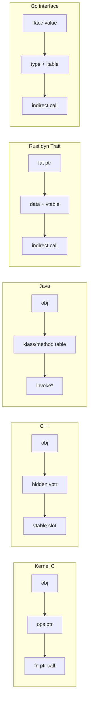

# 第七部分：为什么说 Linux Kernel 比很多 C++ 更 OO

> **本章命题**：面向对象首先是 **设计能力**（抽象边界、可替换实现、稳定接口、可插拔扩展），不是语言关键词。  
> Linux Kernel 用纯 C 把对象模型写成强制架构；许多 C++ 项目虽有 `class` / `virtual`，却把边界、ABI 与生命周期留在「可选风格」里——于是 Kernel 反而更 OO。

这里的「更 OO」不是说 Kernel 语法更高级，而是说：**模块边界更清晰、接口更稳定、插件化更彻底、动态分发更显式可推理**。

---

## 13.1 先对齐比较维度

比较五种对象模型时，固定看五件事：

- **分发机制（Dispatch）**：调用点如何找到最终实现  
- **ABI 稳定性**：接口演进时二进制/源码边界能否守住  
- **模块性（Modularity）**：子系统能否独立理解与替换  
- **可插拔性（Pluginability）**：新实现能否在不改框架核心的前提下挂入  
- **可扩展性（Extensibility）**：扩展是加表项/加模块，还是改基类巨型层次

---

## 13.2 五种对象模型速写

### Kernel C（显式对象协议）

- 对象 = `struct` 实例  
- 方法 = `const struct foo_ops *` 函数指针表  
- 继承 = 嵌入基类 + `container_of` 恢复  
- 分发 = `obj->ops->method(obj, ...)`（自我指针显式）  
- 没有隐藏 this 调整、没有异常表、没有强制 RTTI

### C++（语言级 class OO）

- 对象 = class 实例；方法可静态绑定或虚调用  
- 分发 = vtable（编译器生成）；多重继承还有 thunk/调整  
- 继承/多态/封装由语言直接表达  
- ABI 依赖 Itanium C++ ABI 等约定，跨编译器/版本脆弱面更大  
- 模板、内联、头文件实现常把「接口」与「实现」焊死在编译期

### Java（托管运行时 OO）

- 一切几乎皆对象；接口 + 虚调用是默认路径  
- 分发 = 方法表 / invokevirtual / invokeinterface  
- 强类型接口很好用；但依赖 JVM、GC、反射生态  
- 二进制兼容靠 class 文件契约；内核式无 GC 热路径不适用  
- 插件化强，但运行时与安全模型完全不同

### Rust Trait（静态优先的能力抽象）

- Trait 描述能力；`dyn Trait` 才是运行期胖指针分发  
- 默认偏向静态分发（单态化），性能友好、特化清晰  
- 对象安全、生命周期、所有权进入类型系统  
- 动态插件与稳定 C ABI 边界需要刻意设计（`repr(C)`、vtable 手写等）  
- 抽象强，但对「几十年稳定的 C 插件 ABI」不是默认赠品

### Go Interface（隐式满足的运行期接口）

- 类型只要实现方法集即满足 interface（结构化定型）  
- 分发 = interface 值里的动态类型信息 + itable  
- 插拔体验好，适合服务端模块  
- 方法集演化、nil interface 坑、以及 GC 假设，与内核约束不合  
- 「隐式满足」降低声明成本，也降低「显式契约文档」压力——双刃剑

---

## 13.3 分发机制对比（谁在运行期做决定）

- **Kernel C**  
  - 显式加载 `ops` 指针，再间接调用。  
  - 调用点一眼可见「这里会发生动态绑定」。  
  - 可选方法为 NULL 时的回退策略也是显式契约。

- **C++**  
  - `virtual` 调用经 vptr/vtable；非虚则静态绑定。  
  - 多重继承、虚继承让 this 调整成为隐藏控制流。  
  - 模板常把多态从运行期挪到编译期——快，但插件边界变差。

- **Java**  
  - 几乎默认虚分发；JIT 可去虚化。  
  - 对应用开发友好；对「无运行时、可在原子上下文推理」不友好。

- **Rust Trait**  
  - 静态分发为主；`dyn Trait` 才接近 ops 表。  
  - 所有权使其在安全抽象上更强，但内核式「C 函数指针表 ABI」需另建。

- **Go Interface**  
  - 赋值给 interface 时建立动态类型；调用经 itable。  
  - 非常适合进程内插件；不是内核热路径模型。

Mermaid：同一次「多态调用」在不同世界里的形状



Kernel 的独特优点：**动态分发是数据，不是魔法**。你可以打印 ops、替换 ops、在 code review 中争论某个函数指针是否该为 NULL——全部发生在普通 C 可见性里。

---

## 13.4 ABI 稳定性：为什么 Kernel 常常更「接口硬化」

- **Kernel C**  
  - 对外模块常见策略是：**稳定用户 ABI，对内允许打破，但用显式 ops/结构体版本与审查约束扩展**。  
  - 函数指针表是「窄接口」：框架只依赖表中已知槽位。  
  - 结构体扩展有成熟文化（末尾加字段、能力位、版本协商），且布局完全可控。

- **C++ 项目常见失败模式**  
  - 头文件里内联虚函数/模板实现 → 任何实现细节变动都迫使全世界重编译。  
  - 暴露太多 class 层次 → 基类加字段即 ABI 地震。  
  - 异常、RTTI、不同标准库/编译器组合 → 插件二进制难以长期共存。  
  - 「我们用了 C++」并不自动得到稳定接口；稳定接口是额外纪律。

- **Java / Go**  
  - 有自己的二进制/发布契约，但依赖托管运行时；不是内核模块模型。

- **Rust**  
  - 源码兼容与 API 演进工具强；稳定 `cdylib` 插件 ABI 仍要工程师显式设计。

比较论点（请用条目思考，不要只看关键词）：

- Kernel 把接口写成 **ops 表 + 文档化语义**，实现放在别的翻译单元。  
- 许多 C++ 代码把接口写成 **可继承基类 + 一堆工具函数内联**，边界渗漏。  
- 因此：语言越「OO」，项目越可能误以为边界会自动清晰；Kernel 没有幻觉，只能把边界写出来。

---

## 13.5 模块性与可插拔性：框架 vs 策略

Kernel 反复使用同一句架构口诀：

> **Framework owns the protocol；driver/module owns the policy.**

含义：

- VFS / Driver Model / Networking core 定义对象与 ops 契约；  
- ext4 / e1000 / specific scheduler class 填表；  
- 新实现 = 新模块填同一张表，而不是改 `switch (type)` 巨型函数。

对照：

- **C++**：也能做 Strategy/Plugin；但若基类膨胀、动态库 ABI 不稳、异常穿过边界，插件成本会迅速上升。  
- **Java**：SPI / 接口注入很强；代价是运行时与反射文化。  
- **Rust**：crate 边界清晰；动态加载与稳定 ABI 需额外层。  
- **Go**：interface 插拔顺手；隐式满足可能让「谁承诺了什么」变模糊。

Kernel 更强的地方在于：**插拔不是风格推荐，而是子系统准入形状**。你想进 VFS，就得提供能被挂上的对象与 ops；没有第三种「顺便继承一下基类」的歪路。

ASCII：插件挂载的共同形状

```
+------------------+         +------------------+
| Framework core   |         | Plugin / Driver  |
|  - object type   |         |  - derived state |
|  - ops contract  |<--fill--|  - ops instance  |
|  - lifecycle API |         |  - register()    |
+--------+---------+         +--------+---------+
         |                            |
         +--------- register ---------+
         |
         v
   runtime dispatch via ops
```

---

## 13.6 可扩展性：加实现，而不是改宇宙

- Kernel 扩展通常是 **加一张 ops 实例 / 加一个嵌入派生对象**。  
- 公共路径保持算法稳定：权限、锁、引用、日志、追踪留在框架。  
- 这逼迫设计者把「可变点」提前声明为函数指针槽位。

许多 C++ 代码库的相反路径：

- 先做深继承树；  
- 再在基类加 `protected` 钩子；  
- 再发现钩子不够，开始改虚函数默认实现；  
- 最终框架与所有派生类一起抖动。

不是 C++ 不能做好——优秀的 C++（如部分游戏引擎、COM 风格接口）同样走「窄 vtable / 显式接口」。  
本章的锋芒对着 **「有 class 却无对象边界」的平庸 C++**，不是对着整个语言。

---

## 13.7 为什么「没有 class」反而可能更抽象

抽象的标志不是关键字，而是：

- 调用方是否可以依赖稳定契约而不知道实现类型；  
- 实现方是否可以替换而不迫使框架重写；  
- 对象生命周期与所有权是否有唯一叙述。

Kernel 用三支柱强制这三点：

1. `struct` 固定「什么是对象」；  
2. `ops` 固定「什么叫可替换行为」；  
3. `container_of` 固定「实现如何在回调里回到自己」。

于是出现反直觉结论：

- Kernel **没有** class，但到处是清晰对象；  
- 某些 C++ 项目 **有** class，却到处是互相 include 的实现细节与不稳定基类。

一句话：

> **OO 的质量取决于边界是否被强制执行，而不是语法是否提供 class。**

---

## 13.8 综合对照清单（长论点用条目，不用大表）

**动态分发是否显式？**

- Kernel：显式 ops 指针。  
- C++：虚函数隐式 vptr；模板常无运行期分发。  
- Java/Go：默认动态。  
- Rust：默认静态，`dyn` 才动态。

**跨模块长期演进谁更硬？**

- Kernel：靠窄 C ABI 文化与审查。  
- C++：若暴露 class 布局/异常，很容易脆。  
- Java/Go/Rust：各有生态解法，但模型不同。

**新驱动/新协议加进来要改谁？**

- Kernel：理想情况只加模块与注册。  
- 坏的 C++：改基类、改工具头、全树重编。  
- 好的 C++/Rust/Java/Go：同样可以只加插件——关键是接口是否真窄。

**能否在中断/原子上下文推理控制流？**

- Kernel：无异常展开，函数指针调用可见。  
- C++：异常与复杂对象生命周期增加推理成本。  
- 托管语言：另当别论。

---

## 13.8.1 更深一层：显式性本身就是可扩展性

许多关于「哪种语言更 OO」的争论停在语法糖层面。对 Kernel 这种超大规模、超长生命周期、跨公司协作的系统而言，真正稀缺的是 **显式契约**：

- 显式对象：状态在哪个 struct，一目了然；  
- 显式方法表：可变点在哪个函数指针槽，一目了然；  
- 显式恢复：从基类回到派生的位置，一目了然；  
- 显式生命周期：get/put/release 写在协议里，而不是藏在析构副作用里。

C++ 完全可以做到同样显式——优秀项目往往手写 vtable 风格接口、禁用异常、稳定 C ABI 边界。但语言默认能力越强，团队越容易沉没成本式地「先继承再说」「先模板再说」「先抛异常再说」。Kernel 的贫困（没有 class）反而变成富矿：它逼迫设计者把对象模型当成架构交付物。

这也是本章标题里「比很多 C++ 更 OO」的精确量化方式：

- 更 OO，不是指继承层次更深；  
- 更 OO，是指抽象边界更硬、插件替换成本更低、接口演进更可治理、动态绑定更可审查。

若拿「优秀的 C 接口风格 C++」与 Kernel 比，差距会缩小；若拿「随意继承与头文件实现细节横飞的 C++」与 Kernel 比，差距会刺眼。本书瞄准的是后一种常见现实，以便读者把 Kernel 的纪律迁移回自己的用户空间项目——哪怕那些项目用的是 C++、Rust 或 Go。

## 13.8.2 给架构师的迁移建议

如果你在用户空间主导一个需要插件化的系统，可以从 Kernel 借四条，而不必「重写成内核风格 C」：

1. **先写窄接口表，再写实现类/结构体。** 不要先堆基类字段。  
2. **让框架依赖接口，不依赖实现头文件里的私有细节。**  
3. **生命周期协议与方法表一起评审。** 没有 release 叙事的对象模型是半成品。  
4. **动态分发点要少、要显眼、要文档化。** 到处虚函数并不等于好 OO。

这四条在 C++/Java/Rust/Go 里都能落地。Kernel 只是把它们逼到了极致，从而成为教科书级样本。

## 13.9 本章小结：回到三大支柱

Linux Kernel「比很多 C++ 更 OO」的真正意思是：

- 它把对象、方法、继承恢复写成 **可审查的数据与宏**；  
- 它用框架/策略分离获得真正的插件化；  
- 它让动态绑定在源码中显形，从而让大规模协作成为可能。

三大支柱再次合龙：

1. **`struct`** —— 对象、状态、生命周期与关系的唯一载体；  
2. **`ops`（函数指针表）** —— 接口、多态与动态绑定的显式 vtable；  
3. **`container_of` + 嵌入** —— 无语言继承时的 is-a 恢复手术刀。

下一章把全书收成一条思维链，并给出读 Kernel 源码时的九问 Checklist。
