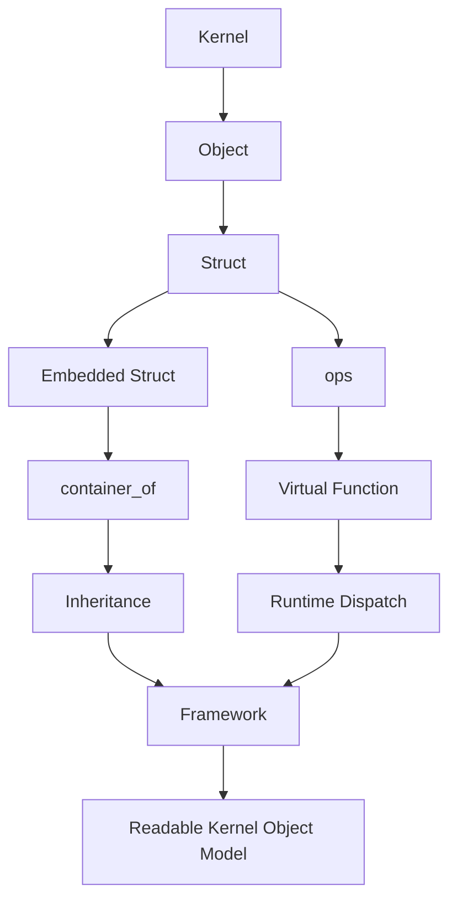

# 第八部分：建立最终心智模型

> **从「Everything is a struct」走到「Everything is an Object」。**  
> 不是更换口号，而是完成同构映射：在 Kernel 里，对象的物理形态永远是结构体实例；对象的行为、继承与协作，全部由三大支柱显式编码。

本章把全书压成一条可背诵的思维链，并给出阅读任意子系统时的 **九问 Object Model Checklist**。以后你打开陌生文件，不应先问「这个函数干什么」，而应先问「对象在哪里」。

---

## 14.1 同构映射：struct 世界与 Object 世界

```
Userspace OO slogan:     Everything is an Object
Kernel precise slogan:   Everything is a struct
Mapping:                 Object  ≅  live struct instance
```

展开：

- Object 的 **身份** = 结构体实例地址（再加子系统定义的引用规则）；  
- Object 的 **状态** = 字段；  
- Object 的 **方法** = ops 表中的函数指针（显式 self）；  
- Object 的 **继承** = 嵌入基类成员 + `container_of`；  
- Object 的 **多态** = 运行期选择不同的 ops 实例；  
- Object 的 **框架** = 只依赖基类视图与 ops 契约的公共算法。

因此读 Kernel 时说「找对象」，翻译成工程动作就是：**找承载状态与生命周期的那颗 struct，再找它的 ops 与嵌入关系。**

---

## 14.2 统一思维链（必须能默写）

ASCII 主链：

```
Kernel
  |
  v
Object
  |
  v
Struct                    <--- 物理载体
  |
  +-- Embedded Struct     <--- is-a 布局
  |         |
  |         v
  |   container_of        <--- 继承恢复
  |         |
  |         v
  |   Inheritance
  |
  +-- ops table           <--- 方法/接口
            |
            v
      Virtual Function    <--- 槽位语义
            |
            v
      Runtime Dispatch    <--- obj->ops->fn
            |
            v
      Framework           <--- 稳定协议 + 可插拔策略
```

Mermaid（同一条链的流程图视图）：



口诀版（九步缩成一句）：

> **结构体成对象，嵌入成继承，container_of 找回自己，ops 做虚调用，框架只认契约。**

---

## 14.3 九问 Kernel 阅读 Object Model Checklist

把下面九问当成代码阅读仪表盘。每一问都给出「在源码里如何作答」。

### 1. Object 在哪里？

**问什么**：谁是运行期实体？谁有身份、状态、可被引用？

**如何作答**：

- 找被分配、被引用计数、被挂进树/链表/哈希的 `struct xxx`；  
- 典型信号：`alloc`/`get`/`put`/`register`/`unregister` 围绕同一类型转；  
- 区分「临时栈上描述符」与「堆上长寿命对象」。

### 2. Base Struct 在哪里？

**问什么**：框架看见的通用视图是什么？

**如何作答**：

- 找公共 API 参数类型：`struct device *`、`struct inode *`、`struct sock *`；  
- 找被多个派生共享的嵌入成员类型；  
- 基类字段通常表达：名字、父指针、锁、引用、ops 指针、通用链表节点。

### 3. Derived Struct 在哪里？

**问什么**：实现私有状态住在哪？

**如何作答**：

- 找「外层结构体里嵌入了基类」的定义；  
- 找 `to_xxx()` / `XXX_I()` / `dev_get_drvdata` 等恢复路径的目标类型；  
- 派生字段应是策略相关：硬件寄存器、协议控制块、文件系统私有布局。

### 4. ops 在哪里？

**问什么**：可替换行为表是哪一张？挂在哪个对象上？

**如何作答**：

- 搜 `*_operations` / `*_ops` / `*_type` 中的函数指针集；  
- 看对象字段：`f_op`、`i_op`、`netdev_ops`、`ktype`…  
- 确认表是否 `const`、是否只读共享、是否可在运行期切换。

### 5. container_of 在哪里？

**问什么**：从基类/成员视图回到派生对象的边界点？

**如何作答**：

- 在回调第一行附近找恢复宏或 `to_*` 包装；  
- 确认 member 名称与嵌入字段一致；  
- 若用 `private`/`drvdata` 而非嵌入，记录为「关联恢复」而非「继承恢复」。

### 6. 谁拥有谁？

**问什么**：对象图上的所有权边如何走？

**如何作答**：

- 画 ASCII：父对象、孩子列表、指向 ops 的指针、指向私有数据的指针；  
- 分清 **拓扑父**（device parent）与 **容器父**（嵌入外层）；  
- 问：释放 A 是否必须先使 B 不可达？

### 7. 生命周期是谁管理？

**问什么**：创建、销毁、最后一次引用落下的职责在谁？

**如何作答**：

- 找 `get/put`、`kref`、`kobject_put`、module 引用、`devm_*`；  
- 找 `release` 回调：那是真正的析构点；  
- 确认错误路径是否对称释放；忘记 release 就是泄漏协议漏洞。

### 8. 动态绑定发生在哪里？

**问什么**：哪一个调用点不再静态知道最终函数？

**如何作答**：

- 找 `obj->ops->method(...)` 形态；  
- 记录该方法的契约：能否睡眠、锁前提、NULL 是否允许；  
- 区分「一次绑定（注册时填表）」与「每次调用分发」。

### 9. 对象之间如何协作？

**问什么**：一次请求跨越哪些对象？各对象贡献什么？

**如何作答**：

- 沿指针走完调用链：例如 `file` → `inode` → `mapping` → `address_space_operations`；  
- 标出框架对象与驱动对象的交接面；  
- 用一句话写清：谁编排流程，谁执行策略。

---

## 14.3.1 九问的使用顺序与常见卡点

九问不是平行问卷，而有推荐顺序：

```
1 Object -> 2 Base -> 3 Derived -> 4 ops -> 5 container_of
                 \
                  +-> 6 Ownership -> 7 Lifetime
                 /
         8 Dispatch  ,  9 Collaboration
```

前五问建立「类型与行为骨架」；六、七问建立「生死与所有权」；八、九问建立「运行期故事」。很多人卡在第 1 问：看到函数就开读。纠正方法是强迫自己先写下结构体名字，哪怕暂时猜错，也比沉进辅助函数海洋更接近对象模型。

另一常见卡点是第 6 问与第 2 问混淆：把「嵌入外层」当成「设备树父节点」。二者都叫 parent 很危险。阅读时请强制使用两个词：

- **container outer**：布局上的外层对象（`container_of` 的目标）；  
- **topology parent**：对象图上的父节点（sysfs/device 树）。

第 5 问也常被跳过：有人看见 `drvdata` 就说「没有 container_of」。请诚实记录：「本路径用关联指针恢复，而非嵌入恢复」。Checklist 的目标是看见真相，不是强行把一切塞进同一种手法。

### 把九问写成阅读注释模板

在笔记里可以直接粘贴：

```
[Subsystem]
Object:
Base:
Derived:
ops:
Recovery (container_of / drvdata / other):
Owner edges:
Lifetime protocol:
Dispatch site(s):
Collaboration path:
Pillar-1 one-liner:
Pillar-2 one-liner:
Pillar-3 one-liner:
```

连续做十次，你会发现不同子系统的「填空内容」变了，但表格形状几乎不变——这就是心智模型内化的证据。

## 14.3.2 从九问反推设计：写新框架时怎么用

九问不只服务阅读，也服务设计。当你要新写一个小型框架（例如插件式协议解析、设备模拟、策略引擎），先按九问的逆序做设计评审：

1. 先定义协作路径（第 9 问）：一次请求跨哪些对象？  
2. 再定义动态绑定点（第 8 问）：哪些行为必须可替换？  
3. 再定义生命周期（第 7 问）与所有权（第 6 问）。  
4. 然后才落结构体：基类视图、派生视图、是否嵌入。  
5. 最后才写 `container_of` 与 ops 填表代码。

这个逆序能防止「先写一堆字段，再发现没法插件化」。Kernel 子系统看起来「结构体很多」，其实往往是先有框架协议，再长出结构体；阅读时用九问顺读，设计时用九问逆写，两条路径对准的是同一对象模型。

## 14.4 用一张清单读一次「假想驱动」

```
Reading checklist applied:

1. Object:          my_dev instance
2. Base:            embedded device / kobject
3. Derived:         struct my_dev { ...; struct device dev; ... }
4. ops:             bus probe/remove + file_operations for char node
5. container_of:    from &dev to my_dev; from inode/cdev back if needed
6. Ownership:       device model owns device link; my_dev owns hw state
7. Lifetime:        register gets refs; release frees my_dev
8. Dynamic bind:    VFS calls fops->read; bus calls drv->probe
9. Collaboration:   userspace -> VFS file -> fops -> my_dev -> hardware
```

若九问都能填空，你就已经「看见对象模型」；细节函数只是填充物。

---

## 14.5 设计原则（最终版）

1. **Everything is a struct** —— 先找实例，再谈抽象。  
2. **ops table is the vtable** —— 行为变化点必须显式成槽位。  
3. **Embedding is inheritance** —— 同生共死的 is-a 用嵌入，不要误当成 has-a。  
4. **container_of recovers the derived type** —— 框架看基类，实现回派生。  
5. **Framework owns protocol, implementation owns policy** —— 扩展靠填表，不靠改核心。  
6. **Lifetime is a protocol** —— get/put/release 与对象模型同级，不可事后补。  
7. **Dispatch must be reviewable** —— 动态绑定应在源码中可见、可文档化。  
8. **Narrow interfaces age better** —— 表越窄，插件 ABI 越硬。

---

## 14.6 从书到肌肉记忆

建议训练法：

1. 任选一个子系统文件；  
2. 只回答九问，禁止先写「功能概述」；  
3. 画一张仅含 `+ - |` 的对象关系图；  
4. 标出唯一的动态绑定点与唯一的类型恢复点；  
5. 用三大支柱各写一句话总结。

当你能在 15 分钟内对陌生 `*_ops` 完成上述五步，心智模型就已内化。

补充一条长期练习：每隔一段时间，故意挑一个你不熟的子系统（例如 TTY、IRQ chip、LSM hook、scheduler class），只回答九问并画对象图，不追求背诵函数名。你会逐渐感到「子系统差异」变小、「对象形状」变大——那正是从知识走向直觉的转折点。若九问中有一问长期答不出，那一问就是你对象模型上的盲区，应回到对应支柱章节补课：答不出对象/生命周期，回看支柱一；答不出 ops/分发，回看支柱二；答不出恢复/派生，回看支柱三与第 12 章。

---

## 14.7 本章小结

最终心智模型不是更多术语，而是一条链：

> **Kernel → Object → Struct → Embedded Struct → container_of → Inheritance → ops → Virtual Function → Runtime Dispatch → Framework**

九问 Checklist 把这条链变成读码动作。你不必一次记住全部细节，但必须能沿着这条链走完一圈：看见结构体就想到对象，看见嵌入就想到继承，看见 ops 就想到虚调用，看见框架就想到可插拔策略。下一章给出全书总结、总流程图，以及最常见的误区清单。
