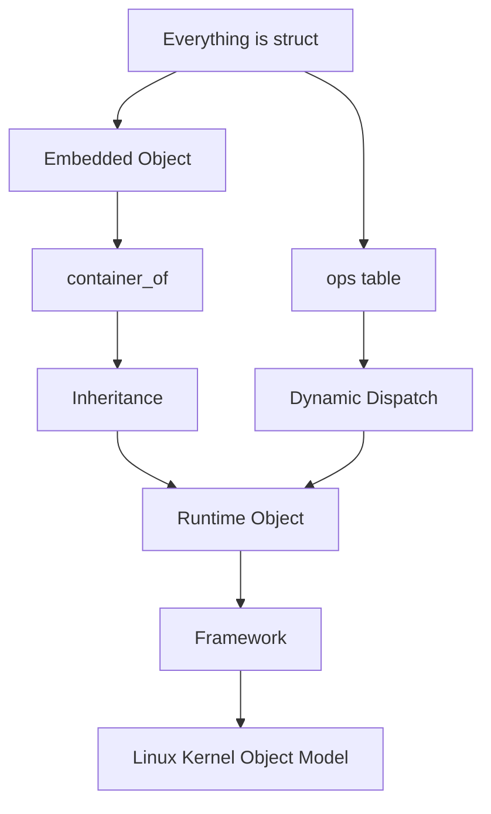

# 第九部分：最终总结

> 读完本 Cookbook，你应能用同一套对象模型阅读 VFS、网络、驱动、调度与安全框架，而不再把它们当成互不相关的「子系统名词堆」。

---

## 15.1 一句话回顾

Linux Kernel 在纯 C 中实现了完整的 OO Design：**结构体是对象，ops 表是虚函数表，嵌入 + `container_of` 是继承恢复。** 语言没有 `class`，架构却强制了对象边界。

---

## 15.2 三大支柱（计划中的总结原句）

Linux Kernel 的 Object Model 建立在三大支柱之上：

1. **`struct`** —— 表示对象（Object），承载状态、生命周期与对象关系  
2. **function pointer（ops table）** —— 表示行为（Method），实现接口、多态与动态绑定  
3. **`container_of`（配合嵌入式 struct）** —— 表示继承（Inheritance by Embedding），完成基类与派生类之间的类型恢复

闭环口诀：

> **对象用 struct 承载；接口用 ops 表声明；派生关系用嵌入 + `container_of` 恢复。**

---

## 15.3 总流程图



ASCII 对照版（便于默写）：

```
Everything is struct
        |
        +------------------+
        |                  |
        v                  v
 Embedded Object      ops table
        |                  |
        v                  v
  container_of      Dynamic Dispatch
        |                  |
        v                  |
  Inheritance              |
        |                  |
        +--------+---------+
                 |
                 v
          Runtime Object
                 |
                 v
            Framework
                 |
                 v
   Linux Kernel Object Model
```

---

## 15.4 你现在应该具备的能力

- 在陌生代码里迅速定位：**对象 / 基类 / 派生类 / ops / 恢复点**。  
- 解释为何 Kernel 能在无 C++ 的情况下完成封装、继承、多态与框架插件化。  
- 诚实理解 `container_of`：几何本质、编译器合同、`__builtin_offsetof`、类型检查与 const/NULL 演化。  
- 区分 **is-a 嵌入继承** 与 **has-a 指针关联**，以及二者的生命周期后果。  
- 用九问 Checklist 把「读功能」升级为「读对象模型」。

---


## 15.4.1 三大支柱如何互相卡住「假 OO」

只具备其中一两根支柱，会得到残缺模型：

- 只有 `struct`：有状态，无多态，框架只能写死分支。  
- 只有 ops：有间接调用，但状态无处安放，或散落在全局表。  
- 只有 `container_of`：会算地址，却没有对象叙事与接口叙事，只是技巧。  
- `struct` + ops 但无恢复：只能操作公共字段，或靠 `void *` 偷运私有状态。  
- 三支柱齐全：框架保持抽象，实现保持完整，扩展保持可插拔。

因此最终总结不是三句口号的并列，而是 **三句必须同时成立**。缺一，就退回「用 C 写了点面向对象味道的代码」；齐备，才配称为 Linux Kernel Object Model。

## 15.5 常见误区清单

1. **把 ops 指针当成普通可变数据字段乱改**  
   ops 表通常是契约与（常为）只读共享实现。运行期随意改写槽位，等于暗中替换虚表，极易造成并发下的行为撕裂与安全漏洞。应通过正规注册/绑定路径切换行为，而不是把 `ops` 当 scratch 字段。

2. **忘记 release → 泄漏**  
   注册成功、引用加一、kobject 挂上树之后，若错误路径或卸载路径缺少对称的 `put`/`unregister`/`release`，对象会成为幽灵节点：sysfs 还在、内存还在、模块却走了。生命周期协议与对象模型同级，不是可选清理。

3. **对非嵌入成员做 container_of**  
   宏只做地址减法。若指针并非某外层结构的嵌入成员地址，结果不是「类型转换失败」，而是「对错误地址做字段解释」。出身不变量被破坏时，任何 cast 都救不了你。

4. **以为 container_of 有昂贵运行时代价**  
   正常情况下是编译期常量偏移加一次指针减法，不是反射、不是搜索。真正昂贵的是错误使用后的调试与崩溃。性能焦虑应放在间接调用与锁上，而不是放在恢复宏本身。

5. **把嵌入式继承当成 has-a**  
   `struct derived { struct base b; ... }` 表达的是 is-a 布局：基类子对象与派生对象同生共死。若你按「b 是我拥有的独立部件」去设计第二套生命周期，就会出现双重释放、释放顺序错误，或错误地以为可以单独 free 基类视图。has-a 请用指针/句柄；is-a 才用嵌入。

补充易错点（短记）：

- 写错 `type`/`member` 却因同名成员仍编译通过；  
- 恢复后在无锁/无引用下继续使用；  
- 把设备树 parent 与 container 外层对象当成同一条边。

---


## 15.5.1 误区为何反复出现

五条常见误区背后其实是同一类认知偏差：**把对象模型组件降级成普通 C 技巧**。

- 把 ops 当可变字段，是忘记「方法表是接口」。  
- 忘记 release，是忘记「对象必有生命周期协议」。  
- 对非嵌入成员 `container_of`，是忘记「继承恢复依赖布局出身」。  
- 恐惧宏的运行代价，是忘记「偏移是编译期常量」。  
- 把嵌入当 has-a，是忘记「同生共死的 is-a 语义」。

纠正偏差的方法不是背更多 API，而是每次 code review 强制回到三大支柱与九问。只要提问「这是对象、接口，还是恢复？」，误区会自己现形。

## 15.6 最后的阅读姿态

以后打开内核子系统，请按这个顺序：

1. 画出 struct 对象；  
2. 找到 ops；  
3. 找到嵌入与 `container_of`；  
4. 写清所有权与释放；  
5. 才进入算法细节。

当你稳定地这样阅读时，Linux Kernel 不再是「巨大的 C 函数集合」，而是一座由无数显式对象组成的、可扩展的运行时系统——这正是本 Cookbook 想交给你的最终图像。

## 15.7 全书收束

从第 1 章的「为什么在 C 里做 OO」，到第 15 章的总图，你反复看到同一真相：

> Linux Kernel 用架构纪律补齐了语言没有提供的对象系统。

请把总流程图、三大支柱原句、九问 Checklist 与误区清单放在一起保存。下次阅读或设计时，先打开这四样，再打开源码。若你能把它们讲给另一位只懂 C 的同事听懂，本 Cookbook 就完成了它的教学使命。
