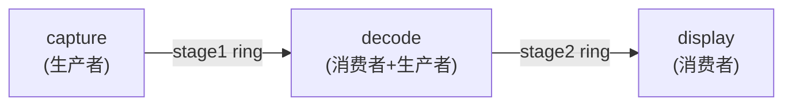

# 05. Producer-Consumer Pipeline（多级流水线）

对应文档：[../../share_memory_design.md](../../share_memory_design.md) 第 6 节。

## 心智模型

- **问题**：视频/AI 推理/网络包处理常常是"采集 -> 解码 -> 显示"这样的
  多级流水线，每一级都是独立进程（甚至独立模块/团队维护），如何做到
  零拷贝、模块解耦？
- **核心技巧**：把每一级之间的"传送带"实现成一个独立的
  [SPSC Ring Buffer](../01_ring_buffer_spsc/)（每级只有一个上游写、一个
  下游读，天然满足 SPSC 假设）。整条流水线 = N 个进程 + (N-1) 个环形缓冲区
  首尾相连，数据只在共享内存里流动，不需要 `read()`/`write()` 拷贝进/出
  用户态堆。
- **观察点**：`decode` 进程既是 stage1 的消费者，又是 stage2 的生产者——
  流水线的每一级都同时扮演两个角色，这是它与单纯的"生产者-消费者"模型
  的区别。
- **适用场景**：视频采集/编解码、AI 推理流水线、网络包处理链。

## 拓扑



## 构建与运行

```bash
make
./run_demo.sh
```

`run_demo.sh` 会启动三个进程（顺序不重要，每一级都会自己等待上游共享内存
出现）：

1. `capture`：产生 200000 个"帧"（payload = 帧序号），写入 stage1 环形缓冲区。
2. `decode`：从 stage1 读取，模拟解码（payload 乘以 2），写入 stage2 环形缓冲区。
3. `display`：从 stage2 读取，校验 `payload == seq*2` 是否成立。

## 预期输出

```text
[capture] stage1 ring created, count=200000
[capture] done, produced 200000 frames
[display] attached to stage2, waiting for frames
[display] got sentinel at seq=200000, stop
[display] received 200000 frames, integrity=OK
[decode] stage2 ring created, waiting for frames
[decode] done, processed 200000 frames
```

`integrity=OK` 说明 200000 帧数据经过两级处理后，序号和数值变换都完全正确，
没有丢帧、错序或数据损坏。
