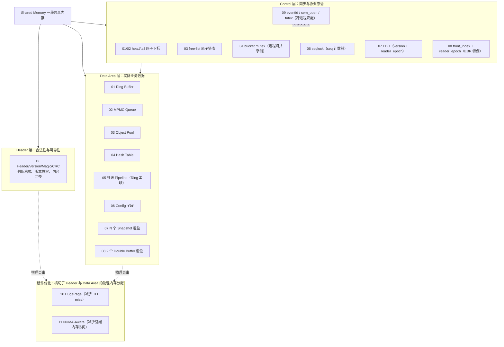

# Shared Memory 设计模式 —— 心智模型总结

本文档是 [README.md](README.md) 十二个可运行示例的收尾总结。建议先跑通
`01_ring_buffer_spsc` 到 `12_header_version_magic` 全部示例，再回来读
这份总结——每张"心智模型卡"背后都对应着一段真实跑过、压测过、甚至
踩过坑才定型的代码，而不是纯理论推演。

## 目录

- [心智模型卡（逐模式）](#心智模型卡逐模式)
- [分层架构图](#分层架构图)
- [选型决策表](#选型决策表)
- [贯穿全部示例的三条元规律](#贯穿全部示例的三条元规律)

---

## 心智模型卡（逐模式）

### 01. Ring Buffer（SPSC）

- **问题**：一个进程持续产出数据，另一个进程持续消费，如何不加锁、不
  `malloc`、且 cache-friendly？
- **核心技巧**：两个原子下标 `head`（生产者独占写）/`tail`（消费者
  独占写），只需要 `acquire`/`release`，不需要 CAS；`capacity` 取 2 的
  幂用位运算取模；故意牺牲一个槽位区分"空"与"满"。
- **数据结构**：`{ atomic head, tail; T slots[capacity]; }`
- **适用场景**：DPDK `rte_ring`（单核对单核）、音视频采集流水线、
  网络收包队列。
- **常见坑**：`head`/`tail` 必须是真正的 `_Atomic`，否则弱内存序架构
  （ARM）上读者可能看到"写了一半"的数据；多生产者/多消费者不能直接
  套用，见 02。

### 02. Lock-Free Queue（MPMC）

- **问题**：01 的 SPSC 假设被打破——多个进程同时抢着写、多个进程同时
  抢着读，怎么保证不丢、不重复？
- **核心技巧**：用 CAS 竞争"抢到哪个 slot"的资格（类似简化版
  `rte_ring` 的多生产者模式），每个 slot 带一个序列号防止"抢到了但还
  没写完就被读走"。
- **数据结构**：`{ atomic head, tail; struct { atomic seq; T val; } slots[capacity]; }`
- **适用场景**：多线程/多进程任务队列、事件总线。
- **常见坑（真实踩过）**：一开始用"跨消费者的严格顺序"去校验正确性，
  结果一直报"乱序"——MPMC 队列只保证**恰好一次交付**（不丢、不重复），
  不保证多个消费者按生产顺序处理；验证逻辑改成"用共享 bitmap 检查
  完整性和唯一性"才是正确的校验方式。

### 03. Shared Object Pool

- **问题**：高频分配/释放固定大小对象时，`malloc`/`free`
  的锁开销和内存碎片不可接受。
- **核心技巧**：共享内存里预分配 N 个对象槛位 + 无锁 free list（单链表
  头部用 CAS push/pop）；用"tagged index"（索引 + 版本号打包在一个
  原子字里）代替裸指针，避免 ABA 问题。
- **数据结构**：`{ atomic free_list_head; struct { atomic tagged_next; T obj; } slots[capacity]; }`
- **适用场景**：连接对象池、内存块池、任何"生命周期短、大小固定、
  高频创建销毁"的对象。
- **常见坑**：直接用裸指针做链表头会遇到经典 ABA 问题（A 被弹出、复用、
  又被推回，另一个线程的 CAS 却认不出中间发生过变化）——必须用带版本号
  的 tagged index，或者 128 位 double-word CAS。

### 04. Shared Hash Table

- **问题**：需要跨进程共享一个可增删查的键值表，但又不想为每次操作
  引入全表锁。
- **核心技巧**：固定 bucket 数组，每个 bucket 挂一把
  `pthread_mutex_t`（`PTHREAD_PROCESS_SHARED` 属性）+ 独立的节点池；
  只锁"访问到的那个 bucket"，不同 bucket 的操作可以完全并行。
- **数据结构**：`{ struct { pthread_mutex_t lock; atomic head; } buckets[N]; node_t pool[capacity]; }`
- **适用场景**：跨进程共享缓存、路由表、会话表。
- **常见坑**：`pthread_mutex_t` 必须显式设置
  `PTHREAD_PROCESS_SHARED` 属性才能跨进程使用（默认是
  `PTHREAD_PROCESS_PRIVATE`，只能同进程内线程间共享）。

### 05. Producer-Consumer Pipeline

- **问题**：视频/网络包处理往往是多阶段的（采集→解码→显示），怎么
  避免每级之间用锁排队、避免不必要的拷贝？
- **核心技巧**：把 01 的 SPSC Ring Buffer 串联起来，每一级的输出 Ring
  就是下一级的输入 Ring，级间零拷贝，只传"这块数据在共享内存里的位置"。
- **数据结构**：三个独立的 `ring_buffer`（capture→decode、decode→display）。
- **适用场景**：音视频处理流水线、网络协议栈分层处理、ETL 数据管道。
- **常见坑**：级间速率不匹配时，慢的一级会通过 Ring 的"满/空"背压传导
  到上游/下游——设计时要想清楚背压传导到最上游后系统的整体行为（丢帧？
  阻塞？）。

### 06. Shared Configuration（Write Once, Read Many）

- **问题**：一个配置进程更新配置，多个 worker 高频读取；写少读多，
  绝不能让 worker 读到"改了一半"的撕裂配置。
- **核心技巧（seqlock）**：写者 `seq++`（变奇数，宣告"正在写"）→
  更新字段 → `seq++`（变偶数，宣告"写完了"）；读者记录 `seq1` → 读字段
  → 再读 `seq2`，若 `seq1` 是奇数或 `seq1 != seq2` 就重试。
- **数据结构**：`{ atomic seq; uint32_t magic, version; ...fields...; uint32_t checksum; }`
- **适用场景**：热更新限流阈值、特性开关、路由表版本号——Linux 内核
  `jiffies`/`xtime` 用的就是这个思路。
- **常见坑（压测复现）**：写者在"正在写"期间被调度器换出，会导致所有
  reader 一直空转重试直到写者被重新调度——这不是 bug，是
  忙等类设计通用的"调度延迟"问题，实时性敏感系统需要额外关注 CPU
  亲和性/优先级。

### 07. Snapshot（Epoch-Based Reclamation）

- **问题**：Writer 持续构建"下一代完整数据"，多个 Reader 只想读"当前
  这一份"，且读写双方都不希望互相阻塞——数据库 MVCC、Linux RCU 都是
  这个思路的变体。
- **核心技巧**：N 个槛位轮转 + 每个 Reader 一个"广播位"
  （`reader_epoch[reader_id]`）宣告自己在读哪个版本；Writer 回收槛位前
  必须确认没有 Reader 还广播着"即将被回收"的版本，否则等待。
- **数据结构**：`{ atomic current_version; atomic reader_epoch[MAX_READERS]; slot_t slots[N]; }`
- **适用场景**：多读者共享的行情快照、配置缓存、只读数据的热替换。
- **常见坑（本项目最曲折的一次调试）**：最初用简单的每槛位
  `refcount`（读之前 `+1`，读完 `-1`）实现，压测后以几万分之一概率复现
  "reader 读到正在被覆写的数据"——根因是"读到 index"和"refcount+1"
  之间存在时间窗口，调度延迟可能让 Writer 在这个窗口内把槛位复用好几轮。
  修补细节（加 CAS 抢占标记）反而引入了更明显的新 bug。最终重新设计为
  可证明正确的 Epoch-Based Reclamation 才根治——**无锁数据结构的正确性
  不能只靠推理，必须靠高强度压力测试验证**。

### 08. Double Buffer（SPSC 特化版 Snapshot）

- **问题**：单生产者/单消费者场景下，07 的"N 槛位 + 多读者广播"是不是
  有点重？
- **核心技巧**：把 07 的协议收窄到"恰好 2 个槛位、恰好 1 个读者"——
  生产者独占写 back 槛位，消费者独占读 front 槛位，翻转 `front_index`
  完成角色互换；本质仍是 EBR，只是槛位数从 N 降到 2。
- **数据结构**：`{ atomic front_index; atomic reader_epoch; slot_t slots[2]; }`
- **适用场景**：图形渲染的前后台缓冲区、仿真系统状态切换、单一消费者
  的控制回路状态。
- **常见坑**：槛位越少，生产者被消费者拖慢的概率越高——压测显示只有 2
  个槛位时，即便只有 1 个读者，写者的等待事件也高达千万级；这是用
  内存换协议简单性的代价，槛位数需要按"读者最大持有时长 × 发布频率"
  设计。

### 09. Event Notification（eventfd / 命名信号量 / futex）

- **问题**：共享内存本身没有"叫醒对方"的能力，01~08 全靠忙等发现数据
  变了——CPU 会持续空转。
- **核心技巧**：借助内核提供的阻塞/唤醒原语，让等待方真正睡眠：
  - `eventfd`：内核计数器 + fd，适合有父子关系（fork 继承 fd）、或需要
    塞进 `epoll` 统一处理的场景；
  - 命名信号量 `sem_open`：不需要父子关系，靠名字握手，天然计数型；
  - `futex`：最底层最轻量，用户态先 CAS 快速路径，无竞争时不进内核，
    glibc mutex/条件变量底层最终都落到它。
- **数据结构**：因机制而异，见各子示例。
- **适用场景**：几乎所有"数据有更新才需要处理，大部分时间应该睡眠"的
  跨进程通知场景。
- **常见坑**：`fork()` 之后子进程 `_exit()` 前如果不 `fflush(stdout)`，
  父进程遗留在 stdio 缓冲区里的输出会被子进程重复打印一遍（本项目在
  10/11 号示例里都真实复现过）——处理 `fork` 相关的 I/O 时要格外注意
  缓冲区语义。

### 10. Shared Memory + HugePage

- **问题**：大块共享内存（几百 MB 级）用 4KB 页会导致大量 TLB miss。
- **核心技巧**：`mmap(MAP_PRIVATE|MAP_ANONYMOUS)` 一段 2MB 对齐、大小是
  2MB 整数倍的内存 + `madvise(MADV_HUGEPAGE)` 提示内核尽量用大页支持；
  查 `/proc/self/smaps` 的 `AnonHugePages` 字段验证是否生效。
- **数据结构**：不改变数据结构本身，只改变底层物理页的分配方式。
- **适用场景**：大内存随机访问的哈希表/行情缓存/模型权重；配合"预加载
  + fork 只读 worker"（COW 不复制物理页）可以让多个进程共享同一批
  大页支持的数据。
- **常见坑（真实排查）**：`MAP_SHARED|MAP_ANONYMOUS`
  实际由 tmpfs/shmem 承载，它的大页开关是独立的
  `shmem_enabled`（本机是 `never`），完全不受 per-VMA
  `madvise` 提示影响——只有 `MAP_PRIVATE|MAP_ANONYMOUS`
  才会遵从 `madvise(MADV_HUGEPAGE)`。

### 11. NUMA-Aware Shared Memory

- **问题**：多路服务器上，CPU 访问挂在别的插槽下的"远端"内存比本地
  内存慢很多。
- **核心技巧**：两步绑定必须成对出现——`numa_alloc_onnode(size, node)`
  把数据绑到指定节点，`numa_run_on_node(node)` 把处理这份数据的
  线程/进程也调度到同一节点的 CPU 上；只做其中一步等于没做。
- **数据结构**：不改变数据结构本身，只改变分配位置和调度亲和性。
- **适用场景**：多路服务器上的大内存高吞吐服务（数据库、内存计算
  引擎）。
- **常见坑**：本机只有 1 个 NUMA node、未装 `libnuma`——这是一个真实
  存在的"环境能力缺失"场景，用 `#ifdef HAVE_LIBNUMA` +
  Makefile 自动探测 `-lnuma` 优雅降级为 `malloc`，比"编译失败"或
  "运行时崩溃"更贴近生产代码应该有的健壮性。

### 12. Header + Version + Magic + CRC

- **问题**：前面所有模式都在解决"数据怎么被高效读写"，但没有回答
  "我怎么知道这段内存是不是我期望的格式、版本，有没有被打乱"。
- **核心技巧**：三层递进校验，**顺序不能颠倒**——Magic（这是不是我
  认识的格式）→ Version（格式认识但协议兼容吗，major 不兼容/minor
  向后兼容）→ CRC（内容有没有被损坏）；一旦上一层失败，不再检查
  下一层。
- **数据结构**：`{ uint32_t magic; uint16_t major, minor; uint64_t sequence, timestamp; uint32_t flags, length, crc; }` + 数据区。
- **适用场景**：任何需要跨进程/跨版本/长期运行的共享内存协议——工业界
  几乎标配。
- **常见坑**：如果不按 Magic→Version→CRC 的顺序检查（比如先算 CRC），
  一旦 Magic 都不对，`length` 字段可能是随机垃圾，用它去算 CRC 有越界
  读风险。

---

## 分层架构图

原文档"工业界最常见的组合"把共享内存分成 Header / Data Area /
同步原语 三层；下图把本项目全部 12 个模式映射进这个分层里，并补充了
"硬件优化"这个横切关注点（HugePage、NUMA 不属于任何一层，而是同时
作用于 Header 和 Data Area 底层的物理内存分配方式）。

---

## 选型决策表

| 场景 | 建议模式 | 为什么 |
|---|---|---|
| 单进程产出、单进程消费的高频数据流（音视频帧、网络包） | 01 Ring Buffer SPSC | 只有一读一写，不需要 CAS，`acquire/release` 即可，延迟最低 |
| 多个进程都可能生产/消费同一批任务 | 02 Lock-Free Queue MPMC | 需要 CAS 解决多方竞争同一个槛位的问题 |
| 高频创建/销毁固定大小对象，想避开 `malloc`/`free` | 03 Object Pool | 预分配 + 无锁 free list，规避锁开销和内存碎片 |
| 跨进程共享一个可增删查的键值表 | 04 Shared Hash Table | bucket 级细粒度锁，读写并发度高于全表锁 |
| 多阶段流水线处理（采集→解码→显示/编码→发送） | 05 Pipeline | 复用 Ring Buffer，级间零拷贝 |
| 一个进程写配置，多个进程高频读，写少读多 | 06 Shared Config（seqlock） | 读者永远不阻塞，写者也不用等读者，适合"读多写少" |
| 多个读者需要读到"任意某个历史版本"的完整数据，且不希望阻塞写者 | 07 Snapshot（EBR） | N 个槛位 + Epoch 回收，允许读者适度落后而不出错 |
| 恰好一个消费者、一个生产者的"前后台缓冲区"场景 | 08 Double Buffer | 比 07 更省内存，但对消费者速度要求更高 |
| 数据有更新才需要处理，绝大部分时间应该睡眠而不是空转 | 09 Event Notification | 用 eventfd/sem_open/futex 让等待方真正睡眠 |
| 已确认父子进程关系，且想统一进 `epoll` | 09a eventfd | fork 天然继承 fd，可与网络 I/O 一起 `epoll_wait` |
| 两个完全独立启动、无亲缘关系的进程要同步 | 09b sem_open 或 09c futex | 靠名字或共享内存里的字握手，不依赖 fork |
| 追求极致的唤醒延迟/无竞争时零系统调用开销 | 09c futex | 用户态 CAS 快速路径 + 内核睡眠慢速路径 |
| 共享内存区域很大（几百 MB 级），且是大量随机访问 | 10 HugePage | 减少页表项数量和 TLB miss |
| 多路服务器，且该内存主要由固定 CPU 集合访问 | 11 NUMA-Aware | 减少跨 NUMA 节点的远端内存访问延迟 |
| 任何需要长期运行、允许升级、需要检测损坏的共享内存协议 | 12 Header/Version/Magic/CRC | 几乎应该无条件叠加在其他所有模式之上 |

---

## 贯穿全部示例的三条元规律

1. **无锁数据结构的正确性必须靠压力测试验证，不能只靠"讲得通"的
   推理。** 07_snapshot 的 refcount 方案在逻辑上"讲得通"，却在几万次
   运行里复现一次撕裂读——这类概率性 bug 只有高并发、长时间压测才能
   暴露，逐条推理很难一眎看穿。
2. **没有免费的午餐，槛位/缓冲区数量本质是"内存 vs 阻塞概率"的权衡。**
   07（N 槛位）与 08（2 槛位）用完全相同的 EBR 协议，槛位越少写者越容易
   被读者拖慢；选型时要按"读者最大持有时长 × 发布频率"倒推需要多少
   槛位。
3. **环境能力有边界时，优雅降级比"编译失败"或"运行时崩溃"更贴近生产
   代码该有的样子。** 10（THP 不保证生效，只是尽力而为）与 11（没装
   `libnuma` 就自动退化为 `malloc`）都是同一种心智模型的体现：先探测
   环境能力，再决定走哪条路径，并且清晰地把"降级"这件事打印出来，而
   不是悄悄地假装什么都没发生。
