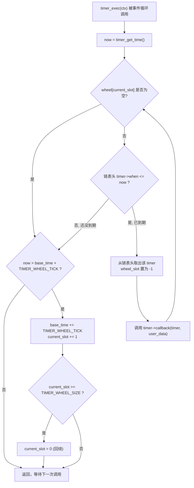

# 时间轮定时器系统设计文档

## 1. 基本思想与设计理念

### 1.1 时间轮概念

时间轮定时器是一种高效的定时器管理算法，其核心思想是将时间轴分割成固定的时间片段，并用环形数组表示这些时间片段。就像钟表的表盘一样，指针按固定速度转动，指向当前的时间片段。

**直观类比：把 8192 个槎位想象成一个巨大的圆形表盘**

真实实现中槎位数组 `wheel[8192]` 是一维数组，但逻辑上它首尾相连，构成一个环。`current_slot` 就是表盘上的指针，每过 1 秒（`TIMER_WHEEL_TICK`）走一格；走到 8191 格之后再走一步，就会回绕到 0 格，如此往复。把这个环"剪开拉直"看会更直观：

```
  [0] -> [1] -> [2] -> ... -> [100] -> ... -> [8190] -> [8191] ----+
                                 ^                                 |
                            current_slot                           |
                          (指针现在停在这里)                         |
                                                                   |
   [0] <----------------------- 走到头就回绕到 0 --------------------+
```

指针每走到一个新槎位，就意味着"现在"往前推进了 1 秒；只要把定时器提前挂到"未来会被指针扫到"的那个槎位上，指针迟早会转过去并把它揪出来执行——这就是时间轮 O(1) 调度的全部秘密。

**核心优势：**
- **O(1) 插入和删除复杂度**：直接计算定时器应该放入的槽位
- **批量处理能力**：同一时间片内的多个定时器可以一次性处理
- **内存使用高效**：固定大小的数组加动态链表，避免内存碎片
- **适合高并发场景**：减少锁竞争，支持大量定时器

### 1.2 设计哲学

本定时器系统遵循以下设计原则：

1. **简单性优于复杂性**：API 设计简洁明了，易于理解和使用
2. **性能优于功能丰富性**：专注于核心功能的高效实现
3. **可预测性**：定时器行为可预测，便于调试和优化
4. **资源可控性**：内存使用量可预测，避免意外的资源消耗

## 2. 架构设计

### 2.1 数据结构关系

下图用一份"带真实字段值"的内存快照，展示 `timer_context_t` 与 `wheel[]` 数组、槎位内定时器链表三者的关系（字段名与 [timer.h](timer.h) 保持一致）：

```
+----------------------------------------------------------------+
| timer_context_t (ctx)                                          |
|----------------------------------------------------------------|
| current_slot = 100                                             |
| base_time    = 1000000000   (us, current slot's base time)     |
|                                                                |
| wheel[8192]:                                                   |
|   [ 99] -> NULL                                                |
|   [100] -> T1 -> T3 -> NULL      <-- current_slot points here  |
|   [101] -> T2 -> NULL                                          |
|   [102] -> NULL                                                |
|   ...                                                          |
|   [8191] -> NULL                                               |
+----------------------------------------------------------------+
```

注：`[100]` 就是当前槎位（`current_slot`），链表里挂着 T1、T3 两个定时器；`base_time` 是这个槎位对应的时间基准。

单个 `gtimer_t` 节点的内容（以 T1 为例）：

```
+------------------------------------------------------------+
| gtimer_t  T1                                               |
|------------------------------------------------------------|
| when       = 1000000300   (absolute expiry time, us)       |
| interval   = 1000000      (repeat interval, us)            |
| next       -> T3          (next timer in same slot)        |
| wheel_slot = 100          (slot currently occupied)        |
| name       = "heartbeat"                                   |
| callback   = heartbeat_callback                            |
| user_data  = &ctx                                          |
| timer_id   = 1                                             |
+------------------------------------------------------------+
```

**要点：**
- `wheel_slot == -1` 表示该定时器当前不在轮子里（未启动或已停止）。
- 同一槎位内多个定时器用单链表串起来，按 `when` 从小到大排序（见 3.2 节）。
- `ctx` 本身不持有定时器的内存，`gtimer_t` 由调用者通过 `timer_create()` / `timer_delete()` 管理生命周期。

### 2.2 时间轮参数配置

- **轮子大小 (WHEEL_SIZE)**: 8192 个槽位
- **时间粒度 (WHEEL_TICK)**: 1,000,000 微秒（1秒）
- **时间精度**: 微秒级别，适合网络协议和实时系统

这种配置提供了良好的时间范围覆盖：
- 最小粒度：1秒
- 直接覆盖范围：8192秒（约2.3小时）
- 通过多轮机制可支持任意长时间

### 2.3 内存布局优化

**槽位分布策略：**
- 近期定时器集中在当前指针附近的槽位
- 远期定时器通过哈希分散到整个轮子
- 同一槽位内按到期时间排序，确保执行顺序正确

**内存使用特点：**
- 固定开销：轮子数组 8192 * 8 字节 = 64KB
- 动态开销：每个定时器对象约 80 字节
- 无内存碎片：使用链表连接，不需要连续内存

## 3. 核心算法机制

### 3.1 槽位计算算法

定时器插入时的槽位计算是时间轮的核心：

```
时间偏移 = 定时器到期时间 - 轮子基准时间
槽位偏移 = 时间偏移 ÷ 时间粒度
目标槽位 = (当前槽位 + 槽位偏移) % 轮子大小
```

对应到实现代码 `timer_insert_internal()`（[timer.c](timer.c)）：

```c
offset  = timer->when - ctx->base_time;
offset /= TIMER_WHEEL_TICK;
offset += ctx->current_slot;
offset %= TIMER_WHEEL_SIZE;
```

**逐步演算示例**

假设此刻：`ctx->current_slot = 100`，`ctx->base_time = 1,000,000,000` (us)。
现在要为一个 3.5 秒后到期的定时器插入时间轮，即 `timer->when = base_time + 3,500,000 = 1,000,003,500,000`... 只需关心两者的差值：

```
第 1 步  offset = when - base_time
                = 3,500,000                            (us，即 3.5 秒)

第 2 步  ticks  = offset / TIMER_WHEEL_TICK
                = 3,500,000 / 1,000,000
                = 3                                     (整数除法，向下取整)

第 3 步  slot   = (current_slot + ticks) % WHEEL_SIZE
                = (100 + 3) % 8192
                = 103
```

如果一个定时器的 `when` 已经小于 `base_time`（说明因为调度延迟等原因已经过期），代码会把 `offset` 直接归零，让它落在当前槎位，下一次 `timer_exec()` 就会立刻把它取出来执行——不会被"甩到过去"而永远丢失。

**时间轴 → 槎位的映射图**

把同一段时间差投影到"时间轴"和"环形槎位"两种视角上，能看出它们其实是同一件事的两种表示：

```
时间轴 (微秒):

  base_time                                                 when
  |------ tick ------|------ tick ------|------ tick ------|
  slot100            slot101            slot102            slot103
                                            (offset = 3,500,000us = 3 ticks, 落在 slot103)

环形槎位 (局部展开):

  [100]     [101]     [102]     [103]     [104] ...
    ^                              ^
    |                              |
current_slot                  定时器被插入到这里
(指针现在在这里)                (3 个 tick 之后指针会转到这里)
```

**算法特点：**
- 将连续时间映射到离散槽位
- 利用取模运算实现环形结构
- 自动处理时间超出轮子范围的情况（`offset < 0` 时直接归零，放入当前槎位，见代码中的保护逻辑）

### 3.2 有序插入机制

每个槽位内的定时器按到期时间排序：

**插入策略：**
1. 计算目标槽位
2. 在槽位链表中寻找正确插入位置
3. 维护链表的时间有序性
4. 更新定时器的槽位标记

对应 `timer_insert_internal()` 中的查找逻辑（[timer.c](timer.c)）：

```c
for (;;) {
    current = *insert_point;
    if (current == NULL)
        break;                                     /* 到达链表末尾 */
    if (timer_time_cmp(current->when, timer->when) >= 0)
        break;                                     /* 找到了比自己晚到期的节点，插入它前面 */
    insert_point = &current->next;
}
timer->next  = *insert_point;
*insert_point = timer;
```

**插入前后对比示例**

假设槎位 `wheel[103]` 上已经有两个定时器 T1(`when=200`) 和 T4(`when=500`)，现在要插入 T2(`when=350`)：

```
插入前:

  wheel[103] --> T1(when=200) --> T4(when=500) --> NULL
                    ^                  ^
              insert_point 从这里出发   在这里发现 500 >= 350，停止查找

插入后:

  wheel[103] --> T1(when=200) --> T2(when=350) --> T4(when=500) --> NULL
                                       ^
                              T2 被插入到 T1 和 T4 之间
```

**执行优化：**
- 最早到期的定时器位于链表头部
- 执行时从头开始，遇到未到期的定时器即可停止
- 批量处理同一槽位的连续到期定时器

### 3.3 时间轮推进机制

时间轮指针的推进是定时系统的核心节拍：

**推进条件：**
- 当前时间超过下一个槽位的时间阈值
- 每次推进一个槽位，确保不遗漏定时器

**推进过程：**
1. 更新基准时间到下一个槽位时间
2. 推进当前槽位指针
3. 处理指针环绕（回到槽位0）

`timer_exec()`（[timer.c](timer.c)）把"处理到期定时器"和"推进指针"这两段逻辑合并在一次调用里，完整流程如下：



**关键点：**
- 只有指针**当前所在**的那个槎位会被检查，其它 8191 个槎位在这一次调用里完全不用碰——这正是 O(1) 的来源。
- 一次 `timer_exec()` 调用最多只推进指针一格；如果调用间隔超过多个 tick（例如程序被阻塞很久），槎位会在多次调用中被逐个"追平"，不会丢失任何定时器，只是触发会稍微延迟。
- 回调执行发生在把定时器从链表摘除**之后**，所以回调里调用 `timer_restart()` 重新插入同一个 `timer` 是安全的（不会插入到自己正待摘除的位置）。

### 3.4 连续多个 tick 的完整例子

用 [main.c](main.c) 里真实的心跳定时器场景（`timer_create("heartbeat", heartbeat_callback, &heartbeat_counter, 1)`，间隔 3 秒）走一遍从"插入"到"触发"再到"重新插入"的全过程。为了方便演算，假设程序启动时 `base_time = 0`，`current_slot = 0`。

```
t = 0s   —— 创建并启动心跳定时器
  timer_start() 计算: when=3,000,000, offset=3,000,000/1,000,000=3 ticks
  slot = (0 + 3) % 8192 = 3

  current_slot = 0  (指针在这里)
  wheel[0] -> NULL
  wheel[1] -> NULL
  wheel[2] -> NULL
  wheel[3] -> heartbeat(when=3,000,000) -> NULL      <- 心跳被安排在这里等待
```

```
t = 1s   —— timer_exec() 被调用，指针推进一格
  wheel[0] 为空，无事可做；now(1,000,000) <= next_slot_time(1,000,000)? 触发推进
  base_time = 1,000,000, current_slot = 1

  current_slot = 1  (指针走到这里)
  wheel[1] -> NULL
  wheel[2] -> NULL
  wheel[3] -> heartbeat(when=3,000,000) -> NULL      <- 心跳还在原地，静静等待
```

```
t = 2s   —— 再推进一格，指针仍未到达心跳所在的槎位
  current_slot = 2

  current_slot = 2  (指针走到这里)
  wheel[2] -> NULL
  wheel[3] -> heartbeat(when=3,000,000) -> NULL      <- 还没轮到它
```

```
t = 3s   —— 指针终于走到 slot 3，心跳到期
  current_slot = 3, now = 3,000,000
  wheel[3] 链表头 heartbeat.when(3,000,000) <= now(3,000,000) ? 是 -> 摘除并触发回调

  摘除前:  wheel[3] -> heartbeat -> NULL
  摘除后:  wheel[3] -> NULL                          <- heartbeat 已被取出

  heartbeat_callback() 内部调用 timer_restart():
    when   = now + interval = 3,000,000 + 3,000,000 = 6,000,000
    offset = when - base_time = 6,000,000 - 3,000,000 = 3,000,000
    ticks  = 3,000,000 / 1,000,000 = 3
    slot   = (current_slot + ticks) % 8192 = (3 + 3) % 8192 = 6

  重新插入后:
  wheel[6] -> heartbeat(when=6,000,000) -> NULL      <- 心跳被安排到 3 格之后，等待下一次触发
```

**这个例子说明的几件事：**
1. 定时器一旦被 `timer_start()`/`timer_restart()` 插入，就"睡"在某个槎位里，不需要任何轮询或排序操作，直到指针转到它所在的槎位。
2. 指针的每一次推进都是 O(1)：只需要检查它现在停留的这一个槎位是否为空、链表头是否到期。
3. 周期性定时器（心跳、保活等）的本质就是"触发 -> 摘除 -> 重新计算槎位 -> 插入到未来的槎位"，循环往复；`timer_restart()` 正是把 3.1/3.2 节的槎位计算和有序插入逻辑合在一起调用。
4. 一次性定时器（如 `oneshot`）在回调里不调用 `timer_restart()`，触发后就彻底从轮子里消失，不会再被指针碰到。

## 4. 性能分析

### 4.1 时间复杂度分析

**基本操作复杂度：**
- 定时器创建：O(1)
- 定时器启动：O(k)，k为同槽位定时器数量
- 定时器停止：O(k)，k为同槽位定时器数量  
- 定时器执行：O(m)，m为到期定时器数量

**空间复杂度：**
- 固定空间：O(N)，N为槽位数量（8192）
- 动态空间：O(T)，T为活跃定时器数量

**直观对比：插入一个新定时器时，三种实现大致要做多少工作**（定时器总数 T 越大，柱子拉得越长）：

```
时间轮 (本设计)   O(1)         [==]
排序链表          O(T)         [======================================]
最小堆            O(log T)     [========]

                              工作量随定时器总数 T 增长的速度（示意，非精确比例）
```

- **排序链表**：每次插入都要从头遍历，直到找到比自己晚到期的位置——定时器越多，平均要走的步数越多。
- **最小堆**：插入/删除是 O(log T)，比链表好很多，但仍然随 T 增长；而且堆的内存访问模式不如"数组下标 + 链表"规整，缓存命中率更差。
- **时间轮**：槎位由 `when` 直接计算得出（3.1 节的三步演算），跟 T 完全无关，所以插入/删除的耗时几乎是恒定的——这也是时间轮特别适合"海量定时器、高频创建销毁"场景（如网络连接超时）的根本原因。

### 4.2 性能优化策略

**哈希分布优化：**
- 选择合适的槽位数量，减少哈希冲突
- 8192个槽位提供良好的分布特性

**缓存友好性：**
- 按时间顺序访问槽位，提高缓存命中率
- 链表节点局部性好，减少内存访问延迟

**批量处理优化：**
- 一次轮转处理多个到期定时器
- 减少系统调用和上下文切换开销

## 5. 适用场景与限制

### 5.1 理想使用场景

**网络协议栈：**
- TCP 超时重传
- 连接保活检测
- 协议状态机超时

**实时系统：**
- 周期性任务调度
- 看门狗定时器
- 系统维护任务

**高并发服务：**
- 会话超时管理
- 缓存过期处理
- 速率限制实现

### 5.2 使用限制

**时间精度限制：**
- 最小粒度受轮子时间片限制
- 不适合毫秒级以下的高精度定时

**内存使用考虑：**
- 大量长期定时器会占用较多内存
- 不适合定时器数量极少的场景

**单线程模型：**
- 基础实现为单线程设计
- 多线程环境需要额外的同步机制

## 6. 最佳实践

### 6.1 参数调优建议

**轮子大小选择：**
- 根据应用的定时器分布特点选择
- 平衡内存使用和哈希冲突率
- 建议选择 2 的幂次，优化取模运算

**时间粒度设置：**
- 根据应用的最小时间间隔需求
- 考虑系统时钟精度和调度延迟
- 避免过小的粒度导致频繁的轮子推进

### 6.2 集成指导

**事件循环集成：**
- 使用 `timer_get_next_timeout()` 设置 select/poll 超时
- 在每次事件循环迭代中调用 `timer_exec()`
- 确保定时器执行不阻塞事件处理

**错误处理策略：**
- 定时器回调函数应避免长时间阻塞
- 处理回调函数中的异常，避免影响其他定时器
- 合理设计定时器的生命周期管理

**内存管理：**
- 及时清理不需要的定时器
- 避免在定时器回调中创建大量新定时器
- 考虑使用定时器池减少内存分配开销

### 6.3 调试与监控

**性能监控指标：**
- 活跃定时器数量
- 平均槽位链表长度
- 定时器执行延迟分布

**调试技巧：**
- 使用定时器名称标识不同类型的定时器
- 记录定时器的创建、启动、停止事件
- 监控定时器回调的执行时间

## 7. 总结

时间轮定时器系统通过巧妙的数据结构设计和高效的算法实现，为网络协议栈和实时系统提供了一个高性能的定时器解决方案。其核心价值在于：

1. **算法效率**：O(1) 的基本操作复杂度
2. **设计简洁**：易于理解和维护的实现
3. **资源可控**：可预测的内存使用和性能特征
4. **广泛适用**：适合多种应用场景的通用设计

通过合理的参数配置和正确的使用方式，时间轮定时器可以在高并发、大规模的系统中提供稳定可靠的定时服务，是构建高性能网络应用的重要基础组件。