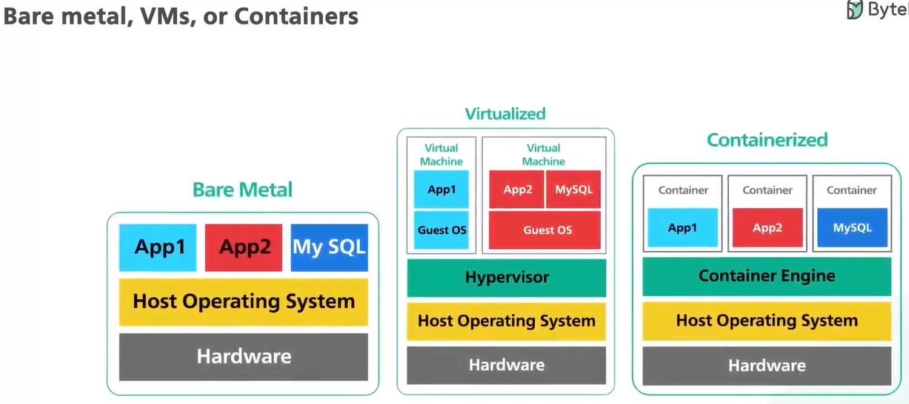

Linux 内核 → LXC → Docker 的关系
```
Docker：用户空间 → 封装并更易用
	Docker 不是重新发明容器，而是对 Linux 容器技术做了易用化、标准化封装，让容器真正普及
|
V
LXC：用户空间 → 调用能力  (Docker 最初基于 LXC，后来改用自研的 libcontainer，但始终依赖 Linux 内核的隔离与限制能力)
|
V
内核：内核空间 → 提供能力
	Namespace：隔离资源（进程、网络、用户、文件系统等）
	Cgroups：限制资源（CPU、内存、磁盘 IO、带宽等）


┌─────────────────────────────────────────────────────────┐
│                    应用 & 业务程序                        │
├─────────────────────────────────────────────────────────┤
│                         Docker                          │
│  ├─ 标准化镜像 (Docker Image)                            │
│  ├─ 分层文件系统 (OverlayFS/AUFS)                        │
│  ├─ 镜像仓库 (Docker Hub/Registry)                      │
│  ├─ 简单 CLI：docker run / build / push / pull          │
│  ├─ 网络、数据卷、容器编排、日志管理等上层能力               │
│  └─ 统一生命周期管理                                     │
├─────────────────────────────────────────────────────────┤
│                          LXC                            │
│  （早期 Linux 容器工具集）                                │
│  提供基础容器创建、启动、管理命令                           │
│  偏底层、无统一镜像、无标准化分发                           │
├─────────────────────────────────────────────────────────┤
│                  Linux 内核（核心能力）                   │
│  ├─ Namespace：PID、Mount、Network、User、UTS 等隔离      │
│  └─ Cgroup：CPU、内存、IO、带宽等资源限制                   │
└─────────────────────────────────────────────────────────┘
```

- [Docker Networking overview](https://docs.docker.com/engine/network/)
- [awesome-compose](https://github.com/docker/awesome-compose)
- [awesome-docker](https://github.com/veggiemonk/awesome-docker)
- [Docker Docs](https://docs.docker.com/)
- [Dockerfile reference](https://docs.docker.com/reference/dockerfile)
- [CLI reference](https://docs.docker.com/reference/cli/docker/)
- [Docker Compose](https://docs.docker.com/compose/)
- [Building best practices](https://docs.docker.com/build/building/best-practices/)
- [Docker 依赖的 Linux 内核核心技术](docker_and_linux_kernel.md)
- [Docker 底层原理（Namespace / cgroups / Mount / Network）的统一心智模型](docker_namespace_mental_model.md)
- []()
- []()
[Docker in Action](https://github.com/munishdell/book-1/tree/master/docker)

[What's LXC?](https://linuxcontainers.org/lxc/introduction/)  
[Docker 从入门到实践](https://vuepress.mirror.docker-practice.com/)  
[Docker Hub](https://hub.docker.com/)  

[**dockerdocs**](https://docs.docker.com/)  
- [CLI reference](https://docs.docker.com/reference/cli/docker/)  
- [Dockerfile reference](https://docs.docker.com/reference/dockerfile/)  

[A Docker Tutorial for Beginners](https://docker-curriculum.com/)  
[Docker 教程](https://www.runoob.com/docker/docker-tutorial.html)  
[]()  

[Windows WSL2 + Docker + Kafka 学习指南](docker/wsl2_docker_kafka.md)

[Docker Cli Usage Scenarios 1](docker_usage_1.md)  
[Docker Cli Usage Scenarios 2](docker_usage_2.md)  
[Dockerfile Instruction Usage](docker_instruction_usage.md)  
[Docker Compose Usage Scenarios](docker_compose_usage.md)  


[Understanding Hypervisors: Exploring Type-1 vs Type-2 and Full vs Para Virtualization](https://medium.com/@ravipatel.it/understanding-hypervisors-exploring-type-1-vs-type-2-and-full-vs-para-virtualization-71b4dad9abd9)  
  
[Bare Metal, VMs 和 Containers](docker/bareMetal_VMs_Containers.md)  
[两种Virtual Machine 的 Hypervisor](docker/VMs.png)  
> Bare Metal Hypervisor 不依赖于 Host OS, 直接控制硬件，可以提供更高的性能，缺点是支持Bare Metal Hypervisor的Hardware通常更昂贵


[LXD](https://documentation.ubuntu.com/lxd/en/stable-5.21/explanation/)  
[oVirt](https://www.ovirt.org/)  

[Kubernetes Deployment Antipatterns](https://codefresh.io/blog/kubernetes-antipatterns-1/)  
[Docker anti-patterns](https://codefresh.io/blog/docker-anti-patterns/)  

- Learning Guide
	- [README](docker/learning-guide/README.md)
	- [01 the problem docker is solving](docker/learning-guide/01-the-problem-docker-is-solving.md)
	- [02 containers vs vms](docker/learning-guide/02-containers-vs-vms.md)
	- [03 docker architecture](docker/learning-guide/03-docker-architecture.md)
	- [04 linux primitives](docker/learning-guide/04-linux-primitives.md)
	- [05 docker images](docker/learning-guide/05-docker-images.md)
	- [06 docker containers](docker/learning-guide/06-docker-containers.md)
	- [07 dockerfile](docker/learning-guide/07-dockerfile.md)
	- [08 docker networking](docker/learning-guide/08-docker-networking.md)
	- [09 volumes](docker/learning-guide/09-volumes.md)
	- [10 docker compose](docker/learning-guide/10-docker-compose.md)
	- [11 real projects](docker/learning-guide/11-real-projects.md)
	- [12 common mistakes](docker/learning-guide/12-common-mistakes.md)
	- [13 docker vs kubernetes](docker/learning-guide/13-docker-vs-kubernetes.md)
	- [14 repositories](docker/learning-guide/14-repositories.md)
	- [15 mental model](docker/learning-guide/15-mental-model.md)

[Linux 虚拟化技术总结：LXD、LXC、KVM、Docker、oVirt](virtualization_summary.md)
[Container from scratch: table of contents](https://kevinboone.me/containerfromscratch_toc.html)
[Difference Between chroot and Docker](https://www.baeldung.com/ops/chroot-vs-docker)
[ruri](https://github.com/Moe-hacker/ruri)


- [**Mini Container Series**](https://hechao.li/tags/container/)  
- [Container engines, runtimes and orchestrators: an overview](https://sarusso.github.io/blog/container-engines-runtimes-orchestrators.html)  
- [每天5分钟玩转Docker容器技术](https://github.com/loveLynch/Book/tree/master)  
- [Docker 简易入门教程](https://iphysresearch.github.io/blog/post/programing/docker-tutorial/)  
- [Docker 入门教程](https://www.ruanyifeng.com/blog/2018/02/docker-tutorial.html)  
- [Docker 微服务教程](https://www.ruanyifeng.com/blog/2018/02/docker-wordpress-tutorial.html)  
- [docker Reference documentation](https://docs.docker.com/reference/)  
- [Digging Into Runtimes – runc](https://blog.quarkslab.com/digging-into-runtimes-runc.html)  
- [Digging into the OCI Image Specification](https://blog.quarkslab.com/digging-into-the-oci-image-specification.html)  
- [Digging into Linux namespaces - part 1](https://blog.quarkslab.com/digging-into-linux-namespaces-part-1.html)  
- [Digging into Linux namespaces - part 2](https://blog.quarkslab.com/digging-into-linux-namespaces-part-2.html)  
- [The differences between Docker, containerd, CRI-O and runc](https://www.tutorialworks.com/difference-docker-containerd-runc-crio-oci/)  
- [docker architecture](https://docs.docker.com/get-started/overview/#docker-architecture)  
- [Learning Containers From The Bottom Up](https://iximiuz.com/en/posts/container-learning-path/)  
- [A Practical Introduction to Container Terminology](https://developers.redhat.com/blog/2018/02/22/container-terminology-practical-introduction#)  
- [Difference Between Docker Images and Containers](https://www.baeldung.com/ops/docker-images-vs-containers)  
- [Open Container Initiative](https://github.com/opencontainers/image-spec/blob/main/spec.md#open-container-initiative)  
- [OCI Image Layout Specification](https://github.com/opencontainers/image-spec/blob/main/image-layout.md#oci-image-layout-specification)  
- [Open Container Initiative Runtime Specification](https://github.com/opencontainers/runtime-spec/blob/main/spec.md)  
- [OCI runtime-spec config](https://github.com/opencontainers/runtime-spec/blob/main/config.md#configuration)  
- [COI runtime-spec Configuration Schema Example](https://github.com/opencontainers/runtime-spec/blob/main/config.md#configuration-schema-example)  
- [Runtime and Lifecycle](https://github.com/opencontainers/runtime-spec/blob/main/runtime.md#lifecycle)  
- [Modifying OCI Images the hard way](https://www.justinpolidori.it/posts/20230219_modifying_oci_images_the_hard_way/)  
- [runc](https://github.com/opencontainers/runc)  
- [**Docker Deep Dive.pdf**](https://github.com/Ameen-Alam/CNC-Docker/blob/master/Docker%20Deep%20Dive.pdf)  
- [**Docker Cookbook.pdf**](https://github.com/mr-nsin/references/blob/master/Docker%20Cookbook.pdf)  
- [Most Popular Container Runtimes](https://www.cloudraft.io/blog/container-runtimes)  
- [Overview of Different Container Runtimes](https://cto.ai/blog/overview-of-different-container-runtimes/)  
- [Container Runtimes](https://kubernetes.io/docs/setup/production-environment/container-runtimes/)  
- [Understanding containers](https://www.redhat.com/en/topics/containers?extIdCarryOver=true&sc_cid=701f2000001Css5AAC#overview)  