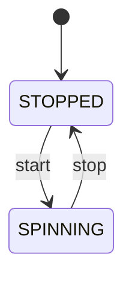

# 第 01 课参考答案

先自己做 `lessons/01-on-off/quiz.md`，再对答案。

## 1. 恰好一个状态 vs 两个布尔

两个布尔（如 `is_on` / `is_off`）可以同时为真或同时为假，出现「又开又关」的非法局面。一个状态枚举在任意时刻只占一个值，非法组合进不了类型。

## 2. 已经是 `ON` 再 `turn_on`

当前状态仍是 `ON`。不违反「一个状态」：还是恰好一个局面，只是停在原地。

## 3. 温度 0–100 当状态枚举？

不适合。状态集合必须有限、可穷举。连续温度是数据，不是局面名。

## 4. 风扇状态图



```
+----------+         start          +-----------+
| STOPPED  | ---------------------> | SPINNING  |
|          | <--------------------- |           |
+----------+          stop          +-----------+
```

## 5. 日志只打 `lamp=1`

缺了可命名的当前状态。复盘时要猜 `1` 是亮、故障还是别的局面。
