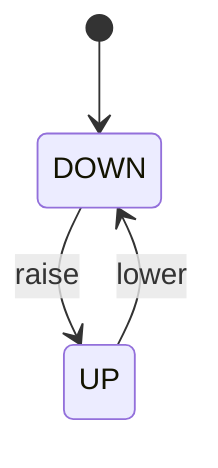

# 第 02 课参考答案

先自己做 `lessons/02-door/quiz.md`，再对答案。

## 1. 转移 vs 状态；只报当前状态不够？

状态回答「现在是什么」。转移是从一状态到另一状态的命名箭头，回答「允许怎么变」。只报当前状态，看不出开门/关门哪些路径合法。

## 2. `switch(state)` vs 两个布尔

`switch(state)` 把「从这个框出发的全部箭头」收在一个 `case` 里，漏画更容易看见。`is_open` / `is_closed` 必须永远相反，漏改一次就会「又开又关」。

## 3. 已经是 `OPEN` 再 `door_open`

当前状态仍是 `OPEN`。算转移：下一状态等于当前状态的自环（表里建议写全；图上可省略）。

## 4. 道闸状态图



```
+------+           raise            +----+
| DOWN | -------------------------> | UP |
|      | <------------------------- |    |
+------+           lower            +----+
```

## 5. Event 列写了 `door_open`，是否已引入事件类型？

没有。那一列只是借用函数名，提醒以后会变成输入名字。本课还没有 `typedef enum Event`，开门关门仍是两个函数。
