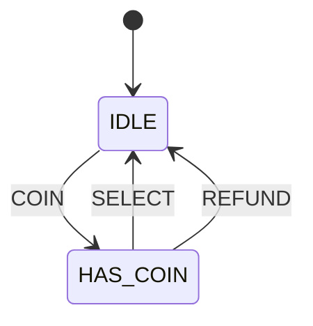

# 第 03 课参考答案

先自己做 `lessons/03-vending/quiz.md`，再对答案。

## 1. 事件 vs 转移；为何输入要单独枚举？

转移是箭头（从哪到哪）。事件是触发箭头的那一种输入。一输入一函数（`coin()` / `select()`）会复制 `switch(state)`，也无法把「所有输入」当成可打印、可穷举的集合。

## 2. `fsm_dispatch(fsm, event)` 好在哪？

所有输入走同一扇门。按 `(当前状态, 事件)` 决定走哪条箭头；没有对应行就忽略。加事件必须改枚举，漏处理更容易被看见。

## 3. `IDLE` 时分发 `SELECT`

当前状态仍是 `IDLE`。不是错误：表上没有可走的变化箭头，应写成忽略（下一状态 = `IDLE`）。图上通常不画。

## 4. 售货机状态图



```
+------+            COIN            +----------+
| IDLE | -------------------------> | HAS_COIN |
|      | <------------------------- |          |
+------+       SELECT / REFUND      +----------+
```

`IDLE` 上的 `SELECT` / `REFUND`、`HAS_COIN` 上的 `COIN` 为忽略，图上省略。

## 5. 同一 `SELECT`、不同下一状态，为何合理？

事件只命名输入，不绑定「全局唯一的下一状态」。下一状态由 `(当前状态, 事件)` 共同决定。不清楚的是没有事件类型、却在多个函数里用多种方式解释「选货」。
