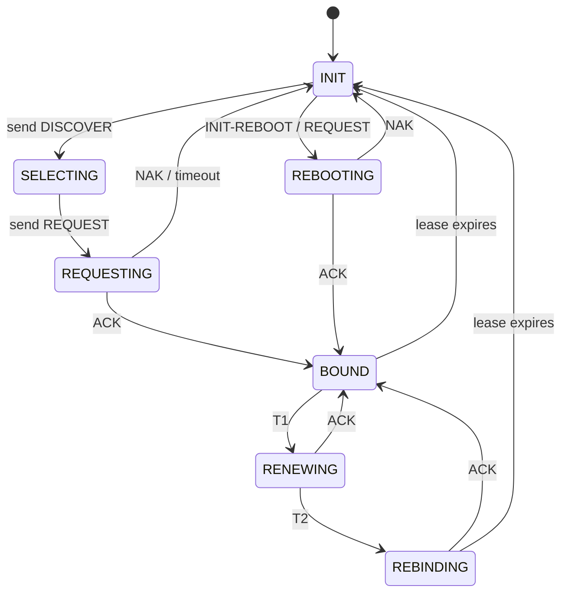
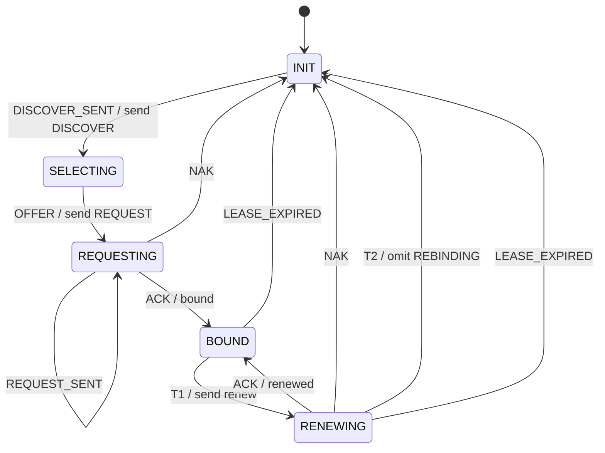

> **附录。先学完主线 01–14 再读附录。** 本篇不引入新 FSM 概念，只用已经会的表驱动，把 DHCP 客户端租约压成五态。不是协议栈，不能对接真实网络。

# 附录：教学 DHCP —— 客户端租约生命周期

真实 DHCP（RFC 2131）还有 `INIT-REBOOT` / `REBOOTING` / `REBINDING`，以及 DISCOVER/REQUEST 的重传定时器。DHCPv6（RFC 8415）报文名和状态名都不同。本附录只教 **DHCPv4 客户端拿到地址、到 T1 续租** 这一条线。

---

## 1. Motivation

主线里的 TCP 管连接，HTTP 管一次请求。主机刚入网时还有另一件事：

> 我还没有 IP。广播 DISCOVER，挑一份 OFFER，REQUEST，等到 ACK，地址才是自己的。租约过半要续，续不到要重来。

用两个布尔 `have_ip` 和 `renewing` 很快会把「正在选 offer」和「已经 bound」混在一起。租约是一台小生命周期机。

用在哪：典型 DHCP 客户端、嵌入式拿到链路后再要地址。本附录只用扁平教学机。

---

## 2. Problem Description

五个局面：

| 状态 | 意思 |
|------|------|
| `INIT` | 没有租约 |
| `SELECTING` | 已发 DISCOVER，在收 OFFER |
| `REQUESTING` | 已选定并在等 ACK |
| `BOUND` | 地址可用 |
| `RENEWING` | T1 到了，向原服务器续租 |

八个事件：`DISCOVER_SENT`、`OFFER`、`REQUEST_SENT`、`ACK`、`NAK`、`T1`、`T2`、`LEASE_EXPIRED`。

主路径：`INIT → SELECTING → REQUESTING → BOUND`。`T1` 进入 `RENEWING`，`ACK` 回 `BOUND`。`T2` **不实现 REBINDING**：打印后回到 `INIT`。没有 RELEASE。

---

## 3. Naive Solution

```c
int have_ip, renewing;

void on_ack(void)  { have_ip = 1; }
void on_t1(void)   { renewing = 1; }
void on_nak(void)  { have_ip = 0; renewing = 0; }
```

`SELECTING` 和 `REQUESTING` 都是 `have_ip==0`，日志里分不清卡在哪。`T2` 再加一个布尔，三个定时器就会和三个局面缠死。

缺的是：租约局面的名字，以及「缺格即忽略」。

---

## 4. FSM Solution

> 客户端租约是一台扁平机。DISCOVER / OFFER / REQUEST / ACK 是事件。T1 / T2 / 租约到期也是事件。`fsm_dispatch` 只查表。

```
State 枚举（5）
Event 枚举（8）
Fsm { state }
table[STATE_COUNT][EVENT_COUNT]
fsm_init
fsm_dispatch(Fsm *, Event)
```

`OFFER` 从 `SELECTING` 进 `REQUESTING`，动作里打印 `send REQUEST`。`REQUEST_SENT` 是 `REQUESTING` 上的自环：发出和收到 ACK 不是同一事件。

---

## 5. State Diagram

### RFC 2131 客户端图（图景，不是本附录代码）



灰色那些（`REBINDING`、`INIT-REBOOT`、`REBOOTING`）代码里没有枚举。

### 本附录代码实际实现的图



---

## 6. State Table

| Current State | Event | Guard | Action | Next State |
|---------------|-------|-------|--------|------------|
| INIT | DISCOVER_SENT | 有格 | send DISCOVER | SELECTING |
| SELECTING | OFFER | 有格 | send REQUEST | REQUESTING |
| REQUESTING | REQUEST_SENT | 有格 | REQUEST on wire | REQUESTING |
| REQUESTING | ACK | 有格 | bound | BOUND |
| REQUESTING | NAK | 有格 | restart | INIT |
| BOUND | T1 | 有格 | send renew | RENEWING |
| RENEWING | ACK | 有格 | renewed | BOUND |
| RENEWING | NAK | 有格 | restart | INIT |
| RENEWING | T2 | 有格 | omit REBINDING | INIT |
| BOUND | LEASE_EXPIRED | 有格 | lease dead | INIT |
| RENEWING | LEASE_EXPIRED | 有格 | lease dead | INIT |
| INIT | ACK | **无格** | ignore | INIT |
| * | （其余） | **无格** | ignore | 保持 |

---

## 7. Event Flow

```
time -->

主路径:
[ INIT ]
    --DISCOVER_SENT / send DISCOVER--> [ SELECTING ]
    --OFFER / send REQUEST--> [ REQUESTING ]
    --REQUEST_SENT--> [ REQUESTING ]
    --ACK / bound--> [ BOUND ]

续租:
[ BOUND ]
    --T1 / send renew--> [ RENEWING ]
    --ACK / renewed--> [ BOUND ]

NAK / T2 / 到期都回 INIT。INIT + ACK 必须 ignore。
```

---

## 8. Implementation

```bash
cc -std=c11 -Wall -Wextra -o dhcp code/c/dhcp.c && ./dhcp
c++ -std=c++17 -Wall -Wextra -o dhcp code/cpp/dhcp.cpp && ./dhcp
python3 code/python/dhcp.py
```

程序自包含。不要去链课程其它目录。

### 伪代码

```
states: INIT, SELECTING, REQUESTING, BOUND, RENEWING
events: DISCOVER_SENT, OFFER, REQUEST_SENT, ACK, NAK, T1, T2, LEASE_EXPIRED

dispatch(e):
    cell <- table[current][e]
    if not cell.defined: print ignore; return
    if cell.action: cell.action()
    current <- cell.next
    print prev --e--> current
```

教学怎么测：事件脚本 + 轨迹。没有 UDP 67/68，没有抓包。

---

## 9. Design Discussion

#### 9.1 RFC 图

RFC 2131 Figure 5 是客户端状态图。规范事件是「发出报文 / 收到报文 / 定时器」。本附录把「发出」也收成事件（`DISCOVER_SENT`、`REQUEST_SENT`），以便 `main` 喂枚举，不必真的发 UDP。

#### 9.2 架构

```
+------------------+   Event    +----------------------+
| link up / main   | ---------> | lease FSM            |
| (pretend UDP)    |            | State + table        |
+------------------+            +----------------------+
                                         |
                                         | printf: send DISCOVER
                                         v
                                +----------------------+
                                | UDP 67/68 (NOT here) |
                                +----------------------+
```

控制面：能不能发 DISCOVER、现在算不算 bound。数据面：xid、chaddr、option 53，本附录没有。

#### 9.3 事件分发

`fsm_dispatch` 一次一格。真实客户端：网卡收包解码成 OFFER/ACK/NAK；定时器线程到期投递 T1/T2。本附录由 `main` 直接喂。

#### 9.4 定时器

| 定时器 | RFC | 本附录 |
|--------|-----|--------|
| DISCOVER/REQUEST 重传 | 指数退避再发 | 省略 |
| T1（约租约 50%） | 单播续租 | 事件 `T1` |
| T2（约 87.5%） | 广播 REBINDING | 事件 `T2`，不进 REBINDING |
| lease | 到期回 INIT | `LEASE_EXPIRED` |

真实 DHCP 定时器比这四只还多（启动延迟、ARP 冲突探测）。DHCPv6 用另一套 T1/T2，挂在 IA 上，不是 DHCPv4 这张图。

#### 9.5 典型工业形态

常见 DHCP 客户端不是 `table[5][8]`，而是：

- 一个套接字上的会话对象（xid、选中的 server id）
- 收包函数里 `switch (msg_type)`
- 若干 timerfd / 用户态定时器

名字仍来自 RFC。嵌入式 lwIP 类栈同样是「当前 DHCP 状态字节 + 定时器回调」，不是二维教学表。

#### 9.6 与 RFC 的差异，以及故意省略

- 无 `INIT-REBOOT` / `REBOOTING`（重启后带着旧地址直接 REQUEST）
- 无 `REBINDING`：`T2` 直接回 `INIT`
- 无 RELEASE、无 DECLINE（地址冲突）
- 无 xid 匹配、无 option 校验
- 多份 OFFER 的选择策略省略（第一份 OFFER 就 REQUEST）
- **DHCPv6 是另一种协议**：Solicit / Advertise / Request / Reply，不是 DISCOVER/OFFER

#### 9.7 优化（只点名）

- 重启走 INIT-REBOOT，避免再 DISCOVER
- 租约存盘，链路闪断后快速 REQUEST
- ARP 探测再宣布地址

不要在本附录做这些。

#### 9.8 缺陷

- T1 到了却向广播地址续租，或 T2 仍只问原服务器
- xid 不匹配仍接受 ACK，租到别人的对话
- NAK 后不停 INIT，对着同一份死 offer 死循环（本附录 NAK 回 INIT，需重新 DISCOVER）
- 把 DHCPv6 IA 定时器套进 DHCPv4 五态

#### 9.9 测试

1. 主路径结束在 `BOUND`，日志含 `send DISCOVER` 和 `bound`
2. `T1` 再 `ACK`，结束仍 `BOUND`，日志含 `renewed`
3. `REQUESTING + NAK` 回 `INIT`
4. `RENEWING + T2` 回 `INIT`，打印 omit REBINDING
5. `INIT + ACK` 打印 `ignore`

---

## 10. Common Mistakes

- 用 `have_ip` 代替五态，续租和选 offer 分不开
- `T1`/`T2`/`LEASE_EXPIRED` 写成同一个 `TIMEOUT` 全局处理，BOUND 上误重传 DISCOVER
- 把 `REBINDING` 偷偷加进枚举却没有广播 REQUEST 那一格
- 动作里改 `fsm->state`，和表的 `next` 打架
- 以为跑过本附录就能对接 dhclient

---

## 11. Refactoring

加回 `REBINDING`：加一态，把 `T2` 的下一状态从 `INIT` 改成 `REBINDING`，再加 `REBINDING + ACK → BOUND`、`REBINDING + LEASE_EXPIRED → INIT`。不要改查找循环。

不要把「租约秒数」做成状态名。剩余时间是数据，到期才是事件。

---

## 12. Exercise

**容易**：给 `SELECTING + NAK` 加一格回 `INIT`（有的实现会在选 offer 时收到迟到 NAK）。只改表。

**中等**：把 `T2` 改成进入新状态 `REBINDING`，再 `ACK` 回 `BOUND`。证明 `BOUND + T2` 仍 ignore。

**挑战**：在纸上列出 DISCOVER 重传需要的格子（自环 + 次数用尽回 INIT）。次数放上下文，不要发明 `DISCOVER_RETRY_1` 状态。

---

## 13. Summary

- 教学 DHCP 五态：`INIT` `SELECTING` `REQUESTING` `BOUND` `RENEWING`
- 主路径四步拿到租约；`T1` 续租回 `BOUND`
- `T2` 故意不进 REBINDING；真实协议定时器更多
- DHCPv6 不是这张图
- 测试靠轨迹，无真实 UDP
