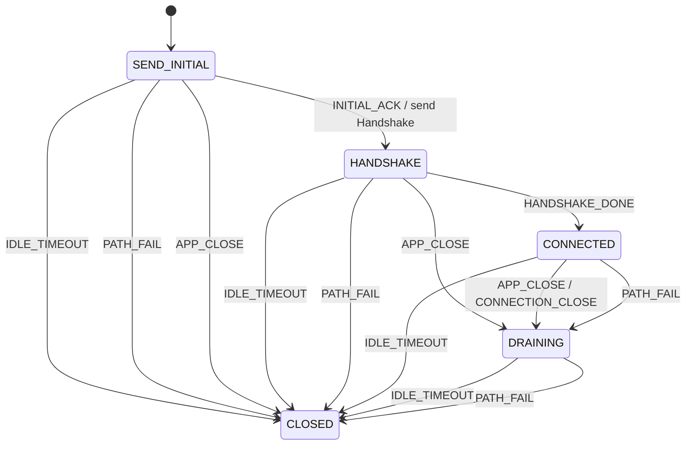

> **附录。先学完主线 01–14 再读附录。** 本篇不引入新 FSM 概念。只教 **连接级** 局面。流、丢包恢复、拥塞控制都不是这台机。

# 附录：教学 QUIC —— 连接级 FSM

QUIC（RFC 9000）不是「UDP 上的 TCP」。连接用 Connection ID，不靠四元组唯一确定；可靠传输按 **packet number space** 做，不是按连接状态重传 SYN。每条 **stream** 另有自己的发送/接收状态机。本附录五个状态只管：握手有没有完、应用要不要关、空闲是否到期、路径是不是废了。

---

## 1. Motivation

若把 QUIC 想成 TCP 十一态，会把 `TIME_WAIT`、`SYN_SENT` 硬套过来。QUIC 没有那些名字。连接要回答的是另一组问题：

> Initial 有没有被确认？Handshake 完了没有？应用关了之后还要不要读一会儿包？空闲太久？路径坏了？

用 `connected` 一个布尔：Draining 时仍可能收包，却已经不能开新流。布尔分不清。

用在哪：典型 QUIC 库的连接对象。本附录只跑教学连接机。

---

## 2. Problem Description

| 状态 | 意思 |
|------|------|
| `SEND_INITIAL` | 已（或正在）发 Initial |
| `HANDSHAKE` | Initial 已被确认，Handshake 未完 |
| `CONNECTED` | 握手完成，可开流（流本身不在本机） |
| `DRAINING` | 已决定关，还在消化迟到包 |
| `CLOSED` | 连接消失 |

事件：`INITIAL_ACK`、`HANDSHAKE_DONE`、`APP_CLOSE`、`IDLE_TIMEOUT`、`PATH_FAIL`。

主路径：`SEND_INITIAL -INITIAL_ACK-> HANDSHAKE -HANDSHAKE_DONE-> CONNECTED`。`APP_CLOSE` 进 `DRAINING`，再 `IDLE_TIMEOUT` 进 `CLOSED`。握手未完成就 `PATH_FAIL` / `IDLE_TIMEOUT` 直接 `CLOSED`。

省略：流状态、丢包恢复、0-RTT、连接迁移成功路径、CLOSING 与 DRAINING 的细拆、版本协商。

---

## 3. Naive Solution

```c
int handshake_done, draining;

void on_ack(void) { /* 分不清是 Initial ACK 还是 1-RTT ACK */ }
void on_idle(void) { handshake_done = 0; }
```

空闲超时在握手中和已连接后含义不同：前者是握手失败，后者是拆连接。一个 `on_idle` 会写错动作。把每条 stream 的 `fin` 焊进连接布尔，连接一关所有流的局面就丢了。

缺的是：连接五态，以及「流是别的机」。

---

## 4. FSM Solution

> 连接是一台扁平机。流是许多台更小的机，本附录不实现。丢包恢复看 packet number，不看这五个状态名。

```
State 枚举（5）
Event 枚举（5）
Fsm { state }
table[STATE_COUNT][EVENT_COUNT]
fsm_init
fsm_dispatch(Fsm *, Event)
```

`HANDSHAKE_DONE` 只从 `HANDSHAKE` 进入 `CONNECTED`。`SEND_INITIAL` 上喂它必须 ignore——不能跳过 Initial 被确认这一跳。

---

## 5. State Diagram

### RFC 9000 连接寿命（图景，不是本附录代码）

```
+-----------+  Initial + Handshake  +-------------+
| handshake | --------------------> | confirmed   |
+-----------+                       +-------------+
      |                                    |
      | idle/path fail                     | CONNECTION_CLOSE / idle
      v                                    v
+--------+     draining/closing      +---------+
| closed | <------------------------ | closing |
+--------+                           +---------+
```

旁边还有：每个 stream 的 `open / send / recv / reset`；每个 packet number space 的丢包时钟。那些 **不是** 连接框里的子状态，是并列的机。

### 本附录代码实际实现的图



---

## 6. State Table

| Current State | Event | Guard | Action | Next State |
|---------------|-------|-------|--------|------------|
| SEND_INITIAL | INITIAL_ACK | 有格 | send Handshake | HANDSHAKE |
| SEND_INITIAL | IDLE_TIMEOUT | 有格 | idle close | CLOSED |
| SEND_INITIAL | PATH_FAIL | 有格 | path fail | CLOSED |
| SEND_INITIAL | APP_CLOSE | 有格 | abandon | CLOSED |
| HANDSHAKE | HANDSHAKE_DONE | 有格 | connected | CONNECTED |
| HANDSHAKE | APP_CLOSE | 有格 | CONNECTION_CLOSE | DRAINING |
| HANDSHAKE | IDLE_TIMEOUT | 有格 | idle close | CLOSED |
| HANDSHAKE | PATH_FAIL | 有格 | path fail | CLOSED |
| CONNECTED | APP_CLOSE | 有格 | CONNECTION_CLOSE | DRAINING |
| CONNECTED | PATH_FAIL | 有格 | path fail | DRAINING |
| CONNECTED | IDLE_TIMEOUT | 有格 | idle close | CLOSED |
| DRAINING | IDLE_TIMEOUT | 有格 | drained | CLOSED |
| DRAINING | PATH_FAIL | 有格 | drained | CLOSED |
| SEND_INITIAL | HANDSHAKE_DONE | **无格** | ignore | SEND_INITIAL |
| * | （其余） | **无格** | ignore | 保持 |

已连接后的 `PATH_FAIL` 进 `DRAINING`（教学：先关再走）；握手中的 `PATH_FAIL` 直接 `CLOSED`（还没有可 drain 的 1-RTT 会话）。

---

## 7. Event Flow

```
time -->

主路径:
[ SEND_INITIAL ]
    --INITIAL_ACK / send Handshake--> [ HANDSHAKE ]
    --HANDSHAKE_DONE / connected--> [ CONNECTED ]

应用关闭:
[ CONNECTED ]
    --APP_CLOSE / CONNECTION_CLOSE--> [ DRAINING ]
    --IDLE_TIMEOUT / drained--> [ CLOSED ]

空闲:
[ CONNECTED ] --IDLE_TIMEOUT--> [ CLOSED ]

缺格:
[ SEND_INITIAL ] --HANDSHAKE_DONE--> ignore
```

---

## 8. Implementation

```bash
cc -std=c11 -Wall -Wextra -o quic code/c/quic.c && ./quic
c++ -std=c++17 -Wall -Wextra -o quic code/cpp/quic.cpp && ./quic
python3 code/python/quic.py
```

程序自包含。没有 UDP，没有 stream 帧。

### 伪代码

```
states: SEND_INITIAL, HANDSHAKE, CONNECTED, DRAINING, CLOSED
events: INITIAL_ACK, HANDSHAKE_DONE, APP_CLOSE, IDLE_TIMEOUT, PATH_FAIL

dispatch(e): look up table; missing cell prints ignore
```

测试：事件脚本 + 轨迹。不要对真实 QUIC 端口发包。

---

## 9. Design Discussion

#### 9.1 RFC 图

RFC 9000 用文字描述 closing/draining，用另一章描述 stream 状态（Figure 17 一类图）。连接级和流级是两张图。丢包恢复在 RFC 9002，又是第三张「算法」，不是连接 FSM 的额外状态。

本附录只实现连接级压缩图。

#### 9.2 架构

```
+------------------+     APP_CLOSE      +----------------------+
| application      | -----------------> | connection FSM       |
| streams (many)   |                     | (this appendix)      |
+------------------+                     +----------------------+
        ^                                          |
        | each stream is its own machine           | send packets
        | (NOT implemented here)                   v
                                           +----------------------+
                                           | UDP + loss recovery  |
                                           | (RFC 9002, NOT here) |
                                           +----------------------+
```

控制面：连接局面。数据面：帧、流缓冲、拥塞窗口。损失恢复读 RTT 和 ack，不读 `SEND_INITIAL` 这个名字来决定重传哪一包。

#### 9.3 事件分发

教学：一次 `fsm_dispatch`。真实库：收包循环解码帧；ACK 可能同时推进丢包引擎 **和** （若还在握手）连接局面；应用关闭从另一侧进来。不要把「收到 ACK」当成只有连接机在听——多数 ACK 只喂丢包引擎。

#### 9.4 定时器

| 定时器 | 谁在用 | 本附录 |
|--------|--------|--------|
| PTO / 丢包 | RFC 9002 | **不是连接事件**，省略 |
| idle timeout | 连接 | `IDLE_TIMEOUT` |
| draining period | 关连接后 | 教学里复用 `IDLE_TIMEOUT` |
| handshake timeout | 常并入 idle / PTO | 握手态上的 `IDLE_TIMEOUT` |

不要把 PTO 到期写成 `CONNECTED → CLOSED`。那只会误拆还活着的连接。

#### 9.5 典型工业形态

典型 QUIC 库（用户态）：

- 每个连接一个对象：CIDs、三个 packet number space、流表
- 握手往往交给 TLS 1.3 状态（密钥），连接对象另记「握手是否 confirmed」
- 关闭：`CLOSING` 还可能重发 CONNECTION_CLOSE；`DRAINING` 只收不发

不是 `table[5][5]`。教学表只帮你先记住五个局面。

#### 9.6 与 RFC 的差异，以及故意省略

- 无独立的 `CLOSING`（与 `DRAINING` 合并）
- 无 stream 状态机
- 无丢包 / 拥塞
- 无 0-RTT、无成功的路径迁移（`PATH_FAIL` 只失败，不换路）
- 无版本协商、无 CID 轮换
- Initial ACK 在真实协议里是丢包引擎的事；教学把它提升成连接事件，为了让主路径看得见

QUIC **不是 TCP**。不要把本附录五态映射回 `SYN_SENT` / `TIME_WAIT`。

#### 9.7 优化（只点名）

- 连接迁移：路径失败先试新路径，而不是立刻 drain
- 0-RTT：握手确认前就开流（有重放代价）
- 多 CID、负载均衡
- GSO / 硬件校验：数据面

#### 9.8 缺陷

- 把 stream reset 当成连接关闭
- idle 超时在有 PING 或未完成握手时算错
- draining 期间仍开新流
- 用 TCP 的 `TIME_WAIT` 去理解 draining（不同：QUIC 靠 CONNECTION_CLOSE 和 CID，不靠 2MSL 四元组）

#### 9.9 测试

1. 主路径结束 `CONNECTED`，含 `send Handshake`
2. `APP_CLOSE` 再 `IDLE_TIMEOUT` 结束 `CLOSED`
3. `CONNECTED + IDLE_TIMEOUT` 直接 `CLOSED`
4. `SEND_INITIAL + HANDSHAKE_DONE` 打印 `ignore`
5. 握手中 `PATH_FAIL` 进 `CLOSED`，已连接 `PATH_FAIL` 进 `DRAINING`

---

## 10. Common Mistakes

- 把 QUIC 画成 TCP 十一态换皮
- 在连接机里加 `STREAM_4_OPEN` 这种状态
- `IDLE_TIMEOUT` 和 PTO 共用一个回调
- `HANDSHAKE_DONE` 允许从 `SEND_INITIAL` 跳进 `CONNECTED`
- 以为跑过本附录就能对接真实 QUIC 库

---

## 11. Refactoring

加回 `CLOSING`：`APP_CLOSE` 先到 `CLOSING`（还可重发 CONNECTION_CLOSE），再一格到 `DRAINING`。不要改 `fsm_dispatch` 的查找。

流：另起 `StreamFsm`，连接 `CONNECTED` 只是「允许创建流」。不要把流 id 写进连接状态名。

---

## 12. Exercise

**容易**：给 `CONNECTED + INITIAL_ACK` 加一格自环，打印 `late Initial ACK`（教学：迟到握手包）。只改表。

**中等**：拆出 `CLOSING`。`APP_CLOSE → CLOSING`，`CLOSING + IDLE_TIMEOUT → DRAINING`，再 `IDLE_TIMEOUT → CLOSED`。证明 `SEND_INITIAL + HANDSHAKE_DONE` 仍 ignore。

**挑战**：在纸上画一条 stream 的发送状态（ready / send / data sent / data recvd / reset），指出它与本附录哪一个连接状态可以并存。不要把那些名字加进连接枚举。

---

## 13. Summary

- 教学 QUIC 五态只描述连接，不描述流，也不描述丢包
- 主路径：`SEND_INITIAL → HANDSHAKE → CONNECTED`
- `APP_CLOSE` 走 `DRAINING`；空闲和握手失败走 `CLOSED`
- QUIC 不是 TCP；TLS 握手密钥在旁边，不在这张表里
- 测试靠轨迹，无真实 UDP
