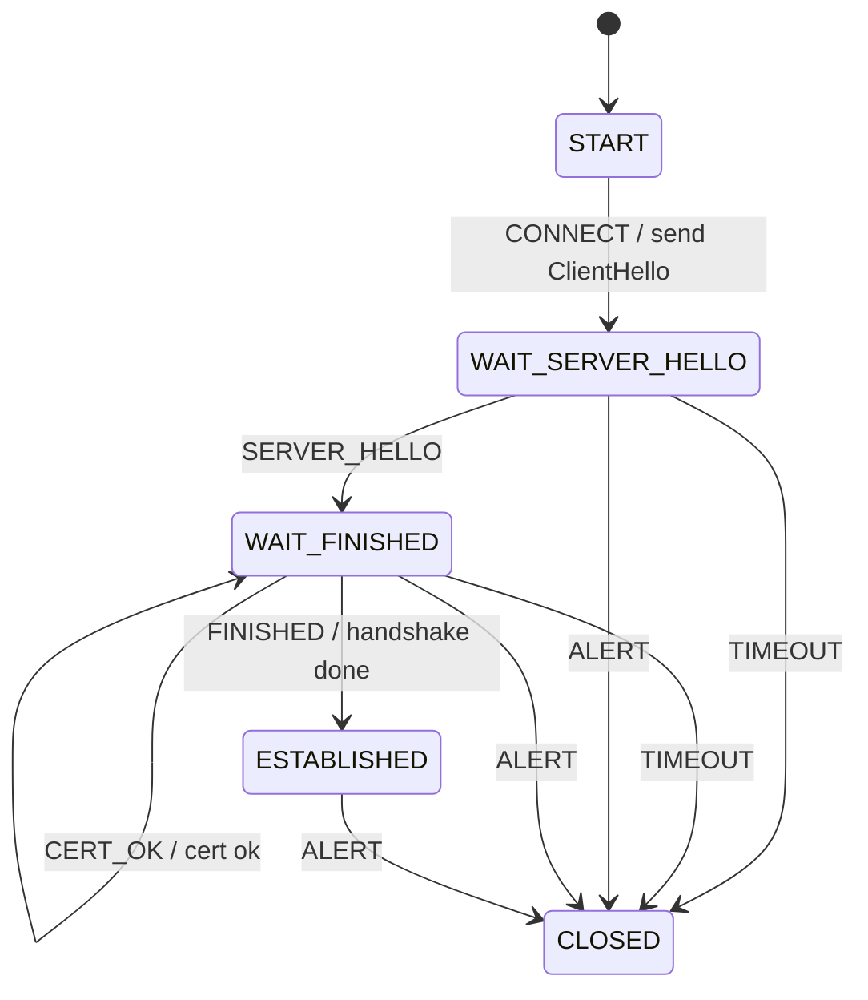

> **附录。先学完主线 01–14 再读附录。** 本篇不引入新 FSM 概念。这是 **握手控制面**，不是密码学，没有密钥调度、没有 AEAD。

# 附录：教学 TLS —— 握手 FSM，不是加密

真实 TLS 1.3（RFC 8446）一次握手是多条消息叠在同一 flight 里：ServerHello、EncryptedExtensions、Certificate、CertificateVerify、Finished。还有 0-RTT、会话票证、HelloRetryRequest、密钥更新。本附录五态六事件，只回答「握手走到哪了」。

---

## 1. Motivation

TCP 的 `ESTABLISHED` 只表示字节能传。TLS 还要先对齐版本、证书、Finished。若用 `handshake_done` 一个布尔：

- 超时、对端 Alert、证书失败会和「还在等 ServerHello」挤在同一个 `0` 里
- 日志看不出卡在 hello 还是卡在 Finished

握手需要自己的局面名字。密码计算是另一条流水线，不要焊进状态枚举。

用在哪：典型 TLS 客户端握手、嵌入式 millTLS 类栈的控制面。本附录只跑教学机。

---

## 2. Problem Description

| 状态 | 意思 |
|------|------|
| `START` | 尚未发起 |
| `WAIT_SERVER_HELLO` | 已发 ClientHello |
| `WAIT_FINISHED` | 已见 ServerHello，还在等证书/Finished |
| `ESTABLISHED` | 握手完成（教学里到此为止） |
| `CLOSED` | 失败或告警后结束 |

事件：`CONNECT`、`SERVER_HELLO`、`CERT_OK`、`FINISHED`、`ALERT`、`TIMEOUT`。

主路径：`START -CONNECT-> WAIT_SERVER_HELLO -SERVER_HELLO-> WAIT_FINISHED -CERT_OK-> WAIT_FINISHED -FINISHED-> ESTABLISHED`。`CERT_OK` 自环：证书校验是握手里的一步，不必再发明 `WAIT_CERT`。Alert 与等待态超时进 `CLOSED`。

省略：完整 1.3 flight、0-RTT、session tickets、HelloRetryRequest、双向证书、密钥更新。

---

## 3. Naive Solution

```c
int connected, got_hello, got_cert, done;

void on_finished(void) { done = 1; connected = 1; }
```

`got_hello==0` 时 Finished 仍可能把 `done` 置 1。Alert 来了不知道该清哪几个标志。超时回调里若写 `done=0`，和下一次 CONNECT 抢同一组布尔。

缺的是：五个局面，以及「未列出的组合忽略」。

---

## 4. FSM Solution

> TLS 握手是一台扁平机。报文到达和超时是事件。密码学成功只表现为 `CERT_OK` 这种已经判定过的事件，不在状态机里做验签。

```
State 枚举（5）
Event 枚举（6）
Fsm { state }
table[STATE_COUNT][EVENT_COUNT]
fsm_init
fsm_dispatch(Fsm *, Event)
```

表不强制「必须先 CERT_OK 再 FINISHED」：教学为了短，两格独立。演示脚本按正确顺序喂。真实栈会在 Finished 之前验证证书链。

---

## 5. State Diagram

### RFC 8446 握手 flight（图景，不是本附录代码）

```
Client                                          Server
------                                          ------
ClientHello          -------->
                                            ServerHello
                                  EncryptedExtensions
                                  Certificate
                                  CertificateVerify
                                            Finished
                     <--------
Certificate*
CertificateVerify*
Finished             -------->
[Application Data]   <------->              [Application Data]
```

0-RTT 会在 ClientHello 之后立刻带早期数据。票证在 NewSessionTicket 里，握手之后才来。本附录代码都没有。

### 本附录代码实际实现的图



---

## 6. State Table

| Current State | Event | Guard | Action | Next State |
|---------------|-------|-------|--------|------------|
| START | CONNECT | 有格 | send ClientHello | WAIT_SERVER_HELLO |
| WAIT_SERVER_HELLO | SERVER_HELLO | 有格 | got ServerHello | WAIT_FINISHED |
| WAIT_FINISHED | CERT_OK | 有格 | cert ok | WAIT_FINISHED |
| WAIT_FINISHED | FINISHED | 有格 | handshake done | ESTABLISHED |
| WAIT_SERVER_HELLO | TIMEOUT | 有格 | timeout | CLOSED |
| WAIT_FINISHED | TIMEOUT | 有格 | timeout | CLOSED |
| WAIT_SERVER_HELLO | ALERT | 有格 | alert | CLOSED |
| WAIT_FINISHED | ALERT | 有格 | alert | CLOSED |
| ESTABLISHED | ALERT | 有格 | alert | CLOSED |
| START | FINISHED | **无格** | ignore | START |
| * | （其余） | **无格** | ignore | 保持 |

`CLOSED` 没有格子：再喂任何事件都 ignore，停在 `CLOSED`。

---

## 7. Event Flow

```
time -->

握手:
[ START ]
    --CONNECT / send ClientHello--> [ WAIT_SERVER_HELLO ]
    --SERVER_HELLO--> [ WAIT_FINISHED ]
    --CERT_OK / cert ok--> [ WAIT_FINISHED ]
    --FINISHED / handshake done--> [ ESTABLISHED ]

超时:
[ START ] --CONNECT--> [ WAIT_SERVER_HELLO ]
    --TIMEOUT--> [ CLOSED ]

告警:
[ ESTABLISHED ] --ALERT--> [ CLOSED ]

缺格:
[ START ] --FINISHED--> ignore, 仍是 START
```

---

## 8. Implementation

```bash
cc -std=c11 -Wall -Wextra -o tls code/c/tls.c && ./tls
c++ -std=c++17 -Wall -Wextra -o tls code/cpp/tls.cpp && ./tls
python3 code/python/tls.py
```

程序自包含。动作只打印，不跑哈希、不验证书。

### 伪代码

```
states: START, WAIT_SERVER_HELLO, WAIT_FINISHED, ESTABLISHED, CLOSED
events: CONNECT, SERVER_HELLO, CERT_OK, FINISHED, ALERT, TIMEOUT

dispatch(e):
    cell <- table[current][e]
    if not cell.defined: print ignore; return
    run action; current <- next
```

测试：事件脚本 + 轨迹。不要对 443 建连。

---

## 9. Design Discussion

#### 9.1 RFC 图

RFC 8446 用消息 flight 描述握手，几乎不画五态图。实现却人人都有「当前等哪一类记录」。把 flight 压成 `WAIT_SERVER_HELLO` / `WAIT_FINISHED` 是教学压缩，不是规范原文。

TLS 1.2 还多一轮 ServerHelloDone / ClientKeyExchange。不要把 1.2 的状态名套进本附录。

#### 9.2 架构

```
+------------------+  CONNECT/ALERT   +----------------------+
| application      | ---------------> | handshake FSM        |
|                  |                  | (this appendix)      |
+------------------+                  +----------------------+
                                               |
                                               | send ClientHello
                                               v
                                      +----------------------+
                                      | record layer / crypto|
                                      | NOT in this lesson   |
                                      +----------------------+
```

控制面：握手局面。数据面：记录分帧、密钥、AEAD。`ESTABLISHED` 之后真实栈几乎不再走进握手机。

#### 9.3 事件分发

教学：`main` 调 `fsm_dispatch`。真实客户端：套接字可读 → 解密记录 → 按握手类型投递；时钟到期投递 `TIMEOUT`；对端 `Alert` 是另一种记录。本附录没有记录层，所以 `SERVER_HELLO` 已经是「解码之后」的事件。

#### 9.4 定时器

| 定时器 | 含义 | 本附录 |
|--------|------|--------|
| 握手超时 | 等 ServerHello / Finished 太久 | `TIMEOUT` → `CLOSED` |
| 重传（DTLS） | 丢包再发飞行 | 省略（这是 TLS over UDP） |
| ticket 寿命 | 会话恢复 | 省略 |
| key update | 1.3 流量密钥更换 | 省略，不是连接关闭 |

`ESTABLISHED` 上没有 `TIMEOUT` 格：应用层空闲超时是另一台机（或另一格），不要和握手超时共用 handler。

#### 9.5 典型工业形态

OpenSSL / BoringSSL / 典型用户态 TLS：

- 一个 `SSL` 对象上的握手状态（内部名字远多于五个）
- I/O 是 `SSL_connect` / `SSL_read` 的非阻塞循环，不是二维教学表
- 证书校验常在回调里，失败再变成 Alert

嵌入式栈同样是「握手状态字节 + 收包驱动」。没有人用 `table[5][6]` 上生产，但问的仍是「当前局面遇到这条记录去哪」。

#### 9.6 与 RFC 的差异，以及故意省略

- 把 ServerHello、EE、Certificate、CertVerify、Finished 收成两三个事件
- 无 0-RTT（ClientHello 带早期数据，失败还要回退）
- 无 session tickets / PSK 恢复
- 无 HelloRetryRequest（换 group 再来一次 ClientHello）
- 无密钥计算、无记录层、无应用数据
- 无 TLS 1.2 兼容路径

这是握手 FSM，**不是** 加密课。

#### 9.7 优化（只点名）

- 会话恢复 / PSK：少一次完整证书链
- 0-RTT：首个 RTT 就发应用数据（有重放代价）
- 硬件加速只加速数据面，不减少握手状态个数
- False Start（1.2 时代）提前发数据——本附录不涉及

#### 9.8 缺陷

- 未校验证书就进 `ESTABLISHED`
- 握手超时和 TCP 超时抢同一回调，误关已完成的会话
- 把 Alert 当应用数据
- 实现 0-RTT 却没有反重放窗口

#### 9.9 测试

1. 主路径结束 `ESTABLISHED`，含 `send ClientHello` 和 `handshake done`
2. `WAIT_SERVER_HELLO + TIMEOUT` 进 `CLOSED`
3. `ESTABLISHED + ALERT` 进 `CLOSED`
4. `START + FINISHED` 打印 `ignore`
5. `CERT_OK` 后仍是 `WAIT_FINISHED`（自环）

---

## 10. Common Mistakes

- 把 `ESTABLISHED` 当成「已经安全」，却从没喂 `CERT_OK`
- 为 Certificate / CertVerify / Finished 各做一个顶层状态，表膨胀，信息不增加
- 在 `action` 里调用真加密库，附录变成无法离线跑的演示
- `TIMEOUT` 写在 `ESTABLISHED` 上当 keepalive，握手失败和空闲断线分不清
- 把 0-RTT 早期数据画进这五个状态里

---

## 11. Refactoring

若要强制「先证书后 Finished」：加上下文 `cert_ok`，`FINISHED` 格子上做监护；缺证书则 ignore 或进 `CLOSED`。不要加 `WAIT_CERT` 除非你真的要教多一个局面。

0-RTT 应另想一条早期数据路径，或另起一台很小的机，不要塞进 `START`。

---

## 12. Exercise

**容易**：给 `WAIT_FINISHED + ALERT` 的动作字符串改成 `alert before finished`，与 `ESTABLISHED + ALERT` 区分。只改动作，不改状态。

**中等**：加上下文 `cert_ok`。未见 `CERT_OK` 时 `FINISHED` 进 `CLOSED`。用轨迹证明顺序反了会失败。

**挑战**：在纸上画出 0-RTT 需要多哪些格子（早期数据发出、ServerHello 拒绝 0-RTT、回退到完整握手）。仍用扁平表，不要画套圈。

---

## 13. Summary

- 教学 TLS 五态：`START` `WAIT_SERVER_HELLO` `WAIT_FINISHED` `ESTABLISHED` `CLOSED`
- `CERT_OK` 自环；Alert / 握手超时进 `CLOSED`
- 这是握手控制面，不是加密实现
- 完整 1.3 flight、0-RTT、票证故意省略
- 测试靠轨迹，不对真实 443
