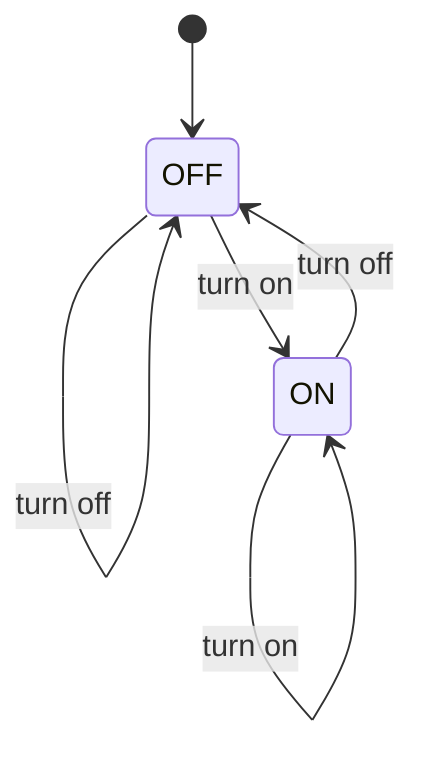

# 第 01 课：On / Off —— 状态（State）

本课只引入一个概念：**状态**。

一台机器在任意时刻只占据一个状态。先把这件事想清楚，后面所有设计才站得住。

---

## 1. Motivation

开关、指示灯、使能位、链路是否起来，看起来都是「一个布尔值」。布尔值能用，但很快会把「现在是什么」和「允许变成什么」混在一起。

状态这个概念存在，是为了把 **系统此刻是什么** 变成一等公民：可命名、可打印、可检查、可画在纸上。

没有它，你只有一堆变量；有了它，你才有「当前局面」。

用在哪：嵌入式 GPIO、GUI 控件开关、网卡链路、功能使能。本课只用灯。

---

## 2. Problem Description

一盏灯有两种局面：

- 灭
- 亮

你可以开灯、关灯。开着的时候再开，灯仍然亮。关着的时候再关，灯仍然灭。

问题不是电路，而是：用什么方式，让程序和人都能回答「现在灯是什么局面」。

---

## 3. Naive Solution

初学者通常写：

```c
int lamp_on = 0;

void turn_on(void)  { lamp_on = 1; }
void turn_off(void) { lamp_on = 0; }
```

这能工作。乱从这里开始：

- `1` / `0` 没有名字，读日志时要猜
- 第三个局面（故障、闪烁）一加，布尔就不够用，只能再堆 `int` 标志
- 「现在是什么」散落在各个函数的赋值里，没有一个地方能一眼看完

布尔不是错误。错误是：把局面当成普通数字，而不是一种有限的、可枚举的存在。

---

## 4. FSM Solution

先不要想「机器」两个字。本课只要一句话：

> 灯在任意时刻处于且仅处于一个命名过的局面。我们把这个局面叫做状态。

两个状态：

- `OFF`
- `ON`

程序里用枚举保存「当前状态」。开灯、关灯只是把当前状态改成另一个合法局面。

为什么这比布尔好：

- 名字就是文档
- 非法局面（比如写成 `2`）编译期或运行期能抓
- 以后加状态时，你会被迫看见所有「当前是什么」的分支

本课 **不** 把「从 OFF 到 ON」命名为专门术语。你只要会改当前状态。

---

## 5. State Diagram



读图规则（本课够用）：

- 圆角框是状态
- 灯永远待在其中一个框里
- 箭头只是「改当前状态」的路径，名字留到下一课

ASCII 对照：

```
+-------+          turn on           +------+
|  OFF  | -------------------------> |  ON  |
|       | <------------------------- |      |
+-------+          turn off          +------+
```

---

## 6. State Table

本课还没有引入后续列里那些术语。表先写成「当前局面、我们做了什么、新局面」。后两列留空，提醒你：它们存在，但不是本课的概念。

| Current State | What we do | Guard | Action | Next State |
|---------------|------------|-------|--------|------------|
| OFF | turn on | （尚未引入） | （尚未引入） | ON |
| OFF | turn off | （尚未引入） | （尚未引入） | OFF |
| ON | turn off | （尚未引入） | （尚未引入） | OFF |
| ON | turn on | （尚未引入） | （尚未引入） | ON |

注意最后两行：在已经是目标局面时，当前状态不变。这不是缺陷，这是「任意时刻恰好一个状态」的直接推论。

---

## 7. Event Flow

把时间画成一条线。方框里的字是 **当时占据的状态**。

```
time -->

[ OFF ] --turn on--> [ ON ] --turn on--> [ ON ] --turn off--> [ OFF ]
```

执行顺序：

1. 上电：当前状态 = `OFF`
2. 开灯：当前状态变成 `ON`
3. 再开灯：当前状态仍是 `ON`
4. 关灯：当前状态变成 `OFF`

调试时只问一句：这一刻的当前状态是什么？

---

## 8. Implementation

同一架构：`State` 枚举 + `Fsm` 结构体里一个 `state` 字段。没有事件类型。

运行：

```bash
cc -std=c11 -Wall -Wextra -o lamp code/c/lamp.c && ./lamp
c++ -std=c++17 -Wall -Wextra -o lamp code/cpp/lamp.cpp && ./lamp
python3 code/python/lamp.py
```

### 伪代码

```
states: OFF, ON
current <- OFF

turn_on:
    if current is OFF:
        current <- ON

turn_off:
    if current is ON:
        current <- OFF
```

C / C++ / Python 见 `code/`。三份程序打印同一段轨迹。

---

## 9. Design Discussion

为什么好：

- 「现在是什么」只有一个字段
- 打印状态就能复盘
- 加第三种局面时，枚举会逼你改所有分支

替代：

- 继续用 `bool`：两种局面时够用，第三种就痛
- 用字符串 `"on"`：能跑，拼写错误要到运行期才发现

取舍：本课用枚举，是因为状态集合必须有限、可穷举。无限局面（任意温度）不是本课的状态机。

工业上：驱动里的链路 up/down、功能 enable/disable，第一步往往就是一个状态枚举。复杂协议会在后面几课出现。

---

## 10. Common Mistakes

初学者：

- 用好几个 `int` 标志表示同一盏灯（`is_on` 和 `is_off` 同时为真）
- 忘记初始化，当前状态是内存垃圾
- 把「想要的结果」和「当前状态」写在同一个变量里

工业上：

- 日志只打 `1`/`0`，出事无法复盘
- 状态枚举与真实硬件不一致（软件以为 ON，灯其实没电）

---

## 11. Refactoring

下一课会给「从哪个状态到哪个状态」一个正式名字。本课先保持函数 `lamp_turn_on` / `lamp_turn_off`。

若你已经想写成一张表：停住。表驱动是第 08 课的概念。现在用手写 `if` 是故意的。

---

## 12. Exercise

**容易**

给风扇加上 `SPINNING` / `STOPPED` 两个状态。初始化为 `STOPPED`。

**中等**

第三种局面 `BROKEN`：一旦进入，开和关都不能把它改走。先只改枚举和 `if`，不要引入新术语。

**挑战**

画出「静音键」的两个状态，并列出一张与本课相同列名的表。不要发明第三种状态。

---

## 13. Summary

- 状态 = 系统此刻占据的、可命名的局面
- 任意时刻恰好一个当前状态
- 用枚举，不用魔法数字
- 本课还没有给「箭头」和「输入」起正式名字

下一课：门。新概念是 **转移（Transition）**。
