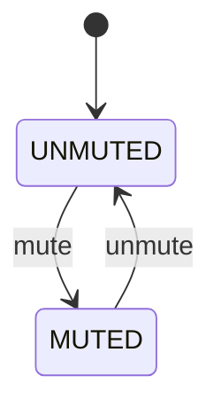

# 第 01 课：五个代表例（状态）

主例「灯」的完整实现在 `code/`。其余四例只建立直觉：问题、图、表、复杂度、用途、常见缺陷、如何变复杂。

复杂度用「状态个数」衡量。本课没有输入类型，所以没有「事件个数」。

---

## 例 1：灯（主例）

**问题**：灯要么灭要么亮。

**状态图**：见 `LESSON.md`。

**状态表**：`OFF`/`ON`，开灯关灯改变当前状态。

**实现**：`code/c/lamp.c`、`code/cpp/lamp.cpp`、`code/python/lamp.py`。

**复杂度**：2 个状态。

**工业用途**：电源指示、使能位。

**常见缺陷**：`is_on` 与 `is_off` 两个标志不同步。

**重构**：以后变成闪烁灯，需要第三个状态，布尔方案会先崩。

---

## 例 2：静音

**问题**：扬声器 MUTED / UNMUTED。



| Current State | What we do | Next State |
|---------------|------------|------------|
| UNMUTED | mute | MUTED |
| MUTED | unmute | UNMUTED |
| UNMUTED | unmute | UNMUTED |
| MUTED | mute | MUTED |

**复杂度**：2。

**工业用途**：通话、会议软件、车机音量。

**常见缺陷**：静音状态和音量大小混在一个变量里。音量是数据，静音是状态。

**重构**：以后要加「仅耳机静音」，状态会增加；音量仍是普通整数。

---

## 例 3：GPIO 电平

**问题**：引脚 LOW / HIGH。

软件里的状态必须和硬件采样一致。状态个数仍是 2，但「谁是权威」变了：硬件才是真局面，软件枚举是影子。

**复杂度**：2。

**工业用途**：嵌入式输出脚、继电器线圈。

**常见缺陷**：软件写了 HIGH，没有确认寄存器，日志骗人。

**重构**：加上「高阻」会变成 3 个状态，布尔立刻不够。

---

## 例 4：管理开关

**问题**：功能 DISABLED / ENABLED。

这不是灯，是策略：禁用时，业务代码根本不该跑。当前状态是总闸。

**复杂度**：2。

**工业用途**：特性开关、维护模式。

**常见缺陷**：用配置文件的字符串判断，散落得到处都是 `if (enabled)`，没有单一当前状态。

**重构**：加上「只读模式」需要第三状态。

---

## 例 5：链路 up / down

**问题**：网口 DOWN / UP。

```
+------+                    +----+
| DOWN | -----------------> | UP |
|      | <----------------- |    |
+------+                    +----+
```

**复杂度**：2（教学）。真实设备还有 testing、dormant 等局面，那是以后的课。

**工业用途**：网卡、无线关联之前的载波检测。

**常见缺陷**：把「有线插着」和「协议已经通」挤在一个布尔里。

**重构**：本课保持 2 个状态。链路协商的更多局面留给协议课。
