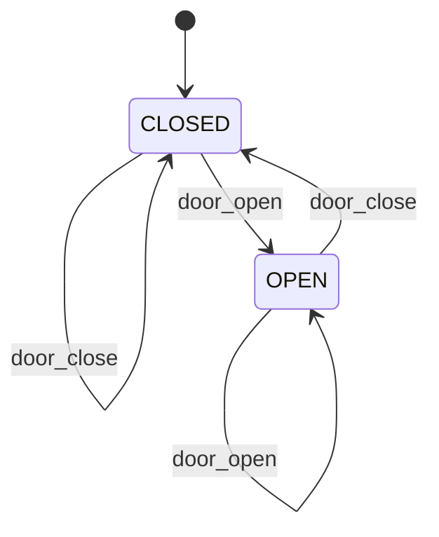

# 第 02 课：门 —— 转移（Transition）

本课只引入一个概念：**转移**。

上一课已经有了状态：灯在任意时刻占据 `OFF` 或 `ON`。本课给「从哪个状态到哪个状态」这条箭头起一个正式名字。

---

## 1. Motivation

第 01 课的灯能工作，是因为局面只有两个，改当前状态的路径也很少。门看起来一样简单：关着、开着。可一旦你要向别人（或向未来的自己）说明「允许怎么变」，只报当前状态就不够了。

状态回答：现在是什么。
转移回答：可以从这里走到哪里。

没有转移这个概念，图上的箭头只是你随手画的线；有了它，每一条箭头都是一条可检查的规则：从哪个局面出发、到哪个局面结束。

用在哪：门锁、道闸、断路器、互斥锁。本课只用门。

---

## 2. Problem Description

一扇门有两种局面：

- 关着（`CLOSED`）
- 开着（`OPEN`）

你可以开门、关门。已经开着再开，门仍开着。已经关着再关，门仍关着。

问题不是木工，而是：用什么方式，让程序把「允许的变化」写成从一状态到另一状态的命名路径，而不是一堆互相打架的布尔赋值。

---

## 3. Naive Solution

初学者通常写：

```c
int is_closed = 1;
int is_open = 0;

void open_door(void)
{
	is_open = 1;
	is_closed = 0;
}

void close_door(void)
{
	is_closed = 1;
	is_open = 0;
}
```

这能工作。乱从这里开始：

- 两个标志表示同一扇门，必须永远相反；漏改一次就出现「又开又关」
- 「从关到开」这条变化没有名字，散落在两个赋值里
- 想画出「允许怎么变」，你得把所有函数读一遍，无法在一张图上指着箭头说话

布尔成对出现不是错误。错误是：把「当前局面」拆成多个变量，又把「局面之间的路径」藏进赋值语句。

---

## 4. FSM Solution

沿用第 01 课：任意时刻恰好一个当前状态。两个状态：

- `CLOSED`
- `OPEN`

本课新加一句话：

> 转移是一条命名过的箭头：从当前状态指向下一状态。开门、关门不是改两个布尔，而是走一条已经画出来的箭头。

四条转移（含停在原地的）：

- `CLOSED` --door_open--> `OPEN`
- `OPEN` --door_close--> `CLOSED`
- `CLOSED` --door_close--> `CLOSED`（已经关着，仍关着）
- `OPEN` --door_open--> `OPEN`（已经开着，仍开着）

程序里仍然只有 `Fsm.state` 一个字段。实现时按 **当前状态** 分支（`switch(state)`），在每个分支里决定走哪条箭头。

本课 **不** 引入输入的枚举类型。开门关门仍是函数 `door_open` / `door_close`，和上一课的 `turn_on` / `turn_off` 同一形态。箭头有了名字；触发箭头的「输入种类」留到下一课。

---

## 5. State Diagram



读图规则（在第 01 课之上只加一条）：

- 圆角框仍是状态
- 门永远待在其中一个框里
- **箭头就是转移**：从哪个框出发、到哪个框结束，这是本课要命名的东西
- 箭头上的字是函数名，不是一种新类型

ASCII 对照：

```
+--------+         door_open          +------+
| CLOSED | -------------------------> | OPEN |
|        | <------------------------- |      |
+--------+         door_close         +------+
```

自环（已经在目标局面时，转移的下一状态等于当前状态）在表里写全，图上可以省略以免拥挤。

---

## 6. State Table

表头沿用课程约定的五列。本课真正填的是「当前状态、我们调用的函数、下一状态」。Event 列写 **函数名**，提醒你：以后这里会变成输入的名字；现在它还不是一种类型。Guard / Action 两列故意留空。

| Current State | Event | Guard | Action | Next State |
|---------------|-------|-------|--------|------------|
| CLOSED | door_open | （尚未引入） | （尚未引入） | OPEN |
| CLOSED | door_close | （尚未引入） | （尚未引入） | CLOSED |
| OPEN | door_close | （尚未引入） | （尚未引入） | CLOSED |
| OPEN | door_open | （尚未引入） | （尚未引入） | OPEN |

读表：每一行就是一条转移。从 `CLOSED` 出发、调用 `door_open`、到达 `OPEN`，这整行是一个对象，不是两句赋值。

没有 `typedef enum Event`。不要把 Event 列理解成「已经引入了事件类型」。

---

## 7. Event Flow

把时间画成一条线。方框里的字是 **当时占据的状态**。箭头上的字是走了哪条转移。

```
time -->

[ CLOSED ] --door_open--> [ OPEN ] --door_open--> [ OPEN ] --door_close--> [ CLOSED ]
```

执行顺序：

1. 上电：当前状态 = `CLOSED`（初始转移进入这个框）
2. `door_open`：走 `CLOSED → OPEN`
3. 再 `door_open`：走 `OPEN → OPEN`（当前状态不变）
4. `door_close`：走 `OPEN → CLOSED`

调试时问两句：这一刻的当前状态是什么？刚才走的是哪条箭头？

---

## 8. Implementation

同一架构：`State` 枚举 + `Fsm` 结构体里一个 `state` 字段。没有事件类型，没有 `fsm_dispatch`。

和上一课的差别：按当前状态 `switch`，而不是一堆布尔，也不是只写 `if (state == CLOSED)` 却把「所有出发箭头」散落在文件各处。每个 `case` 回答：我正待在这个框里，有哪些转移可以走。

运行（在本课目录下）：

```bash
cc -std=c11 -Wall -Wextra -o door code/c/door.c && ./door
c++ -std=c++17 -Wall -Wextra -o door code/cpp/door.cpp && ./door
python3 code/python/door.py
```

### 伪代码

```
states: CLOSED, OPEN
current <- CLOSED

door_open:
    switch current:
        CLOSED: current <- OPEN      # transition CLOSED -> OPEN
        OPEN:   current <- OPEN      # transition OPEN -> OPEN

door_close:
    switch current:
        OPEN:   current <- CLOSED    # transition OPEN -> CLOSED
        CLOSED: current <- CLOSED    # transition CLOSED -> CLOSED
```

C / C++ / Python 见 `code/`。三份程序打印同一段轨迹。

---

## 9. Design Discussion

为什么好：

- 「现在是什么」仍只有一个字段（第 01 课的收获还在）
- 「允许变成什么」可以画成箭头、写成表的一行
- `switch(state)` 把「从这个状态出发的全部转移」收在同一个 `case` 里，漏画箭头时编译器的 `-Wswitch` 或你自己的眼睛更容易发现

替代：

- 继续用一对布尔：两种局面时能跑，第三种局面或第三条路径一加，标志组合会爆炸
- 用「直接赋值 `state = OPEN`」而不经过按状态分支：能改局面，但看不出哪些箭头是合法的

取舍：停在原地的转移（开着再开）要不要画出来？表里建议写全，图上可以省略。写全的好处是：调用方不必先查当前状态再决定能不能调用；函数总是安全的。

工业上：门锁、气阀门、电源接触器，第一步往往是「两个状态 + 几条命名转移」。更复杂的协议图也是先画框，再画箭头；箭头上以后还会挂更多东西，那些不是本课的概念。

---

## 10. Common Mistakes

初学者：

- 用 `is_open` 和 `is_closed` 两个标志，出现两者同时为真
- 只改枚举、不按状态分支，于是「从哪出发」在代码里看不见
- 把函数名 `door_open` 和状态名 `OPEN` 当成同一件事：一个是走箭头，一个是待在框里

工业上：

- 日志只打最终状态，不记录走了哪条转移，复盘时无法知道「怎么到这儿的」
- 图上有箭头，代码里漏了对应 `case`，现场行为比设计更「窄」

---

## 11. Refactoring

下一课会给「触发这条箭头的输入」一个正式名字，并写成枚举，用一次分发代替 `door_open` / `door_close` 两个函数。本课先保持两个函数。

若你已经想写 `typedef enum { OPEN, CLOSE } Event`：停住。那是第 03 课的概念。

若你已经想把转移收成一张 `{next}` 数组：停住。表驱动是后面的课。现在用 `switch(state)` 是故意的。

不要为本课发明条件函数、回调、超时或嵌套状态。门只有两个框、几条平的箭头。

---

## 12. Exercise

**容易**

给窗户加上 `CLOSED` / `OPEN` 两个状态，函数 `window_open` / `window_close`。用 `switch(state)` 实现，初始化为 `CLOSED`。

**中等**

把「已经开着再开」从自环改成：函数直接返回，代码里不写 `state = OPEN`。状态图还要不要画那条自环？用本课的表把你的决定写下来。

**挑战**

画出互斥锁 `UNLOCKED` / `LOCKED` 的状态图，列出与本课相同列名的表（Event 列写 `lock` / `unlock` 函数名）。不要发明第三种状态，不要引入输入枚举类型。

---

## 13. Summary

- 状态 = 系统此刻占据的局面（第 01 课）
- 转移 = 从一状态到另一状态的命名箭头（本课）
- 用 `switch(state)` 列出每个状态出发的转移，不要用一堆布尔
- 开门关门仍是函数，还没有输入的枚举类型

下一课：售货机。新概念是 **事件（Event）**。
