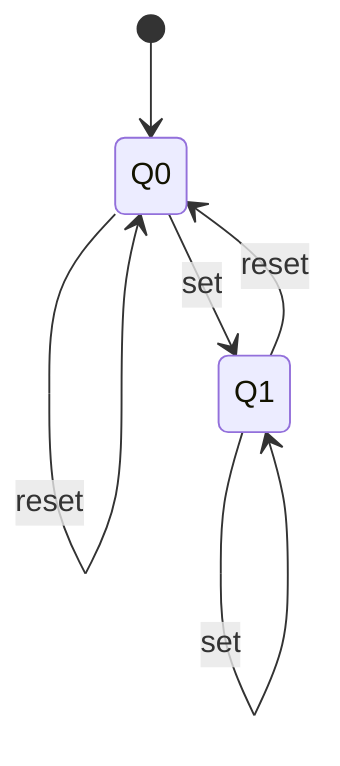
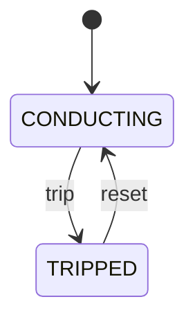

# 第 02 课：五个代表例（转移）

主例「门」的完整实现在 `code/`。其余四例只建立直觉：问题、图、表、复杂度、用途、常见缺陷、如何变复杂。

复杂度用「状态个数 + 转移条数」衡量。本课没有输入类型，Event 列仍写函数名。

---

## 例 1：门（主例）

**问题**：门要么关要么开。变化必须是从一状态到另一状态的箭头，不能靠两个布尔对打。

**状态图**：见 `LESSON.md`。

**状态表**：`CLOSED`/`OPEN`，`door_open` / `door_close` 各走出一条（或留在原地的）转移。

**实现**：`code/c/door.c`、`code/cpp/door.cpp`、`code/python/door.py`。

**复杂度**：2 个状态，4 条转移（含两条自环）。

**工业用途**：门锁、舱盖、机柜门到位信号。

**常见缺陷**：`is_open` 与 `is_closed` 同时为真。

**重构**：以后要加「半开」「卡住」，状态增加，转移条数跟着增加；布尔方案会先崩。

---

## 例 2：触发器（flip-flop）

**问题**：一位存储，局面是 `Q0`（存 0）或 `Q1`（存 1）。`set` 走到 `Q1`，`reset` 走到 `Q0`。



| Current State | Event | Guard | Action | Next State |
|---------------|-------|-------|--------|------------|
| Q0 | set | （尚未引入） | （尚未引入） | Q1 |
| Q0 | reset | （尚未引入） | （尚未引入） | Q0 |
| Q1 | reset | （尚未引入） | （尚未引入） | Q0 |
| Q1 | set | （尚未引入） | （尚未引入） | Q1 |

**复杂度**：2 个状态，4 条转移。

**工业用途**：寄存器位、保持继电器、面板上的置位/复位。

**常见缺陷**：用一个 `int value` 又叠一个 `int last_value`，把「当前局面」和「上次局面」混在一起。当前局面是状态；怎么从上次走到现在，是转移。

**重构**：以后若加 `toggle`，只是多两条转移（`Q0→Q1`、`Q1→Q0`），不必改状态集合。不要为此引入输入枚举——那是下一课。

---

## 例 3：停车场道闸

**问题**：杆子 `DOWN`（拦车）/ `UP`（放行）。`raise` 抬杆，`lower` 落杆。

```
+------+          raise           +----+
| DOWN | -----------------------> | UP |
|      | <----------------------- |    |
+------+          lower           +----+
```

| Current State | Event | Guard | Action | Next State |
|---------------|-------|-------|--------|------------|
| DOWN | raise | （尚未引入） | （尚未引入） | UP |
| UP | lower | （尚未引入） | （尚未引入） | DOWN |
| DOWN | lower | （尚未引入） | （尚未引入） | DOWN |
| UP | raise | （尚未引入） | （尚未引入） | UP |

**复杂度**：2 个状态，4 条转移。

**工业用途**：停车场、小区门禁杆。

**常见缺陷**：用「电机正在转」的布尔代替杆子的局面。电机运动是过程，杆子在顶或在底才是本课这种两状态机。运动过程里的中间局面以后再加。

**重构**：真实道闸还有「上升中」「下降中」。那是更多状态和更多箭头，不是本课要引入的新术语。本课保持两个框。

---

## 例 4：断路器

**问题**：电路要么导通要么已跳闸。状态用 `CONDUCTING` / `TRIPPED`，避免和「门的 OPEN/CLOSED」抢词。`trip` 跳闸，`reset` 复位。



| Current State | Event | Guard | Action | Next State |
|---------------|-------|-------|--------|------------|
| CONDUCTING | trip | （尚未引入） | （尚未引入） | TRIPPED |
| TRIPPED | reset | （尚未引入） | （尚未引入） | CONDUCTING |
| CONDUCTING | reset | （尚未引入） | （尚未引入） | CONDUCTING |
| TRIPPED | trip | （尚未引入） | （尚未引入） | TRIPPED |

**复杂度**：2 个状态，4 条转移。

**工业用途**：配电保护、过流跳闸后的人工复位。

**常见缺陷**：跳闸后只清一个 `overcurrent` 标志，却没有「已跳闸」这个状态，于是复位时机全靠运气。

**重构**：以后要区分「故障仍在」和「故障已消失可复位」，那是箭头上的条件，不是本课概念。现在两条主箭头就够。

---

## 例 5：互斥锁 locked / unlocked

**问题**：锁要么空闲要么被占。`UNLOCKED` --lock--> `LOCKED`，`LOCKED` --unlock--> `UNLOCKED`。

```
+-----------+         lock          +--------+
| UNLOCKED  | --------------------> | LOCKED |
|           | <-------------------- |        |
+-----------+        unlock         +--------+
```

| Current State | Event | Guard | Action | Next State |
|---------------|-------|-------|--------|------------|
| UNLOCKED | lock | （尚未引入） | （尚未引入） | LOCKED |
| LOCKED | unlock | （尚未引入） | （尚未引入） | UNLOCKED |
| UNLOCKED | unlock | （尚未引入） | （尚未引入） | UNLOCKED |
| LOCKED | lock | （尚未引入） | （尚未引入） | LOCKED |

最后一行是教学简化：已锁定再 `lock`，停在 `LOCKED`。真实互斥锁对「谁持有」还有所有者数据；那是数据，不是第三个状态。

**复杂度**：2 个状态，4 条转移。

**工业用途**：临界区、文件锁的教学模型。

**常见缺陷**：`taken` 和 `mine` 两个布尔，出现「没人持有却是我的」这种非法组合。持有与否是状态；所有者是旁路数据。

**重构**：读写锁需要更多状态（无锁 / 读中 / 写中）。本课不要加。也不要为此引入等待队列或超时。
