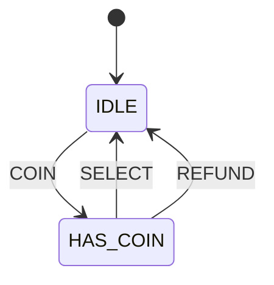

# 第 03 课：售货机 —— 事件（Event）

本课只引入一个概念：**事件**。

上一课已经有了状态和转移：门用 `door_open` / `door_close` 两个函数去走箭头。本课把「触发箭头的那一下输入」收成一种可枚举的名字，一次分发走进所有转移。

---

## 1. Motivation

门只有两种操作，为每种操作写一个函数还撑得住。售货机一上来就有投币、选货、退币。操作再多几个，你会得到 `coin()`、`select()`、`refund()`、`cancel()`……每个函数里再抄一份 `switch(state)`。

状态回答：现在是什么。
转移回答：可以从这里走到哪里。
事件回答：外界刚刚发生了哪一种输入。

没有事件这个概念，输入散落在函数名里，你无法问「当前状态下，这个输入有没有对应的箭头」。有了它，输入变成和状态同级的枚举：可打印、可穷举、可丢进同一个分发函数。

用在哪：遥控器按键、按键去抖、插卡、键盘敲击。本课只用一台极简售货机。

---

## 2. Problem Description

教学售货机只有两个局面：

- 空闲，还没投币（`IDLE`）
- 已经投过一枚币（`HAS_COIN`）

三种外界输入：

- 投币
- 选货
- 退币

规则（刻意砍掉货道、找零、缺货）：

- 空闲时投币 → 变成已投币
- 已投币时选货 → 吐出商品，回到空闲
- 已投币时退币 → 退币，回到空闲
- 空闲时选货或退币 → 什么也不做
- 已投币时再投币 → 什么也不做（本课不攒第二枚）

问题不是商业逻辑，而是：用什么方式，让每一种输入都有一个名字，并且无论哪种输入到来，都走同一扇门进入机器。

---

## 3. Naive Solution

沿用第 02 课的「一输入一函数」：

```c
void coin(void)   { /* switch on two bools or a state */ }
void select(void) { /* another copy of the same switch */ }
void refund(void) { /* a third copy */ }
```

这能工作。乱从这里开始：

- 每加一种输入就加一个函数，每个函数重复「现在是什么状态」
- 非法组合（空闲时选货）的处理策略写三遍，很容易漏
- 日志里只能看到「调用了哪个函数」，没有一种可打印的输入名字
- 你无法把「所有输入」当成集合看待：有没有漏掉一种？来了一种未知的？

多个函数不是错误。错误是：输入已经有好几种了，却还不肯给它们一个共同的类型。

---

## 4. FSM Solution

沿用前两课：当前状态一个字段；变化是转移。两个状态：

- `IDLE`
- `HAS_COIN`

本课新加一句话：

> 事件是一种命名过的输入。机器不提供「每种输入一个函数」，只提供一次分发：`fsm_dispatch(fsm, event)`。分发函数根据当前状态和这次事件，决定走哪条转移；没有对应箭头就忽略。

三种事件：

- `COIN`
- `SELECT`
- `REFUND`

合法转移：

- `IDLE` + `COIN` → `HAS_COIN`
- `HAS_COIN` + `SELECT` → `IDLE`（打印 `dispense`，方便你看见吐货）
- `HAS_COIN` + `REFUND` → `IDLE`（打印 `refund`，方便你看见退币）

其余组合没有箭头：分发函数直接返回，状态不变。忽略不是缺陷，是「表上没有这一行」。

打印只是为了在终端看见机器做了什么。它不是本课的新概念，更不要把打印理解成一种回调类型。

本课 **不** 把「箭头上的布尔条件」命名成术语。`if` 可以写在分发里（例如判断当前状态），那只是实现细节。

---

## 5. State Diagram



读图规则（在第 02 课之上只加一条）：

- 框仍是状态，箭头仍是转移
- **箭头上的字现在是事件名**：哪一种输入到来，才走这条箭头
- 没有画出来的组合（`IDLE` 上的 `SELECT` / `REFUND`，`HAS_COIN` 上的 `COIN`）表示忽略

ASCII 对照：

```
+------+           COIN            +----------+
| IDLE | ------------------------> | HAS_COIN |
|      | <------------------------ |          |
+------+      SELECT / REFUND      +----------+
```

两条回到 `IDLE` 的箭头事件不同：选货走一条，退币走另一条。图上可以画成两根并行的线，表里必须分成两行。

---

## 6. State Table

Event 列从本课起填写真正的事件名，不再借用函数名。Guard / Action 仍未引入。

| Current State | Event | Guard | Action | Next State |
|---------------|-------|-------|--------|------------|
| IDLE | COIN | （尚未引入） | （尚未引入） | HAS_COIN |
| IDLE | SELECT | （尚未引入） | （尚未引入） | IDLE |
| IDLE | REFUND | （尚未引入） | （尚未引入） | IDLE |
| HAS_COIN | SELECT | （尚未引入） | （尚未引入） | IDLE |
| HAS_COIN | REFUND | （尚未引入） | （尚未引入） | IDLE |
| HAS_COIN | COIN | （尚未引入） | （尚未引入） | HAS_COIN |

后几行「下一状态等于当前状态」就是忽略：事件到来了，没有可走的变化箭头。写进表是为了穷举，图上通常省略。

注意：同一事件在不同状态下可以对应不同转移。`SELECT` 在 `HAS_COIN` 会回到 `IDLE`，在 `IDLE` 则原地不动。事件是输入的名字，不是「全局唯一的下一状态」。

---

## 7. Event Flow

方框是当时的状态。箭头上是 **事件**。

```
time -->

[ IDLE ] --COIN--> [ HAS_COIN ] --SELECT--> [ IDLE ] --SELECT--> [ IDLE ]
                                              ^
                                              |
                         (empty: ignored, still IDLE)
```

另一条常见轨迹：

```
[ IDLE ] --COIN--> [ HAS_COIN ] --REFUND--> [ IDLE ]
```

执行顺序（与 `code/` 里的演示一致）：

1. 上电：当前状态 = `IDLE`
2. 分发 `COIN`：走到 `HAS_COIN`
3. 分发 `SELECT`：打印 `dispense`，走到 `IDLE`
4. 再分发 `COIN`：走到 `HAS_COIN`
5. 分发 `REFUND`：打印 `refund`，走到 `IDLE`
6. 空闲时分发 `SELECT`：忽略，仍是 `IDLE`

调试时问三句：当前状态？这次是哪个事件？表上有没有这一行？

---

## 8. Implementation

同一架构，本课补上事件枚举和分发：

```
State 枚举
Event 枚举
Fsm { state }
fsm_init(fsm)
fsm_dispatch(fsm, event)
```

不再为每种输入写一个对外函数。`main` 只构造事件、调用 `fsm_dispatch`。

运行（在本课目录下）：

```bash
cc -std=c11 -Wall -Wextra -o vending code/c/vending.c && ./vending
c++ -std=c++17 -Wall -Wextra -o vending code/cpp/vending.cpp && ./vending
python3 code/python/vending.py
```

### 伪代码

```
states: IDLE, HAS_COIN
events: COIN, SELECT, REFUND
current <- IDLE

dispatch(event):
    switch current:
        IDLE:
            if event is COIN: current <- HAS_COIN
            # SELECT / REFUND: ignore
        HAS_COIN:
            if event is SELECT:
                print "dispense"
                current <- IDLE
            if event is REFUND:
                print "refund"
                current <- IDLE
            # COIN: ignore
```

上面的 `if event is ...` 是在匹配事件，不是本课要你命名的「条件」。C / C++ / Python 见 `code/`。三份程序打印同一段轨迹。

---

## 9. Design Discussion

为什么好：

- 输入和状态一样可穷举、可打印
- 所有箭头经过同一个 `fsm_dispatch`，非法组合有统一的「忽略」策略
- 加一种事件时，你必须改枚举，并在分发里看到每一个 `case`

替代：

- 继续一输入一函数：事件很少时更直白，事件一多就开始复制 `switch(state)`
- 用字符串 `"coin"` 当分发键：能跑，拼写错误要到运行期才发现

取舍：忽略非法事件，还是记录一条日志？本课选择静默忽略，让轨迹干净。工业代码里常常打一条 debug，但那仍不是新概念，只是打印。

同一事件、不同状态、不同下一状态——这是事件模型的正常用法，不是混乱。混乱的是：没有事件类型，却在三个函数里用三种方式解释「选货」。

工业上：遥控器的每一个键、协议里的每一种报文，第一步往往就是事件枚举。后面读协议图时，先找框，再找箭头，再读箭头上的输入名字。定时器、重试那些以后再说。

---

## 10. Common Mistakes

初学者：

- 为每个事件写一个函数，再在每个函数里复制状态分支，等于没引入事件
- 把事件和状态放进同一个枚举（`IDLE`、`COIN`、`HAS_COIN` 并列），类型一乱，转移表就没法读
- 认为「忽略」是 bug：空闲时选货本来就没有箭头

工业上：

- 日志只打状态，不打事件，复盘时不知道是哪一次输入把机器推走的
- 分发函数里用「默认成功」吞掉未处理的事件，现场看起来像丢包

---

## 11. Refactoring

下一课会给「这条箭头能不能走」加上布尔条件。本课的 `if` 只用来区分状态和事件，不要把它们上升成一种叫「守卫」的设计要素。

不要把 `printf("dispense")` 提成函数指针表。副作用的正式位置在后面的课。

不要为本课加超时、第二枚硬币的计数、货道库存。那会逼你写条件，而条件是下一课的主题。

若你已经想写 `table[state][event] = next`：停住。表驱动是第 08 课。现在手写 `switch` 是故意的。

---

## 12. Exercise

**容易**

给台灯加上事件 `TOGGLE`。状态仍是 `OFF` / `ON`。只保留 `fsm_dispatch`，删掉 `turn_on` / `turn_off` 两个入口。

**中等**

给售货机补事件 `CANCEL`：在 `HAS_COIN` 时与 `REFUND` 一样回到 `IDLE`（可以打印 `refund`），在 `IDLE` 时忽略。只改枚举和分发，不要加新状态。

**挑战**

画出电视机遥控器的两个状态 `OFF` / `ON`，事件 `POWER` / `MUTE`。只让 `POWER` 改变电源状态；`MUTE` 在 `OFF` 时忽略。列出与本课相同列名的表。不要引入箭头上的布尔条件这个术语。

---

## 13. Summary

- 状态 = 此刻的局面；转移 = 命名箭头（前两课）
- 事件 = 命名过的输入，经 `fsm_dispatch(fsm, event)` 进入机器（本课）
- 没有对应箭头的组合就忽略
- 打印吐货/退币只是观察用，不是新概念

下一课：101 序列检测。新概念是 **守卫（Guard）**。
