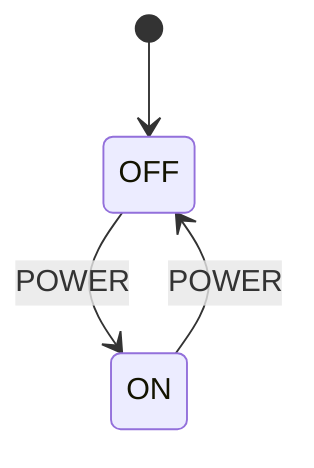
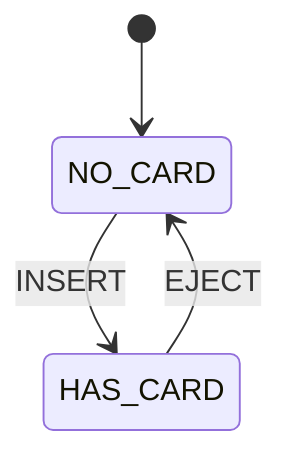

# 第 03 课：五个代表例（事件）

主例「售货机」的完整实现在 `code/`。其余四例只建立直觉：问题、图、表、复杂度、用途、常见缺陷、如何变复杂。

复杂度用「状态个数 + 事件个数」衡量。转移条数等于表里的行数（含忽略行，若你写全）。

---

## 例 1：售货机（主例）

**问题**：投币、选货、退币是三种输入。它们应共享一次分发，而不是三个各写一遍状态分支的函数。

**状态图**：见 `LESSON.md`。

**状态表**：`IDLE` / `HAS_COIN` 对 `COIN` / `SELECT` / `REFUND`；非法组合忽略。

**实现**：`code/c/vending.c`、`code/cpp/vending.cpp`、`code/python/vending.py`。

**复杂度**：2 个状态，3 个事件。

**工业用途**：简易投币器、景区闸机「刷票/通行」的教学模型。

**常见缺陷**：为每个按钮写一个函数，复制 `switch(state)`。

**重构**：以后要加货道、找零，会需要更多状态和更多事件。库存够不够是条件，那是下一课，本课不要加。

---

## 例 2：电视遥控器

**问题**：电源要么关要么开。按键是事件：`POWER` 翻转电源，`MUTE` 仅在已开机时有意义（本课简化：关机时忽略静音）。



| Current State | Event | Guard | Action | Next State |
|---------------|-------|-------|--------|------------|
| OFF | POWER | （尚未引入） | （尚未引入） | ON |
| ON | POWER | （尚未引入） | （尚未引入） | OFF |
| OFF | MUTE | （尚未引入） | （尚未引入） | OFF |
| ON | MUTE | （尚未引入） | （尚未引入） | ON |

`MUTE` 两行都是忽略（下一状态不变）。真实电视还会改静音标志；那是另一个状态机或旁路数据，不要和电源状态挤在一个枚举里。

**复杂度**：2 个状态，2 个事件。

**工业用途**：消费电子遥控、面板按键。

**常见缺陷**：每个按键一个函数，关机时的静音处理写在 `mute()` 里，开机时的写在另一处，行为不一致。

**重构**：以后静音本身要成为状态，需要更多框。本课只练「同一 `POWER` 事件在不同状态下走向不同下一状态」。

---

## 例 3：按键去抖（两个事件）

**问题**：机械按键在按下和松开时会抖动。教学模型不管定时器，只认两种事件：`PRESS`、`RELEASE`。状态 `IDLE`（认为没按下）/ `DOWN`（认为按下）。

```
+------+          PRESS           +------+
| IDLE | -----------------------> | DOWN |
|      | <----------------------- |      |
+------+         RELEASE          +------+
```

| Current State | Event | Guard | Action | Next State |
|---------------|-------|-------|--------|------------|
| IDLE | PRESS | （尚未引入） | （尚未引入） | DOWN |
| DOWN | RELEASE | （尚未引入） | （尚未引入） | IDLE |
| IDLE | RELEASE | （尚未引入） | （尚未引入） | IDLE |
| DOWN | PRESS | （尚未引入） | （尚未引入） | DOWN |

抖动被建模成「同一事件在已处于目标状态时被忽略」。本课没有超时；稳定时间以后再谈。

**复杂度**：2 个状态，2 个事件。

**工业用途**：GPIO 按键、限位开关的软件侧。

**常见缺陷**：在中断里直接 `if (pin) pressed = 1`，把抖动当多次按下。先有事件名，才能讨论哪些重复输入该忽略。

**重构**：加上「去抖中」需要第三个状态和到期输入。到期是以后的课，本课保持两个事件。

---

## 例 4：ATM 插卡

**问题**：卡在不在槽里。事件 `INSERT`、`EJECT`。状态 `NO_CARD` / `HAS_CARD`。



| Current State | Event | Guard | Action | Next State |
|---------------|-------|-------|--------|------------|
| NO_CARD | INSERT | （尚未引入） | （尚未引入） | HAS_CARD |
| HAS_CARD | EJECT | （尚未引入） | （尚未引入） | NO_CARD |
| NO_CARD | EJECT | （尚未引入） | （尚未引入） | NO_CARD |
| HAS_CARD | INSERT | （尚未引入） | （尚未引入） | HAS_CARD |

没有卡时退卡、已有卡时再插，都忽略。PIN 对不对是条件，不要在本课写进表的 Guard 列——那一列还没启用。

**复杂度**：2 个状态，2 个事件。

**工业用途**：读卡器、USB 插拔的教学模型。

**常见缺陷**：用 `card_present` 布尔加上 `trying_insert` 另一个布尔，插卡事件在两个标志之间迷路。

**重构**：以后要加「读卡中」「锁卡」，事件仍是插/拔，状态变多。密码校验留给有守卫的那一课。

---

## 例 5：键盘按键

**问题**：教学上只关心有没有键处于按下。事件 `KEY_DOWN`、`KEY_UP`。状态 `IDLE` / `HELD`。

```
+------+        KEY_DOWN          +------+
| IDLE | -----------------------> | HELD |
|      | <----------------------- |      |
+------+         KEY_UP           +------+
```

| Current State | Event | Guard | Action | Next State |
|---------------|-------|-------|--------|------------|
| IDLE | KEY_DOWN | （尚未引入） | （尚未引入） | HELD |
| HELD | KEY_UP | （尚未引入） | （尚未引入） | IDLE |
| IDLE | KEY_UP | （尚未引入） | （尚未引入） | IDLE |
| HELD | KEY_DOWN | （尚未引入） | （尚未引入） | HELD |

真实键盘有许多键码。键码是事件的参数或许多种事件；本课用两种事件建立「按下/抬起」这一种输入分类。不要为此引入条件函数。

**复杂度**：2 个状态，2 个事件。

**工业用途**：HID、快捷键、游戏输入。

**常见缺陷**：把「哪个键」写进状态名（`HELD_A`、`HELD_B`……），状态集合随键位爆炸。键是事件（或事件携带的数据），不是状态。

**重构**：自动重复需要定时器。本课只练事件分发。后面读协议时，也会先把报文类型收成事件枚举，再谈字段上的条件。
