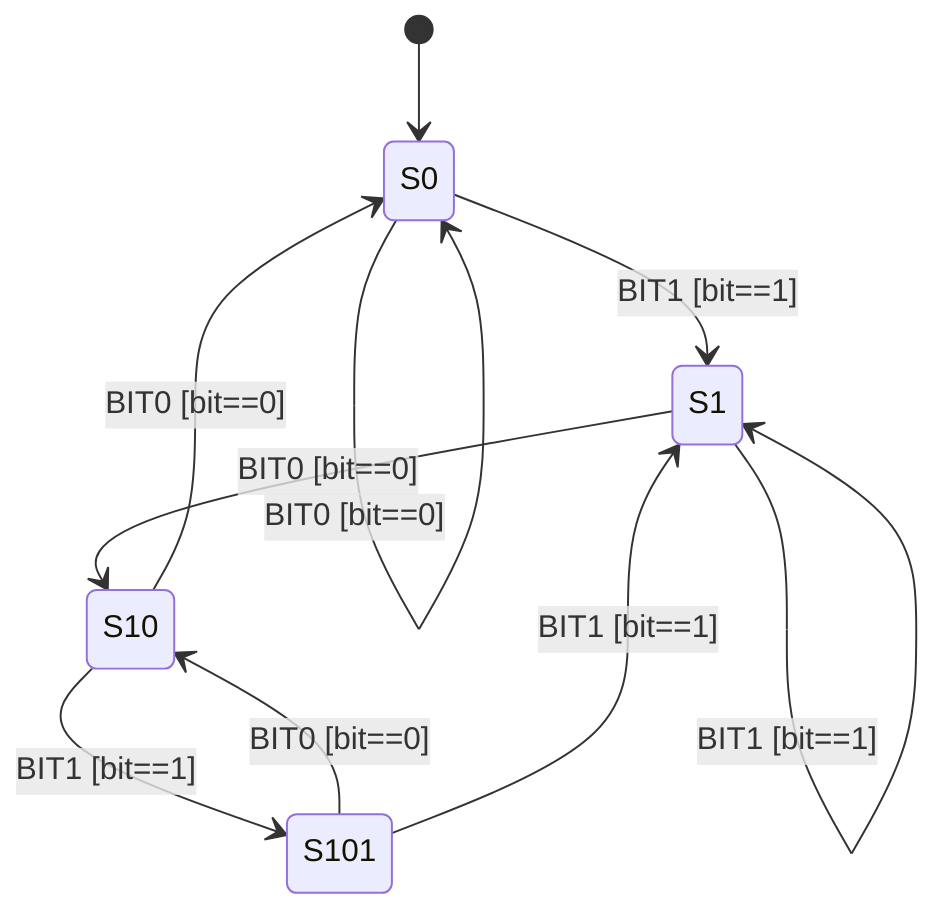

# 第 04 课：101 序列检测 —— 守卫（Guard）

本课只引入一个概念：**守卫**。

前三课已经有了状态、转移、事件。售货机的每一格 `(状态, 事件)` 最多对应一条箭头，要不要走只取决于这两列。本课处理另一种常见情况：箭头上还挂着一个必须为真的布尔条件。

---

## 1. Motivation

事件告诉你「来了一种输入」。它常常不够。同一状态下，同一次输入还要再问一句：这个位是 0 还是 1？密码对不对？余额够不够？

如果把「刚看到的那一位」写进状态名，状态会按输入翻倍：每个前缀都拆成「等到 0 的副本」和「等到 1 的副本」。图立刻不可读。

守卫存在，是为了把「现在匹配到哪一步」留在状态里，把「这一位是否等于箭头所要求的值」留在箭头上。

用在哪：序列检测、PIN 比对、年龄门、余额检查、权限检查。本课用重叠的 `101` 比特序列。

---

## 2. Problem Description

从比特流里找出子串 `101`。允许重叠：`10101` 里有两处 `101`。

教学设定：

- 输入每次一位，编码成两个事件 `BIT0`、`BIT1`（这样 `fsm_dispatch(fsm, event)` 的形状与第 03 课相同）
- 状态只记录「已经匹配了 `101` 的多长前缀」
- 匹配成功时打印一行，方便观察；打印不是本课要命名的新机制

四个局面：

- `S0`：起点，还没有任何前缀
- `S1`：刚看到一个 `1`
- `S10`：已经看到 `10`
- `S101`：已经看到完整的 `101`

重叠规则（必须做对）：待在 `S101` 时，最后一位已经是 `1`。若下一位还是 `1`，这个 `1` 可以当作下一段 `101` 的开头，因此走到 `S1`，而不是留在 `S101`。若下一位是 `0`，当前后缀是 `10`，走到 `S10`。

---

## 3. Naive Solution

两种常见笨法。

第一种：三个布尔。

```c
int saw1 = 0;
int saw10 = 0;
int saw101 = 0;
```

它们可以同时为真，重叠时你分不清「哪几个标志该清」。`10101` 很容易漏掉第二次命中，或把非法组合当成命中。

第二种：按输入复制状态。

```
S0_for0, S0_for1, S1_for0, S1_for1, S10_for0, S10_for1, ...
```

每一位都把状态集合乘 2。前缀信息（匹配到哪）和输入信息（这一位是什么）缠在一起。图上的框不再表示「匹配进度」，而变成「进度 × 最后一位」的笛卡尔积。

布尔和复制状态都能凑出检测器。错误是：该放在箭头上的条件，被你塞进了状态集合。

---

## 4. FSM Solution

沿用前三课：一个当前状态；箭头是转移；`BIT0` / `BIT1` 是事件。本课新加一句话：

> 守卫是箭头上的布尔条件。条件为真才走这条转移；为假则这条箭头根本不点火。

对 101 检测器，每条箭头的守卫都是同一句人话：

> 只有输入位等于这条箭头所要求的值时，才走它。

状态只保留前缀：

| 状态 | 含义 |
|------|------|
| `S0` | 前缀为空 |
| `S1` | 前缀 `1` |
| `S10` | 前缀 `10` |
| `S101` | 前缀 `101`（刚检测成功） |

从同一状态出发、针对两种位，画出两条互斥的箭头。互斥靠守卫，不靠再复制一套状态。

实现里守卫就是分发函数中的 `if`：`event == BIT1` 表示「输入位是 1」。事件仍然负责命名输入；守卫负责批准这条箭头。本课用 `BIT0`/`BIT1` 两个事件，是为了保持 `dispatch(fsm, event)` 签名。于是「事件是 BIT1」和「守卫 bit==1」在代码里会重叠——这是编码选择，不是说守卫等于事件。PIN、年龄、余额那些例子里，同一事件会挂上与事件名无关的条件，区别就清楚了。

到达 `S101` 时打印 `detected 101`。这只是观察用的副作用，不要理解成回调表或一种新类型。表的 Action 列仍标「尚未引入」。

---

## 5. State Diagram

箭头标注写成 `事件 [守卫]`。方括号里的布尔才是本课新东西。



读图规则（在第 03 课之上只加一条）：

- 框仍是状态，箭头仍是转移，箭头先写事件
- **方括号是守卫**：为假则不走这条箭头
- 从同一框出发的 `[bit==0]` 与 `[bit==1]` 互斥，所以一次输入只会点着其中一根

对比：若没有守卫，你往往会把位写进框的名字，得到大约两倍的框。本课的四个框已经够用。

ASCII 对照（主路径从左到右，守卫写在箭头旁）：

```
          [bit==0]              [bit==1]              [bit==0]
             +-+                   +-+
             v |                   v |
          +------+  [bit==1]   +------+  [bit==0]  +-------+  [bit==1]  +-------+
          |  S0  | ----------> |  S1  | ---------> |  S10  | ---------> |  S101 |
          +------+             +------+            +-------+            +-------+
             ^                                       |                     |    |
             +---------------------------------------+                     |    |
                                [bit==0]                            [bit==1]|    |[bit==0]
                                                                           v    v
                                                                          S1   S10
```

`S101` 出发的两根箭头体现重叠：下一位 `1` 回到 `S1`（末尾的 `1` 可作新前缀）；下一位 `0` 回到 `S10`（后缀变成 `10`）。

---

## 6. State Table

Guard 列从本课起填写真正的布尔条件。Action 列仍未作为一等概念引入；命中时的打印只在实现里出现，表中保持空白。

| Current State | Event | Guard | Action | Next State |
|---------------|-------|-------|--------|------------|
| S0 | BIT0 | bit == 0 | （尚未引入） | S0 |
| S0 | BIT1 | bit == 1 | （尚未引入） | S1 |
| S1 | BIT0 | bit == 0 | （尚未引入） | S10 |
| S1 | BIT1 | bit == 1 | （尚未引入） | S1 |
| S10 | BIT0 | bit == 0 | （尚未引入） | S0 |
| S10 | BIT1 | bit == 1 | （尚未引入） | S101 |
| S101 | BIT0 | bit == 0 | （尚未引入） | S10 |
| S101 | BIT1 | bit == 1 | （尚未引入） | S1 |

因为本课用 `BIT0`/`BIT1` 编码，表上看起来 Event 与 Guard 一一对应。读的时候请分开两列的职责：Event 是「来了一位」；Guard 是「这一位是否等于本行要求的值」。换一种编码（单一 `INPUT` 事件，位放在别处）时，Event 列会变成同一名字，Guard 列才会显出差别。本课不采用那种签名，以免和上一课的 `dispatch(fsm, event)` 不一致。

没有「位不匹配还硬走」的行：守卫为假的箭头不会出现在「实际发生的转移」里。

---

## 7. Event Flow

用序列 `1 0 1 0 1 1` 把重叠走一遍。方框是状态，箭头上是事件和守卫。

```
time -->

[ S0 ] --BIT1 [bit==1]--> [ S1 ] --BIT0 [bit==0]--> [ S10 ]
     --BIT1 [bit==1]--> [ S101 ]          (detected 101)
     --BIT0 [bit==0]--> [ S10 ]
     --BIT1 [bit==1]--> [ S101 ]          (detected 101 again)
     --BIT1 [bit==1]--> [ S1 ]
```

逐步：

1. 上电：`S0`
2. `1`：守卫 `bit==1` 成立，`S0 → S1`
3. `0`：`S1 → S10`
4. `1`：`S10 → S101`，打印命中（第一处 `101`）
5. `0`：重叠，后缀是 `10`，`S101 → S10`
6. `1`：`S10 → S101`，再次命中（`10101` 的第二处）
7. `1`：末尾的 `1` 当作新前缀，`S101 → S1`（不是留在 `S101`）

若第 7 步留在 `S101`，就等于声称当前后缀仍是 `101`，但 `1011` 的末三比特是 `011`。重叠做对了，状态才诚实。

---

## 8. Implementation

架构与第 03 课相同，只是分发里多了守卫用的 `if`：

```
State 枚举
Event 枚举          /* BIT0, BIT1 */
Fsm { state }
fsm_init(fsm)
fsm_dispatch(fsm, event)
```

运行（在本课目录下）：

```bash
cc -std=c11 -Wall -Wextra -o detector code/c/detector.c && ./detector
c++ -std=c++17 -Wall -Wextra -o detector code/cpp/detector.cpp && ./detector
python3 code/python/detector.py
```

### 伪代码

```
states: S0, S1, S10, S101
events: BIT0, BIT1
current <- S0

dispatch(event):
    switch current:
        S0:
            if event is BIT1:          # guard: bit == 1
                current <- S1
            # BIT0: guard bit==0, stay S0
        S1:
            if event is BIT0:          # guard: bit == 0
                current <- S10
            # BIT1: guard bit==1, stay S1
        S10:
            if event is BIT1:          # guard: bit == 1
                print "detected 101"
                current <- S101
            else:                      # guard: bit == 0
                current <- S0
        S101:
            if event is BIT1:          # guard: bit == 1; overlap to prefix 1
                current <- S1
            else:                      # guard: bit == 0; overlap to prefix 10
                current <- S10
```

C / C++ / Python 见 `code/`。三份程序打印同一段轨迹，含两次命中和最后一次重叠回到 `S1`。

---

## 9. Design Discussion

为什么好：

- 状态个数等于「可能的前缀个数」，不随输入字母表翻倍
- 每条箭头的点火条件写在明处，画图、填表、写 `if` 三者能对上
- 重叠变成「命中之后走到哪个前缀」，而不是再堆布尔

替代：

- 三个标志：短序列能蒙对，重叠和非法组合会先崩
- 复制状态：正确但框数按 `|前缀| × |字母表|` 涨，读图的人看不到「进度」
- 正则引擎：本课要练的是你自己能画出守卫，而不是调用库

取舍：`BIT0`/`BIT1` 让守卫与事件名重合，签名简单，教学上要口头强调两列职责不同。若把位放进上下文、事件只剩一个 `INPUT`，守卫会更「像条件」——但你会改掉已经学过的分发签名。本课优先签名稳定。

工业上：协议报文常常是一种事件，字段取值才是守卫（版本是否支持、长度是否合法）。本课不实现任何协议；以后读那些图时，先找框和事件，再读箭头上的布尔。副作用（发报文、点灯）的正式位置在下一课。

---

## 10. Common Mistakes

初学者：

- 命中 `101` 后停在 `S101` 吃下一位 `1`，把 `1011` 仍当成「正处于 101」
- 用 `S0_0`、`S0_1` 这种框去代替守卫，状态图变成输入的复印件
- 把守卫写成「下一个状态叫什么」：守卫是布尔，不是状态名

工业上：

- 条件写在分发函数深处，图上的箭头却没标注，现场对照不上
- 两个守卫在同一 `(状态, 事件)` 上同时为真，却没有优先级——本课的 `bit==0` / `bit==1` 互斥，是有意选的简单情形

---

## 11. Refactoring

下一课会给「转移发生时顺便做的事」一个正式名字。本课的 `printf("detected 101")` 先留在分发函数里，不要提成回调数组。

不要为本课加超时、重试、嵌套状态。检测器是扁平的四个框。

若你想把守卫提成函数指针：可以在练习里写一个返回真假的普通函数，但不要做成和下一课副作用混在一起的表项。现在手写 `if (event == BIT1)` 是故意的。

---

## 12. Exercise

**容易**

把检测序列改成 `10`（非重叠也行）。状态用 `S0` / `S1` / `S10`。为每条箭头写出 `bit==0` 或 `bit==1` 的守卫。

**中等**

PIN 锁：状态 `LOCKED` / `UNLOCKED`，事件仍用一个 `UNLOCK`（或你自己的名字）。守卫是「PIN 匹配」。同一事件、两个可能的下一状态，靠守卫分叉。不要为此引入副作用回调类型。

**挑战**

在纸上证明：`10101` 为何产生两次命中。从 `S0` 填一张逐步表（当前状态、事件、守卫真假、下一状态）。然后故意画错：从 `S101` 遇 `1` 仍留在 `S101`，指出第二处命中或后缀含义哪里坏了。

---

## 13. Summary

- 状态、转移、事件仍按前三课
- 守卫 = 箭头上必须为真的布尔条件（本课）
- 状态保存前缀，守卫匹配当前位，避免按输入复制状态
- `101` 可重叠：`S101` 遇 `1` 到 `S1`，遇 `0` 到 `S10`
- 命中时的打印只是观察，不是新概念

下一课：交通灯。新概念是 **动作（Action）**。
