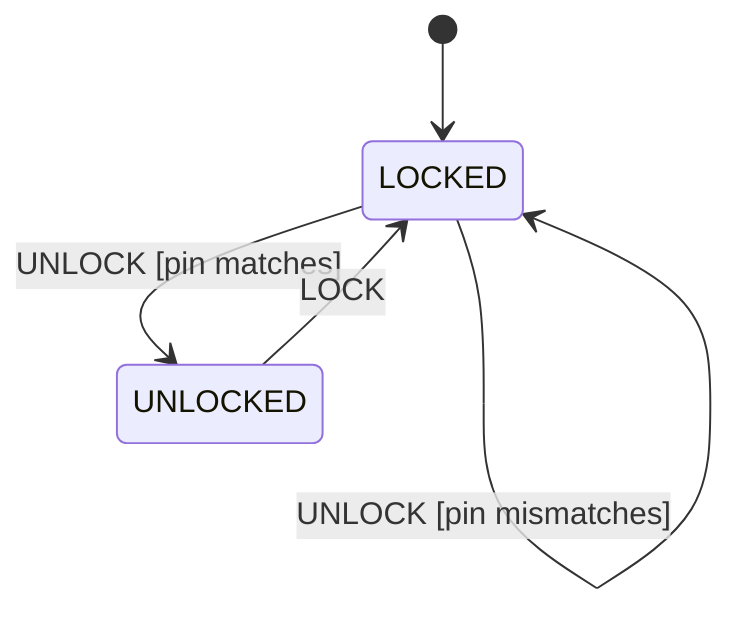
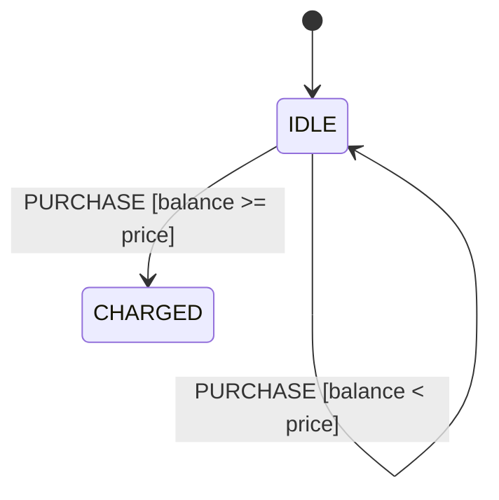

# 第 04 课：五个代表例（守卫）

主例「101 检测器」的完整实现在 `code/`。其余四例只建立直觉：问题、图、表、复杂度、用途、常见缺陷、如何变复杂。

复杂度用「状态个数 + 事件个数 + 守卫条数」衡量。守卫条数按表里填了布尔的行来数。

---

## 例 1：101 检测器（主例）

**问题**：在比特流中找出可重叠的 `101`。状态只保存已匹配前缀；当前位是否等于箭头要求，写在守卫里。

**状态图**：见 `LESSON.md`。

**状态表**：四状态 × `BIT0`/`BIT1`，每行一个 `bit == 0` 或 `bit == 1`。

**实现**：`code/c/detector.c`、`code/cpp/detector.cpp`、`code/python/detector.py`。

**复杂度**：4 个状态，2 个事件，8 条带守卫的转移。

**工业用途**：帧定界、前导码检测、教学用序列识别。

**常见缺陷**：命中后不按重叠更新前缀；或按位复制状态。

**重构**：检测更长模式时只增加前缀状态，字母表仍是 `{0,1}`，守卫形状不变。不要为此引入回调表。

---

## 例 2：PIN 锁（守卫：PIN 匹配）

**问题**：锁要么锁着要么开着。事件 `UNLOCK` 表示一次开锁尝试。走哪条箭头取决于 PIN 对不对——这是与事件名无关的守卫。



| Current State | Event | Guard | Action | Next State |
|---------------|-------|-------|--------|------------|
| LOCKED | UNLOCK | pin matches | （尚未引入） | UNLOCKED |
| LOCKED | UNLOCK | pin mismatches | （尚未引入） | LOCKED |
| UNLOCKED | LOCK | （无额外条件） | （尚未引入） | LOCKED |

同一事件 `UNLOCK`、同一状态 `LOCKED`、两条箭头，靠守卫分叉。这比 101 检测器更能把「事件」和「守卫」拆开：事件都叫 `UNLOCK`，条件却是数据比较。

**复杂度**：2 个状态，2 个事件，两条关键守卫。

**工业用途**：门锁、屏幕解锁的教学模型。

**常见缺陷**：把「PIN 正确」做成状态 `PIN_OK`，于是状态图去复制一份数据。PIN 是数据，匹配与否是守卫。

**重构**：三次失败锁定是计数和超时，不是本课。先把这一条布尔写对。

---

## 例 3：年龄门

**问题**：内容要么拦住要么放行。事件 `REQUEST`。守卫：`age >= 18`。

```
+---------+   REQUEST [age>=18]    +---------+
| BLOCKED | ---------------------> | ALLOWED |
|         | <--------------------- |         |
+---------+   REQUEST [age<18]     +---------+
```

更常见的画法是初始在 `BLOCKED`，年龄不够则自环，够了才到 `ALLOWED`。不要把每一个年龄做成一个状态。

| Current State | Event | Guard | Action | Next State |
|---------------|-------|-------|--------|------------|
| BLOCKED | REQUEST | age >= 18 | （尚未引入） | ALLOWED |
| BLOCKED | REQUEST | age < 18 | （尚未引入） | BLOCKED |

**复杂度**：2 个状态，1 个事件，2 条守卫。

**工业用途**：分级内容、购票年龄确认。

**常见缺陷**：`if (age >= 18) allowed = 1;` 散落在各处，没有「当前是否已放行」这个状态，也没有「这次请求是否满足条件」这个守卫。

**重构**：以后要加「待人工审核」，那是新状态。年龄阈值仍是守卫，不要做成回调类型。

---

## 例 4：余额 / 额度检查

**问题**：一笔扣款要么成功要么拒绝。状态 `IDLE` / `CHARGED`（教学用，不处理部分扣款）。事件 `PURCHASE`。守卫：`balance >= price`。



| Current State | Event | Guard | Action | Next State |
|---------------|-------|-------|--------|------------|
| IDLE | PURCHASE | balance >= price | （尚未引入） | CHARGED |
| IDLE | PURCHASE | balance < price | （尚未引入） | IDLE |

扣款本身会改余额。改余额是副作用，正式名字在下一课。本课只要求你能指出：箭头能不能走，取决于余额这个布尔。

**复杂度**：2 个状态，1 个事件，2 条守卫。

**工业用途**：预付费、额度控制的教学模型。

**常见缺陷**：把「余额数字」切成许多状态（`HAS_1`、`HAS_2`……）。余额是数据；够不够才是守卫。

**重构**：失败重试、超时关单都不是本课。先保证守卫互斥且盖住两种结果。

---

## 例 5：权限检查

**问题**：资源要么拒绝要么授予。事件 `ACCESS`。守卫：`role == admin`（或 `acl_allows`）。

```
+--------+   ACCESS [role==admin]   +---------+
| DENIED | -----------------------> | GRANTED |
|        | <----------------------- |         |
+--------+   ACCESS [role!=admin]   +---------+
```

| Current State | Event | Guard | Action | Next State |
|---------------|-------|-------|--------|------------|
| DENIED | ACCESS | role == admin | （尚未引入） | GRANTED |
| DENIED | ACCESS | role != admin | （尚未引入） | DENIED |

角色是数据。不要为每个角色复制一套状态机；让守卫去读角色。

**复杂度**：2 个状态，1 个事件，2 条守卫。

**工业用途**：管理接口、设备维护模式入口。

**常见缺陷**：`is_admin` 布尔和 `is_granted` 布尔并存，出现「不是管理员却已授予」。授予与否是状态；是不是管理员是守卫要用的数据。

**重构**：以后协议里的「能力协商」也会长成「事件 = 报文类型，守卫 = 字段是否合法」。本课不实现协议，只把这个形状先认熟。
