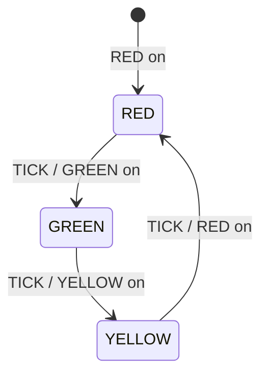

# 第 05 课：交通灯 —— 动作（Action）

本课只引入一个概念：**动作（Action）**。

回顾已经会的四件事：

- **状态（State）**：系统此刻占据的、可命名的局面
- **转移（Transition）**：从当前状态走到下一个状态的那条箭头
- **事件（Event）**：促使转移被考虑的输入
- **监护（Guard）**：转移开火之前必须为真的条件

本课的新问题是：箭头不仅改标签，还要 **对外界做一件事**。

---

## 1. Motivation

前四课的状态机大多在「改当前状态」。对灯、门、售货机来说，改标签常常就够了：日志能复盘，分支能写对。

交通灯不行。路口上的人看不见你的枚举。他们看见的是灯有没有亮。

所以转移必须带一个 **副作用**：点亮红灯、关掉绿灯、接通继电器。这个副作用就是动作。

没有动作，状态机只是在纸上换名字。有了动作，状态机才能驱动真实世界。

用在哪：交通信号、车库门电机、LED 闪烁、继电器线圈、审计日志。本课只用简化交通灯。

本课 **不** 引入定时器对象，也 **不** 把时间叫 Timeout。时间如果出现，它只是第 03 课已经会的事件 `TICK`。

---

## 2. Problem Description

一座简化交通灯，三种局面：

- 红灯亮（`RED`）
- 绿灯亮（`GREEN`）
- 黄灯亮（`YELLOW`）

唯一输入是节拍 `TICK`。每来一次 `TICK`，灯按固定顺序换色：

`RED` → `GREEN` → `YELLOW` → `RED` → …

问题不是「下一个颜色叫什么」——那只是下一状态。问题是：

> 转移开火的那一刻，程序必须真正把对应的灯打开。

如果只改 `fsm->state` 却不点灯，软件以为是绿灯，路口仍是红灯。这比状态写错更危险：两边的「真相」分裂了。

约束（本课故意简化）：

- 只有一个方向、一组灯
- 没有行人按钮
- 没有「红灯要停满 N 秒」的命名定时器
- `TICK` 就是事件，谁产生它（主循环、测试脚本）不重要

---

## 3. Naive Solution

初学者常把「换色」和「点灯」揉在一段过程式代码里：

```c
int color = 0; /* 0 red, 1 green, 2 yellow */

void
on_tick(void)
{
	color = (color + 1) % 3;
	if (color == 0)
		printf("RED on\n");
	else if (color == 1)
		printf("GREEN on\n");
	else
		printf("YELLOW on\n");
}
```

这能跑出正确打印。乱从这里开始：

- `color` 是魔法数字，不是状态
- 点灯语句和换色公式绑死，加第四种灯（闪烁黄）要改两处
- 以后若「有时 TICK 不换色」（监护），副作用会和条件缠在一起
- 测试时很难单独问：「这次转移的动作是什么？」

另一种朴素写法更糟：先改数字，点灯写在别处，某次重构漏掉一处，状态和灯就不一致。

朴素方案缺的不是 `printf`，而是一个名字：**动作属于转移，不散落在随机函数里。**

---

## 4. FSM Solution

把一条转移写成五列里你已经认识的四列，再加上本课的列：

| 列 | 含义 | 本课的角色 |
|----|------|------------|
| Current State | 现在在哪 | 回顾 |
| Event | 来了什么输入 | 回顾（只有 `TICK`） |
| Guard | 是否允许开火 | 回顾；本课主例不需要 |
| **Action** | **开火时做的副作用** | **新概念** |
| Next State | 去哪 | 回顾 |

一句话：

> 动作是转移开火时执行的副作用。它不是状态，也不是事件。

三个状态：`RED`、`GREEN`、`YELLOW`。

一个事件：`TICK`。

三条转移，每条带一个动作：

- `RED` + `TICK` → 动作「GREEN on」→ `GREEN`
- `GREEN` + `TICK` → 动作「YELLOW on」→ `YELLOW`
- `YELLOW` + `TICK` → 动作「RED on」→ `RED`

初始化不是转移，但上电也必须点灯：进入 `RED` 时执行一次「RED on」。这仍是动作，只是发生在 `fsm_init`，还没有事件。

本课主例 **不需要监护**。若你想让每种颜色停留若干拍，可以把 `ticks` 放进 `Fsm` 当 **数据**，用第 04 课的监护 `ticks == N`。那是数据加监护，不是定时器对象，不要给它起 `Timer` 这种名字。

架构与第 03 课相同：

```
State 枚举
Event 枚举
Fsm { state, ... }
fsm_init
fsm_dispatch(Fsm *, Event)
```

动作写成独立小函数（`action_red_on` 等），由 `fsm_dispatch` 在确定「这条转移要开火」之后调用。先决定走哪条箭头，再执行动作，再写入下一状态——顺序要稳定，调试才跟得上。

---

## 5. State Diagram

Mermaid 箭头上同时写事件和动作。斜杠后面是动作，这是本课要练的读图习惯。



读图：

- 框是状态（回顾）
- 箭头是转移（回顾）
- `TICK` 是事件（回顾）
- `/` 后面的 `GREEN on` 是 **动作**（新）

ASCII 对照（框对称，文字左对齐）：

```
                         TICK / GREEN on
    +-------+ --------------------------------> +---------+
    |  RED  |                                   |  GREEN  |
    |       |                                   |         |
    +-------+                                   +---------+
         ^                                           |
         |                                           | TICK / YELLOW on
         |                                           v
         |          TICK / RED on              +----------+
         +------------------------------------ |  YELLOW  |
                                               |          |
                                               +----------+
```

没有自环。本课每个 `TICK` 都换色。忽略未知事件，不要为此发明「错误状态」。

---

## 6. State Table

列名从本课起固定为：Current State、Event、Guard、Action、Next State。

| Current State | Event | Guard | Action | Next State |
|---------------|-------|-------|--------|------------|
| RED | TICK | — | GREEN on | GREEN |
| GREEN | TICK | — | YELLOW on | YELLOW |
| YELLOW | TICK | — | RED on | RED |
| RED | （其它） | — | （无） | RED |
| GREEN | （其它） | — | （无） | GREEN |
| YELLOW | （其它） | — | （无） | YELLOW |

读表：

- 监护列是「—」：主例不判断条件，事件一到就开火
- 动作列第一次有字：这是本课要看见的东西
- 非法事件：无动作、状态不变。这不是新概念，是「没有匹配的转移」

初始化可以单独记一行（没有事件）：

| Current State | Event | Guard | Action | Next State |
|---------------|-------|-------|--------|------------|
| （未初始化） | （上电） | — | RED on | RED |

---

## 7. Event Flow

方框里是当时占据的状态。斜杠后是那次转移的动作。

```
time -->

init / RED on
[ RED ] --TICK / GREEN on--> [ GREEN ] --TICK / YELLOW on--> [ YELLOW ]
       --TICK / RED on--> [ RED ]
```

执行顺序（对应 `main` 里的演示轨迹）：

1. `fsm_init`：当前状态 = `RED`，动作「RED on」
2. `TICK`：动作「GREEN on」，当前状态 = `GREEN`
3. `TICK`：动作「YELLOW on」，当前状态 = `YELLOW`
4. `TICK`：动作「RED on」，当前状态 = `RED`
5. 再来 `TICK`：又是「GREEN on」，循环成立

调试时问两句，不要只问一句：

1. 这一刻的当前状态是什么？
2. 刚才那条转移的动作做了没有？

只问第一句，你会漏掉「软件是绿、硬件是红」。

---

## 8. Implementation

同一架构：`State`、`Event`、`Fsm`、`fsm_init`、`fsm_dispatch`。`Fsm` 里除了 `state`，还有一个 `lamp` 字段，记录动作最近一次命令的颜色。它是数据，用来观察副作用，不是第四个状态。

运行：

```bash
cc -std=c11 -Wall -Wextra -o traffic code/c/traffic.c && ./traffic
c++ -std=c++17 -Wall -Wextra -o traffic code/cpp/traffic.cpp && ./traffic
python3 code/python/traffic.py
```

### 伪代码

```
states: RED, GREEN, YELLOW
events: TICK
current <- RED
action RED on

dispatch(TICK):
    if current is RED:
        action GREEN on
        current <- GREEN
    else if current is GREEN:
        action YELLOW on
        current <- YELLOW
    else if current is YELLOW:
        action RED on
        current <- RED
```

C / C++ / Python 见 `code/`。三份程序打印同一段轨迹：先看到动作行（`RED on`），再看到状态行。

实现要点：

- 动作用独立函数，名字以 `action_` 开头，提醒你「这是副作用」
- `fsm_dispatch` 里先匹配 `(state, event)`，再调用动作，再写 `fsm->state`
- 不要在动作函数里改状态。动作只点灯（本课是打印）
- 不要引入 `timer_start`、`TIMEOUT`、重试

---

## 9. Design Discussion

为什么把动作单独命名：

- 状态回答「现在是什么」
- 事件回答「来了什么」
- 监护回答「能不能走」
- 动作回答「走的时候对外做什么」

四件事混在一个大函数里也能跑，但出 bug 时你分不清是「走错箭头」还是「箭头对了、灯没亮」。

动作与下一状态的关系：

- 下一状态是纯数据：改枚举
- 动作是副作用：打印、写 GPIO、播日志、启动电机
- 可以有转移没有实质动作（空动作）；也可以初始化带动作、没有事件

本课主例没有监护。对照第 04 课：监护在开火 **之前** 求值；动作在开火 **之时** 执行。顺序是：

```
收到事件 -> 找到候选转移 -> 监护为真? -> 执行动作 -> 写入下一状态
```

若监护为假：不动作、不改状态。那是第 04 课已经会的，不要把「再等几个 TICK」误称为超时。

替代：

- 继续把 `printf` 塞进 `dispatch` 的 `case`：小例子能看，动作一多就无法复用（同一「GREEN on」可能被多条转移用到）
- 把点灯写成「状态的属性」：`if (state==GREEN) lamp=green` 每个循环刷一次。这叫轮询输出，不是转移动作。灯会亮，但你失去了「谁在何时点的灯」
- 表驱动 `{action, next}`：正确方向，但是第 08 课的形态。本课用手写 `switch` 是故意的

取舍：教学代码用打印模拟灯。真实控制器里，动作可能写寄存器。寄存器写失败怎么办？本课不展开事务回滚；工业上要决定「先改状态还是先动硬件」。常见稳妥顺序是：先做可回退的准备，硬件成功后再提交状态。本课演示保持「先动作、再改状态」，轨迹更好读。

不要做的升级：

- 不要把「停留 30 秒」做成 `Timer` 对象（第 06 课才讲超时）
- 不要把动作升级成进入/退出动作术语（后面的课）
- 不要为了闪烁再叠一层状态机套状态机

工业上：交通控制器、PLC 输出线圈、采集开关量，第一步都是「转移带着写输出」。协议栈里「发送某报文」也是动作——那是后面协议课的事，本课只要求你能指出：发送是动作，不是状态。

---

## 10. Common Mistakes

初学者：

- 只改 `state`，忘记调用动作：日志漂亮，路口是黑的
- 在动作函数里改 `fsm->state`：动作和转移职责缠死，监护以后无处安放
- 先改状态再匹配「该点哪盏灯」：用新状态反推动作。一旦有两条转移进入同一状态、动作不同，这种写法立刻错
- 把 `TICK` 想成「超时」。`TICK` 只是事件；有没有「到期」是第 06 课的概念
- 用两个变量表示灯（`is_red` 和 `state`）却只更新其中一个

工业上：

- 动作里做阻塞 I/O 或长循环，分发函数再也回不来
- 动作里再投递事件、再进入 `dispatch`（重入），本课禁止
- 日志只打下一状态，不打动作，硬件故障无法复盘
- 把「命令灯」和「读回灯」混成一个字段，反馈回路被自己骗过去

---

## 11. Refactoring

你已经能看出：每条转移是「动作 + 下一状态」。第 08 课会把它们放进表。现在不要提前建表，也不要函数指针数组。

若你想加「每种颜色停 3 拍」：

- 在 `Fsm` 里加整数 `ticks`（数据）
- 用监护 `ticks == 3` 决定是否换色
- 未到 3 的 `TICK`：动作可以是「ticks++」，下一状态仍是自己——这仍是动作，不是超时对象

若你已经想写 `timer_start()` / `EVENT_TIMEOUT`：停住。那是第 06 课。

本课保持：一个事件 `TICK`，三个动作函数，手写 `switch`。

---

## 12. Exercise

**容易**

给风扇加上动作：进入 `SPINNING` 时打印 `motor on`，进入 `STOPPED` 时打印 `motor off`。事件用你已经会的任意一个（例如 `PRESS`）。不要加定时器。

**中等**

交通灯增加非法事件 `NIGHT`：任何状态下收到它都 **无动作、不改状态**。先改表，再改 `dispatch`。不要为此增加第四个状态。

**挑战**

用本课的五列表，画出「按一下按钮，继电器吸合；再按一下，继电器释放」。指出哪一格是动作、哪一格是下一状态。动作写成 `coil on` / `coil off`。不要引入超时或重试。

---

## 13. Summary

- 动作 = 转移开火时执行的副作用
- 状态是局面，动作是对外做的事；两者必须分开命名
- 本课主例：`TICK` 换色，动作打印 `RED on` / `GREEN on` / `YELLOW on`
- `TICK` 只是事件，不是超时；计数若出现，它是 `Fsm` 里的数据
- 架构未变：`State`、`Event`、`Fsm`、`fsm_init`、`fsm_dispatch`

下一课：电梯。新概念是 **超时（Timeout）**——计数耗尽时，它会 **变成一次事件**。
