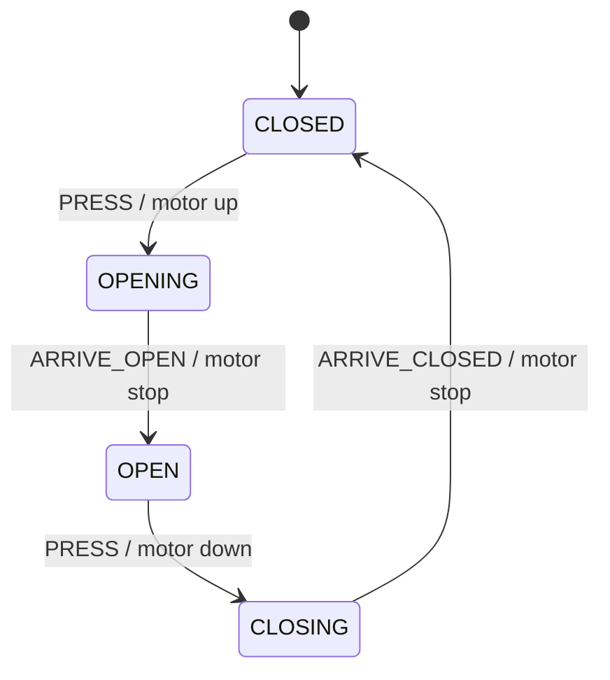
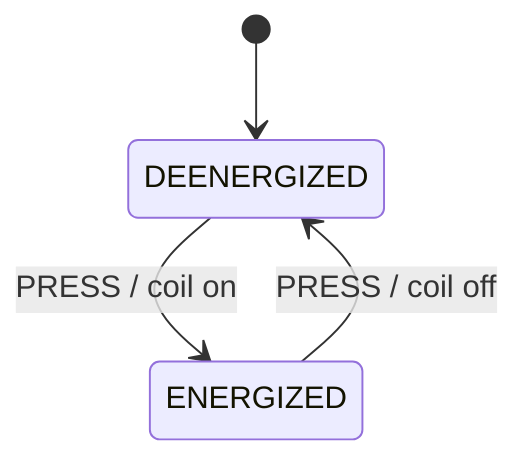

# 第 05 课：五个代表例（动作）

主例「交通灯」的完整实现在 `code/`。其余四例只建立直觉：同一概念（转移开火时的副作用）换一个外壳。

复杂度用「状态个数 / 事件个数」衡量。本课新增加的是动作个数——每条转移可以带一个。

---

## 例 1：交通灯（主例）

**问题**：三种颜色循环，每次换色必须真正点灯。

**状态图**：见 `LESSON.md`。

**状态表**：`RED` / `GREEN` / `YELLOW`，事件 `TICK`，动作 `RED on` / `GREEN on` / `YELLOW on`。

**实现**：`code/c/traffic.c`、`code/cpp/traffic.cpp`、`code/python/traffic.py`。

**复杂度**：3 个状态，1 个事件，3 个换色动作 + 1 个初始化动作。

**工业用途**：路口信号、简易塔灯。

**常见缺陷**：只改枚举，不写输出脚。

**重构**：以后要「红灯停满 N 拍」时，加的是 `Fsm` 数据和监护，不是定时器对象。不要在本例引入 Timeout。

---

## 例 2：车库门电机

**问题**：门要开、要关，但电机是硬件。转移必须启动或停止电机，不能只改「开门中」这个标签。



| Current State | Event | Guard | Action | Next State |
|---------------|-------|-------|--------|------------|
| CLOSED | PRESS | — | motor up | OPENING |
| OPENING | ARRIVE_OPEN | — | motor stop | OPEN |
| OPEN | PRESS | — | motor down | CLOSING |
| CLOSING | ARRIVE_CLOSED | — | motor stop | CLOSED |

**复杂度**：4 个状态，3 个事件，4 条带电机动作的转移。

**工业用途**：卷帘门、道闸。`ARRIVE_*` 来自限位开关，本例把它们当成事件即可。

**常见缺陷**：进入 `OPENING` 却忘记 `motor up`，门停在关位，软件以为在开。

**重构**：限位超时是第 06 课。本例只要求你指出动作列是电机命令。不要加自动再开再关。

---

## 例 3：LED 闪烁图案

**问题**：一颗 LED 按节拍亮灭。`TICK` 仍是第 03 课的事件；亮和灭是动作写 GPIO。

```
+------+        TICK / LED on         +-----+
|  OFF | ---------------------------> | ON  |
|      | <--------------------------- |     |
+------+        TICK / LED off        +-----+
```

| Current State | Event | Guard | Action | Next State |
|---------------|-------|-------|--------|------------|
| OFF | TICK | — | LED on | ON |
| ON | TICK | — | LED off | OFF |

**复杂度**：2 个状态，1 个事件，2 个动作。

**工业用途**：故障闪码、心跳灯。

**常见缺陷**：在主循环里 `if (state==ON) led=1` 每个节拍刷一次。灯会闪，但那是轮询输出，不是转移动作；你说不清「是哪一次 TICK 点的灯」。

**重构**：多种闪码（快闪、慢闪）以后用不同监护或不同状态，不要在本课做定时器。

---

## 例 4：继电器控制

**问题**：线圈要么得电要么失电。按钮是事件，写线圈是动作。



| Current State | Event | Guard | Action | Next State |
|---------------|-------|-------|--------|------------|
| DEENERGIZED | PRESS | — | coil on | ENERGIZED |
| ENERGIZED | PRESS | — | coil off | DEENERGIZED |

**复杂度**：2 / 1。和第 01 课的灯很像，差别只有一列：现在必须写出动作。

**工业用途**：PLC 输出、接触器。

**常见缺陷**：用状态名当线圈命令（`state = ENERGIZED` 就算吸合）。硬件没写，接触器没动。

**重构**：热保护跳闸可以加第三状态 `TRIPPED`；跳闸动作是强制 `coil off`。仍不要超时对象。

---

## 例 5：进入时写审计日志

**问题**：转移已经改了状态，还要留下「谁在何时走到了新局面」的痕迹。写日志是动作，不是第五个状态。

教学上不要把它升级成「进入动作」这个术语。本课的说法是：

> 这条转移的动作 = 打印一行「now in STATE」。

| Current State | Event | Guard | Action | Next State |
|---------------|-------|-------|--------|------------|
| IDLE | START | — | log "now in RUN" | RUN |
| RUN | STOP | — | log "now in IDLE" | IDLE |

两条转移可以调用同一个 `action_log(next)`，参数不同。动作可复用，状态不能复用成两个当前局面。

**复杂度**：2 / 2，外加 2 次日志副作用。

**工业用途**：操作审计、配置变更记录、安全关键切换。

**常见缺陷**：只在成功路径打日志，非法事件静默吞掉，出事无痕。本课主例对非法事件保持静默是为了简单；审计场景应在表上为「拒绝」也留一行动作。

**重构**：完整的进入/退出语义以后再学。现在只要能指出：日志行是 Action 列里的字。
