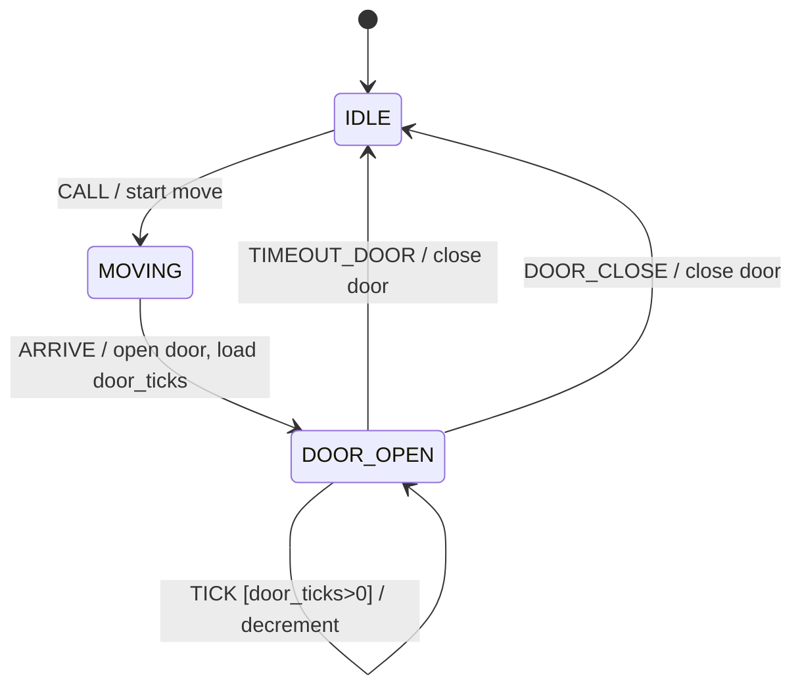

# 第 06 课：电梯 —— 超时（Timeout）

本课只引入一个概念：**超时（Timeout）**。

回顾已经会的五件事：

- **状态**：此刻局面
- **转移**：箭头
- **事件**：输入
- **监护**：开火前条件
- **动作**：开火时的副作用（第 05 课）

本课的新问题是：有些事件不是按钮按出来的，而是 **时间到了，自己变成一次输入**。

---

## 1. Motivation

第 05 课的交通灯用 `TICK` 换色。`TICK` 是外界节拍，每次到来都是「又来了一个事件」。灯不需要「预约未来的某一拍」。

电梯门不一样。门打开之后，你希望它 **过一会儿自己关上**。人可以按关门；人也可以不按。不按时，时间必须替人按一次。

「时间替人按一次」就是超时：你在 `Fsm` 里记下还剩几拍，每一拍减一；减到 0 的那一刻，把它当成一个真正的事件来分发。

超时不是第四种状态，也不是动作。超时是 **到期之后的那次事件**。

用在哪：电梯门、看门狗、会话空闲、ARP 等待、DHCP 发现等待。本课只用简化电梯（一层行程、两层楼）。

本课 **不** 引入重试、退避、指数加倍。门关失败就关失败，不要自动再开再关第三次。

---

## 2. Problem Description

一部两层教学电梯（楼层 `0` 和 `1`）：

- 空闲，门关着（`IDLE`）
- 门开着等人（`DOOR_OPEN`）
- 正在两层之间走（`MOVING`）

输入：

- `CALL`：有人叫梯
- `DOOR_CLOSE`：有人按关门
- `ARRIVE`：到了目标层（行程故意简化成一次事件）
- `TICK`：节拍，用来减门的剩余拍数
- `TIMEOUT_DOOR`：门等候到期——**这是本课的新事件**

期望行为（故意简化）：

1. `IDLE` 收到 `CALL`：开始移动（即使「已经在那一层」也走 `MOVING`，避免本课讨论「是否已在目标层」）
2. `MOVING` 收到 `ARRIVE`：开门，进入 `DOOR_OPEN`，并记下门还要开几拍（`door_ticks`）
3. `DOOR_OPEN` 期间每个 `TICK` 把 `door_ticks` 减一
4. 减到 0：视为门超时，按 `TIMEOUT_DOOR` 处理 → 关门，回到 `IDLE`
5. `DOOR_OPEN` 期间若收到 `DOOR_CLOSE`：立刻关门，回到 `IDLE`（人按的关门，不是超时）

楼层用 `Fsm` 里的整数 `current_floor` / `target_floor` 保存。它们是数据，不是状态。状态只有三个。

---

## 3. Naive Solution

初学者常写「开门然后 sleep」：

```c
void
on_arrive(void)
{
	door = OPEN;
	sleep(3);
	door = CLOSED;
}
```

这能演示「过一会儿关门」，但会把整个程序卡住。分发函数回不来，`CALL` 进不来，日志停住。教学和嵌入式里都不要在状态机里睡觉。

另一种朴素写法：到处减一个全局 `int door_timer`，减到 0 就直接关门，不经过事件：

```c
void
on_tick(void)
{
	if (door_timer > 0) {
		door_timer--;
		if (door_timer == 0)
			door = CLOSED; /* 偷偷改局面，没有事件 */
	}
}
```

乱在这里：

- 关门有两条路（人按、时间到），其中一条不经过分发，复盘对不上
- `door_timer` 和当前状态谁说了算，不清楚
- 以后若「超时后要先响蜂鸣再关门」，你没有一个叫 `TIMEOUT_DOOR` 的地方挂动作

朴素方案缺的不是计数器，而是一句话：**计数耗尽必须变成一次事件，再走转移。**

---

## 4. FSM Solution

超时的定义（本课只需这句）：

> 超时是一台记在 `Fsm` 里的计数。它随 `TICK` 递减；减到 0 时，变成一个事件，再交给 `fsm_dispatch`。

注意用词：

- `door_ticks` 是 **数据**（还剩几拍）
- `TICK` 是已经会的节拍事件
- `TIMEOUT_DOOR` 是 **到期事件**（新）
- 不要发明 `Timer` 类、`timer_start()` API。本课用整数即可

三个状态：`IDLE`、`MOVING`、`DOOR_OPEN`。

关键转移：

- `IDLE` + `CALL` → 动作「开始移动」→ `MOVING`（记下 `target_floor`）
- `MOVING` + `ARRIVE` → 动作「开门并装上门等候拍数」→ `DOOR_OPEN`
- `DOOR_OPEN` + `TICK` 且 `door_ticks` 尚未到 0 → 动作「拍数减一」→ 仍停在 `DOOR_OPEN`
- `DOOR_OPEN` + `TICK` 且减完为 0 → **内部视为 `TIMEOUT_DOOR`**
- `DOOR_OPEN` + `TIMEOUT_DOOR` → 动作「关门」→ `IDLE`
- `DOOR_OPEN` + `DOOR_CLOSE` → 动作「关门」→ `IDLE`

实现上推荐：在 `fsm_dispatch` 开头处理 `TICK`；若正在 `DOOR_OPEN` 且减到 0，把本次事件改写成 `TIMEOUT_DOOR`，然后落入同一套 `switch`。这样学生能看见「超时就是事件」——不是另一套偷偷改状态的通道。

`main` 也可以自己先发 `TICK`、再发 `TIMEOUT_DOOR`。两种写法都合法。本课代码用第一种：分发函数内部把到期的 `TICK` 变成 `TIMEOUT_DOOR`。

架构未变：

```
State 枚举
Event 枚举
Fsm { state, current_floor, target_floor, door_ticks }
fsm_init
fsm_dispatch(Fsm *, Event)
```

---

## 5. State Diagram



`TIMEOUT_DOOR` 不是从天上掉下来的：它是 `DOOR_OPEN` 里 `TICK` 把 `door_ticks` 减到 0 之后的那个事件。图上单独画它，是为了让「到期」和「人按关门」成为两条并列的转移。

ASCII 对照：

```
                    CALL / start move
    +--------+ ----------------------------> +----------+
    |  IDLE  |                               |  MOVING  |
    |        |                               |          |
    +--------+                               +----------+
         ^                                        |
         |                                        | ARRIVE / open door
         |                                        v
         |     TIMEOUT_DOOR / close door    +------------+
         +--------------------------------- | DOOR_OPEN  |
         |     DOOR_CLOSE / close door      |            |
         +--------------------------------- |            |
                                            +------------+
                                                 |
                                                 | TICK [door_ticks>0]
                                                 | / decrement
                                                 v
                                            (stay DOOR_OPEN)
```

楼层数字不画在框里。框只有三个。`current_floor` 写在 `Fsm` 数据里。

---

## 6. State Table

| Current State | Event | Guard | Action | Next State |
|---------------|-------|-------|--------|------------|
| IDLE | CALL | — | start move, set target_floor | MOVING |
| MOVING | ARRIVE | — | open door, current_floor=target, door_ticks=N | DOOR_OPEN |
| DOOR_OPEN | TICK | door_ticks>1（减完仍>0） | door_ticks-- | DOOR_OPEN |
| DOOR_OPEN | TICK | 减完为 0 | 将事件视为 TIMEOUT_DOOR | （见下一行） |
| DOOR_OPEN | TIMEOUT_DOOR | — | close door, door_ticks=0 | IDLE |
| DOOR_OPEN | DOOR_CLOSE | — | close door, door_ticks=0 | IDLE |
| IDLE | TICK | — | （无） | IDLE |
| MOVING | TICK | — | （无） | MOVING |
| * | （未列出的组合） | — | （无） | 保持 |

读表：

- `TIMEOUT_DOOR` 和 `DOOR_CLOSE` 的下一状态相同、动作相同：都是关门回空闲。差别是 **谁产生的事件**
- `TICK` 在 `IDLE` / `MOVING` 上被忽略：没有门在倒数
- 监护列出现在 `TICK` 上：这是第 04 课的工具，用来判断「还没到期」还是「已经到期」

`N` 在教学代码里取 `3`，方便轨迹里看见三次递减。

---

## 7. Event Flow

两条路径：等到超时关门，以及人提前按关门。

```
time -->

[ IDLE floor=0 ]
    --CALL / start move--> [ MOVING target=1 ]
    --ARRIVE / open door, door_ticks=3--> [ DOOR_OPEN floor=1 ]
    --TICK / door_ticks=2--> [ DOOR_OPEN ]
    --TICK / door_ticks=1--> [ DOOR_OPEN ]
    --TICK / door_ticks=0 => TIMEOUT_DOOR / close door--> [ IDLE ]

[ IDLE floor=1 ]
    --CALL / start move--> [ MOVING target=0 ]
    --ARRIVE / open door, door_ticks=3--> [ DOOR_OPEN floor=0 ]
    --DOOR_CLOSE / close door--> [ IDLE ]
```

执行顺序：

1. 上电：`IDLE`，`current_floor = 0`，`door_ticks = 0`
2. `CALL`：进入 `MOVING`，`target_floor = 1`
3. `ARRIVE`：进入 `DOOR_OPEN`，开门动作，`door_ticks = 3`
4. 三个 `TICK`：拍数 3→2→1→0；最后一次 `TICK` 变成 `TIMEOUT_DOOR`，关门回 `IDLE`
5. 再 `CALL` 去 0 层；开门后 `DOOR_CLOSE` 提前结束等候

调试时问三句：

1. 当前状态是什么？
2. `door_ticks` 还剩几？
3. 这一拍结束后，有没有产生 `TIMEOUT_DOOR`？

---

## 8. Implementation

`Fsm` 字段：

- `state`：三个局面之一
- `current_floor` / `target_floor`：`0` 或 `1`
- `door_ticks`：门还开几拍；仅在 `DOOR_OPEN` 有意义

运行：

```bash
cc -std=c11 -Wall -Wextra -o elevator code/c/elevator.c && ./elevator
c++ -std=c++17 -Wall -Wextra -o elevator code/cpp/elevator.cpp && ./elevator
python3 code/python/elevator.py
```

### 伪代码

```
states: IDLE, MOVING, DOOR_OPEN
events: CALL, DOOR_CLOSE, ARRIVE, TICK, TIMEOUT_DOOR
DOOR_HOLD <- 3

init:
    current <- IDLE
    current_floor <- 0
    door_ticks <- 0

dispatch(e):
    if e is TICK and current is DOOR_OPEN:
        door_ticks <- door_ticks - 1
        if door_ticks > 0:
            return
        e <- TIMEOUT_DOOR          /* 到期：计数变成事件 */

    if current is IDLE and e is CALL:
        target_floor <- 1 - current_floor
        action start move
        current <- MOVING

    if current is MOVING and e is ARRIVE:
        current_floor <- target_floor
        door_ticks <- DOOR_HOLD
        action open door
        current <- DOOR_OPEN

    if current is DOOR_OPEN and e is TIMEOUT_DOOR:
        action close door
        door_ticks <- 0
        current <- IDLE

    if current is DOOR_OPEN and e is DOOR_CLOSE:
        action close door
        door_ticks <- 0
        current <- IDLE
```

C / C++ / Python 见 `code/`。演示轨迹先走完一次超时关门，再走一次人工关门。

实现要点：

- 用第 05 课的动作函数：`action_start_move`、`action_open_door`、`action_close_door`
- `door_ticks` 不要叫 `timer`，避免学生以为必须有定时器对象
- `TIMEOUT_DOOR` 必须出现在 `Event` 枚举里，即使它常常由 `TICK` 改写而来
- 不要在动作里 `sleep`
- 不要在本课做「开门失败再试」——那是重试，第 07 课才有

---

## 9. Design Discussion

超时和 `TICK` 的差别：

- `TICK`：节拍本身，可能什么也不做（`IDLE` 里的 `TICK`）
- 超时：你曾经 **预约**「最多再等 N 拍」；N 用尽时，产生一个 **有业务含义的事件**

所以超时 = 「带截止日期的等待」变成事件。`TICK` 只是推动截止日期的齿轮。

为什么必须变成事件，而不是在 `if (door_ticks==0) state=IDLE` 里偷改：

- 关门动作只写在一个转移上，人按和到期可以共用
- 日志能打印 `TIMEOUT_DOOR`，复盘时知道不是有人按了关门
- 以后若超时要走不同动作（先蜂鸣），只改这一行表

`door_ticks` 放在 `Fsm` 里，不放在全局变量：一台电梯一份数据。第 10 课才会有多机；现在只要习惯「数据跟着这台 `Fsm`」。

谁发送 `TICK`：本课由 `main` 依次调用 `fsm_dispatch`。真实系统里可能是硬件节拍、系统滴答。来源不重要，重要的是：状态机不睡觉，只对事件做反应。

替代：

- `sleep`：简单，阻塞，教学禁止
- 绝对时间戳（`deadline = now + 3s`）：工业常用，本课用剩余拍数更直观
- 独立定时器线程发 `TIMEOUT_DOOR`：和「`TICK` 减到 0 再改写」等价，本课不引入线程

取舍：两层、一次 `ARRIVE` 就到。真实电梯有多楼层队列、开门受阻、超载。那些会炸状态数。本课保持三个状态，把复杂度留在数据（楼层整数）里。

不要做的升级：

- 不要加 `RETRY_CLOSE` 或退避（第 07 课）
- 不要把「正在走」拆成 `MOVING_UP` / `MOVING_DOWN` 复合结构
- 不要引入邮箱或演员

工业对照（概念，不是作业）：看门狗是「若 N 拍内没有踢狗，则超时复位」；会话空闲是「若 N 拍内没有报文，则超时断开」。它们和门等候是同一模式：计数 + 到期事件。

---

## 10. Common Mistakes

初学者：

- 在 `dispatch` 里 `sleep`，把超时做成阻塞
- 减到 0 直接改 `state`，`Event` 枚举里根本没有 `TIMEOUT_DOOR`
- 把 `door_ticks` 当成第四个状态（`if (door_ticks==2)` 写一堆分支）
- `ARRIVE` 时忘记装载 `door_ticks`，门永远等不到超时
- `DOOR_CLOSE` 后忘记清零 `door_ticks`，下次误触发
- 把 `CALL` 理解成「已经在这层就开门」——本课故意一律进 `MOVING`，不要自行加聪明

工业上：

- 节拍抖动：用剩余拍数时，拍长必须稳定；否则「3 拍」不是 3 秒
- 超时事件在门已经关上之后才迟到：必须用状态忽略过期的 `TIMEOUT_DOOR`
- 多个等候（门、行驶）共用一个计数器，互相踩踏。本课只有门在倒数

---

## 11. Refactoring

第 09 课才会出现「事件队列 + 统一滴答」。现在 `main` 里手写一串 `fsm_dispatch` 是故意的。

若你想加「行驶也要 N 拍才 `ARRIVE`」：再放一个 `move_ticks` 数据，用同样的「减到 0 变成事件」模式。那仍是超时，不是新概念。本课主例为了读得快，行驶用一次 `ARRIVE` 模拟。

若你已经在写「关门失败则再试 3 次」：停住。次数和退避是第 07 课的 **重试**。本课超时只发生一次，然后门关上。

保持手写 `switch`。不要表驱动。

---

## 12. Exercise

**容易**

把 `DOOR_HOLD` 从 3 改成 2。只改装载拍数的地方和演示里的 `TICK` 次数。状态图不用改。

**中等**

增加事件 `OBSTRUCT`：仅在 `DOOR_OPEN` 时有效，动作为「重新装载 `door_ticks = N`」（门被挡住，重新计时）。下一状态仍是 `DOOR_OPEN`。不要加新状态，不要重试关闭。

**挑战**

用五列表画出「会话空闲」：状态 `ONLINE` / `OFFLINE`，事件 `DATA`、`TICK`、`TIMEOUT_IDLE`。`DATA` 刷新剩余拍数；拍数到 0 变成 `TIMEOUT_IDLE` 并进入 `OFFLINE`。指出哪一行是本课的超时。不要画重试。

---

## 13. Summary

- 超时 = 记在 `Fsm` 里的剩余拍数，随 `TICK` 递减，到 0 时变成一个事件
- `TIMEOUT_DOOR` 和 `DOOR_CLOSE` 是不同事件、可走同一动作
- 不要用 `sleep` 模拟等待；不要把计数器当成状态
- 本课没有重试：门关一次就回 `IDLE`
- 架构未变，只是 `Fsm` 多了楼层和 `door_ticks`

下一课：播放器。新概念是 **重试（Retry）**——有限次数，加上退避，而不是永远重新开始。
