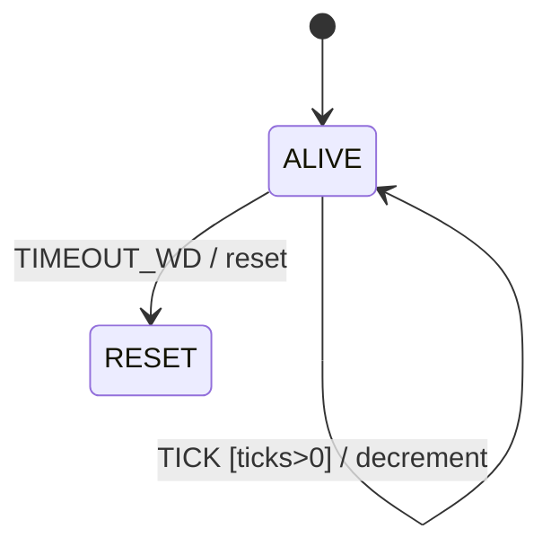

# 第 06 课：五个代表例（超时）

主例「电梯门」的完整实现在 `code/`。其余四例只建立直觉：剩余拍数减到 0，变成一次有名字的事件。

本课仍然使用第 05 课的动作。新增加的是「到期事件」，不是新的状态种类。

---

## 例 1：电梯门（主例）

**问题**：门打开后，人可以按关门；人不按，时间必须替人关一次。

**状态图**：见 `LESSON.md`。

**状态表**：`IDLE` / `MOVING` / `DOOR_OPEN`；`TICK` 递减 `door_ticks`，到 0 变成 `TIMEOUT_DOOR`。

**实现**：`code/c/elevator.c`、`code/cpp/elevator.cpp`、`code/python/elevator.py`。

**复杂度**：3 个状态，5 个事件（含 `TICK` 与 `TIMEOUT_DOOR`），门等候拍数是数据。

**工业用途**：电梯、自动门。

**常见缺陷**：`sleep(3)` 挡在分发函数里；或减到 0 偷偷改状态，日志里没有 `TIMEOUT_DOOR`。

**重构**：不要加「关门失败再试」。那是第 07 课的重试。本例超时只产生一次关门。

---

## 例 2：看门狗

**问题**：主循环必须定期「踢狗」。若连续 N 拍没有踢，则到期复位。



| Current State | Event | Guard | Action | Next State |
|---------------|-------|-------|--------|------------|
| ALIVE | KICK | — | reload ticks | ALIVE |
| ALIVE | TICK | ticks>0 减完仍>0 | ticks-- | ALIVE |
| ALIVE | TICK | 减完为 0 | 视为 TIMEOUT_WD | （下一行） |
| ALIVE | TIMEOUT_WD | — | reset | RESET |

**复杂度**：2 个状态。和电梯门相同的骨架：装载、递减、到期事件。

**工业用途**：嵌入式看门狗、进程监护。

**常见缺陷**：把「踢狗」写成动作却忘了重新装载拍数，下一次 `TICK` 立刻复位。

**重构**：真实硬件看门狗往往在芯片里，软件只负责踢。教学上用 `ticks` 数据就够。不要做「复位失败再复位」的重试。

---

## 例 3：会话空闲

**问题**：已经在线的会话，若 N 拍没有任何数据，就到期断开。

```
+--------+   DATA / reload     +--------+
| ONLINE | <-----------------> | ONLINE |
|        |   TICK / decrement  |        |
+--------+                     +--------+
     |
     | TIMEOUT_IDLE / hangup
     v
+----------+
| OFFLINE  |
+----------+
```

| Current State | Event | Guard | Action | Next State |
|---------------|-------|-------|--------|------------|
| ONLINE | DATA | — | reload idle ticks | ONLINE |
| ONLINE | TICK | 尚未到期 | idle ticks-- | ONLINE |
| ONLINE | TIMEOUT_IDLE | — | hangup | OFFLINE |

**复杂度**：2 / 3。`DATA` 的动作是「刷新截止日期」，不是换状态。

**工业用途**：SSH 空闲、TCP 应用层心跳缺失（教学级）。

**常见缺陷**：用绝对时钟却在测试里不注入 `TICK`，会话永远不断。教学请坚持拍数。

**重构**：重连是第 07 课。本例到期只挂断一次。

---

## 例 4：ARP 等待

**问题**：发出一次地址请求后，在窗口内等应答。窗口用尽则到期，认为「没有人认领」。

教学简化：不发真实报文，动作用打印代替。

| Current State | Event | Guard | Action | Next State |
|---------------|-------|-------|--------|------------|
| IDLE | NEED | — | print "who-has", load ticks | WAIT |
| WAIT | REPLY | — | print "have", clear ticks | IDLE |
| WAIT | TICK | 尚未到期 | ticks-- | WAIT |
| WAIT | TIMEOUT_ARP | — | print "nobody" | IDLE |

**复杂度**：2 个状态。到期后回到 `IDLE`，**不再自动发第二次**。

**工业用途**：邻居发现的等待窗口。

**常见缺陷**：把「还在等」做成三个状态 `WAIT1` `WAIT2` `WAIT3`。拍数是数据。

**重构**：真实 ARP 会重发。那是重试，留给第 07 课和第 08 课。本例只教窗口到期。

---

## 例 5：DHCP 发现等待（只预告）

**问题**：主机广播发现后，会启动等待。若窗口内没有提供，时间必须变成一次「发现超时」事件。

本例 **只画骨架，不实现协议，不写报文**：

```
IDLE --DISCOVER / send discover, load ticks--> WAITING
WAITING --OFFER / take offer--> (以后的课)
WAITING --TIMEOUT_DISCOVER / (本课：回到 IDLE)--> IDLE
```

你现在只需要认出：

- `TIMEOUT_DISCOVER` 和电梯的 `TIMEOUT_DOOR` 是同一类事件
- 装载与递减的数据仍叫剩余拍数，不要叫协议定时器对象
- 真实 DHCP 在超时后会 **再广播**，并且间隔变长——那是第 07 课的重试，附录才会把协议拼完整

**复杂度（教学）**：2 个状态就够表达「等 / 不等」。

**工业用途**：地址获取的等待窗口。

**常见缺陷**：在本课实现 Discover/Offer/Request/Ack 全图。不要做。本课只预告「发现也会超时」。

**重构**：附录的 DHCP 课会把重试叠上去。你读到那里时，会发现超时事件还在，只是多了次数。
