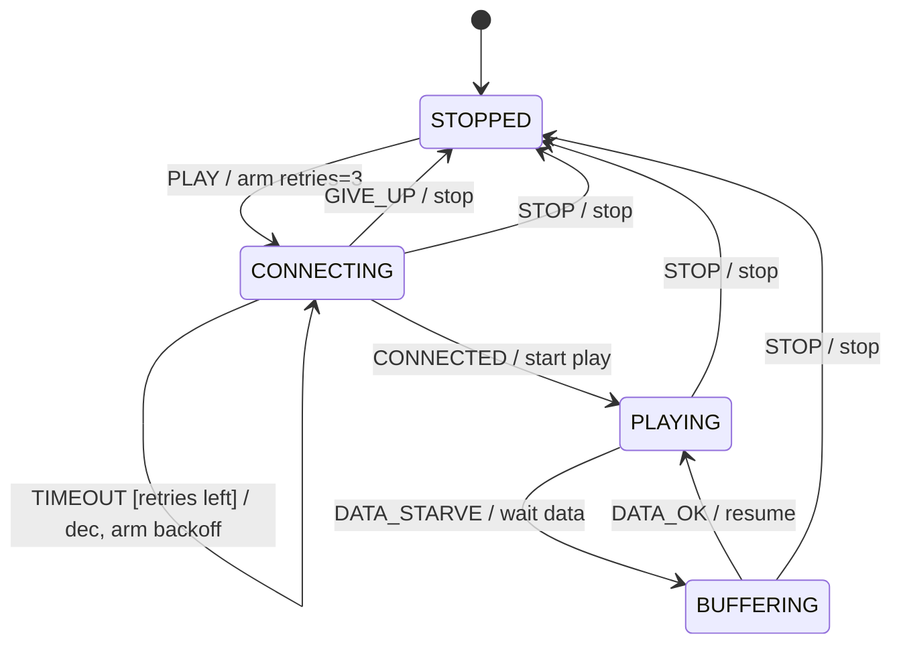

# 第 07 课：播放器 —— 重试（Retry）

本课只引入一个概念：**重试（Retry）**。

回顾已经会的六件事：

- **状态**、**转移**、**事件**、**监护**
- **动作**：转移上的副作用（第 05 课）
- **超时**：剩余拍数减到 0，变成一次事件（第 06 课）

本课的新问题是：失败之后能不能再来一次——以及 **什么时候必须停手**。

---

## 1. Motivation

第 06 课的电梯门：时间到了就关，关一次。没有「再开再关再开」。

播放器连网播流时，第一次握手经常失败：无线抖一下、服务器忙、DNS 慢。若失败就回 `STOPPED`，用户要不停按播放。若失败就永远再连，电量和日志都会被烧穿。

重试是这两极之间的纪律：

> 还有预算就再试，并且一次比一次等得更久；预算用尽就放弃，回到停止。

「再试」不是新状态机，「放弃」也不是新架构。重试是 **次数 + 退避**，记在 `Fsm` 的数据里，用你已经会的超时去等待下一次尝试。

用在哪：播放缓冲、TCP SYN 重传（只建立直觉）、HTTP 客户端重试、磁盘读失败、登录失败锁定。本课只用扁平的教学方播放器。

本课状态全部摊在一层。不要把「正在连」拆成子状态。后面才有那种写法。

---

## 2. Problem Description

一台教学媒体播放器，四个局面（扁平，没有嵌套）：

- 停止（`STOPPED`）
- 正在连接（`CONNECTING`）
- 正在播放（`PLAYING`）
- 正在缓冲（`BUFFERING`）

事件：

- `PLAY` / `STOP`：用户
- `CONNECTED`：握手成功
- `DATA_STARVE` / `DATA_OK`：播着播着没数据 / 数据又够了
- `TIMEOUT`：连接等待到期（第 06 课的超时，用在连接上）
- `TICK`：推动退避等待
- `GIVE_UP`：预算用尽——**由重试逻辑产生**

期望行为：

1. `PLAY`：进入 `CONNECTING`，装上重试预算（教学取 3），退避序列从 1 拍起
2. `CONNECTED`：进入 `PLAYING`
3. `PLAYING` + `DATA_STARVE` → `BUFFERING`（缺数据，不是连接失败）
4. `BUFFERING` + `DATA_OK` → `PLAYING`
5. `CONNECTING` + `TIMEOUT`（连接没成功）：预算减一并打印剩余次数
   - 若还剩次数：留在 `CONNECTING`，装上退避拍数（1，然后 2，然后 4）
   - 若次数为 0：视为 `GIVE_UP`，动作停止，回到 `STOPPED`
6. `STOP`：任何播放相关状态都回 `STOPPED`，清掉预算

`BUFFERING` 不是重试。缺数据时你已经连上了，只是在等码流。重试只发生在 `CONNECTING` 的失败路径上。这是本课最容易混的一点，讲义会反复说。

---

## 3. Naive Solution

两种常见极端。

永远重来：

```c
void
on_timeout(void)
{
	connect_again(); /* 没有次数，没有等待 */
}
```

网络一抖就打爆对端，日志里全是同一行，你无法知道试了第几次。

立刻放弃：

```c
void
on_timeout(void)
{
	state = STOPPED;
}
```

一次超时就停，用户体验差，也学不到「预算」。

第三种乱法：每次失败 `sleep(1)` 再连。这是第 06 课禁止的阻塞，加上没有上限的循环，比前两种更糟。

朴素方案缺的是两样 **数据**，不是新状态：

- `retries_left`：还能试几次
- `backoff_ticks` / `wait_ticks`：下一次要等几拍（1、2、4）

---

## 4. FSM Solution

重试的定义（本课只需这句）：

> 重试 = 有限次数的再尝试 + 一次比一次长的等待。等待用第 06 课的超时实现。次数用尽则发出放弃事件，回到安全状态。

它 **不是**：

- 无限 `while` 重连
- 多一个「重试中」状态（本课退避期间仍停在 `CONNECTING`）
- 缓冲（`BUFFERING` 是另一条转移）

四个扁平状态：`STOPPED`、`CONNECTING`、`PLAYING`、`BUFFERING`。

`Fsm` 数据：

- `retries_left`：剩余预算，`PLAY` 时装 3
- `backoff_ticks`：下一次失败后要等的拍数，从 1 起，每次失败后乘 2（1、2、4）
- `wait_ticks`：当前退避还剩几拍；为 0 表示不在等，可以接受下一次 `TIMEOUT` 或 `CONNECTED`

关键路径：

- `STOPPED` + `PLAY` → 装预算 → `CONNECTING`（第一次尝试，打印次数）
- `CONNECTING` + `CONNECTED` → `PLAYING`
- `CONNECTING` + `TIMEOUT` 且 `wait_ticks == 0`：
  - `retries_left--`，打印
  - `> 0`：`wait_ticks = backoff_ticks`，`backoff_ticks *= 2`，仍停在 `CONNECTING`
  - `== 0`：事件改写成 `GIVE_UP`
- `CONNECTING` + `GIVE_UP` → 动作停止 → `STOPPED`
- `CONNECTING` + `TICK` 且正在退避：`wait_ticks--`；减到 0 时打印 `retry connect`
- `PLAYING` + `DATA_STARVE` → `BUFFERING`
- `BUFFERING` + `DATA_OK` → `PLAYING`
- `STOP` → `STOPPED`，清预算

`TIMEOUT` 在这里是「这一次连接尝试失败」。它复用第 06 课：你可以想象连接也有剩余拍数；教学演示里由 `main` 直接投递 `TIMEOUT`，表示「这次没连上」。退避等待才用 `TICK` 递减。

架构未变：

```
State 枚举
Event 枚举
Fsm { state, retries_left, backoff_ticks, wait_ticks }
fsm_init
fsm_dispatch(Fsm *, Event)
```

---

## 5. State Diagram



退避期间的 `TICK` 是自环，图上省略以免吵；表里有。

ASCII 对照：

```
                     PLAY / arm retries
    +----------+ --------------------------> +-------------+
    | STOPPED  |                             | CONNECTING  |
    |          | <-------------------------- |             |
    +----------+   GIVE_UP / stop            +-------------+
         ^                                   |     ^
         | STOP                              |     | TIMEOUT [retries left]
         |                                   |     | / dec, backoff
         |                                   |     +
         |                                   | CONNECTED
         |                                   v
         |                             +------------+
         +---------------------------- |  PLAYING   |
                   STOP                |            |
                                       +------------+
                                            |  ^
                                DATA_STARVE |  | DATA_OK
                                            v  |
                                       +------------+
                                       | BUFFERING  |
                                       +------------+
```

四个框，没有框中框。`CONNECTING` 上的自环就是重试。不要把自环画成子状态。

---

## 6. State Table

| Current State | Event | Guard | Action | Next State |
|---------------|-------|-------|--------|------------|
| STOPPED | PLAY | — | arm retries=3, backoff=1, print budget, start connect | CONNECTING |
| CONNECTING | CONNECTED | wait 已结束或允许提前成功 | start play, clear wait | PLAYING |
| CONNECTING | TIMEOUT | wait_ticks==0 且 retries_left>1 | retries--, print, arm wait=1/2/4 | CONNECTING |
| CONNECTING | TIMEOUT | wait_ticks==0 且 retries_left==1 | retries-- 至 0, 视为 GIVE_UP | （见下一行） |
| CONNECTING | GIVE_UP | — | stop, print give up | STOPPED |
| CONNECTING | TICK | wait_ticks>0 | wait--, 到 0 则 print retry | CONNECTING |
| CONNECTING | TIMEOUT | wait_ticks>0 | （无，退避中忽略） | CONNECTING |
| PLAYING | DATA_STARVE | — | wait data | BUFFERING |
| BUFFERING | DATA_OK | — | resume play | PLAYING |
| PLAYING | STOP | — | stop, clear budget | STOPPED |
| BUFFERING | STOP | — | stop, clear budget | STOPPED |
| CONNECTING | STOP | — | stop, clear budget | STOPPED |
| BUFFERING | DATA_STARVE | — | （无） | BUFFERING |
| PLAYING | DATA_OK | — | （无） | PLAYING |
| * | （未列出） | — | （无） | 保持 |

读表：

- 重试行的下一状态仍是 `CONNECTING`。新概念在 **动作和数据**，不在多出来的状态名
- `GIVE_UP` 是预算用尽时由 `TIMEOUT` 改写出来的事件，和电梯里 `TICK` 改写成 `TIMEOUT_DOOR` 同一手法
- `BUFFERING` 各行没有 `retries_left`。不要给缓冲加预算，那会把两个问题焊在一起

---

## 7. Event Flow

先走一条「连三次都失败，放弃」的路径，再走一条「连上、卡顿、恢复、停止」的路径。

```
time -->

[ STOPPED ]
    --PLAY / retries=3--> [ CONNECTING ]
    --TIMEOUT / retries=2, wait=1--> [ CONNECTING ]
    --TICK / wait=0, retry connect--> [ CONNECTING ]
    --TIMEOUT / retries=1, wait=2--> [ CONNECTING ]
    --TICK / wait=1--> [ CONNECTING ]
    --TICK / wait=0, retry connect--> [ CONNECTING ]
    --TIMEOUT / retries=0 => GIVE_UP / stop--> [ STOPPED ]

[ STOPPED ]
    --PLAY / retries=3--> [ CONNECTING ]
    --CONNECTED / start play--> [ PLAYING ]
    --DATA_STARVE / wait data--> [ BUFFERING ]
    --DATA_OK / resume--> [ PLAYING ]
    --STOP / stop--> [ STOPPED ]
```

执行顺序：

1. `PLAY`：预算 3，进入 `CONNECTING`，打印剩余次数
2. 第一次 `TIMEOUT`：剩余 2，退避 1 拍
3. 1 个 `TICK` 后打印 `retry connect`
4. 第二次 `TIMEOUT`：剩余 1，退避 2 拍
5. 2 个 `TICK` 后再次 `retry connect`
6. 第三次 `TIMEOUT`：剩余 0，改写成 `GIVE_UP`，回 `STOPPED`
7. 再 `PLAY`，这次 `CONNECTED`，进入播放；缺数据进缓冲，数据够了回播放；`STOP` 结束

调试时打印 **剩余次数**。本课若日志里看不见次数，重试就白做了。

---

## 8. Implementation

运行：

```bash
cc -std=c11 -Wall -Wextra -o player code/c/player.c && ./player
c++ -std=c++17 -Wall -Wextra -o player code/cpp/player.cpp && ./player
python3 code/python/player.py
```

### 伪代码

```
states: STOPPED, CONNECTING, PLAYING, BUFFERING
events: PLAY, STOP, CONNECTED, DATA_STARVE, DATA_OK, TIMEOUT, TICK, GIVE_UP
BUDGET <- 3

init:
    current <- STOPPED
    retries_left <- 0
    backoff_ticks <- 1
    wait_ticks <- 0

dispatch(e):
    if e is TICK and current is CONNECTING and wait_ticks > 0:
        wait_ticks <- wait_ticks - 1
        if wait_ticks == 0:
            print "retry connect", retries_left
        return

    if current is CONNECTING and e is TIMEOUT and wait_ticks == 0:
        retries_left <- retries_left - 1
        print retries_left
        if retries_left <= 0:
            e <- GIVE_UP
        else:
            wait_ticks <- backoff_ticks
            print backoff
            backoff_ticks <- backoff_ticks * 2
            return

    if current is STOPPED and e is PLAY:
        retries_left <- BUDGET
        backoff_ticks <- 1
        wait_ticks <- 0
        print budget
        action start connect
        current <- CONNECTING

    if current is CONNECTING and e is CONNECTED:
        action start play
        wait_ticks <- 0
        current <- PLAYING

    if current is CONNECTING and e is GIVE_UP:
        action stop
        current <- STOPPED

    if current is PLAYING and e is DATA_STARVE:
        action wait data
        current <- BUFFERING

    if current is BUFFERING and e is DATA_OK:
        action resume
        current <- PLAYING

    if e is STOP and current is not STOPPED:
        action stop
        clear budget
        current <- STOPPED
```

C / C++ / Python 见 `code/`。轨迹必须能看见 `retries left` 从 3 减到 0，以及退避 1、2。

实现要点：

- 打印剩余次数是本课的教学要求，不要删掉
- 退避 1、2、4 存在 `Fsm` 里，用 `TICK` 等待，不要 `sleep`
- `GIVE_UP` 必须是 `Event` 枚举的一员
- 四个状态保持扁平；退避不是第五个状态
- 不要给 `BUFFERING` 做次数限制（除非练习里你自己加，且能说清那是另一条策略）

---

## 9. Design Discussion

重试与超时的分工：

| | 超时（第 06 课） | 重试（本课） |
|--|------------------|--------------|
| 问的问题 | 这一次等待是否到期？ | 到期之后还能否再来一次？ |
| 数据 | 一个剩余拍数 | 次数 + 下一次要等的拍数 |
| 结束 | 产生一个到期事件 | 次数用尽产生放弃事件 |
| 失败一次 | 就做那次到期该做的事 | 可能回到同一状态再试 |

本课把两者叠在 `CONNECTING` 上：`TIMEOUT` 表示「这一枪没中」；重试决定「还有没有下一枪」。退避等待再次使用超时手法（`wait_ticks` + `TICK`）。

为什么退避要加倍（1、2、4），而不是每次等 1 拍：

- 对端或信道可能拥塞。固定猛打会加重拥塞
- 教学序列短，学生能在轨迹里数拍
- 真实系统还有抖动、上限封顶（例如不超过 32）。本课不封顶，因为预算只有 3，序列自然停

为什么退避期间留在 `CONNECTING`：

- 局面仍是「还没连上、还在连」
- 多一个 `WAITING` 状态并不增加信息，只增加表行
- 用 `wait_ticks > 0` 当监护即可区分「正在连」和「正在等下一枪」

`BUFFERING` 为什么不是重试：

- 你已经 `CONNECTED` 过了
- 缺的是码流，不是套接字
- 用 `DATA_OK` 恢复，不消耗 `retries_left`

替代：

- 无限重连：运维简单、事故巨大
- 立即放弃：实现简单、体验差
- 线性退避（1、2、3）：也能教次数，但看不到「越等越久」
- 把每次尝试做成独立状态 `TRY1` `TRY2` `TRY3`：状态爆炸，预算一改就要改枚举。次数必须是数据

取舍：教学播放器没有真实套接字。`CONNECTED` / `TIMEOUT` 由 `main` 喂入。你要假装自己是网络。

工业对照（只建立直觉，不在本课实现协议）：

- TCP 对 SYN 会重传，并且间隔变长，次数用尽则放弃——和第 08 课相遇时你已经认识「次数 + 退避」
- HTTP 客户端对 503 有时会再试，但幂等和不幂等请求的策略不同
- 磁盘读失败常做有限次重试，避免把坏块打成活锁

不要做的升级：不要把 `PLAYING` 画成套着 `BUFFERING` 的大圈。四个名字平铺，已经够用。

---

## 10. Common Mistakes

初学者：

- 失败后 `retries_left` 不减，或减了不打印，轨迹无法批改
- `TIMEOUT` 一次就 `STOPPED`，重试数据成了死字段
- 退避用 `sleep`，分发函数卡死
- 给 `BUFFERING` 也减 `retries_left`，播着播着无故放弃
- 增加 `RETRYING` 状态，和 `CONNECTING` 抢「现在是什么」
- 把 `GIVE_UP` 只写成函数调用，不放进 `Event`，放弃路径无法画进表
- 预算写成 3，却在第一次 `PLAY` 时先减一次，实际只试了两回

工业上：

- 重试不幂等的请求（同一笔扣款打三次）
- 退避没有上限，最后一次要等几分钟，用户以为死机
- 成功路径忘记清预算，下一次 `PLAY` 带着旧的 `retries_left=0` 立刻放弃
- 日志不打第几次，事故分析只能猜

---

## 11. Refactoring

第 08 课会把「状态 × 事件」放进表。重试数据仍然留在 `Fsm` 里，不会变成表的第三维。现在不要建表。

若你想给连接本身加「单次尝试最多 5 拍」：再放一个 `connect_ticks`，用第 06 课的手法在 `CONNECTING` 且 `wait_ticks==0` 时递减，到 0 投递 `TIMEOUT`。那是超时，不是新的重试规则。本课 `main` 直接喂 `TIMEOUT`，是为了让轨迹短。

若你已经在画大圈套小圈：停住。摊平四个状态完成本课。

---

## 12. Exercise

**容易**

把预算从 3 改成 2。退避仍是 1、2、4（第三次用不到 4）。改 `PLAY` 装载和 `main` 里失败路径的事件序列，使轨迹在第二次 `TIMEOUT` 后 `GIVE_UP`。

**中等**

`BUFFERING` 增加「最多等 4 个 `TICK`，否则 `STOP`」。这是给缓冲加超时，不是给缓冲加重试。不要动 `retries_left`。说明你为什么拒绝把缓冲和连接预算共用一个计数器。

**挑战**

用五列表画出「登录：最多 3 次密码错误，然后锁定」。状态只要 `PROMPT` / `LOCKED`（可加 `OK`）。指出哪一列是动作（例如 `retries--`）、哪一行是放弃。退避可以省略。不要画嵌套状态。

---

## 13. Summary

- 重试 = 有限次数 + 退避等待，不是无限重启
- 次数和退避是 `Fsm` 数据；放弃是事件 `GIVE_UP`
- 连接失败才消耗预算；`BUFFERING` 是缺数据，不是重试
- 退避用第 06 课的拍数，动作用第 05 课的函数，状态保持四个扁平名字
- 打印剩余次数，否则你无法证明重试发生过

下一课：教学 TCP。新概念是 **表驱动**——把本课仍在手写的 `switch` 收成 `table[state][event]`。
