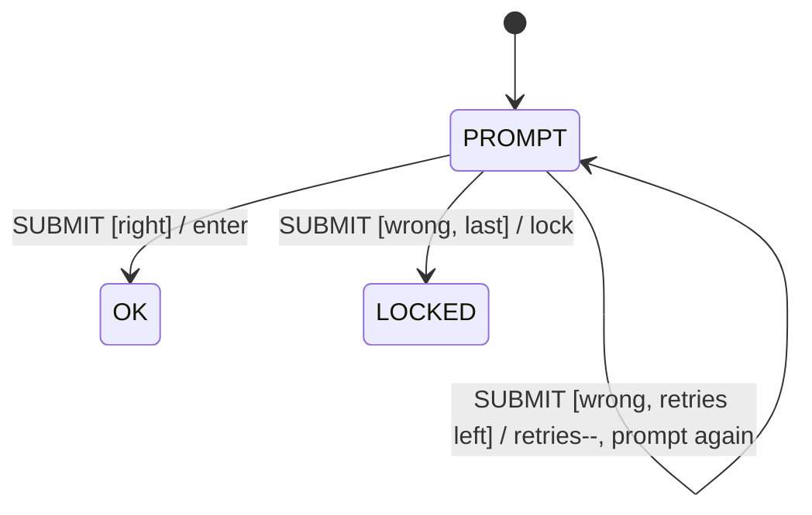

# 第 07 课：五个代表例（重试）

主例「播放器连接」的完整实现在 `code/`。其余四例只建立直觉：有限次数 + 退避，用尽则放弃。

本课继续使用动作和超时。新增加的是预算，不是新的状态层。

---

## 例 1：播放器缓冲与连接（主例）

**问题**：连网失败要再试，但只能试有限次；连上之后缺数据走 `BUFFERING`，那条路不消耗连接预算。

**状态图**：见 `LESSON.md`。

**状态表**：`STOPPED` / `CONNECTING` / `PLAYING` / `BUFFERING`；`TIMEOUT` 减 `retries_left`，到 0 变成 `GIVE_UP`。

**实现**：`code/c/player.c`、`code/cpp/player.cpp`、`code/python/player.py`。

**复杂度**：4 个扁平状态；重试数据 3 个整数。

**工业用途**：流媒体播放器的启动握手。

**常见缺陷**：缓冲也减同一计数；或失败后不打印剩余次数。

**重构**：不要把 `PLAYING` 画成套着缓冲的大状态。四个名字平铺即可。

---

## 例 2：SYN 重传（只预告）

**问题**：客户端发出连接请求后，若窗口内没有应答，会再发，并且间隔变长；次数用尽则放弃。

本例 **不实现 TCP，不画全部十一状态**。你只需要认出和第 07 课相同的骨架：

```
CLOSED --ACTIVE_OPEN / send SYN, arm retries--> SYN_SENT
SYN_SENT --TIMEOUT [retries left] / retransmit, backoff--> SYN_SENT
SYN_SENT --GIVE_UP / give up--> CLOSED
SYN_SENT --SYN_ACK / ...--> (第 08 课再展开)
```

| 播放器 | SYN 预告 |
|--------|----------|
| CONNECTING | SYN_SENT |
| TIMEOUT | 重传计时到期 |
| retries_left | 还能发几次 SYN |
| 1, 2, 4 | 重传间隔变长 |
| GIVE_UP | 放弃连接，回 CLOSED |

**复杂度（预告）**：先当 2 个状态看。完整 TCP 是第 08 课的表驱动。

**工业用途**：可靠握手。

**常见缺陷**：在本课抄一份内核 TCP。不要做。本例只为了让你在第 08 课看见重传时不觉得陌生。

**重构**：第 08 课会把这些转移放进表。预算仍然是上下文数据。

---

## 例 3：HTTP 重试

**问题**：对某些失败（连接被重置、503）再发请求；次数用尽则把错误交给调用者。

教学简化：没有套接字，事件用枚举。

| Current State | Event | Guard | Action | Next State |
|---------------|-------|-------|--------|------------|
| IDLE | START | — | send request, arm retries=3 | WAIT |
| WAIT | OK | — | deliver body | IDLE |
| WAIT | FAIL | retries left | retries--, arm backoff | WAIT |
| WAIT | FAIL | retries==0 | GIVE_UP / deliver error | IDLE |

**复杂度**：2 个状态。和播放器相比，少了 `PLAYING` / `BUFFERING`，重试骨架相同。

**工业用途**：客户端库、网关。

**常见缺陷**：对 `POST` 扣款也盲目重试——请求必须幂等，或带幂等键。这是策略，不是状态个数问题。

**重构**：取消请求是后面应用生命周期课的话题。本例只要求次数有上限。

---

## 例 4：磁盘 I/O 重试

**问题**：读块偶尔失败（总线抖、控制器忙）。再读有限次；用尽则报 I/O 错误，不要死循环砸盘。

```
+--------+  READ / arm retries     +--------+
|  IDLE  | ----------------------> |  BUSY  |
|        | <---------------------- |        |
+--------+  OK / deliver           +--------+
     ^                                  |
     | GIVE_UP / error                  | FAIL [retries left]
     +----------------------------------+ / retry read
```

| Current State | Event | Guard | Action | Next State |
|---------------|-------|-------|--------|------------|
| IDLE | READ | — | start read, retries=3 | BUSY |
| BUSY | OK | — | deliver | IDLE |
| BUSY | FAIL | retries left | retries--, print, start read | BUSY |
| BUSY | FAIL | 用尽 | print give up | IDLE |

退避在磁盘上可以很短（0 或 1 拍）。教学仍建议打印次数，否则看不出试过几回。

**复杂度**：2 / 3。

**工业用途**：块设备、闪存读取。

**常见缺陷**：`while (1) read()`；坏块会把 CPU 和介质一起耗死。

**重构**：把失败分类（可重试 / 不可重试）是监护，不是新状态。介质只读错误应直接 `GIVE_UP`。

---

## 例 5：登录重试

**问题**：密码错可以再试；试满 3 次则锁定，不再接受 `SUBMIT`。



| Current State | Event | Guard | Action | Next State |
|---------------|-------|-------|--------|------------|
| PROMPT | SUBMIT | 密码对 | enter | OK |
| PROMPT | SUBMIT | 密码错且 retries>1 | retries--, print | PROMPT |
| PROMPT | SUBMIT | 密码错且 retries==1 | lock | LOCKED |
| LOCKED | SUBMIT | — | （无） | LOCKED |

这里的「放弃」进入的是 `LOCKED`，不是回到可继续试的提示。预算用尽后的安全状态可以不同于起点——播放器回到 `STOPPED` 是因为停止仍然安全；登录必须换一个锁死局面。

退避可以省略（防止暴力破解时，反而常用 **加长** 等待）。教学上打印剩余次数仍然必要。

**复杂度**：3 个状态，1 个事件，差别全在监护与动作。

**工业用途**：控制台登录、SIM 解锁。

**常见缺陷**：锁定后仍减 `retries_left`（减成负数），或锁定状态还能被 `SUBMIT` 打开。

**重构**：解锁超时（过十分钟自动回 `PROMPT`）是第 06 课手法叠在锁定上。可以做，但那是超时，不是把重试预算无限续上。
