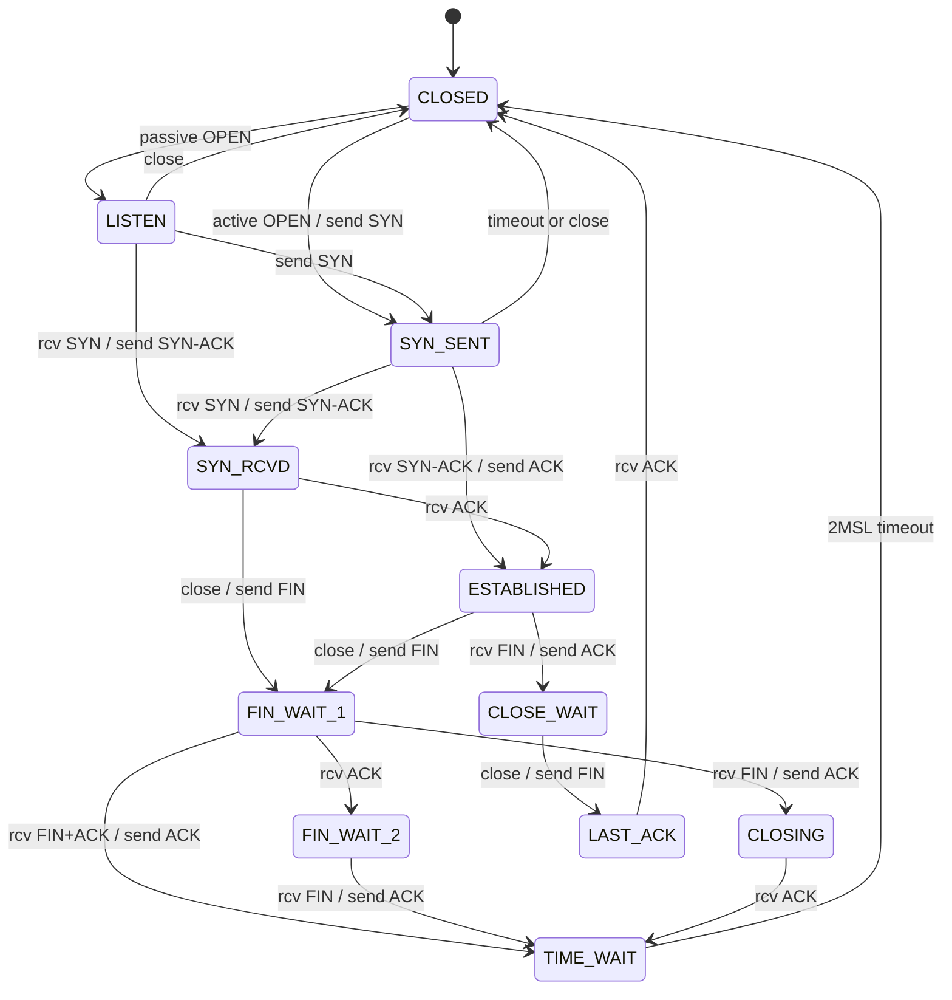
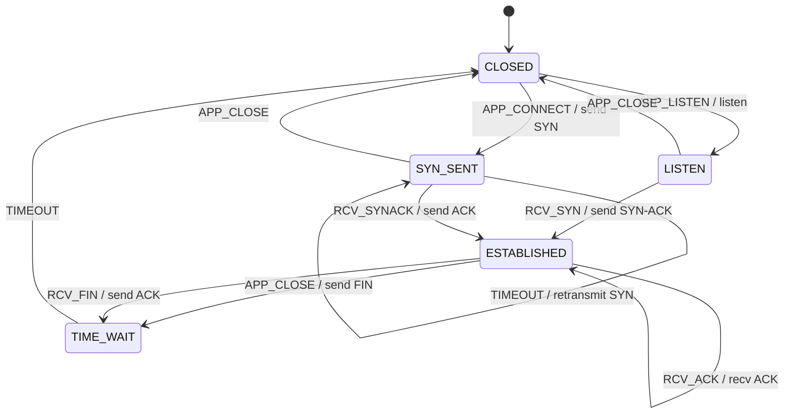

# 第 08 课：教学 TCP —— 表驱动协议 FSM

本课只引入一个概念：**把转移编码成表** `table[state][event] = {action, next}`。

回顾已经会的七件事（全部仍在本课里出现，只是不再用手写 `switch` 去实现）：

- **状态（State）**：此刻局面
- **转移（Transition）**：箭头
- **事件（Event）**：输入
- **监护（Guard）**：开火前条件——本课的表没有单独一列监护；缺格就等于「不满足」
- **动作（Action）**：开火时的副作用（打印 `send SYN` 等）
- **超时（Timeout）**：到期变成一次事件（本课叫 `TIMEOUT`）
- **重试（Retry）**：`SYN_SENT` 上的 `TIMEOUT` 再发一次 SYN，仍停在同一状态

本课的新问题是：状态 × 事件一旦到了协议规模，嵌套 `switch` 会把「整张图」藏进控制流。表把图摊平，查找代替分支。

本课 **不** 把状态套进状态，**不** 引入邮箱并发模型。TCP 教学机仍然是一台扁平机。

---

## 1. Motivation

第 03–07 课的 `fsm_dispatch` 都是：

```c
switch (fsm->state) {
case STATE_A:
	if (event == EVENT_X)
		...
}
```

售货机、交通灯、播放器，状态不到十个，这样写清楚。协议不一样。TCP 的 RFC 图有十一个状态，事件是「段上的标志组合 + 应用调用 + 定时器」，格子很多。嵌套 `switch` 的问题不是「C 写不出来」，而是：

- 缺一条转移时，编译器不抱怨，运行时静默走 `default`
- 你无法把「整张图」打印出来核对
- 同一事件在不同状态下含义不同（`TIMEOUT` 在 `SYN_SENT` 是重传，在 `TIME_WAIT` 是收摊），分支会越写越像两台机器焊在一起

表驱动把这件事收成一次查表：

```
cell = table[state][event]
if cell.defined:
    cell.action(fsm)
    state = cell.next
```

用在哪：协议控制面、解析器、会话建立。本课用 **教学 TCP**（不是协议栈）：没有 socket，没有报文，动作用 `printf` 假装收发。

---

## 2. Problem Description

### 教学 TCP 要什么

五个状态（代码里只有这些）：

| 状态 | 意思 |
|------|------|
| `CLOSED` | 没有连接 |
| `LISTEN` | 被动等别人来 |
| `SYN_SENT` | 主动发了 SYN，在等 SYN-ACK |
| `ESTABLISHED` | 可以传数据（本课不传数据） |
| `TIME_WAIT` | 主动关掉之后，再等一会儿才真正消失 |

八个事件：

| 事件 | 意思 |
|------|------|
| `APP_LISTEN` | 应用要被动打开 |
| `APP_CONNECT` | 应用要主动打开 |
| `RCV_SYN` | 收到 SYN |
| `RCV_SYNACK` | 收到 SYN-ACK |
| `RCV_ACK` | 收到 ACK |
| `APP_CLOSE` | 应用要关 |
| `RCV_FIN` | 收到 FIN |
| `TIMEOUT` | 定时器到期（RTO 或 2MSL，看当前状态） |

主路径（必须能跑出来）：

1. **被动打开**：`CLOSED -APP_LISTEN-> LISTEN -RCV_SYN-> ESTABLISHED`  
   教学上 **跳过 `SYN_RCVD`**：收到 SYN 就打印 `send SYN-ACK`，直接进 `ESTABLISHED`。真实握手还要再等一次 ACK。
2. **主动打开**：`CLOSED -APP_CONNECT-> SYN_SENT -RCV_SYNACK-> ESTABLISHED`  
   打印 `send SYN`，然后 `send ACK`。
3. **关闭**：`ESTABLISHED -APP_CLOSE-> TIME_WAIT -TIMEOUT-> CLOSED`  
   打印 `send FIN`。教学上 **跳过** `FIN_WAIT_1`、`FIN_WAIT_2`、`CLOSE_WAIT`、`LAST_ACK`、`CLOSING`。

另外两条为了复习超时和重试：

- `SYN_SENT + TIMEOUT`：打印 `retransmit SYN`，留在 `SYN_SENT`
- `ESTABLISHED + RCV_FIN`：打印 `send ACK`，进 `TIME_WAIT`（把被动关闭也压成一步）

### RFC 图里有、代码里故意没有的

RFC 793 的状态机（现行整理见 RFC 9293）有十一个状态。下面这些 **只出现在本课状态图里，不出现在代码里**：

- `SYN_RCVD`（被动打开的第三次握手）
- `FIN_WAIT_1`、`FIN_WAIT_2`、`CLOSING`、`CLOSE_WAIT`、`LAST_ACK`（四次挥手的中间态）

没有套接字，没有序号，没有窗口，没有拥塞控制，没有 RST 处理。这些代码不能对接真实网络。

---

## 3. Naive Solution

把第 07 课的 `switch` 直接放大：

```c
void
fsm_dispatch(Fsm *fsm, Event event)
{
	switch (fsm->state) {
	case STATE_SYN_SENT:
		switch (event) {
		case EVENT_RCV_SYNACK:
			printf("send ACK\n");
			fsm->state = STATE_ESTABLISHED;
			break;
		case EVENT_TIMEOUT:
			printf("retransmit SYN\n");
			break;
		default:
			break;
		}
		break;
	case STATE_ESTABLISHED:
		switch (event) {
		case EVENT_TIMEOUT:
			/* 这里的 TIMEOUT 不该重传 SYN，但 default 很容易写错 */
			break;
		...
		}
	}
}
```

同一份 `TIMEOUT` 在两个 `case` 里含义相反。漏写 `default` 或把动作拷错行，编译仍然通过。协议变大之后，你无法回答「`LISTEN + RCV_FIN` 有没有定义？」——除非把整份函数读完。

朴素方案缺的不是事件枚举（第 03 课已经有了），而是 **可枚举的转移集合**。

---

## 4. FSM Solution

表驱动的定义（本课只需这句）：

> 每一格是 `{action, next, defined}`。`fsm_dispatch` 只做查找：有格就执行动作并改状态，没格就忽略。

架构仍是扁平的一台机：

```
State 枚举（5 个教学状态）
Event 枚举（8 个）
Fsm { state }
table[STATE_COUNT][EVENT_COUNT]
fsm_init
fsm_dispatch(Fsm *, Event)   /* 内部是查表，不是嵌套 switch */
```

格子：

```
+--------+--------+------------------+-------------+
| state  | event  | action           | next        |
+--------+--------+------------------+-------------+
| CLOSED | APP_LISTEN | listen       | LISTEN      |
| CLOSED | APP_CONNECT| send SYN     | SYN_SENT    |
| LISTEN | RCV_SYN    | send SYN-ACK | ESTABLISHED |
| SYN_SENT | RCV_SYNACK | send ACK   | ESTABLISHED |
| SYN_SENT | TIMEOUT    | retransmit | SYN_SENT    |
| ESTABLISHED | APP_CLOSE | send FIN | TIME_WAIT   |
| ESTABLISHED | RCV_FIN   | send ACK | TIME_WAIT   |
| TIME_WAIT | TIMEOUT     | (none)   | CLOSED      |
+--------+--------+------------------+-------------+
```

未列出的格 `defined = 0`。这就是本课对待监护的方式：不写函数，缺格即「不允许」。

**事件分发**：外界（本课是 `main`）每次调用 `fsm_dispatch` 一次。没有队列——队列是第 09 课的事。没有 socket 回调；`RCV_SYN` 是你用手喂进去的枚举。

**定时器**：本课不实现 tick。`TIMEOUT` 由 `main` 直接投递。你要假装自己是 RTO 或 2MSL。第 06 课的拍数、第 07 课的退避，在 `SYN_SENT + TIMEOUT` 这一格里以「再发 SYN、不改状态」的形式复习。

---

## 5. State Diagram

### RFC 全图（建立完整图景，不是本课代码）

下列十一个名字来自 RFC 793 / RFC 9293。灰色省略的那些，代码里没有对应枚举值。



ASCII 对照（同样是 RFC 全图，教学代码只走加粗路径的压缩版）：

```
                    passive OPEN                 active OPEN / SYN
    +--------+ ----------------------> +--------+ ------------------> +----------+
    | CLOSED |                         | LISTEN |                     | SYN_SENT |
    |        | <---------------------- |        |                     |          |
    +--------+      close              +--------+                     +----------+
         ^                                  |   rcv SYN / SYN-ACK          |
         |                                  v                              |
         |                            +-----------+   rcv SYN / SYN-ACK    |
         |                            | SYN_RCVD  | <----------------------+
         |                            +-----------+                        |
         |                                  | rcv ACK                      | rcv SYN-ACK / ACK
         |                                  v                              v
         |                            +--------------+
         |                            | ESTABLISHED  |
         |                            +--------------+
         |                             /            \
         |                 close/FIN  /              \ rcv FIN / ACK
         |                           v                v
         |                    +------------+    +------------+
         |                    | FIN_WAIT_1 |    | CLOSE_WAIT |
         |                    +------------+    +------------+
         |                      /    |   \              |
         |            rcv ACK  /     |    \ rcv FIN     | close / FIN
         |                    v      |     v            v
         |             +-----------+ |  +---------+  +----------+
         |             | FIN_WAIT_2| |  | CLOSING |  | LAST_ACK |
         |             +-----------+ |  +---------+  +----------+
         |                    |      |        |            |
         |             rcv FIN|      | rcv ACK|            | rcv ACK
         |                    v      v        v            |
         |                  +-----------+                  |
         +----------------- | TIME_WAIT | -----------------+
              2MSL timeout  +-----------+
```

### 本课代码实际实现的图



被动路径把 `LISTEN → SYN_RCVD → ESTABLISHED` 收成一跳。关闭路径把四次挥手收成 `ESTABLISHED → TIME_WAIT → CLOSED`。图上请自己标出「压缩了哪一段」，不要把教学图当成 RFC。

---

## 6. State Table

| Current State | Event | Guard | Action | Next State |
|---------------|-------|-------|--------|------------|
| CLOSED | APP_LISTEN | 表中有格 | listen | LISTEN |
| CLOSED | APP_CONNECT | 表中有格 | send SYN | SYN_SENT |
| LISTEN | RCV_SYN | 表中有格 | send SYN-ACK（跳过 SYN_RCVD） | ESTABLISHED |
| LISTEN | APP_CLOSE | 表中有格 | （无） | CLOSED |
| SYN_SENT | RCV_SYNACK | 表中有格 | send ACK | ESTABLISHED |
| SYN_SENT | TIMEOUT | 表中有格 | retransmit SYN | SYN_SENT |
| SYN_SENT | APP_CLOSE | 表中有格 | （无） | CLOSED |
| ESTABLISHED | APP_CLOSE | 表中有格 | send FIN | TIME_WAIT |
| ESTABLISHED | RCV_FIN | 表中有格 | send ACK | TIME_WAIT |
| ESTABLISHED | RCV_ACK | 表中有格 | recv ACK | ESTABLISHED |
| TIME_WAIT | TIMEOUT | 表中有格 | （无） | CLOSED |
| CLOSED | RCV_FIN | **无格** | ignore | CLOSED |
| * | （其余组合） | **无格** | ignore | 保持 |

读表：

- 监护列几乎全是「表中有格」。这是表驱动的默认监护：非法输入不占一行动作，只是缺席
- `TIMEOUT` 出现两行，动作完全不同。同一事件名、不同格子——这就是为什么要用表，而不是按事件写一个大函数
- `SYN_SENT + TIMEOUT` 的下一状态仍是 `SYN_SENT`：第 07 课的重试，没有新状态名

---

## 7. Event Flow

```
time -->

被动:
[ CLOSED ]
    --APP_LISTEN / listen--> [ LISTEN ]
    --RCV_SYN / send SYN-ACK--> [ ESTABLISHED ]
    --APP_CLOSE / send FIN--> [ TIME_WAIT ]
    --TIMEOUT--> [ CLOSED ]

主动 + 一次重传:
[ CLOSED ]
    --APP_CONNECT / send SYN--> [ SYN_SENT ]
    --TIMEOUT / retransmit SYN--> [ SYN_SENT ]
    --RCV_SYNACK / send ACK--> [ ESTABLISHED ]
    --RCV_ACK / recv ACK--> [ ESTABLISHED ]
    --RCV_FIN / send ACK--> [ TIME_WAIT ]
    --TIMEOUT--> [ CLOSED ]

缺格:
[ CLOSED ]
    --RCV_FIN--> ignore, 仍是 CLOSED
```

执行顺序与 `main` 一致。调试时必须能看见 **动作打印** 和 **状态箭头** 两行。若只有状态变化没有 `send SYN`，表的 `action` 列就白做了。

---

## 8. Implementation

运行（在本课目录，或按下面的相对路径）：

```bash
cc -std=c11 -Wall -Wextra -o tcp_fsm code/c/tcp_fsm.c && ./tcp_fsm
c++ -std=c++17 -Wall -Wextra -o tcp_fsm code/cpp/tcp_fsm.cpp && ./tcp_fsm
python3 code/python/tcp_fsm.py
```

本课程序 **自包含**：不要 `#include` 课程根目录的 `engine/`。`fsm_dispatch` 里直接查 `table[state][event]`。学完后，同样的查找骨架放在：

- `engine/c/table_fsm.h`
- `engine/c/table_fsm.c`
- `engine/cpp/table_fsm.hpp`
- `engine/python/table_fsm.py`

那是带走用的泛型骨架，不是本课的编译依赖。

### 伪代码

```
states: CLOSED, LISTEN, SYN_SENT, ESTABLISHED, TIME_WAIT
events: APP_LISTEN, APP_CONNECT, RCV_SYN, RCV_SYNACK, RCV_ACK,
        APP_CLOSE, RCV_FIN, TIMEOUT

table[s][e] = { action, next, defined }   # 稀疏，缺格 defined=0

init:
    current <- CLOSED

dispatch(e):
    cell <- table[current][e]
    if not cell.defined:
        print ignore
        return
    if cell.action:
        cell.action()          # printf "send SYN" 等
    current <- cell.next
    print prev --e--> current
```

C 用指定初始化器填稀疏二维数组；C++17 没有数组下标指定初始化，所以在 `ensure_table` 里逐格写入；Python 用 `dict[(State, Event)] -> Cell`。三种写法是同一张表。

### 教学 FSM 怎么测

不要拿真实网卡。用 **事件脚本 + 轨迹断言**：

1. 固定序列喂给 `fsm_dispatch`（本课 `main` 已经是三组脚本）
2. 核对打印：状态名、事件名、动作字符串必须与表一致
3. 故意喂缺格（`CLOSED + RCV_FIN`），必须看到 `ignore`，状态不变
4. 同一事件在两态：`SYN_SENT + TIMEOUT` 打印重传且不离开；`TIME_WAIT + TIMEOUT` 回 `CLOSED` 且不重传
5. 三语言轨迹应当逐行可对齐（动作文本保持英文，方便 diff）

这就是本课的测试策略。没有报文 golden file，没有抓包。

实现要点：

- `fsm_dispatch` 里禁止再写「按状态的业务 `switch`」；查表是本课唯一新概念
- 动作只打印，不真正发送
- `SYN_RCVD` 不要偷偷加进枚举「以后再用」——本课明确省略，图上保留即可

---

## 9. Design Discussion

### 五种写法比什么

| 形态 | 转移写在哪 | 优点 | 缺点 | 本课 |
|------|------------|------|------|------|
| 嵌套 `switch` / `if` | 控制流 | 短程序直观 | 缺转移难发现；同一事件分散 | 第 03–07 课 |
| **表驱动** `{action, next}` | `table[s][e]` | 图与代码同构；缺格即忽略；可打印整表 | 监护、跨格数据不好放进第三维 | **本课采用** |
| 函数指针表 `table[s][e] = handler` | 每格一个函数 | 格子里可以写任意逻辑 | 逻辑散落；表仍在，只是动作更肥 | 本课的 `action` 列已经是函数指针；handler 若再改状态，表的 `next` 就撒谎了 |
| State Pattern（每状态一个类型） | 虚函数 / 方法 | 加新状态少改旧文件 | 加新事件要改所有状态类；协议事件集合不稳定时很痛 | 不采用 |
| 生成式 FSM（从表格或图生成 C） | 外部描述 | 图与代码同源 | 要工具链；生成结果往往仍是表或巨大 switch | 不采用，但工业上存在 |

表驱动和函数指针表常常是同一件事的两极：格子瘦（本课）还是格子肥（一格一个完整 handler）。瘦格子逼你把「下一状态」写在数据里，这正是本课要练的。

State Pattern 适合「状态少、事件集合还在长」的 GUI；TCP 相反：状态集合相对稳定，事件是段标志的组合，用类爆炸换不来清晰。

### 控制面与数据面

```
+------------------+        +-------------------------+
| application      |        | control plane           |
| listen/connect/  | -----> | teaching TCP FSM        |
| close            |  Event | table[state][event]     |
+------------------+        +-------------------------+
                                      |
                                      | actions: print "send SYN"
                                      | (real stacks: enqueue a segment)
                                      v
                            +-------------------------+
                            | data plane              |
                            | seq/ack, window, payload|
                            | NOT in this lesson      |
                            +-------------------------+
```

控制面回答「现在能不能 listen / 要不要发 SYN」。数据面回答「这个序号对不对、窗口还有没有」。本课只有控制面。真实栈里，`ESTABLISHED` 的快路径几乎不走进完整状态机，只更新序号和缓冲——见下面工业对照。

### 事件分发（本课 vs 真实）

本课：`main` 调 `fsm_dispatch`。一次一个枚举。

典型内核 TCP：网卡中断或 NAPI 把段送进协议处理；套接字 API 从另一侧注入 `connect` / `listen` / `close`。两端都变成「对这台机的输入」，但输入不是小枚举，而是「段 + 套接字命令 + 定时器回调」三种来源。表仍然可以想，只是键不再是 `Event` 八个值，而是标志位组合，所以工业代码很少真的写成 `table[11][8]`。

### 定时器子系统

RFC 里和状态强相关的计时器（教学只需知道名字）：

| 计时器 | 谁在用 | 到期之后 |
|--------|--------|----------|
| RTO（重传） | `SYN_SENT`、以及已发送未确认的数据 | 再发，间隔变长（第 07 课的重试） |
| 2MSL | `TIME_WAIT` | 回到 `CLOSED` |
| keepalive（可选） | `ESTABLISHED` 空闲 | 探测对端是否还在 |

本课把它们压成 **一个** `TIMEOUT` 事件，靠当前状态选格子。真实系统是多个计时器源，到期时投递不同事件（第 09 课才会把「到期写成入队事件」做完整）。

### 典型工业实现（自绘，不是本课程文件）

Linux 内核 TCP 的常见分工（这些是开源内核源码树里的常见位置，**不是本课程里的文件**）：

```
socket API (listen/connect/close)
        |
        v
+------------------+     incoming segments
| tcp_*_connect    |     +--------------------+
| inet_listen      |     | tcp_v4_rcv         |
+------------------+     |  (net/ipv4/tcp_input.c 等常见路径)
        |                +--------------------+
        |                         |
        |                         +--> ESTABLISHED 快路径
        |                         |    tcp_rcv_established
        |                         +--> 其它状态
        |                              tcp_rcv_state_process
        v                         |
+------------------+              v
| sk->sk_state     | <--- 改状态、发段 --- tcp_output / tcp_timer
+------------------+
        ^
        | timers: retransmit, timewait, delay-ack
        +--- net/ipv4/tcp_timer.c 等常见路径
```

要点：工业实现 **不是** 一张 `table[state][event]`。它是：

- 一个套接字上的 `sk_state` 字节
- 快路径（已建立、序号符合预期）绕开完整状态处理
- 慢路径里大量 `if (flags)` 而不是枚举事件
- 定时器在另一组函数里，到期再进入协议处理

DPDK 类用户态栈：轮询网卡，把段从用户空间送进 **同样概念的控制面**；定时器常用时间戳计数而不是内核 jiffies。状态名仍是 RFC 那些，分发手段变成轮询而不是中断。本课例子 5 只谈这个差别，不写 DPDK 代码。

### 为什么实现和 RFC 不一样

- RFC 把「事件」定义成应用调用和段到达的组合；实现面对的是字节流和标志位，必须先解码再决定走哪条箭头
- `SYN_RCVD` 在许多栈里寿命很短，有的实现用其它结构记住「还欠一次 ACK」，不一定单独占一个对外可见状态
- `TIME_WAIT` 常被单独的 timewait 控制块管理，以免占满已连接套接字表
- 同时打开（`SYN_SENT` 收到 SYN）合法但罕见，快路径不优化它
- 拥塞控制、SACK、TFO 是 **额外的数据与算法**，不是多出来的 RFC 十一状态

### 本课教学代码省略了什么

- `SYN_RCVD` 以及全部挥手中间态
- 序号、窗口、RST、同时打开、同时关闭
- 真实 RTO 计算、2MSL 的真实时长
- 任何 socket / 报文
- 拥塞控制与快路径

### 优化（只点名，本课不实现）

- `ESTABLISHED` 快路径：预测下一序号，避免完整状态函数
- 状态存在套接字结构的一个字节里，比较与跳转成本低
- 分段卸载（TSO/GSO）、GRO：数据面的事，不改 FSM 图
- 生成式表或编译器跳转表：仍是表驱动的亲戚

不要在本课做这些。你现在要练的是：把箭头写成格子。

---

## 10. Common Mistakes

初学者：

- `fsm_dispatch` 里查完表又写一遍 `switch`，表成了摆设
- 给缺格填上「默认下一状态 = CLOSED」，一次非法 `RCV_FIN` 就把监听端干掉
- 把 `TIMEOUT` 写成按事件处理的全局重传，`TIME_WAIT` 到期也会 `retransmit SYN`
- 把 `SYN_RCVD` 加进代码却没有第三次 `RCV_ACK`，图和实现再次分裂
- 动作里直接改 `fsm->state`，和表的 `next` 打架

工业上常见、本课只建立直觉：

- `TIME_WAIT` 堆积占满本地端口，新 `connect` 失败
- 同时关闭时 `CLOSING` / `LAST_ACK` 处理错，连接泄漏
- 快路径与慢路径对同一段的状态判断不一致
- 重传超时和 `TIME_WAIT` 共用一个回调，到期后看错 `sk_state`

---

## 11. Refactoring

若你想把 `SYN_RCVD` 加回来：加一个状态枚举值，加两格（`LISTEN + RCV_SYN → SYN_RCVD`，`SYN_RCVD + RCV_ACK → ESTABLISHED`），不要改 `fsm_dispatch` 的查找结构。这就是表驱动的好处——新箭头是新数据，不是新控制流。

若你想把 `TIMEOUT` 拆成 `RTO_EXPIRED` 和 `TIMEWAIT_EXPIRED`：事件变多、格子更不易混。第 09 课就会为 Hold / Keepalive / ConnectRetry 使用 **不同的到期事件**。本课故意用一个 `TIMEOUT` 让你看见「同一事件、两行表」。

不要开始画框中框。`ESTABLISHED` 里面的「正在传数据」不是子状态，本课根本没有数据面。

可复用引擎：理解本课的二维查找之后，再去读 `engine/` 里的泛型 `TableFsm`。不要把引擎提前链进第 01–07 课。

---

## 12. Exercise

**容易**

给 `LISTEN + APP_CONNECT` 加一格：打印 `send SYN`，下一状态 `SYN_SENT`（RFC 允许从监听转主动）。只改表和一条 `main` 演示，不改 `fsm_dispatch`。

**中等**

把 `TIMEOUT` 拆成两个事件 `RTO` 与 `MSL`。`SYN_SENT` 只接受 `RTO`，`TIME_WAIT` 只接受 `MSL`。证明：喂错事件会 `ignore`。这是用事件枚举代替「靠状态区分同一超时」。

**挑战**

在纸上（不要写进本课代码）列出 RFC 的 `FIN_WAIT_1` / `FIN_WAIT_2` / `CLOSE_WAIT` / `LAST_ACK` / `CLOSING` 各需要哪些格子才能替换本课那条压缩的关闭路径。指出哪一格对应本课的 `APP_CLOSE`，哪一格对应本课的 `RCV_FIN`。仍然用五列表，不要画嵌套状态。

---

## 13. Summary

- 表驱动 = `table[state][event] = {action, next}`；`fsm_dispatch` 只查找
- 缺格就是非法输入；不要用 `default: 回 CLOSED` 偷懒
- 教学 TCP 只有五态八事件；RFC 十一态画在图上，代码明确跳过 `SYN_RCVD` 和挥手中间态
- `TIMEOUT` 在 `SYN_SENT` 是重试，在 `TIME_WAIT` 是收摊——同一事件，两行表
- 内核 TCP、用户态轮询栈都不是一张小表，但控制面问的仍是「当前状态遇到这个输入去哪」
- 本课无 socket、无报文；测试靠事件脚本和打印轨迹

下一课：教学 BGP。表还在；新概念是 **事件先入队，定时器到期也变成队列里的事件，再用循环取出分发**。
