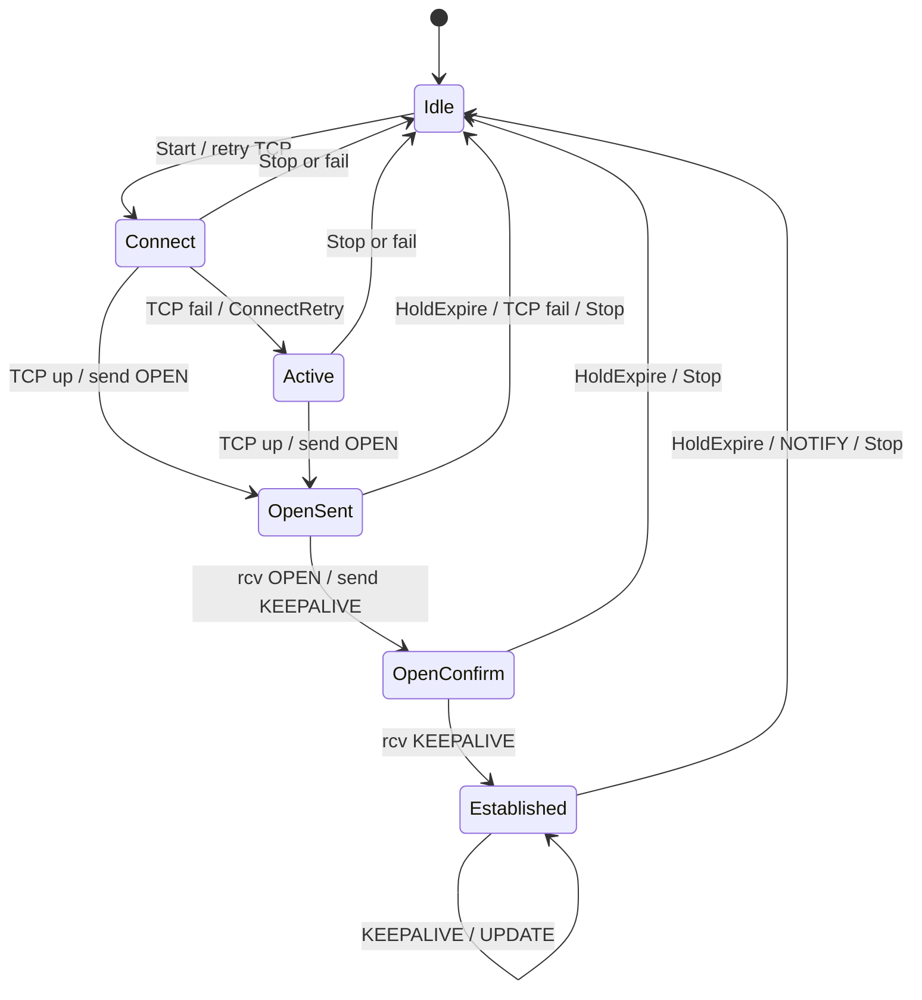
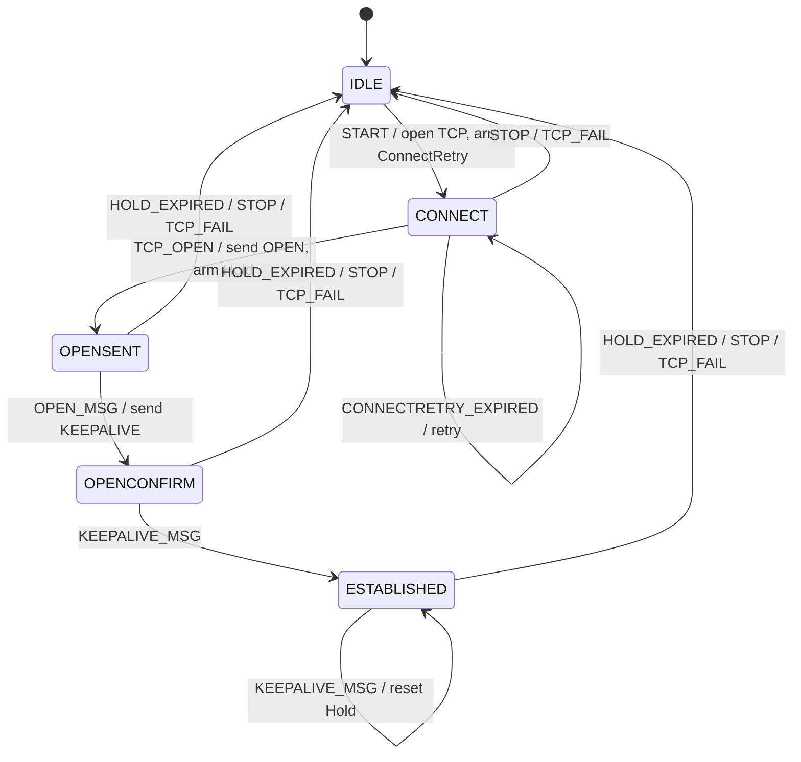

# 第 09 课：教学 BGP —— 事件循环与定时器子系统

本课只引入一个概念：**事件先进入队列；定时器到期也变成队列里的事件；循环 `while (dequeue) dispatch`。**

回顾第 08 课：转移已经在表里。`fsm_dispatch` 只查找 `table[state][event]`。本课 **仍然用那张表**。新问题不是「格子怎么写」，而是「事件从哪来、什么时候查表」。

第 06 课的超时是：`TICK` 递减，减到 0 时在 `dispatch` **内部改写** 成到期事件。本课把改写挪到队列边界上——`tick()` 只负责入队，`fsm_run()` 只负责取出再查表。查表函数保持纯。

本课 **不** 把状态套进状态，**不** 把队列叫做并发角色的邮箱。队列是单线程的教学数组。

---

## 1. Motivation

第 08 课的 `main` 直接：

```c
fsm_dispatch(&tcp, EVENT_RCV_SYNACK);
```

教学 TCP 可以这样，因为没有「时间自己会响」。BGP 会话在 RFC 4271 里靠三只钟活着：

- **ConnectRetry**：TCP 还没建起来，过一阵再试
- **Hold**：太久没收到对端的 Keepalive / Update，认为对端死了
- **Keepalive**：自己该发一拍心跳了

这三只钟会在随机的时刻到期，同时又有「对端发来 OPEN」这种输入。若到期时直接在 `tick` 里改状态，定时器模块就嵌进了状态机；若 `dispatch` 里再 `sleep` 等下一只钟，又回到第 06 课禁止的阻塞。

正确的边界：

```
任何来源 --> 入队 --> while (dequeue) --> 查表 dispatch
tick() 只递减并在到期时入队
```

用在哪：路由守护进程的对等会话、任何「I/O 就绪 + 定时器」合一的控制面。本课用 **教学 BGP**（不是路由软件）：没有 TCP socket，没有 UPDATE 路由，动作用打印假装。

---

## 2. Problem Description

### 教学 BGP 要什么

五个状态（代码里只有这些；RFC 还有 `Active`，本课不单独做）：

| 状态 | 意思 |
|------|------|
| `IDLE` | 不想连，或刚刚拆掉 |
| `CONNECT` | 正在等 TCP 建好 |
| `OPENSENT` | TCP 好了，OPEN 已发出 |
| `OPENCONFIRM` | 收到对端 OPEN，在等对端 KEEPALIVE |
| `ESTABLISHED` | 可以交换路由（本课不交换） |

九个事件：

| 事件 | 来源 |
|------|------|
| `START` / `STOP` | 应用 / 配置 |
| `TCP_OPEN` / `TCP_FAIL` | 假装底下那台 TCP 机的结果 |
| `OPEN_MSG` / `KEEPALIVE_MSG` | 假装对端 BGP 报文 |
| `HOLD_EXPIRED` / `KEEPALIVE_EXPIRED` / `CONNECTRETRY_EXPIRED` | **由 tick 入队** |

主路径：

```
START -> CONNECT
TCP_OPEN -> OPENSENT
OPEN_MSG -> OPENCONFIRM
KEEPALIVE_MSG -> ESTABLISHED
HOLD_EXPIRED -> IDLE
```

过程中 Keepalive 钟会先响若干次：`KEEPALIVE_EXPIRED` 打印 `send KEEPALIVE`，**留在** `ESTABLISHED`，并重新武装 Keepalive。Hold 一直减；减到 0 才拆会话。这是第 06 课超时 + 第 08 课表自环。

第二条演示：`START` 之后永远不喂 `TCP_OPEN`，ConnectRetry 到期，再试一次仍停在 `CONNECT`。

### RFC 有、本课故意不做的

RFC 4271 的会话状态机比这大：

- **Connect vs Active**：谁主动发起 TCP、谁在听。本课只留 `CONNECT`
- 大量管理事件（手动启停、自动启停的细分类）
- **DelayOpen**
- **Graceful Restart**（真实守护进程常加 RFC 未画进基础图的行为）
- Clearing / 前缀撤回的细节
- NOTIFICATION 报文、AS 号、能力协商

真实守护进程还常常 **增加** RFC 没列出的内部状态（例如「正在清表」）。讲义会提到，代码不实现。

没有真实 TCP、没有 BGP 字节、没有 RIB。这些代码不能对接真实对等体。

---

## 3. Naive Solution

在 `tick` 里直接改状态：

```c
void
tick(Fsm *fsm)
{
	fsm->hold_ticks--;
	if (fsm->hold_ticks == 0)
		fsm->state = STATE_IDLE; /* 绕过表，动作、打印、清定时器全乱 */
}
```

或在 `dispatch` 里等：

```c
case EVENT_START:
	while (!tcp_ready)
		sleep(1); /* 第 06 课禁止的阻塞；Keepalive 永远没机会响 */
```

或让 `main` 继续直接 `fsm_dispatch(HOLD_EXPIRED)`，于是「钟」只存在于注释里，子系统没有边界。

朴素方案缺的是两样东西，都不是新状态：

- `EventQueue`：先到先服务的数组
- `tick()`：只递减，到期只 `enqueue`

---

## 4. FSM Solution

事件循环的定义（本课只需这句）：

> 所有输入（应用、假装的 TCP、假装的对端报文、定时器到期）都先入队。`fsm_run` 循环取出，交给第 08 课那种查表 `fsm_dispatch`。`tick` 不查表。

```
+-----------+     enqueue      +------------+     dequeue      +---------------+
| START     | ---------------> | EventQueue | ---------------> | fsm_dispatch  |
| TCP_OPEN  |                  | array[16]  |                  | table[s][e]   |
| OPEN_MSG  |                  +------------+                  +---------------+
| tick()->EXPIRED              ^
+-----------+                  |
     fsm_tick() 到期只入队 ----+
```

`Fsm` 数据：

- `state`
- `queue`（`items`、`head`、`count`）
- `hold_ticks` / `keepalive_ticks` / `connectretry_ticks`（0 表示这只钟没武装）

表（仍是 `{action, next}`）：

- `IDLE + START → CONNECT`，动作 `open TCP`，武装 ConnectRetry=3
- `CONNECT + TCP_OPEN → OPENSENT`，动作 `send OPEN`，停 ConnectRetry，武装 Hold
- `OPENSENT + OPEN_MSG → OPENCONFIRM`，动作 `send KEEPALIVE`，武装 Hold 与 Keepalive
- `OPENCONFIRM + KEEPALIVE_MSG → ESTABLISHED`，再次武装会话钟
- `ESTABLISHED + KEEPALIVE_EXPIRED → ESTABLISHED`，`send KEEPALIVE`，再武装 Keepalive
- `ESTABLISHED + HOLD_EXPIRED → IDLE`，拆会话，清钟
- `CONNECT + CONNECTRETRY_EXPIRED → CONNECT`，再试 TCP，再武装 ConnectRetry
- 若干 `STOP` / `TCP_FAIL` 回 `IDLE`

**事件分发**：禁止从 `main` 直接调 `fsm_dispatch`（演示里 `fsm_post` + `fsm_run`）。`fsm_dispatch` 仍然存在，供循环调用，保持和第 08 课相同的查表形状。

**定时器子系统**：就是 `fsm_tick`。每一拍打印三只钟的剩余值。谁为 0 就不减。谁减到 0，入队对应的 `*_EXPIRED`。Hold 到期与 Keepalive 到期是 **不同事件**——第 08 课用一个 `TIMEOUT` 靠状态区分；本课事件名拆开，因为同一状态（`ESTABLISHED`）里两只钟含义相反。

BGP 控制面 vs 数据面（本课只有控制面）：

```
+------------------+     TCP byte stream      +------------------+
| BGP session FSM  | <-----------------------> | TCP (lesson 08   |
| (this lesson)    |  OPEN/KEEPALIVE as events |  conceptual)     |
+------------------+                          +------------------+
        |
        | ESTABLISHED 之后才谈路由
        v
+------------------+
| RIB / Loc-RIB    |
| NOT in this code |
+------------------+
```

会话机是控制面。UPDATE 改路由表是另一件事。不要把前缀数量画成 BGP 状态。

---

## 5. State Diagram

### RFC 4271 全图（建立图景）

RFC 六个会话状态。本课把 `Active` 折进 `CONNECT` 的文字里。



```
                    Start
    +------+ ----------------------> +---------+
    | Idle |                         | Connect |
    |      | <---------------------- |         |
    +------+  fail/Stop/Hold         +---------+
       ^                               |  TCP up / OPEN
       |                               |     \
       |                               |      \ (RFC Active omitted in code)
       |                               v
       |                         +----------+
       |                         | OpenSent |
       |                         +----------+
       |                               | OPEN / KEEPALIVE
       |                               v
       |                         +-------------+
       |                         | OpenConfirm |
       |                         +-------------+
       |                               | KEEPALIVE
       |                               v
       +------------------------ +-------------+
              HoldExpire         | Established |
                                 +-------------+
```

### 本课代码实际实现的图



---

## 6. State Table

| Current State | Event | Guard | Action | Next State |
|---------------|-------|-------|--------|------------|
| IDLE | START | 有格 | open TCP, arm ConnectRetry | CONNECT |
| CONNECT | TCP_OPEN | 有格 | send OPEN, arm Hold, stop ConnectRetry | OPENSENT |
| CONNECT | CONNECTRETRY_EXPIRED | 有格 | retry open TCP, re-arm | CONNECT |
| CONNECT | TCP_FAIL / STOP | 有格 | drop, clear timers | IDLE |
| OPENSENT | OPEN_MSG | 有格 | send KEEPALIVE, arm Hold+Keepalive | OPENCONFIRM |
| OPENSENT | HOLD_EXPIRED / STOP / TCP_FAIL | 有格 | drop | IDLE |
| OPENCONFIRM | KEEPALIVE_MSG | 有格 | session up, arm timers | ESTABLISHED |
| OPENCONFIRM | HOLD_EXPIRED / STOP / TCP_FAIL | 有格 | drop | IDLE |
| ESTABLISHED | KEEPALIVE_EXPIRED | 有格 | send KEEPALIVE, re-arm Keepalive | ESTABLISHED |
| ESTABLISHED | KEEPALIVE_MSG | 有格 | reset Hold | ESTABLISHED |
| ESTABLISHED | HOLD_EXPIRED / STOP / TCP_FAIL | 有格 | drop | IDLE |
| * | （其余） | 无格 | ignore | 保持 |

读表：

- 到期事件已经是一等公民，和 `OPEN_MSG` 同一列
- Keepalive 到期 **不** 拆会话；Hold 到期才拆。两只钟不要合成第 08 课那种单一 `TIMEOUT`
- ConnectRetry 是第 07 课重试：自环 + 再武装，本课仍无次数上限（演示只响一次）

---

## 7. Event Flow

```
time -->

建链 + 心跳 + Hold 拆掉:
[ IDLE ]
    --post START--> run: CONNECT, ConnectRetry=3
    --post TCP_OPEN--> run: OPENSENT, Hold=5
    --post OPEN_MSG--> run: OPENCONFIRM, Hold=5 Keepalive=2
    --post KEEPALIVE_MSG--> run: ESTABLISHED, Hold=5 Keepalive=2
    --tick...--> Keepalive 到期: send KEEPALIVE, 仍 ESTABLISHED
    --tick...--> Hold 到期: drop --> IDLE

TCP 起不来:
[ IDLE ]
    --post START--> CONNECT, ConnectRetry=3
    --tick x3--> CONNECTRETRY_EXPIRED / retry, 仍 CONNECT
```

`post` 只入队；`run` 才查表。若你看见「post 行和状态变化行之间没有 run」，那是 bug：事件还在数组里。

调试时必须打印：

- `post: EVENT`
- `tick: hold=.. keepalive=.. connectretry=..`
- `timer: ... expired`
- 查表箭头 `STATE --EVENT--> STATE`

---

## 8. Implementation

```bash
cc -std=c11 -Wall -Wextra -o bgp_fsm code/c/bgp_fsm.c && ./bgp_fsm
c++ -std=c++17 -Wall -Wextra -o bgp_fsm code/cpp/bgp_fsm.cpp && ./bgp_fsm
python3 code/python/bgp_fsm.py
```

程序自包含。表驱动与第 08 课相同；新代码是 `EventQueue`、`fsm_post`、`fsm_run`、`fsm_tick`。

### 伪代码

```
queue: array of Event, capacity 16

post(e): enqueue(e)
run():
    while dequeue(&e):
        dispatch(e)          # 第 08 课查表

tick():
    print remaining clocks
    if connectretry > 0:
        connectretry <- connectretry - 1
        if 0: enqueue CONNECTRETRY_EXPIRED
    if hold > 0:
        hold <- hold - 1
        if 0: enqueue HOLD_EXPIRED
    if keepalive > 0:
        keepalive <- keepalive - 1
        if 0: enqueue KEEPALIVE_EXPIRED
```

教学拍数：Hold=5，Keepalive=2，ConnectRetry=3。不是 RFC 默认秒数（Hold 常为 90、Keepalive 为 Hold/3）。短拍是为了让轨迹能数。

### 教学 FSM 怎么测

1. **脚本化的 post/tick/run 序列**（本课 `main` 两组）
2. 断言状态序列：`IDLE CONNECT OPENSENT OPENCONFIRM ESTABLISHED` 然后若干次仍 `ESTABLISHED`，最后 `IDLE`
3. 断言 Keepalive 到期时 **不** 出现 `drop session`；Hold 到期时出现
4. 断言 `tick` 本身不打印 `--HOLD_EXPIRED-->`；那一行必须出现在 `run` 之后——证明到期走了队列
5. ConnectRetry 组：没有 `TCP_OPEN`，第三次 tick 后仍是 `CONNECT` 且再次 `open TCP`
6. 队列满：可在练习里连续 `post` 超过 16，必须看到 drop，而不是越界

三语言轨迹应对齐。

实现要点：

- `tick` 禁止调用 `fsm_dispatch`
- `dispatch` 禁止调用 `sleep`
- 进入 `IDLE` 必须 `clear_timers`，否则拆掉的会话还会假到期
- 收到 `KEEPALIVE_MSG` 重置 **Hold**，不要重置错成只重置 Keepalive（RFC：收到任何有效报文刷新 Hold）

---

## 9. Design Discussion

### 和第 08 课的分工

| | 第 08 课 | 本课 |
|--|----------|------|
| 新概念 | 表 | 队列 + tick 入队 |
| 事件从哪来 | `main` 直接 dispatch | `post` / `tick` |
| 超时事件个数 | 一个 `TIMEOUT` | 三只钟三个事件 |
| `dispatch` | 查表 | 仍然查表 |

不要把队列理解成「又一种表」。队列是时间上的缓冲；表是状态上的字典。

### 控制面与数据面

BGP 的控制面是会话 FSM + 定时器 + 报文解析。数据面若存在，是转发平面用已安装的路由。教学代码两者都假：没有解析器，没有 FIB。FRRouting 类守护进程里，会话机和 RIB 是分开的子系统——会话 `ESTABLISHED` 只表示「可以说话」，不表示「已经有路由」。

### 事件分发

真实守护进程典型结构（自绘）：

```
+-------------------+     readable      +------------------+
| event loop        | ----------------> | read TCP / parse |
| select/epoll/     |                   | OPEN/KEEPALIVE/  |
| libevent-class    |                   | UPDATE/NOTIFY    |
+-------------------+                   +------------------+
        |                                         |
        | timerfd / wheel                         | as FSM events
        v                                         v
+-------------------+                    +------------------+
| Hold/Keepalive/   | enqueue expiry     | per-peer FSM     |
| ConnectRetry      | -----------------> | table or switch  |
+-------------------+                    +------------------+
```

常见开源位置（FRRouting 类守护进程里的常见路径，**不是本课程里的文件**）：`bgpd/bgp_fsm.c` 一类文件集中处理会话转移；定时器在该守护进程的定时器库里注册，到期再调用 FSM。不要到本课程目录里找这些名字。

### 定时器子系统（本课核心）

三只钟独立武装：

- 只有相关状态才应非零。`IDLE` 全零
- 同一拍里两只钟都可能到期：教学 `tick` 会都入队。`main` 避免让它们同拍为零，以免轨迹难读。真实代码要规定顺序（通常先处理更「致命」的 Hold）
- Keepalive 是「该我说了」；Hold 是「该听却没听到」

第 06 课把到期改写放在 `dispatch(TICK)` 内部。本课把 `TICK` 从 Event 枚举拿掉，改成函数 `fsm_tick`。`TICK` 不再是协议事件，只是时钟驱动。协议事件是三只 `*_EXPIRED`。

### 典型工业实现为何不像一张 RFC 图

- RFC 把 Connect 和 Active 分开；许多实现用「出方向 socket + 入方向 listen」两个尝试，内部仍可能合成一套会话对象
- 自动启停、指数退避、会话震荡抑制（dampening）是额外数据
- Graceful Restart、LLGR、BFD 会在 RFC 4271 图外加事件
- UPDATE 处理、路由反射、策略是 ESTABLISHED **之后** 的另一层，不是第六、第七个会话状态

### 本课省略

- `Active`、DelayOpen、NOTIFICATION 细节、能力协商
- 真实秒数、抖动、Hold 与 Keepalive 的协商最小值
- TCP 真实连接（第 08 课那台机没有在进程里跑；只是事件名 `TCP_OPEN`）
- 路由通告

### 优化（只点名）

- 定时器轮（timing wheel）而不是每个 peer 一个用户态递减整数
- I/O 事件与定时器在同一 epoll 集合，避免额外线程
- ESTABLISHED 快路径：解析 UPDATE 不重入完整会话表
- 批量 peer 的 Keepalive 对齐，减少唤醒

本课不实现。

---

## 10. Common Mistakes

初学者：

- `tick` 里直接 `fsm->state = IDLE`
- `post` 之后忘记 `run`，以为状态已经变了
- Hold 到期和 Keepalive 到期共用一个事件，`ESTABLISHED` 心跳把自己拆掉
- 拆到 `IDLE` 不清钟，下一拍假 `HOLD_EXPIRED` 再入队
- 队列用未检查的下标，满了就越界
- 把队列称为多线程邮箱，并加锁——本课是单线程数组

工业上：

- Hold 小于 Keepalive，自己还没发出去就被自己或对端拆掉
- 只重置 Keepalive、不重置 Hold，对端活着仍掉线
- ConnectRetry 过短，打爆对端 listen
- 会话震荡时没有惩罚，CPU 和 RIB 被反复全量通告

---

## 11. Refactoring

若要把第 08 课的教学 TCP **真正接在下面**：不要把 TCP 状态画进 BGP 框。保留两台扁平机：TCP 的 `ESTABLISHED` 转换成 BGP 的 `TCP_OPEN` 事件，入 **BGP 的队列**。例子 5 只谈这个关系；本课代码仍用假 `TCP_OPEN`。

若要给 ConnectRetry 加第 07 课预算：在 `Fsm` 里加 `retries_left`，动作用尽后 `post(STOP)` 或直接走回 `IDLE`。不要加 `RETRYING` 状态。

不要开始把 `ESTABLISHED` 拆成「正在收 UPDATE / 正在发 Keepalive」子状态。两只钟是数据，不是子状态。

---

## 12. Exercise

**容易**

把 Keepalive 预算改成 3，Hold 仍为 5。改 `main` 的 tick 次数，使轨迹里 Keepalive 到期次数变化，Hold 仍能拆掉会话。

**中等**

实现「收到 `KEEPALIVE_MSG` 时既重置 Hold 也重新对齐 Keepalive」。说明 RFC 要求刷新的是 Hold；你加的对齐是工程策略。用轨迹证明：对端很勤快时，本地 `KEEPALIVE_EXPIRED` 变少。

**挑战**

给队列容量改为 2。在 `ESTABLISHED` 时连续 `post` 三个 `KEEPALIVE_MSG`，再 `run`。指出哪个事件被丢，会话 Hold 是否因此可能误到期。不要引入多线程。

---

## 13. Summary

- 新概念：队列 + `while (dequeue) dispatch`；`tick` 到期只入队
- 表驱动仍然是 `table[state][event]`，不要退回嵌套业务 `switch`
- Hold / Keepalive / ConnectRetry 是三只钟、三个事件；同一状态里含义不同就不能共用一个 `TIMEOUT`
- 教学 BGP 五态；RFC 的 Active、Graceful Restart、清表等只在文字里
- 测试：post/tick/run 脚本，断言「到期打印在 tick、转移打印在 run」
- 无真实 TCP、无路由表

下一课：教学 OSPF。新概念是 **两台扁平机互相投递事件**（接口机与邻居机），仍然不用把一台画进另一台的框里。
