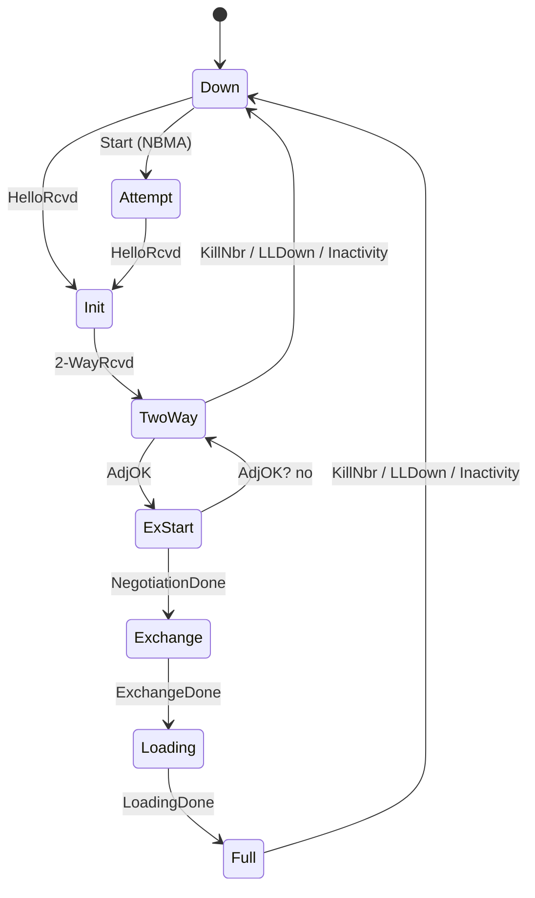
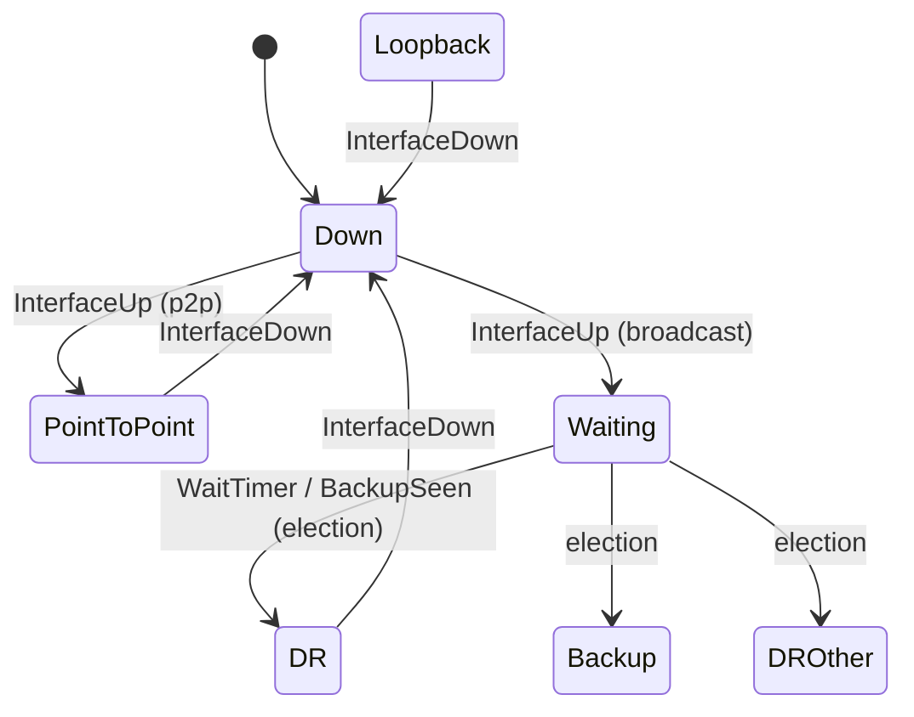
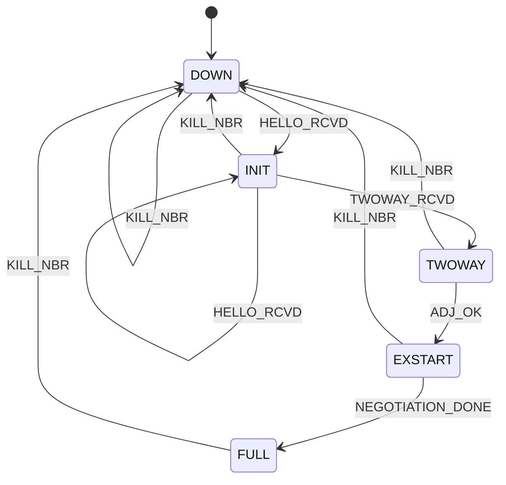
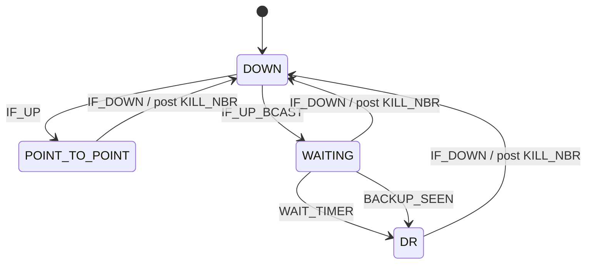

# 第 10 课：教学 OSPF —— 两台互相投递事件的扁平机

本课只引入一个概念：**一个协议可以是两台扁平状态机，彼此把事件投给对方。**

回顾：第 08 课的表、第 09 课的「事件是一等公民」。本课两台机 **各自一张表、各自一个 dispatch**。新问题不是队列（第 09 课已会），而是 **谁向谁发事件**。

不要把邻居机画进接口机的方框里。不要把两台机乘成一张巨大的「接口×邻居」状态枚举。接口有接口的局面，邻居有邻居的局面；接口倒下时，向邻居机投递一个 `KILL_NBR` 即可。

本课 **不** 使用后面才教的套盒术语，**不** 把两台机写成并发角色。教学程序仍是单线程：先 `ism_dispatch`，其动作里直接调用 `nsm_dispatch`。

---

## 1. Motivation

第 08 课一台 TCP 机就够：连接只有一个「当前局面」。第 09 课一台 BGP 机也够：一个对等体一条会话。

OSPF 不是这样。一块网卡（接口）可以处于「点对点已起来」或「正在选 DR」；同一块网卡上的 **每一个邻居** 又各自处于「只听到 Hello」或「邻接已满」。接口死了，所有邻居都该死；某个邻居死了，接口未必死。

若硬做成一台机：

```c
enum { IF_UP_NBR_DOWN, IF_UP_NBR_FULL, IF_DOWN_NBR_FULL /* 不可能却会出现在枚举里 */ };
```

状态个数按乘积涨，而且会出现无意义组合。两台机 + 事件缝，组合由运行时的两个字段表达，枚举保持可数。

用在哪：链路状态路由的接口与邻居、任何「资源一台机、会话另一台机」的控制面。本课用 **教学 OSPF**（不是 OSPF 实现）：没有 LSA、没有链路状态数据库、Hello 只是事件名。

---

## 2. Problem Description

### 邻居机 NSM（主例）

RFC 2328 邻居状态机有：Down、Attempt、Init、2-Way、ExStart、Exchange、Loading、Full。

本课只保留：

| 状态 | 意思 |
|------|------|
| `DOWN` | 不认识这个邻居 |
| `INIT` | 听到 Hello，对方未必听到我 |
| `TWOWAY` | Hello 双向 |
| `EXSTART` | 开始主从协商（教学是桩） |
| `FULL` | 邻接完成（教学跳过 Exchange / Loading） |

**明确省略**：`Attempt`（NBMA 里主动探邻居）、`Exchange`、`Loading`。

事件：`HELLO_RCVD`、`TWOWAY_RCVD`、`ADJ_OK`、`NEGOTIATION_DONE`、`KILL_NBR`。

### 接口机 ISM（配合 NSM）

RFC 2328 接口状态机有：Down、Loopback、Waiting、Point-to-Point、DR Other、Backup、DR。

本课只保留：

| 状态 | 意思 |
|------|------|
| `DOWN` | 接口未启用 |
| `POINT_TO_POINT` | 点对点已起来（主演示） |
| `WAITING` | 广播网上等 Wait 定时器（选 DR 前） |
| `DR` | 教学桩：定时器到了就宣布自己是 DR |

**DR 选举是桩**：不比较 Router Priority / Router ID，不实现 Backup、DR Other。

事件：`IF_UP`（点对点）、`IF_UP_BCAST`（进 WAITING）、`IF_DOWN`、`WAIT_TIMER`、`BACKUP_SEEN`（桩里与 Wait 到期同样变成 DR）。

### 主演示

1. ISM `IF_UP` → `POINT_TO_POINT`
2. Hello → NSM `DOWN` → `INIT`；再 `TWOWAY_RCVD` → `TWOWAY`
3. `ADJ_OK` → `EXSTART`；`NEGOTIATION_DONE` → `FULL`（协商与数据库同步都是桩）
4. ISM `IF_DOWN` → `DOWN`，动作向 NSM 投递 `KILL_NBR` → `DOWN`

Hello 在 ISM 仍为 `DOWN` 时必须被丢掉：接口没起来，邻居机不应偷跑。

没有真实 IP、没有组播 224.0.0.5、没有 LSA。这些代码不能对接真实 OSPF 邻居。

---

## 3. Naive Solution

把接口和邻居焊成一个枚举：

```c
typedef enum {
	DOWN,
	IF_UP,
	IF_UP_AND_NBR_FULL
} State;
```

`IF_DOWN` 时邻居已经 Full 的情况无处安放；两个邻居时更是乘不完。

或者一台 `switch` 里既改 `if_state` 又改 `nbr_state`，没有「KillNbr 是邻居机的事件」这条缝，接口逻辑和邻居逻辑缠在一起，缺一次 Hello 要从两份缩进里找。

朴素方案缺的是：**两个当前状态字段，两次查表，一次跨机投递。**

---

## 4. FSM Solution

两台扁平机的定义（本课只需这句）：

> 接口机和邻居机各有自己的状态枚举、事件枚举和表。接口倒下时，不直接改邻居的枚举值，而是调用邻居的 `nsm_dispatch(KILL_NBR)`。

```
+--------------------+   KILL_NBR (on IF_DOWN)    +--------------------+
| ISM                | -------------------------> | NSM                |
| DOWN               |                            | DOWN               |
| POINT_TO_POINT     |                            | INIT               |
| WAITING            |   Hello only if ISM up     | TWOWAY             |
| DR                 | -------------------------> | EXSTART            |
+--------------------+                            | FULL               |
         ism_dispatch                             +--------------------+
                                                         nsm_dispatch
```

`Ospf` 对象同时持有两个当前状态（教学只有 **一个** 邻居）。多邻居时，应是「一台 ISM + 每邻居一台 NSM」，见例子 5；代码不实现列表。

**事件分发**：

- 来自「网卡启用」的，进 `ism_dispatch`
- 来自 Hello / 双向 / AdjOK 的，进 `nsm_dispatch`（Hello 先经 `fsm_dispatch_hello` 检查 ISM）
- 来自接口倒下的，ISM 动作里投递 NSM 事件

本课没有第 09 课那种数组队列：跨机调用是直接函数调用。队列不是本课新概念。若你想先入队再 `run`，那是把第 09 课叠上来，可以做，但主例保持直接调用，轨迹更短。

**定时器**：ISM 的 Wait 定时器用事件 `WAIT_TIMER` 表示到期（`main` 直接喂，像第 08 课）。没有实现 `tick`。HelloInterval / DeadInterval / Wait Timer 的真实秒数省略。DeadInterval 到期在 RFC 里对 NSM 是 `KillNbr` 一类事件——本课用接口 `IF_DOWN` 演示同一条缝。

控制面 vs 数据面：

```
+------------------+     Hello / DD / LSR     +------------------+
| ISM + NSM        | <-----------------------> | neighbor router  |
| (control)        |                          +------------------+
+------------------+
        |
        | FULL 之后才同步 LSA
        v
+------------------+     SPF      +------------------+
| LSDB             | -----------> | forwarding       |
| NOT in this code |              | NOT in this code |
+------------------+              +------------------+
```

两台教学机都是控制面。SPF 和转发表是 FULL 之后的另一件事。

---

## 5. State Diagram

### RFC 2328 邻居机（全图）



本课砍掉 Attempt、Exchange、Loading，把 NegotiationDone 直接送进 Full。

### RFC 2328 接口机（全图）



Loopback、DROther、Backup 只出现在这张图，不出现在代码。

### 本课代码实际实现

NSM：



ISM：



两图之间唯一画出来的箭头是 `IF_DOWN` 产生的 `KILL_NBR`。不要把 NSM 画进 ISM 的 `POINT_TO_POINT` 方框内部。

ASCII 协作：

```
  ISM                              NSM
+----------------+                +-----------+
| DOWN           |                | DOWN      |
+----------------+                +-----------+
        | IF_UP                          ^
        v                                | KILL_NBR
+----------------+                +-----------+
| POINT_TO_POINT | --Hello allowed--> INIT --> TWOWAY --> EXSTART --> FULL
+----------------+                +-----------+
        | IF_DOWN                        |
        +--------------------------------+
```

---

## 6. State Table

ISM：

| Current State | Event | Guard | Action | Next State |
|---------------|-------|-------|--------|------------|
| DOWN | IF_UP | 有格 | interface up (p2p) | POINT_TO_POINT |
| DOWN | IF_UP_BCAST | 有格 | start Wait | WAITING |
| POINT_TO_POINT | IF_DOWN | 有格 | post KILL_NBR | DOWN |
| WAITING | WAIT_TIMER | 有格 | become DR（桩） | DR |
| WAITING | BACKUP_SEEN | 有格 | become DR（桩） | DR |
| WAITING / DR | IF_DOWN | 有格 | post KILL_NBR | DOWN |
| DOWN | （Hello 经 fsm_dispatch_hello） | ISM==DOWN | drop Hello | DOWN |

NSM：

| Current State | Event | Guard | Action | Next State |
|---------------|-------|-------|--------|------------|
| DOWN | HELLO_RCVD | 有格 | neighbor seen | INIT |
| INIT | HELLO_RCVD | 有格 | neighbor seen | INIT |
| INIT | TWOWAY_RCVD | 有格 | two-way Hello | TWOWAY |
| TWOWAY | ADJ_OK | 有格 | start DD stub | EXSTART |
| EXSTART | NEGOTIATION_DONE | 有格 | skip Exchange/Loading | FULL |
| * | KILL_NBR | 有格 | neighbor DOWN | DOWN |

`ADJ_OK` 在 RFC 里是一个 **问题**（要不要形成邻接）：点对点通常要；广播上只与 DR/BDR 形成。本课没有监护函数，`ADJ_OK` 是外部喂入的事件——相当于你已经替 RFC 回答了「要」。

---

## 7. Event Flow

```
time -->

点对点 + 单邻居:
ISM [ DOWN ] --IF_UP--> [ POINT_TO_POINT ]
NSM [ DOWN ] --HELLO_RCVD--> [ INIT ]
NSM [ INIT ] --TWOWAY_RCVD--> [ TWOWAY ]
NSM [ TWOWAY ] --ADJ_OK--> [ EXSTART ]
NSM [ EXSTART ] --NEGOTIATION_DONE--> [ FULL ]
ISM [ POINT_TO_POINT ] --IF_DOWN / post KILL_NBR-->
NSM [ FULL ] --KILL_NBR--> [ DOWN ]
ISM --> [ DOWN ]

广播桩:
ISM [ DOWN ] --IF_UP_BCAST--> [ WAITING ] --WAIT_TIMER--> [ DR ]

Hello 在接口未启用:
ISM [ DOWN ], fsm_dispatch_hello --> drop, NSM 仍 DOWN
```

调试时前缀必须能区分两台机：`ISM:` 与 `NSM:`。若日志分不清谁在变，协作就无法批改。

`IF_DOWN` 的打印顺序是：先 NSM 的 `KILL_NBR` 箭头（动作里同步调用），再 ISM 自己的箭头。这是直接调用而不是队列的结果；认一下即可。

---

## 8. Implementation

```bash
cc -std=c11 -Wall -Wextra -o ospf_fsm code/c/ospf_fsm.c && ./ospf_fsm
c++ -std=c++17 -Wall -Wextra -o ospf_fsm code/cpp/ospf_fsm.cpp && ./ospf_fsm
python3 code/python/ospf_fsm.py
```

`fsm_init` 同时复位两台机。分发函数是 `ism_dispatch` 与 `nsm_dispatch`（两台机各一次查表）。`fsm_dispatch_hello` 是缝上的守卫。

程序自包含，各机一张稀疏表，形态与第 08 课相同。

### 伪代码

```
Ospf { ism, nsm }

ism_dispatch(e):
    cell <- ism_table[ism][e]
    if not defined: ignore; return
    cell.action()          # IF_DOWN 的 action 调用 nsm_dispatch(KILL_NBR)
    ism <- cell.next

nsm_dispatch(e):
    cell <- nsm_table[nsm][e]
    if not defined: ignore; return
    cell.action()
    nsm <- cell.next

hello():
    if ism == DOWN: drop; return
    nsm_dispatch(HELLO_RCVD)
```

### 教学 FSM 怎么测

1. 主脚本走到 `FULL`，再 `IF_DOWN`，断言 NSM 回到 `DOWN` **且** ISM 回到 `DOWN`
2. 断言 `KILL_NBR` 出现在 ISM 动作打印之后、ISM 状态行之前（或同一次 IF_DOWN 处理中）
3. `fsm_dispatch_hello` 在 ISM `DOWN` 时不得把 NSM 推到 `INIT`
4. 广播脚本：`IF_UP_BCAST` 后 NSM 仍 `DOWN`（还没喂 Hello），ISM 为 `WAITING` 再 `DR`
5. 非法格：`FULL + HELLO_RCVD` 无格则 ignore，仍 FULL（本课未定义 Full 上的 Hello 刷新）
6. 三语言 `ISM:` / `NSM:` 前缀对齐

不要抓组播包。不要起真实路由进程。

实现要点：

- 禁止用一个 `switch` 同时赋值 `ism` 和 `nsm`（`KILL_NBR` 那条缝除外：它必须走 `nsm_dispatch`）
- `action_ism_down` 里不要写 `o->nsm = NSM_DOWN`；那会跳过邻居表的动作打印
- 省略的 Exchange / Loading 不要留空枚举值「以后再用」——讲义已声明跳过

---

## 9. Design Discussion

### 为什么是两台而不是一台

| 一台乘积机 | 两台扁平机 |
|------------|------------|
| 状态数 ≈ 接口态 × 邻居态 × 邻居个数 | 每台保持 RFC 可读的名字 |
| 无意义组合要靠监护剔除 | 无意义组合根本不存在（字段独立） |
| 接口 Down 必须手写清每一个邻居分支 | 对每个邻居 `dispatch(KILL_NBR)` |

第 09 课例子 5 已经说过：BGP 和 TCP 是两台机。本课把「两台机」放进 **同一份可运行程序**。仍然不要画框中框。

### 控制面与数据面

Hello、邻接、DR 选举属于控制面。LSDB 同步（本课跳过的 Exchange/Loading）仍是控制面。SPF 算出的下一跳才进入转发。工业实现里，邻居 Full 只表示「数据库应对齐」，不等于已经转发。

### 事件分发

典型链路状态守护进程（自绘）：

```
+------------------+     socket / packet      +------------------+
| Hello recv       | -----------------------> | demux by iface,  |
|                  |                          | neighbor key     |
+------------------+                          +------------------+
        |                                           |
        | IF_UP from config                         v
        v                                  +------------------+
+------------------+                       | NSM per neighbor |
| ISM per iface    | --KillNbr / AdjOK-->  | table or switch  |
+------------------+                       +------------------+
        ^
        | Wait timer, Hello interval
        +---- timer wheel (lesson 09 idea)
```

常见开源位置（FRRouting / Quagga 类守护进程里的常见路径，**不是本课程里的文件**）：`ospfd/ospf_ism.c`、`ospfd/ospf_nsm.c` 一类文件分别实现接口机与邻居机。不要在本课程目录里打开这些名字。

跨机事件在工业代码里可能是函数调用（本课这样），也可能是第 09 课那种队列，避免在收包上下文里做完 SPF。本课选直接调用，概念更短。

### 定时器子系统

RFC 相关钟（只点名）：

| 钟 | 属于谁 | 到期 |
|----|--------|------|
| HelloInterval | 接口 | 再发 Hello（本课不发） |
| Wait Timer | 接口 WAITING | 开始选 DR |
| DeadInterval / Inactivity | 邻居 | KillNbr |
| RxmtInterval | 邻居 Exchange/Loading | 重传 DD/LSA（本课无） |

本课只把 Wait 做成 `WAIT_TIMER` 事件；Dead 用 `IF_DOWN` → `KILL_NBR` 代替。完整 tick 子系统见第 09 课，本课不重复发明队列。

### 典型工业实现为何不同于 RFC 图

- Attempt 主要出现在 NBMA；以太网实现常常几乎看不见
- Exchange 与 Loading 可能很快，日志里一闪而过，调试时仍必须存在
- DR 选举有优先级、Router ID、等待、Backup；许多部署其实是点对点，根本不选
- 多区域、虚链路、Graceful Restart、BFD 在 2328 基础图外加事件
- 邻居常是哈希表，按 Router ID 索引，不是本课的单个 `nsm` 字段

### 本课省略

- Attempt、Exchange、Loading
- Loopback、DR Other、Backup
- 真实选举比较、LSA、SPF、多邻居列表、多区域

### 优化（只点名）

- 邻居查找用哈希而不是线性表
- Hello 发送与收包在快路径，不每次走完整 NSM
- LSA 泛洪与邻接状态机解耦，避免 Full 时卡在同步循环
- BFD 取代较长的 DeadInterval

本课不实现。

---

## 10. Common Mistakes

初学者：

- `IF_DOWN` 时写 `o->nsm = DOWN`，轨迹里没有 `KILL_NBR`
- Hello 不看 ISM，接口没启用邻居却到了 `INIT`
- 把 `POINT_TO_POINT` 和 `FULL` 合成一个状态名
- 为两个邻居把 ISM 复制两份（接口应仍是一台）
- 在动作里互相无限调用（本课 NSM 不得再调 ISM；缝是单向的：ISM → NSM）

工业上：

- DeadInterval 与邻居 HelloInterval 不一致，误杀邻居
- 广播网上对每一个邻居都 AdjOK，邻接数量爆炸
- DR 选举振荡导致邻接反复 Full / Down，LSDB 抖动
- 接口 Down 未 Kill 全部邻居，留下幽灵 Full

---

## 11. Refactoring

若加回 Exchange / Loading：只改 NSM 表，加两态两事件，ISM 不动。这证明两台机的缝是值得的。

若加第二个邻居：`Ospf` 里放 `Nsm nsm[2]`，`IF_DOWN` 对两个都 `nsm_dispatch(KILL_NBR)`。仍然一台 ISM。不要复制 `ism`。

若把第 09 课队列叠上来：ISM 动作只 `post(KILL_NBR)` 到邻居队列，`run` 再 dispatch。本课主例不这么做，以免两个新概念抢戏。

不要把 NSM 画进 ISM 方框。不要引入套盒或分区术语完成本课。

---

## 12. Exercise

**容易**

给 NSM 的 `FULL + HELLO_RCVD` 加一格：动作打印 `hello refresh`，下一状态仍 `FULL`。证明接口 Down 时这条格不会被 Hello 守卫误触发。

**中等**

增加第二个邻居字段 `nsm2`。Hello 事件要带「邻居编号」。`IF_DOWN` 必须把两个邻居都 Kill。画出事件流，仍用两台机的名字，不要乘积枚举。

**挑战**

在纸上补全 RFC 的 Exchange / Loading 格子（DD 报文、LSR、LSU 用假事件名即可），并标明哪一格对应本课的 `NEGOTIATION_DONE`。ISM 表应一行不改。不要画框中框。

---

## 13. Summary

- 新概念：两台扁平机，靠事件协作；接口 Down 投递 `KILL_NBR`，不直接写对方的状态字段
- 各机一张第 08 课风格的表；`fsm_init` 复位两台
- 教学 NSM 五态，省略 Attempt / Exchange / Loading；教学 ISM 四态，DR 选举是桩
- Hello 在 ISM `DOWN` 时丢弃
- 测试看 `ISM:` / `NSM:` 前缀，以及 Kill 是否走邻居 dispatch
- 无 LSA、无 SPF、无真实 Hello 报文

下一课：应用层生命周期（教学 HTTP 客户端）。新概念在会话的上下文与取消，不再增加协议控制面的第三台机。
