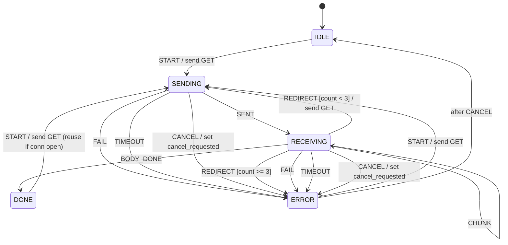

# 第 11 课：HTTP 客户端 —— 应用请求生命周期与取消

本课只引入一个概念：**一次应用请求的生命周期，以及中途取消（Cancel）**。

回顾已经会的三件协议课工具（第 08–10 课）：

- **表驱动**：`table[state][event] = {action, next}`，不再手写一长串 `switch`
- **事件循环想法**：事件进队列，定时器用 tick 到期后再投递（本课 `main` 直接喂事件，不实现队列）
- **多机协同**：两台扁平 FSM 可以各管一件事。本课只实现 **请求机**；连接池是另一台机的职责，讲义里对照，代码不写第二台

本课 **不是** 套接字协议栈，也不是 HTTP/1.1 连接状态机。本课是：

> 调用者说「发一个 GET」之后，这一次请求从发出、收到头、收完体、成功 / 失败 / 被取消，直到可以再发下一次。

新能力是 **取消**：正在 `SENDING` 或 `RECEIVING` 时，用户可以放弃这次请求。取消记在上下文的 `cancel_requested` 标志里，不是多一个叫 `CANCELLING` 的状态。

---

## 1. Motivation

第 08 课的教学 TCP 管的是 **一条连接** 怎么建立和拆除。浏览器、爬虫、微服务客户端管的是另一件事：

> 我要这份资源。发请求、等响应、可能跟一次重定向、可能看到一半不看了。

如果把「一次 GET」写成 `send(); recv();` 两行阻塞调用：

- 用户点取消时，你卡在 `recv`，取消进不来
- 302 要再发一次时，你把「还在第一次请求里」和「已经是第二次 GET」混在同一个布尔里
- 失败、超时、成功结束三种结局共用一个 `done` 标志，调试时看不出现在卡在哪

应用请求需要自己的生命周期。它骑在连接之上，但不等于连接：连接可以活过许多次请求，一次请求也可以在连接还开着时被取消。

用在哪：典型 HTTP 客户端库的一次 transfer、RPC 一次调用、下载任务、带取消令牌的异步请求。本课只用扁平的教学请求机。

---

## 2. Problem Description

一台教学 HTTP 客户端，管 **一次请求**，五个局面：

- `IDLE`：没有进行中的请求
- `SENDING`：正在把请求写出去（教学里打印 `send GET`）
- `RECEIVING`：正在读响应（教学里打印 `got 200`，没有真解析器）
- `DONE`：这一次成功结束
- `ERROR`：这一次失败（超时、传输失败、重定向过多）

事件：

- `START`：调用者要发请求
- `SENT`：请求已经写完
- `HEADER_OK`：状态行是成功（教学固定当成 200）
- `BODY_DONE`：体收完
- `REDIRECT`：状态行是 302，要跟
- `FAIL`：传输或协议失败
- `CANCEL`：调用者放弃
- `TIMEOUT`：请求定时器到期
- `CHUNK`：体的一个片段（流式，自环，可选）

期望行为：

1. 主路径：`IDLE -START-> SENDING -SENT-> RECEIVING -BODY_DONE-> DONE`
2. `HEADER_OK` 停在 `RECEIVING`（头到了，体还在路上），打印 `got 200`
3. `CANCEL` 只能从 `SENDING` 或 `RECEIVING` 进来：先到 `ERROR`，再回到 `IDLE`，并置上 `cancel_requested`
4. 取消之后，迟到的 `SENT` / `HEADER_OK` / `BODY_DONE` / `REDIRECT` / `CHUNK` **必须忽略**
5. `REDIRECT`：`RECEIVING -> SENDING`，最多跟 3 次；第 4 次进 `ERROR`
6. `FAIL` / `TIMEOUT` 进 `ERROR` 并留下，便于看见失败结局
7. `DONE` 或 `ERROR` 上可以再 `START`（同一客户端对象发下一次请求）

上下文（`Context`，放在 `Fsm` 里）至少有：

- `cancel_requested`：取消标志。本课新数据
- `redirect_count`：已经跟了几次
- `connection_open`：教学用的「连接还在」标志，用来打印复用，**不是连接池**
- `timer_armed`：请求定时器是否还在走（对照第 09 课：到期变成 `TIMEOUT` 事件）

没有真实 HTTP 解析，没有套接字。`main` 假装自己是网络和用户。

---

## 3. Naive Solution

常见三种乱法。

阻塞一次做完：

```c
void
get(const char *url)
{
	connect_if_needed();
	send_get(url);
	recv_all(); /* 取消进不来 */
}
```

取消只能杀线程，迟到的响应还可能写进已经扔掉的缓冲区。

用一堆布尔代替状态：

```c
int sending, receiving, done, failed, cancelled;
```

302 时 `sending` 和 `receiving` 会同时为真。取消后 `done` 和 `cancelled` 也会同时为真。你无法画出一张表。

加一个 `CANCELLING` 状态，却不处理「取消之后包还在路上」：

```
SENDING --CANCEL--> CANCELLING
CANCELLING --BODY_DONE--> DONE   /* 取消失败了 */
```

取消必须是 **标志 + 忽略迟到事件**，否则状态图看起来取消了，数据面还在把 body 交给调用者。

朴素方案缺的是：

- 一次请求的五个局面（状态）
- 取消作为事件，以及上下文里的 `cancel_requested`
- 重定向次数这种 **不属于状态名** 的数据

---

## 4. FSM Solution

请求生命周期的定义（本课只需这句）：

> 一次请求是一台 FSM。发出、在途、结束、失败都是状态。取消是事件，记住「已经不要了」用上下文标志，不是新状态。

它 **不是**：

- TCP 连接状态机（那是第 08 课）
- HTTP/2 流复用或多路请求挤在一条连接上（本课省略）
- 连接池内部怎么选 socket（本课只留一个 `connection_open` 打印）

五个扁平状态：`IDLE`、`SENDING`、`RECEIVING`、`DONE`、`ERROR`。

`Fsm`：

```
Fsm {
    state
    ctx { cancel_requested, redirect_count, connection_open, timer_armed }
}
fsm_init
fsm_dispatch(Fsm *, Event)
```

表驱动（第 08 课手法）管住大多数格子。两处不进纯表，因为下一状态依赖数据：

- `REDIRECT`：次数 < 3 则回 `SENDING`，否则 `ERROR`
- `CANCEL`：表先送到 `ERROR`，分发函数再立刻送到 `IDLE`

关键路径：

- `IDLE` + `START` → 清取消标志、重定向计数，打印 `send GET` → `SENDING`
- `SENDING` + `SENT` → 置 `connection_open` → `RECEIVING`
- `RECEIVING` + `HEADER_OK` → 打印 `got 200` → 仍是 `RECEIVING`
- `RECEIVING` + `BODY_DONE` → `DONE`
- `SENDING` 或 `RECEIVING` + `CANCEL` → 置 `cancel_requested` → `ERROR` → `IDLE`
- 若 `cancel_requested`：忽略后续进度事件
- `RECEIVING` + `REDIRECT` 且次数未满 → 计数 +1，再 `send GET` → `SENDING`
- `FAIL` / `TIMEOUT` → `ERROR`
- `DONE` + `START`：若 `connection_open` 则打印 `reuse connection`，再发下一次 GET

取消为什么不做成状态：取消是瞬时放弃。需要记住的是「不要再把迟到数据当成功」，这是标志的工作。需要看见的是「这一次已经结束，客户端空闲」，这是回到 `IDLE`。

架构仍是第 03 课起的那一套，只是 `Fsm` 里多了 `Context`。

---

## 5. State Diagram

教学请求机（代码实现这一张）：



ASCII 对照：

```
                    START / send GET
    +--------+ --------------------------> +----------+
    |  IDLE  |                             | SENDING  |
    |        | <-------------------------- |          |
    +--------+   CANCEL: ERROR then IDLE   +----------+
         ^                                   | SENT    | FAIL/TIMEOUT
         |                                   v         v
         |                             +------------+  +-------+
         |         HEADER_OK / got 200 | RECEIVING  |  | ERROR |
         |         CHUNK (self)        |            |  +-------+
         |                             +------------+      ^
         |                              |  |     |         |
         |                     BODY_DONE|  |     +---------+
         |                              v  |      FAIL/TIMEOUT/CANCEL
         |                           +------+     REDIRECT if max
         |                           | DONE |     REDIRECT [ < 3 ]
         |                           +------+ -----------> SENDING
         |                              |
         +------------------------------+  START (reuse conn)
```

规范里 HTTP 并没有一张和 TCP 一样的十一状态图。规范讲的是 **报文语义** 和 **连接上请求/响应的交错规则**。下面 9.1 对照规范图；上面这一张才是本课要跑的机。

`CHUNK` 和 `HEADER_OK` 都是 `RECEIVING` 上的自环，避免为「收到了一点体」再发明状态。

---

## 6. State Table

| Current State | Event | Guard | Action | Next State |
|---------------|-------|-------|--------|------------|
| IDLE | START | — | 清 cancel，清 redirect，send GET，arm timer | SENDING |
| DONE | START | — | 同上；若 conn 开着则 reuse | SENDING |
| ERROR | START | — | 同上（失败后连接已关，走 new connection） | SENDING |
| SENDING | SENT | cancel==0 | 置 conn 开，print sent | RECEIVING |
| SENDING | CANCEL | — | 置 cancel，abort | ERROR，然后 IDLE |
| SENDING | FAIL | — | 关连接，print fail | ERROR |
| SENDING | TIMEOUT | — | 关连接，print timeout | ERROR |
| RECEIVING | HEADER_OK | cancel==0 | print got 200 | RECEIVING |
| RECEIVING | CHUNK | cancel==0 | print chunk | RECEIVING |
| RECEIVING | BODY_DONE | cancel==0 | print body done，停表 | DONE |
| RECEIVING | REDIRECT | cancel==0 且 count < 3 | count++，send GET | SENDING |
| RECEIVING | REDIRECT | count >= 3 | too many redirects | ERROR |
| RECEIVING | CANCEL | — | 置 cancel，abort | ERROR，然后 IDLE |
| RECEIVING | FAIL | — | 关连接 | ERROR |
| RECEIVING | TIMEOUT | — | 关连接 | ERROR |
| * | 进度事件 | cancel==1 | ignore | 保持 |
| * | （未列出） | — | （无） | 保持 |

读表：

- 取消行的下一状态写了两步：先 `ERROR`（这一次请求失败地结束），再 `IDLE`（客户端可以接下一次）。这是本课指定的取消路径
- `FAIL` / `TIMEOUT` **停在** `ERROR`。取消是「我不看了」，失败是「请看错误」
- `redirect_count` 和 `cancel_requested` 都在上下文，不出现在状态名里
- `HEADER_OK` 的下一状态仍是 `RECEIVING`。新概念不靠多一个 `HEADERS` 状态

---

## 7. Event Flow

先走主路径，再走取消（含迟到事件），再走重定向预算用尽。

```
time -->

[ IDLE ]
    --START / send GET--> [ SENDING ]
    --SENT--> [ RECEIVING ]
    --HEADER_OK / got 200--> [ RECEIVING ]
    --BODY_DONE--> [ DONE ]

[ IDLE ]
    --START / send GET--> [ SENDING ]
    --CANCEL / cancel=1--> [ ERROR ] --> [ IDLE ]
    --SENT / ignore--> [ IDLE ]

[ IDLE ]
    --START--> [ SENDING ] --SENT--> [ RECEIVING ]
    --REDIRECT (1/3)--> [ SENDING ] --SENT--> [ RECEIVING ]
    --REDIRECT (2/3)--> [ SENDING ] --SENT--> [ RECEIVING ]
    --REDIRECT (3/3)--> [ SENDING ] --SENT--> [ RECEIVING ]
    --REDIRECT / too many--> [ ERROR ]
```

执行顺序（对应 `main` 轨迹）：

1. 主路径四步，结束在 `DONE`，打印 `send GET` 和 `got 200`
2. 不 `fsm_init`，再 `START`：打印 `reuse connection`（教学里的连接复用，不是连接池）
3. 一次 302 再 200
4. 四次 `REDIRECT`，最后一次进 `ERROR`
5. `SENDING` 上取消，随后 `SENT` 被忽略
6. `RECEIVING` 上取消，随后 `BODY_DONE` 被忽略
7. 两个 `CHUNK` 再 `BODY_DONE`
8. `TIMEOUT`、`FAIL` 各自进 `ERROR`

调试时打印 **`cancel_requested` 和 `redirect_count`**。本课若日志里看不见取消标志，取消就白做了。

---

## 8. Implementation

运行：

```bash
cc -std=c11 -Wall -Wextra -o http_client code/c/http_client.c && ./http_client
c++ -std=c++17 -Wall -Wextra -o http_client code/cpp/http_client.cpp && ./http_client
python3 code/python/http_client.py
```

### 伪代码

```
states: IDLE, SENDING, RECEIVING, DONE, ERROR
events: START, SENT, HEADER_OK, BODY_DONE, REDIRECT, FAIL, CANCEL, TIMEOUT, CHUNK
MAX_REDIRECT <- 3

init:
    current <- IDLE
    ctx.cancel_requested <- 0
    ctx.redirect_count <- 0
    ctx.connection_open <- 0
    ctx.timer_armed <- 0

dispatch(e):
    if ctx.cancel_requested and e in {SENT, HEADER_OK, BODY_DONE, REDIRECT, CHUNK}:
        print ignore
        return

    if current is RECEIVING and e is REDIRECT:
        if ctx.redirect_count >= MAX_REDIRECT:
            action too many
            current <- ERROR
            return
        ctx.redirect_count <- ctx.redirect_count + 1
        print send GET
        current <- SENDING
        return

    look up table[current][e]
    if missing: return
    run action
    current <- next

    if e is CANCEL:
        current <- IDLE
```

C / C++ / Python 见 `code/`。轨迹必须能看见：

- `send GET`、`got 200`
- 取消后 `cancel=1`，以及 `ignore SENT` / `ignore BODY_DONE`
- 重定向 `(1/3)` … 然后 `too many redirects`
- 第二次 `START` 打印 `reuse connection`

实现要点：

- `Context` 是本课的数据面。取消标志不升级成状态
- 表驱动管规则格子；`REDIRECT` 次数和「取消后再回 IDLE」放在 `fsm_dispatch` 里，因为它们依赖上下文
- 没有 HTTP 解析器。不要在练习里偷偷加 `strstr("HTTP/1.1")`
- 不要实现流水线、HTTP/2 多路复用、连接池淘汰算法（见 9.6）

---

## 9. Design Discussion

取消与失败的分工：

| | FAIL / TIMEOUT | CANCEL |
|--|----------------|--------|
| 谁发起 | 网络或定时器 | 调用者 |
| 标志 | 不必记「已经不要了」 | 必须记，否则迟到包会当成成功 |
| 下一状态 | 留在 `ERROR` | `ERROR` 然后 `IDLE` |
| 连接 | 关掉（教学里 `connection_open=0`） | 同样关掉，避免把半截响应留给下次 |

为什么取消先经过 `ERROR` 再回 `IDLE`：

- `ERROR` 让「这一次请求没有成功」留在轨迹里
- `IDLE` 让客户端对象可以立刻 `START` 下一次
- 若只停在 `ERROR`，调用者要再发一个「确认错误」事件才能空闲，教学上多余
- 若直接 `SENDING -> IDLE`，日志上看不出这是放弃而不是根本没发

为什么重定向回 `SENDING` 而不是回 `IDLE`：

- 还在 **同一次** 调用者请求里（用户只说了一次 `START`）
- `IDLE` 表示「没有进行中的请求」。跟 302 时请求仍在进行
- 次数在上下文里累加，不增加 `REDIRECT1` `REDIRECT2` 状态

`DONE` 上允许 `START`：教学里同一 `Fsm` 对象发第二次 GET，用来演示连接还开着。真实库往往是「一次 transfer 一个对象，结束即销毁」；那是对象寿命，不是状态机寿命。两种都行，表里写清楚即可。

替代：

- 阻塞 `send/recv`：实现短、无法取消
- `CANCELLING` 状态：若中止需要与对端握手（例如发 RST、等 drain）才值得加；本课中止是本地放弃
- 把连接状态和请求状态焊成一张大表：状态爆炸，也把第 10 课「两台机」的教训丢掉

取舍：没有真套接字。`SENT` / `HEADER_OK` 由 `main` 喂入。你要假装自己是网卡和服务器。

### 协议对照（九块）

协议课固定九块。HTTP 规范几乎不画「请求 FSM」；工业客户端却人人都有一台。下面把规范图、架构、分发、定时器、典型库、和规范的差异、优化、缺陷、测试一次讲完。代码仍然只跑教学机。

#### 9.1 RFC / 规范图

HTTP 语义在 RFC 9110，HTTP/1.1 的报文与连接在 RFC 9112。规范关心的是：

- 一个请求对应一个响应（除非 HEAD 等没有体）
- 3xx 带 `Location` 时，客户端 **可以** 用新 URI 再发（方法是否改成 GET 取决于状态码；本课一律再发 GET）
- 连接可以在多次请求之间保持（`connection: keep-alive` 的现代默认）

规范 **不** 规定你必须有 `SENDING` / `RECEIVING` 这两个名字。那是实现把「写请求」和「读响应」拆开后的局面。

规范视角的连接（极度简化，不是本课代码）：

```
+-----------+  open   +---------------+  request/response   +-----------+
|  closed   | ------> |  established  | <-----------------> |  closing  |
+-----------+         +---------------+                     +-----------+
```

在这条连接上，**一次请求** 的教学图才是第 5 节那张。不要把两张图焊成一台机：连接的 established 可以覆盖许多次 IDLE→…→DONE。

重定向在规范里是响应处理，不是单独协议。教学把它收成事件 `REDIRECT`，避免解析状态码。

#### 9.2 架构

```
+------------------+        events         +----------------------+
| caller / UI      | START, CANCEL         | request FSM          |
|                  | <-------------------- | state + Context      |
+------------------+     DONE / ERROR      +----------------------+
                                                    |
                                                    | send GET / read
                                                    v
                                           +----------------------+
                                           | connection (not in   |
                                           | this lesson's code)  |
                                           +----------------------+
```

控制面：请求 FSM。数据面：读写字节（本课用 `printf` 代替）。

典型 HTTP 库还会再拆：

- **连接管理**：开、闲置、关掉 TCP（或 TLS）
- **请求管理**：本课这一台
- **解析器**：字节 → 头字段和体（本课省略，用 `HEADER_OK` / `BODY_DONE` 代替）

第 10 课的多机思想在这里：连接机和请求机是两台扁平机。本课只实现请求机，避免概念变成「一次写两台」。`connection_open` 只是请求机上下文里的一个布尔，用来打印复用，不是第二台 FSM。

#### 9.3 事件分发

教学分发：`fsm_dispatch` 一次处理一个事件。第 09 课的队列在本课仍是想法：真实库里，套接字可读、定时器到期、用户点取消，都会变成队列里的事件，再串行喂进同一台机。

本课取消的分发规则多一条：

> 标志一旦为真，进度事件不再查表。

这和「非法输入静默忽略」不同：取消后的 `BODY_DONE` 在未取消时是合法的。忽略是因为 **上下文** 说这次请求已经死了。

表里没有的格子（例如 `IDLE` + `SENT`）同样忽略。不要为每个非法格子增加 `ERROR`，否则一次误投递会污染生命周期。

#### 9.4 定时器

真实客户端通常不止一只表：

| 定时器 | 含义 | 本课 |
|--------|------|------|
| 连接超时 | TCP 建连 | 省略（没有连接机） |
| 请求超时 | 从发到整段响应结束 | `timer_armed`，到期由 `main` 喂 `TIMEOUT` |
| 空闲超时 | 连接闲置太久关掉 | 省略（那是连接机） |

第 09 课用 tick 减剩余拍数。本课为了让轨迹短，不实现 tick 循环，只保留「表还在走」这个字段，到期事件从外部进来。你已经会自己加 `TICK`。

取消必须停表，否则取消之后仍可能收到 `TIMEOUT` 再进一次 `ERROR`。教学代码在 `action_cancel` 里把 `timer_armed` 清掉；`TIMEOUT` 若在取消之后到来，表上 `IDLE` + `TIMEOUT` 无格子，忽略。

#### 9.5 典型实现

典型 HTTP 客户端库（同步易用接口、或一次可跑多个 transfer 的异步接口）几乎都有：

- 每个 transfer 一份状态（排队、发送、接收、完成、错误）
- 取消令牌或 `abort`：置位后，完成回调以「aborted」结束，不再把 body 交给成功路径
- 有限次自动重定向
- 可选的连接复用：完成后把 socket 放回闲置，而不是拆掉

它们不会在库内部实现 HTTP/2 帧调度的完整规范机给你当 API；那是更下层。你作为库的用户，看到的就是 **请求生命周期 + 取消**。

教学代码对应到典型库的心智模型：

| 本课 | 典型库 |
|------|--------|
| `START` | 提交一次 GET |
| `CANCEL` + `cancel_requested` | abort / cancel token |
| `DONE` | 成功回调 |
| `ERROR` | 失败回调 |
| `connection_open` | 「这次用的连接还活着」，不是池的全部实现 |

#### 9.6 与规范的差异，以及本课故意省略

实现偏离规范（以及规范根本没写实现状态）是正常的：

- 规范允许更多 3xx 语义（301/302/307/308 对方法是否保持）。本课所有重定向都再发 GET
- 规范不要求「最多 3 次」；这是客户端自己的安全预算，防止环
- 规范描述连接上的流水线（pipeline）：多个请求写出去再依次读响应。本课一次只有一个请求在飞
- HTTP/2 把多个请求变成同一条连接上的流。那是另一台（其实是很多台）流状态机，本课不写
- 解析、分块编码、压缩、认证头、Cookie：全部省略

本课故意省略（避免掩盖「生命周期 + 取消」）：

- 流水线
- HTTP/2 多路复用
- 连接池内部：最大闲置数、按主机分组、健康检查
- 真解析器
- TLS 握手（那是连接建立的一部分）

省略不是说那些不重要，是说它们不是本课的新概念。连接池用第 10 课「再来一台机」去想；多路复用用「每个流一台请求机」去想。

#### 9.7 优化（点到为止，不写进示例）

- 连接复用：避免每次 GET 都做 TCP（和 TLS）握手。教学只打印 `reuse connection`
- 并行：多个 `Fsm` 实例，不是把并行焊进一台请求机
- 读超时和写超时拆开：慢速攻击时，只设一个总超时会误杀大下载
- 零拷贝读 body：属于数据面，不改变状态表

不要为了「快」在 `RECEIVING` 里再拆十个状态。优化优先改 I/O，不改局面名字。

#### 9.8 常见缺陷（协议层面）

- 取消后仍把 body 交给成功回调（没看 `cancel_requested`）
- 重定向环没有上限
- 对非幂等请求自动重试（那是第 07 课的策略错误，本课连重试都没做，以免和取消缠在一起）
- 把连接关闭误当成请求成功（读到 0 字节以为 `BODY_DONE`）
- 流水线情况下把响应和请求对错号——所以本课根本不实现流水线

#### 9.9 测试策略

针对 **教学 FSM**，不是协议一致性套件：

1. 主路径：结束状态是 `DONE`，日志含 `send GET` 和 `got 200`
2. 取消发送：结束 `IDLE`，`cancel_requested==1`，随后 `SENT` 不改变状态
3. 取消接收：随后 `BODY_DONE` 被忽略
4. 重定向 3 次成功跟，第 4 次 `ERROR`
5. `IDLE` + `SENT` 保持 `IDLE`（非法事件）
6. `DONE` + `START` 打印 `reuse connection`

用轨迹对比，不要用真实端口。这些代码不能对接真实网络。

---

工业对照（只建立直觉）：嵌入式设备上的固件升级下载、GUI 里取消图片加载、游戏里取消资源拉取，都是同一台请求机。不要在本课对照路由守护进程或内核 TCP——那些是连接或会话，不是「一次 GET」。

不要做的升级：不要把 `RECEIVING` 画成套着「读头 / 读体」的大圈。两个自环事件已经够用。套圈的写法留到后面的课。

---

## 10. Common Mistakes

初学者：

- 增加 `CANCELLING` 状态，却让 `BODY_DONE` 仍能进 `DONE`
- `cancel_requested` 置了却不在分发开头检查，迟到事件照样成功
- 取消后停在 `ERROR` 不回 `IDLE`，下一次 `START` 要靠调用者猜
- 用 `IDLE` 表示「正在跟重定向」，`redirect_count` 变成幽灵数据
- 把 `HEADER_OK` 做成独立状态 `GOT_HEADERS`，表行翻倍，信息不增加
- 在 `action` 里 `sleep` 等响应，取消永远插不进 `dispatch`

工业上：

- 取消令牌只停 UI，不停 I/O 线程
- 连接池把已取消请求的半截 socket 放回去，污染下一次请求
- 重定向跟到内网地址（SSRF）——这是安全策略，不是状态个数，但要在「跟 302」的动作里做监护
- 日志不打取消标志，事故里分不清超时还是用户点了取消

---

## 11. Refactoring

本课已经用第 08 课的表。上下文不会变成表的第三维：`cancel_requested` 仍是格子外面的监护。

若你想加「单次请求最多 5 拍」：用第 06 / 09 课的 `TICK` 减拍，到 0 投递 `TIMEOUT`。那是定时器，不是新的取消规则。

若你想把连接池写成第二台 FSM：可以，那是第 10 课的多机。请求机 `START` 时向连接机要一条连接；连接机空闲超时自己关。不要把池的状态名塞进请求枚举。

若你已经在画 `RECEIVING` 里套子状态：停住。本课五个名字平铺。后面才会把状态套起来。

---

## 12. Exercise

**容易**

把 `MAX_REDIRECT` 改成 1。改 `main` 里「too many」那一段，使第二次 `REDIRECT` 就进 `ERROR`。轨迹里仍要打印次数。

**中等**

给 `DONE` 增加「调用者必须先确认再回到 IDLE」：新事件 `ACK`，`DONE + ACK -> IDLE`。然后禁止 `DONE + START`。说明这和取消路径里「ERROR 然后 IDLE」有何不同（一个是成功交付后的确认，一个是放弃后的清空）。

**挑战**

画出「下载文件：可取消、可流式」的五列表，状态仍用本课五个名字，事件加上 `CHUNK`。指出哪一行必须检查 `cancel_requested`。不要加 `CANCELLING`，不要画嵌套状态。

---

## 13. Summary

- 一次 HTTP 请求是一台应用层生命周期机，不是 TCP 连接机
- 新概念是 **取消**：事件 `CANCEL` + 上下文 `cancel_requested` + 忽略迟到进度
- 取消路径：`SENDING` / `RECEIVING` → `ERROR` → `IDLE`
- 重定向是同一次请求回到 `SENDING`，次数是上下文，最多 3 次
- 表驱动管格子；依赖计数和标志的格子放在 `dispatch` 里
- 流水线、HTTP/2 多路、连接池内部本课省略

下一课：教学 WiFi 关联。新概念是 **会话失败后回到一个熟知状态再试**——扫描，而不是崩溃。
