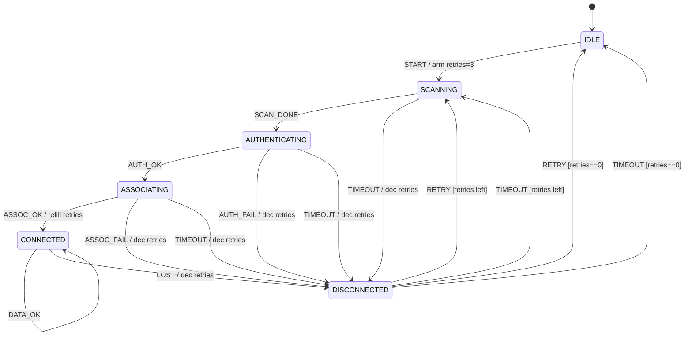

# 第 12 课：WiFi —— 会话失败恢复

本课只引入一个概念：**会话失败之后，回到一个熟知状态再试，并且次数有上限**。

回顾已经会的：

- 表驱动、事件、超时、重试预算（第 07 课的次数，本课用在 **恢复** 上）
- 第 08–10 课：表、事件循环想法、多机协同
- 第 11 课：应用请求生命周期 + 取消。那是一次 GET 的生老病死。本课是 **无线会话** 的生老病死

本课新问题不是「取消这一次」，而是：

> 认证失败、关联失败、或者已经连上又丢了，机器不要崩溃，也不要停在错误里等死。回到 `SCANNING`，还有预算就再走一遍扫描 → 认证 → 关联。

熟知状态是 `SCANNING`（以及预算用尽后的 `IDLE`）。不要为每一种失败发明一个终点。

四次握手和漫游只出现在讲义和图里，**不进代码**。本课全部扁平，不要把省电画成 `CONNECTED` 里面的另一层。那种套起来的写法是第 13 课的事。

---

## 1. Motivation

第 07 课播放器：连接失败就在 `CONNECTING` 上自环重试。无线局域网的失败更吵：

- 密码错、AP 拒认、关联超时、走着走着信号没了
- 失败点不同，但恢复动作往往相同：**重新扫描，再选一个 BSS 试**
- 若每次失败都 `abort()` 或停在 `AUTHENTICATING` 里，笔记本会「看起来在连，其实已经死了」
- 若失败就无限扫描，电池和空中时间会被打穿

恢复是纪律：

> 所有失败先回到同一个局面（本课是 `DISCONNECTED`，再进 `SCANNING`）。还有预算就再试；没有预算就回 `IDLE`。

这和「崩溃」相对，也和第 11 课的取消相对：取消是调用者不要了；恢复是会话还要，只是这一枪没中。

用在哪：典型 Wi-Fi 请求端程序（supplicant）的扫描 / 认证 / 关联循环、蜂窝注册、VPN 会话重连。本课只用扁平的教学关联机。

---

## 2. Problem Description

一台教学 Wi-Fi 会话机，六个局面（扁平，没有套圈）：

- `IDLE`：未开始，也不在恢复
- `SCANNING`：正在扫描
- `AUTHENTICATING`：802.11 认证（教学里的开放系统认证，不是四次握手）
- `ASSOCIATING`：关联
- `CONNECTED`：已经关联，可以走数据（教学把关联成功当成会话可用）
- `DISCONNECTED`：刚失败，正在决定是再扫描还是放弃

事件：

- `START`：用户要连
- `SCAN_DONE`：扫描到候选
- `AUTH_OK` / `AUTH_FAIL`
- `ASSOC_OK` / `ASSOC_FAIL`
- `DATA_OK`：链路上有数据（自环，表示还活着）
- `LOST`：已经连上之后丢了
- `TIMEOUT`：当前步骤等待到期；在 `DISCONNECTED` 上则表示「到了该再试的时刻」
- `RETRY`：立刻再试（用户或策略）

期望行为：

1. 成功主路径：`IDLE -START-> SCANNING -SCAN_DONE-> AUTHENTICATING -AUTH_OK-> ASSOCIATING -ASSOC_OK-> CONNECTED`
2. `AUTH_FAIL`、`ASSOC_FAIL`、`LOST`，以及扫描/认证/关联上的 `TIMEOUT`：进入 `DISCONNECTED`，预算减一
3. `DISCONNECTED` + `RETRY` 或 `TIMEOUT`：若 `retries_left > 0` → `SCANNING`；否则 → `IDLE`
4. `CONNECTED` + `DATA_OK` 停在 `CONNECTED`
5. 关联成功时把预算重新装满，使得后来的 `LOST` 有完整的恢复次数

上下文：

- `retries_left`：还能再回到扫描几次
- `timer_armed`：当前步骤是否在等超时（第 09 课想法；`main` 直接喂 `TIMEOUT`）

没有真实 802.11 帧，没有密钥。`main` 假装自己是驱动和 AP。

四次握手、漫游、省电：**讲义可以画，代码不实现**。下面会写「故意省略」。

---

## 3. Naive Solution

失败就崩：

```c
void
on_auth_fail(void)
{
	abort(); /* 或 return 到一个再也不会 START 的角落 */
}
```

一次密码抖动，整台设备的网络栈退出。用户只能重启。

失败停在当前状态：

```c
/* 仍是 AUTHENTICATING，但不会再发认证帧 */
```

UI 显示「正在认证」，实际已经没有定时器。这比崩溃更难查。

每种失败一个终点状态：`AUTH_FAILED`、`ASSOC_FAILED`、`LINK_LOST`、`SCAN_TIMEOUT`。恢复时你要从四个地方抄同一段「再扫描」代码。预算也会抄四份。

无限扫描：

```c
void
on_fail(void)
{
	state = SCANNING; /* 没有次数 */
}
```

第 07 课已经禁止这种没有预算的「再来」。

朴素方案缺的是：

- 一个 **共同的失败局面**（`DISCONNECTED`）
- 一个 **熟知的再入口**（`SCANNING`）
- 预算在上下文里，不在状态名里

---

## 4. FSM Solution

会话失败恢复的定义（本课只需这句）：

> 失败不崩溃。先进入同一个恢复局面，再回到熟知状态（扫描）重新走主路径。次数用尽则回到空闲。

它 **不是**：

- 在失败点原地自环（那是第 07 课「同一步再打一枪」；无线往往要重新选 AP，所以回扫描）
- 四次握手（那是关联之后的密钥步骤，本课省略）
- 把 `CONNECTED` 拆成套着的子局面（第 13 课才套）

六个扁平状态。`Fsm`：

```
Fsm {
    state
    ctx { retries_left, timer_armed }
}
fsm_init
fsm_dispatch(Fsm *, Event)
```

表驱动管成功格子和「失败 → DISCONNECTED」。`DISCONNECTED` 上的 `RETRY` / `TIMEOUT` 依赖预算，放在 `dispatch` 里监护。

关键路径：

- `IDLE` + `START` → 预算装 3 → `SCANNING`
- `SCANNING` + `SCAN_DONE` → `AUTHENTICATING`
- `AUTHENTICATING` + `AUTH_OK` → `ASSOCIATING`
- `ASSOCIATING` + `ASSOC_OK` → 预算重新装满 → `CONNECTED`
- 失败事件 → 预算减一 → `DISCONNECTED`
- `DISCONNECTED` + `RETRY`/`TIMEOUT` 且预算 > 0 → `SCANNING`
- `DISCONNECTED` + `RETRY`/`TIMEOUT` 且预算 == 0 → `IDLE`

为什么失败先到 `DISCONNECTED` 再扫描，而不是直接 `AUTH_FAIL -> SCANNING`：

- 真实设备常常要等一小会儿（本课用 `TIMEOUT`）或等用户按「再试」（`RETRY`）
- 这个等待局面是明确的：会话已经断了，还没开始下一轮扫描
- 预算用尽时下一状态是 `IDLE` 不是 `SCANNING`，监护放在一个格子里最清楚

第 07 课重试停在 `CONNECTING` 自环，因为还是同一次握手。本课回 `SCANNING`，因为无线环境可能已经变了，要重新看有哪些 AP。

架构未变：仍然是 `State`、`Event`、带上下文的 `Fsm`、`fsm_init`、`fsm_dispatch`。

---

## 5. State Diagram

教学会话机（代码实现这一张）：



ASCII 对照：

```
           START / arm retries
    +------+ --------------------> +----------+
    | IDLE |                       | SCANNING |
    |      | <-------------------- |          |
    +------+   give up             +----------+
        ^                           | SCAN_DONE
        |                           v
        |                    +----------------+
        |                    | AUTHENTICATING |
        |                    +----------------+
        |                           | AUTH_OK
        |                           v
        |                    +--------------+
        |                    | ASSOCIATING  |
        |                    +--------------+
        |                           | ASSOC_OK
        |                           v
        |                    +------------+
        |                    | CONNECTED  | <---- DATA_OK
        |                    +------------+
        |                           | LOST / AUTH_FAIL / ASSOC_FAIL / TIMEOUT
        |                           v
        |                    +---------------+
        +--------------------| DISCONNECTED  |
              retries==0     +---------------+
                             | RETRY/TIMEOUT
                             | [retries left]
                             v
                          SCANNING
```

规范里的站点状态更粗（未认证 / 已认证未关联 / 已关联）。9.1 对照那张图。代码多出来的 `SCANNING` 和 `DISCONNECTED` 是 **实现为了恢复** 加上的局面，不是规范强制的名字。

四次握手 **不要** 画进上面这张实现图。见 9.1 旁路图。漫游也不要画成 `CONNECTED` 里再套一个扫描。

---

## 6. State Table

| Current State | Event | Guard | Action | Next State |
|---------------|-------|-------|--------|------------|
| IDLE | START | — | 预算=3，start scan | SCANNING |
| SCANNING | SCAN_DONE | — | begin auth | AUTHENTICATING |
| SCANNING | TIMEOUT | — | session fail，retries-- | DISCONNECTED |
| AUTHENTICATING | AUTH_OK | — | begin assoc | ASSOCIATING |
| AUTHENTICATING | AUTH_FAIL | — | session fail，retries-- | DISCONNECTED |
| AUTHENTICATING | TIMEOUT | — | session fail，retries-- | DISCONNECTED |
| ASSOCIATING | ASSOC_OK | — | 预算重新装满，connected | CONNECTED |
| ASSOCIATING | ASSOC_FAIL | — | session fail，retries-- | DISCONNECTED |
| ASSOCIATING | TIMEOUT | — | session fail，retries-- | DISCONNECTED |
| CONNECTED | DATA_OK | — | print data ok | CONNECTED |
| CONNECTED | LOST | — | session fail，retries-- | DISCONNECTED |
| DISCONNECTED | RETRY | retries_left > 0 | retry scan | SCANNING |
| DISCONNECTED | TIMEOUT | retries_left > 0 | retry scan | SCANNING |
| DISCONNECTED | RETRY | retries_left == 0 | give up | IDLE |
| DISCONNECTED | TIMEOUT | retries_left == 0 | give up | IDLE |
| * | （未列出） | — | （无） | 保持 |

读表：

- 所有失败行的下一状态都是 `DISCONNECTED`。新概念在 **共同恢复点**，不在失败状态的个数
- 预算减一发生在 **进入 DISCONNECTED 时**。`RETRY` 只决定去扫描还是回空闲
- `ASSOC_OK` 把预算装满：一次成功会话之后的 `LOST` 应有完整恢复次数
- 没有 `AUTH_FAILED` 这种终点状态

---

## 7. Event Flow

先走成功，再走认证失败恢复，再走预算用尽。

```
time -->

[ IDLE ]
    --START / retries=3--> [ SCANNING ]
    --SCAN_DONE--> [ AUTHENTICATING ]
    --AUTH_OK--> [ ASSOCIATING ]
    --ASSOC_OK / refill--> [ CONNECTED ]
    --DATA_OK--> [ CONNECTED ]

[ IDLE ]
    --START--> [ SCANNING ] --SCAN_DONE--> [ AUTHENTICATING ]
    --AUTH_FAIL / retries=2--> [ DISCONNECTED ]
    --RETRY / retry scan--> [ SCANNING ]
    --SCAN_DONE--> [ AUTHENTICATING ]
    --AUTH_OK--> [ ASSOCIATING ]
    --ASSOC_OK--> [ CONNECTED ]

[ IDLE ]
    --START / retries=3--> ... ASSOCIATING
    --ASSOC_FAIL / retries=2--> [ DISCONNECTED ]
    --RETRY--> SCANNING ... ASSOC_FAIL / retries=1--> DISCONNECTED
    --RETRY--> SCANNING ... ASSOC_FAIL / retries=0--> DISCONNECTED
    --RETRY / give up--> [ IDLE ]
```

执行顺序（对应 `main` 轨迹）：

1. 主路径到 `CONNECTED`，再 `DATA_OK`
2. `AUTH_FAIL` 后 `RETRY`，再走成功
3. 三次 `ASSOC_FAIL` 后第四次 `RETRY` 回 `IDLE`
4. `CONNECTED` 上 `LOST`，用 `TIMEOUT` 当自动再试，再连上
5. 扫描三次 `TIMEOUT` 后放弃

调试时打印 **`retries left`**。看不见次数，恢复就无法批改。

---

## 8. Implementation

运行：

```bash
cc -std=c11 -Wall -Wextra -o wifi code/c/wifi.c && ./wifi
c++ -std=c++17 -Wall -Wextra -o wifi code/cpp/wifi.cpp && ./wifi
python3 code/python/wifi.py
```

### 伪代码

```
states: IDLE, SCANNING, AUTHENTICATING, ASSOCIATING, CONNECTED, DISCONNECTED
events: START, SCAN_DONE, AUTH_OK, AUTH_FAIL, ASSOC_OK, ASSOC_FAIL,
        DATA_OK, LOST, TIMEOUT, RETRY
BUDGET <- 3

init:
    current <- IDLE
    ctx.retries_left <- 0
    ctx.timer_armed <- 0

dispatch(e):
    if current is DISCONNECTED and e in {RETRY, TIMEOUT}:
        if ctx.retries_left > 0:
            print retry scan
            current <- SCANNING
        else:
            print give up
            current <- IDLE
        return

    look up table[current][e]
    if missing: return
    run action          /* fail 路径会 retries-- */
    current <- next
```

C / C++ / Python 见 `code/`。轨迹必须能看见：

- 主路径打印 `assoc ok, connected`
- `AUTH_FAIL` 后 `retry scan` 再连上
- 预算到 0 后 `give up, back to idle`
- `LOST` 后 `TIMEOUT` 回到 `SCANNING`

实现要点：

- 失败动作共用 `action_session_fail`，不要复制四份
- 四次握手、漫游、省电不要偷偷加进表
- 六个名字保持扁平。不要出现 `CONNECTED` 下面再挂一个名字

---

## 9. Design Discussion

恢复与第 07 课重试的差别：

| | 第 07 课重试 | 本课会话恢复 |
|--|--------------|----------------|
| 失败后停在哪 | 同一状态 `CONNECTING` | 共同局面 `DISCONNECTED`，再入口 `SCANNING` |
| 为什么 | 还是同一次握手 | 射频环境可能变了，要重新扫描 |
| 预算 | `retries_left` + 退避拍 | `retries_left`；退避用 `DISCONNECTED` 上的 `TIMEOUT` 表达 |
| 成功后 | 播放 | 会话可用；预算重新装满 |

为什么熟知状态是扫描而不是认证：

- AP 可能已经消失，继续向旧 BSSID 认证会浪费超时
- 扫描是「重新看世界」的最小步骤
- 典型请求端程序在失败后也是先 scan 再选 BSS

为什么要 `DISCONNECTED` 而不是失败直接 `SCANNING`：

- 把「已经断」和「正在扫」分开，日志才能读
- 给等待和「立刻再试」留一个格子
- 预算用尽时有地方走去 `IDLE`

`TIMEOUT` 一身兼两职：

- 在扫描/认证/关联：这一步没等到应答 → 失败
- 在 `DISCONNECTED`：等待结束 → 再试或放弃

这和电梯课「到期变成一次事件」相同，只是到期后查的表行不同。不要因此拆成两个事件名，除非你已经写混了；教学里靠 **当前状态** 区分。

替代：

- 崩溃 / 停住：实现少、产品不可用
- 每种失败一个终点：恢复代码复制
- 失败直接扫描：少一个状态，但把「断了但还没扫」藏进定时器里，更难调试
- 无限恢复：电池问题

取舍：没有真驱动。`SCAN_DONE` / `AUTH_OK` 由 `main` 喂入。

不要做的升级：不要把省电、漫游画进 `CONNECTED` 的内部。本课六个名字平铺。第 13 课才会讨论如何把状态套起来——那时再用省电当例子。现在若写成套圈，你会提前用到还没教的结构。

### 协议对照（九块）

#### 9.1 规范 / 规格图

IEEE 802.11 把站点对某个 AP 的关系粗分成（教学简化）：

```
  未认证、未关联          已认证、未关联           已认证、已关联
+------------------+    +------------------+    +------------------+
|  Class 1 frames  | -> |  Class 2 frames  | -> |  Class 3 frames  |
+------------------+    +------------------+    +------------------+
         ^                      | auth fail              | deauth/disassoc
         +----------------------+------------------------+
```

本课把它拆成可运行的名字：扫描是规范图左边之前的实现步骤；`DISCONNECTED` 是实现为了恢复加上的。`CONNECTED` 对应「已关联」。教学 **不** 实现「已认证未关联」上能发的 Class 2 数据细节。

四次握手（RSN / WPA2 个人，规格在 IEEE 802.11i / 802.11-2016 密钥管理，教学只需知道有四步）发生在 **关联成功之后、单播数据受保护之前**：

```
STA                                              AP
 | -- 1. EAPOL-Key (ANonce) ------------------> |
 | <-- 2. EAPOL-Key (SNonce, MIC) ------------- |
 | -- 3. EAPOL-Key (install, MIC) ------------> |
 | <-- 4. EAPOL-Key (ACK) --------------------- |
 |                  PTK 安装，数据可加密          |
```

本课代码在 `ASSOC_OK` 后直接进 `CONNECTED`，等于假装开放系统、没有密钥。四次握手若做成状态，至少再加四个局面，会把「失败回扫描」淹没。所以：**图在讲义，表不进代码。**

漫游（reassociation 到另一个 AP）规范上是另一组帧。教学图：

```
CONNECTED -- (signal bad, 规范外的策略) --> 扫描邻居
         -- reassoc --> 另一个 AP 的已关联
```

若画成扁平机，你会加上 `ROAM_SCAN` `REASSOCIATING`，主路径立刻变胖。本课不编码。更不要写成 `CONNECTED` 内部再挂扫描——那是第 13 课才教的套法。

#### 9.2 架构

```
+------------------+     user START/RETRY      +-----------------------+
| OS / UI          | ------------------------> | session FSM           |
+------------------+                           | scan/auth/assoc/conn  |
                                               +-----------------------+
                                                          |
                                                          | mlme commands
                                                          v
                                               +-----------------------+
                                               | driver / radio        |
                                               | (not in this code)    |
                                               +-----------------------+
```

典型 Wi-Fi 请求端程序（supplicant）负责：选网、凭据、802.11 认证/关联请求、四次握手、EAP。驱动负责扫描结果、收发包、密钥安装。

教学把 supplicant 的会话决策收成一台扁平机。驱动用事件 `SCAN_DONE`、`AUTH_OK` 代替。

控制面：会话 FSM。数据面：`DATA_OK` 只表示「还能通」，不转发真实 MSDU。

#### 9.3 事件分发

`fsm_dispatch` 一次一个事件。真实请求端程序里，驱动回调、定时器、用户「忘记网络」都会变成事件，再串行送进同一台机。

本课分发多一条监护：`DISCONNECTED` 上不查纯表，因为下一状态依赖 `retries_left`。这和第 11 课重定向次数同一手法：依赖数据的格子不要硬塞进没有监护的二维表。

非法事件（`IDLE` + `AUTH_OK`）忽略。不要把误投递当成 `LOST`。

#### 9.4 定时器

| 定时器 | 含义 | 本课 |
|--------|------|------|
| 扫描最大时长 | 一直听不到 Beacon | `SCANNING` + `TIMEOUT` |
| 认证超时 | 等不到 Auth 响应 | `AUTHENTICATING` + `TIMEOUT` |
| 关联超时 | 等不到 AssocResp | `ASSOCIATING` + `TIMEOUT` |
| 恢复等待 | 失败后过多久再扫 | `DISCONNECTED` + `TIMEOUT` |
| 四次握手超时 | 某一拍 EAPOL 没到 | 省略 |
| 省电唤醒 | TIM / 监听间隔 | 省略 |

第 09 课的 tick 本课不实现循环，只留 `timer_armed`。`main` 喂 `TIMEOUT`。

失败进入 `DISCONNECTED` 时重新武装定时器，表示「若没人按 RETRY，到期就自己再试或放弃」。

#### 9.5 典型实现

典型 Wi-Fi 请求端程序会：

- 维护一份「对当前选定 BSS 的会话状态」
- 失败后回到扫描或候选列表，而不是退出进程
- 把四次握手做成关联之后的另一步（有的实现甚至是另一台小机）
- 凭据错误（密码错）往往 **立刻放弃** 而不是扫满三次——那是监护：不可恢复的失败不应消耗完预算才告诉用户

教学代码没有区分「密码错」和「一时收不到」。全部走同一条恢复。练习里可以加监护：`AUTH_FAIL` 且原因是密码则直接 `IDLE`。

不要对照某份本地源码。把 supplicant 当成行业里「站点侧会话决策」的通称即可。

#### 9.6 与规格的差异，以及本课故意省略

- 规格的 Class 1/2/3 与本课六个名字不是一一映射；`SCANNING` / `DISCONNECTED` 是实现态
- 开放系统认证在现代 RSN 里几乎是空操作，真正的认证在 802.1X / 四次握手。本课仍保留 `AUTHENTICATING`，为的是让主路径有三步可看
- `ASSOC_OK` 后规格还没允许你发受保护的单播数据；本课当成 `CONNECTED`
- 规格没有「重试 3 次」；这是产品策略

故意省略：

- 四次握手（图在 9.1，代码无）
- 漫游 / 重关联（图在讲义，代码无）
- 省电（PS-Poll、U-APSD）：若做成扁平兄弟状态，会看起来「不在 CONNECTED」。正确的套法留到第 13 课
- 802.1X / EAP 企业认证
- 国家码、信道、速率协商
- 真帧格式

#### 9.7 优化（点到为止，不写进示例）

- 缓存上一次成功的 BSSID，失败后先试它再全频段扫描
- 按 RSSI 排序候选，不要每次都从最弱的试
- 密码错误立刻停，避免无意义扫描
- 漫游时先关联新 AP 再丢旧 AP（make-before-break），减少断流——那是另一条策略，本课 `LOST` 是先断后扫

不要为了快把六个状态合成三个。恢复点变模糊，比少几次扫描更贵。

#### 9.8 常见缺陷（协议层面）

- 失败停在 `AUTHENTICATING`，定时器已停，UI 假进度
- 密码错误还按预算扫满三轮
- `LOST` 后不回扫描，对着已经消失的 BSSID 重关联
- 四次握手失败却报告「已连接」（关联成功 ≠ 密钥安装成功）。本课省略握手，所以讲义必须把这句写出来，避免你以后读真 supplicant 时搞混
- 恢复没有上限，漫游场景下空中全是 Probe

#### 9.9 测试策略

针对教学 FSM：

1. 主路径结束在 `CONNECTED`，日志含 `assoc ok, connected`
2. `AUTH_FAIL` + `RETRY` 再成功
3. 三次关联失败后 `RETRY` 回到 `IDLE`，日志含 `give up`
4. `CONNECTED` + `LOST` + `TIMEOUT` 进入 `SCANNING`，且次数已减
5. `IDLE` + `LOST` 保持 `IDLE`
6. `DATA_OK` 不改变状态

不要开真实射频。这些代码不能关联真 AP。

---

工业对照：物联网模组掉线重连、手机 Wi-Fi、消费类路由器的中继模式，都是「失败回扫描 + 预算」。嵌入式上预算往往更小（省电）。不要在本课对照内核 TCP 或 HTTP 库——那是另一层会话。

---

## 10. Common Mistakes

初学者：

- `AUTH_FAIL` 直接 `IDLE`，用户要不停按连接。那是没有恢复
- `AUTH_FAIL` 直接 `SCANNING`，日志上看不出曾经断过，也没有地方等 `RETRY`
- 为 `AUTH_FAIL` / `ASSOC_FAIL` / `LOST` 各做一个终点状态，恢复代码复制三份
- 失败不减 `retries_left`，或减了不打印
- 把四次握手四拍做成四个顶层状态，主路径从 4 步变成 8 步，本课概念被淹没
- 画 `CONNECTED` 里面再挂 `POWER_SAVE`（不要这样做；第 13 课才套状态）

工业上：

- 不可恢复失败（错误口令）仍走满预算
- 恢复间隔太短，AP 过载
- 报告 Connected 时四次握手还没完成，DHCP 立刻失败
- 漫游时先 `LOST` 再扫，语音通话掉一截——需要另一条「先连新再断旧」的策略，不是多几个失败终点

---

## 11. Refactoring

表已经在用。预算仍在上下文，不要把 `TRY1` `TRY2` 写进枚举。

若要区分「密码错立刻停」和「一时超时再试」：在 `AUTH_FAIL` 上加监护，看上下文里的失败原因。那是第 04 课手法，不是新状态。

若要把四次握手加进来：先另画一张四拍的图，想清楚失败是回 `ASSOCIATING` 还是回 `SCANNING`。不要把四拍焊进本课主表交差。本课练习可以画图，不要改主例除非你能说清恢复点仍是扫描。

若已经在套 `CONNECTED` 的内部局面：停住。摊平完成本课。第 13 课会用「已连接还要省电」说明为什么后来需要把状态套起来。

---

## 12. Exercise

**容易**

把预算从 3 改成 1。改 `main` 里「assoc fail until budget exhausted」：一次 `ASSOC_FAIL` 后，下一次 `RETRY` 就应 `give up`。

**中等**

增加失败原因：`AUTH_FAIL` 若 `ctx.bad_password==1` 则直接 `IDLE`，不进 `DISCONNECTED`。说明为什么这是监护，为什么密码错误不应消耗扫描预算。

**挑战**

只在纸上（不要改本课代码冒充实现）画出四次握手四拍，以及「第 2 拍超时」应回到哪个 **本课已有** 状态。论证你为什么选 `SCANNING` 或 `DISCONNECTED` 而不是停在一个新的 `PTK_NEGOTIATING` 终点。仍然不要套圈。

---

## 13. Summary

- 会话失败恢复 = 回到熟知状态再走主路径，不是崩溃，也不是停在失败点
- 共同失败局面是 `DISCONNECTED`，再入口是 `SCANNING`，放弃点是 `IDLE`
- 预算在上下文；失败时减一，成功关联时装满
- 四次握手、漫游、省电本课只讲不写。扁平六状态已经够用
- 把状态套起来（例如已连接还要省电）是第 13 课的新概念，本课不要提前用

下一课：开始把扁平机里重复的结构 **套起来**，解决状态个数膨胀。带着本课的 `CONNECTED` 与省电去读。
