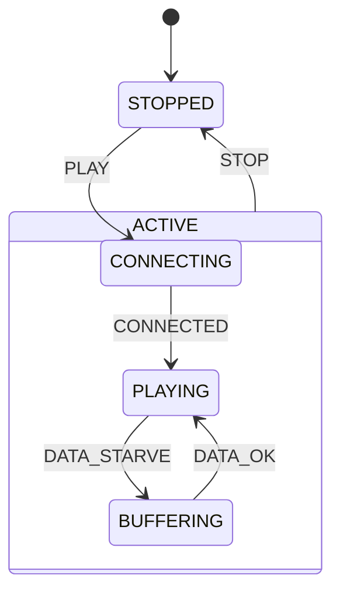

# 第 13a 课：复合状态 —— 扁平机为什么会炸

本课只引入一个概念：**复合状态（Composite）**，也叫嵌套状态。

第 07 课的播放器是四个扁平名字：`STOPPED`、`CONNECTING`、`PLAYING`、`BUFFERING`。`STOP` 要从三个播放相关状态各画一支箭回停止。那时四个名字够用。

本课回答：当「正在干活」这件事下面还要再分局面时，为什么不能继续把所有名字摊在同一层——以及 HSM 发明出来，就是为了把那一层公共的箭钉在父框上。

本课 **不** 把进入 / 退出、历史、正交、伪状态当成术语。你可以在进入某个叶子时改字段，但不要给它起「Entry」这个名字。箭头仍然是普通转移。

---

## 1. Motivation

第 07 课已经能跑：

- `PLAY`：停止 → 连接
- `CONNECTED`：连接 → 播放
- `DATA_STARVE` / `DATA_OK`：播放 ↔ 缓冲
- `STOP`：连接、播放、缓冲都回停止

扁平机的代价藏在 `STOP` 上。图上三支箭，代码里三个 `else if (event == STOP)`。产品经理下一句往往是：

- 播放时还能 Seek
- 连接失败要分「第 1 次 / 第 2 次 / 第 3 次」
- 缓冲时还要分「等关键帧 / 等码率切换」

若每一种组合都变成顶层枚举：

```
PlayingHealthy, PlayingBuffering, PlayingSeeking,
ConnectingRetry1, ConnectingRetry2, ConnectingRetry3, ...
```

`STOP` 要从 **每一个** 新名字再画一支箭。状态个数按特征相乘，转移按「公共事件 × 叶子数」相乘。这就是 **状态爆炸**。

HSM（Hierarchical State Machine，分层状态机）被发明出来，不是为了画得好看，而是为了说：

> `CONNECTING`、`PLAYING`、`BUFFERING` 都是「活动中」的一种。`STOP` 是活动中的共同出路，只应画在父框上一次。

用在哪：媒体播放器、第 12 课那种「已连接还要再分省电 / 漫游」的会话、任何「一组兄弟状态共享同一条退出」的控制面。本课只回看教学播放器。

---

## 2. Problem Description

同一台第 07 课播放器，用户可见行为不变：

1. `STOPPED` + `PLAY` → `CONNECTING`
2. `CONNECTING` + `CONNECTED` → `PLAYING`
3. `PLAYING` + `DATA_STARVE` → `BUFFERING`
4. `BUFFERING` + `DATA_OK` → `PLAYING`
5. 活动中任意叶子 + `STOP` → `STOPPED`

新要求不是新功能，而是新结构：

- 当前状态仍然是 **一个叶子**（任意时刻恰好一个当前局面，第 01 课没变）
- `ACTIVE` 是盒子，不是第五个「现在待着的」叶子
- `STOP` 在图上只出现一次：从 `ACTIVE` 指向 `STOPPED`

本课故意不再演示第 07 课的重试预算。重试若做成 `ConnectingRetry1` / `Retry2` / `Retry3` 三个顶层状态，正是爆炸的典型来源；次数应继续当数据，不要当状态名。

没有真实套接字、没有渲染器。`main` 喂事件，程序打印叶子路径和「`STOP` 走父框」。

---

## 3. Naive Solution

继续摊平，把产品新特征乘进枚举：

```c
typedef enum {
	STOPPED,
	CONNECTING_RETRY1,
	CONNECTING_RETRY2,
	CONNECTING_RETRY3,
	PLAYING_HEALTHY,
	PLAYING_BUFFERING,
	PLAYING_SEEKING
} FlatState;
```

每一个新名字都要抄一遍 `STOP`：

```c
case PLAYING_HEALTHY:
case PLAYING_BUFFERING:
case PLAYING_SEEKING:
case CONNECTING_RETRY1:
	/* ... 每一个 case 里再写一遍 goto STOPPED */
```

乱从这里开始：

- 公共退出被复制 N 份，漏抄一份就停不住
- 枚举里出现无意义组合（「第 3 次重试且正在 Seek」）
- 读图的人无法回答「哪些状态其实是同一种活动」
- 第 07 课已经用 `retries_left` 解决的次数问题，又被错误地做成状态

朴素方案缺的不是事件，而是 **一层盒子**：把共享出路的叶子收进同一个父状态。

---

## 4. FSM Solution

复合状态的定义（本课只需这句）：

> 一个状态可以包含若干子状态。机器的当前局面仍是某个叶子；父状态表示「此刻也处于这个更大的局面」。画在父框上的转移，对每一个子状态都有效。

它 **不是**：

- 同时待在两个叶子里（那是后面才教的另一件事）
- 把 `ACTIVE` 当成可以 `current = ACTIVE` 而不进入子状态的第五个停靠点（本课进入 `ACTIVE` 时必须落到一个叶子）
- 历史记忆（离开后再回来停在哪，下一课以后再说）

结构：

```
Player
  STOPPED          （叶子）
  ACTIVE           （复合）
    CONNECTING     （叶子）
    PLAYING        （叶子）
    BUFFERING      （叶子）
```

`Fsm` 仍然只有一个 `state` 字段，取值是叶子。`ACTIVE` 用谓词表达：

```
in_active(s) = s 是 CONNECTING 或 PLAYING 或 BUFFERING
```

`STOP` 只写一次：

```
if event is STOP and in_active(current):
    current <- STOPPED
```

这就是父框上一支箭在代码里的形状。子状态之间的箭（`CONNECTED`、`DATA_STARVE`、`DATA_OK`）仍画在叶子上，因为它们不是整个 `ACTIVE` 的共同行为。

架构未变：

```
State 枚举（只列叶子）
Event 枚举
Fsm { state }
fsm_init
fsm_dispatch(Fsm *, Event)
in_active(State)     /* 本课新增的盒子谓词 */
```

---

## 5. State Diagram

先看扁平爆炸（**不要实现这张图**）：

```
+-------------------+  STOP   +---------+
| CONNECTING_RETRY1 | ----+   |         |
+-------------------+     |   |         |
+-------------------+     |   |         |
| CONNECTING_RETRY2 | ----+   |         |
+-------------------+     |   | STOPPED |
+-------------------+     +-> |         |
| PLAYING_HEALTHY   | ----+   |         |
+-------------------+     |   |         |
+-------------------+     |   |         |
| PLAYING_BUFFERING | ----+   |         |
+-------------------+     |   |         |
+-------------------+     |   |         |
| PLAYING_SEEKING   | ----+   +---------+
+-------------------+
```

每一条 `STOP` 都是抄来的。再加一个特征，箭再乘一倍。

再看嵌套（本课要实现的）：



ASCII 对照：

```
+------------------------------------------+
| Player                                   |
|                                          |
|  +----------+     PLAY      +----------+ |
|  | STOPPED  | ------------> |          | |
|  |          | <------------ |  ACTIVE  | |
|  +----------+      STOP     |          | |
|                             |  +-----+ | |
|                             |  | CON | | |
|                             |  +--+--+ | |
|                             |     |    | |
|                             |     |CONNECTED
|                             |     v    | |
|                             |  +-----+ | |
|                             |  | PLAY| | |
|                             |  +--+--+ | |
|                             |     |    | |
|                             |     |DATA_STARVE / DATA_OK
|                             |     v    | |
|                             |  +-----+ | |
|                             |  | BUF | | |
|                             |  +-----+ | |
|                             +----------+ |
+------------------------------------------+
```

读图：

- 圆角大框 `ACTIVE` 是复合状态
- 当前局面仍是框里某一个小框
- `STOP` 从大框边出发，不从每个小框再拉一次
- `PLAY` 进入 `ACTIVE` 时落到 `CONNECTING`（本课的默认子状态；不要把它叫做伪状态）

---

## 6. State Table

叶子表。`STOP` 合并成一行，用「`ACTIVE` 的任意子状态」当当前状态。

| Current State | Event | Guard | Action | Next State |
|---------------|-------|-------|--------|------------|
| STOPPED | PLAY | — | print enter ACTIVE/CONNECTING | CONNECTING |
| CONNECTING | CONNECTED | — | print | PLAYING |
| PLAYING | DATA_STARVE | — | print | BUFFERING |
| BUFFERING | DATA_OK | — | print | PLAYING |
| ACTIVE 的任一子状态 | STOP | — | print parent STOP | STOPPED |
| PLAYING | DATA_OK | — | （无） | PLAYING |
| BUFFERING | DATA_STARVE | — | （无） | BUFFERING |
| STOPPED | STOP | — | （无） | STOPPED |
| * | （未列出） | — | （无） | 保持 |

读表：

- 真正省下的是 `STOP` 行。扁平表里它会按叶子数复制
- `ACTIVE` 不出现在「当前状态」列的单独一行里当叶子；它出现在「任一子状态」这种量化里
- 子状态之间的转移没有被父框吃掉。父框只吃 **所有孩子都该做的那件事**

---

## 7. Event Flow

```
time -->

[ STOPPED ]
    --PLAY--> [ ACTIVE/CONNECTING ]
    --CONNECTED--> [ ACTIVE/PLAYING ]
    --DATA_STARVE--> [ ACTIVE/BUFFERING ]
    --DATA_OK--> [ ACTIVE/PLAYING ]
    --STOP / one arrow on ACTIVE--> [ STOPPED ]

[ STOPPED ]
    --PLAY--> [ ACTIVE/CONNECTING ]
    --STOP / same parent arrow--> [ STOPPED ]
```

执行顺序：

1. 上电：叶子 = `STOPPED`，不在 `ACTIVE` 里
2. `PLAY`：叶子变成 `CONNECTING`，此时也处于 `ACTIVE`
3. `CONNECTED`：叶子变成 `PLAYING`，仍在 `ACTIVE`
4. 缺数据、恢复：只在 `ACTIVE` 内部换叶子
5. `STOP`：不论叶子是连接、播放还是缓冲，都走同一条父转移，回到 `STOPPED`

调试时打印 **路径**（`ACTIVE/PLAYING`），不要只打印叶子。否则你看不出盒子是否还在。

---

## 8. Implementation

运行：

```bash
cc -std=c11 -Wall -Wextra -o player_hsm code/c/player_hsm.c && ./player_hsm
c++ -std=c++17 -Wall -Wextra -o player_hsm code/cpp/player_hsm.cpp && ./player_hsm
python3 code/python/player_hsm.py
```

### 伪代码

```
leaf states: STOPPED, CONNECTING, PLAYING, BUFFERING
events: PLAY, STOP, CONNECTED, DATA_STARVE, DATA_OK

in_active(s):
    s is CONNECTING or PLAYING or BUFFERING

path(s):
    if in_active(s): "ACTIVE/" + name(s)
    else name(s)

init:
    current <- STOPPED

dispatch(e):
    if e is STOP and in_active(current):
        print "ACTIVE --STOP--> STOPPED"
        current <- STOPPED
        return

    if current is STOPPED and e is PLAY:
        current <- CONNECTING
    else if current is CONNECTING and e is CONNECTED:
        current <- PLAYING
    else if current is PLAYING and e is DATA_STARVE:
        current <- BUFFERING
    else if current is BUFFERING and e is DATA_OK:
        current <- PLAYING
```

C / C++ / Python 见 `code/`。轨迹必须能看见：

- 扁平爆炸名单（打印出来对照，不要真去实现那些状态）
- `ACTIVE/CONNECTING` 这类路径
- `STOP` 从 `PLAYING` 和从 `CONNECTING` 打出同一句父框转移

实现要点：

- `state` 只存叶子。不要 `current = ACTIVE`
- `in_active` 是盒子，不是第二个状态字段
- 不要 `#include` 课程的 `engine/`。本课用手写谓词就够
- 不要给进入 / 退出函数起 Entry / Exit 的名字

---

## 9. Design Discussion

四套词，本课必须分清。后面子课只会往 HSM 上加零件，不会改这张对照表。

| | 扁平 FSM（第 01–12 课） | HSM（本课起） | Statechart（Harel / UML） | Actor（第 14 课才做） |
|--|-------------------------|---------------|---------------------------|------------------------|
| 当前局面 | 一个枚举值 | 一个叶子，外加父链 | 同 HSM，还可同时有多个区域 | 每个对象自己一台机 |
| 状态怎么长 | 特征相乘，容易炸 | 盒子收共享转移 | HSM + 历史 + 正交 + 伪状态 | 用邮箱隔离并发，不解决爆炸 |
| `STOP` 画几次 | 每个叶子一次 | 父框一次 | 同 HSM | 每个 Actor 自己决定 |
| 本课用不用 | 第 07 课已经用过 | **本课只用复合** | 13d–13f 才把「额外零件」补齐 | 只预告：并发隔离是下一阶段 |

逐条：

**FSM（扁平）**  
任意时刻一个状态，所有状态是兄弟。第 07 课四个名字是合格的扁平机。它不是错的；它在「共享退出 × 叶子数」变大时变贵。

**HSM**  
状态可以有父。发明它的直接理由就是本课的爆炸：公共事件不应按叶子复制。HSM 仍然是一台机、一个当前叶子。父状态是分类，不是第二台机。

**Statechart**  
David Harel 的状态图 = HSM **再加** 历史、正交区域、条件分支等图上符号。UML 状态机走的是这条线。有人把 HSM 和 Statechart 混着叫。本课程把词拆开：

- 13a：只有复合（HSM 的核心）
- 13b 起：一次加一个 Statechart 零件

所以：**Statechart = HSM + 额外机制**。不要在本课把历史画成 `H`，也不要把 Wi-Fi 画进播放器旁边当第二列。

**Actor**  
解决的是另一件事：许多对象同时活着、消息不能直接改对方的字段。第 10 课已经用「两台扁平机互相投递」做过协同；第 14 课会把「每对象一台机 + 邮箱」说完整。Actor **不**替代 HSM。一台 Actor 里面仍然可以是扁平机或分层机。本课只记住一句：分层解决的是 **一张图里的爆炸**；并发隔离是下一阶段。

替代：

- 继续扁平 + 宏展开 `STOP`：能跑，漏抄是必然的
- 两个布尔 `is_active` + `leaf`：等价于复合，但图上没有盒子，后来的人会再发明一套枚举
- 把活动中的三个叶子合成一个状态，用内部变量区分：你失去了「可画的子局面」，调试只能读变量

取舍：教学播放器没有真实 I/O。复合的收益用「`STOP` 写一次」和「路径打印」证明，不用性能数字。

工业对照（公开概念，不指向任何本地工程）：

- 媒体播放器的「正在播」下面再分缓冲 / Seek，停止应停掉整个活动
- 802.11 已关联之后再分休眠 / 唤醒：第 12 课禁止把省电做成与 `CONNECTED` 并列的顶层状态，本课给出为什么——省电是盒子里面的叶子，不是另一个顶层兄弟
- UI 向导的「步骤中」共享取消键，取消画在父框上

---

## 10. Common Mistakes

初学者：

- 把 `ACTIVE` 放进 `state` 枚举并让 `current = ACTIVE`，然后不知道 `CONNECTED` 该进哪
- `STOP` 仍在三个叶子里各写一遍，盒子成了注释
- 用 `ConnectingRetry1` 三个状态代替第 07 课的 `retries_left`，爆炸从这里重新开始
- 打印只打叶子，批改时看不出父框是否存在
- 以为复合等于「同时处于 CONNECTING 和 PLAYING」

工业上：

- 规格图画了大框，实现仍是扁平枚举，图和代码分家
- 把两个独立对象的状态乘进一个枚举（第 10 课已经反对过），却误称为 HSM
- 日志不打路径，事故里只看见 `3`，看不见当时在哪个盒子里

---

## 11. Refactoring

13b 会给「走进一个状态 / 离开一个状态」正式名字，并规定顺序。本课先保持「改 `current` + 打印路径」。

若你已经在画 `H` 或把 Wi-Fi 画进 `ACTIVE` 右边：停住。那些是后面子课的零件。

若你想把连接和播放做成 **两台对象** 再互相投递：那是第 10 课的多机，不是本课的盒子。本课是 **一个对象、一张图、一层父框**。

并发隔离（许多播放器实例、邮箱、不能直接改对方字段）留到第 14 课。本课先把一张图收拢。

---

## 12. Exercise

**容易**

给 `ACTIVE` 增加叶子 `PAUSED`。`PLAYING` + `PAUSE` → `PAUSED`，`PAUSED` + `RESUME` → `PLAYING`。`STOP` 仍然只写在 `in_active` 那一行——确认你没有给 `PAUSED` 再抄一遍 `STOP`。

**中等**

把第 12 课的 `CONNECTED` 收成盒子，下面暂时只放一个叶子 `ONLINE`（不要做省电，那是 13e）。指出：哪些失败事件应画在盒子上（整段会话结束），哪些应留在叶子上。

**挑战**

数一数：若扁平机有「连接 3 档重试 × 播放 3 种子局面」，`STOP` 要画几支箭？改成「`ACTIVE` 盒子 + 次数当数据 + 3 个播放叶子」之后，`STOP` 还剩几支？不要引入历史符号。

---

## 13. Summary

- 扁平机在「公共事件 × 叶子」上爆炸；HSM 用父框把公共转移写一次
- 复合状态是盒子；当前局面仍是恰好一个叶子
- `ACTIVE --STOP--> STOPPED` 是本课的全部收益
- Statechart = HSM + 更多图上零件；本课只用复合
- Actor 解决并发隔离，不解决一张图的爆炸；那是第 14 课

下一课：同一台播放器。新概念是 **进入动作 / 退出动作**，以及离开 `ACTIVE` 时父框也要退出。
