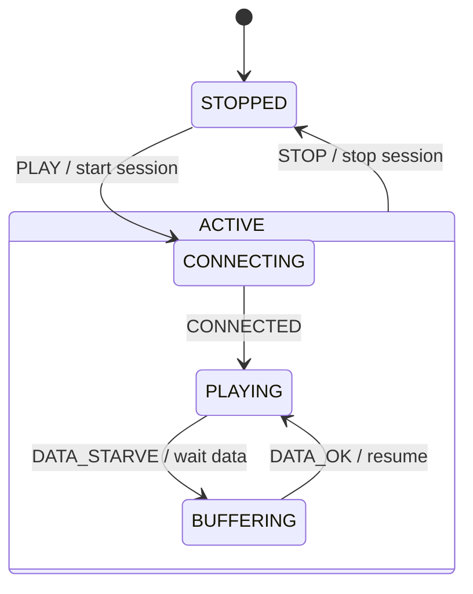

# 第 13b 课：进入动作与退出动作

本课只引入一个概念：**进入动作（Entry）和退出动作（Exit）**。

13a 已经把 `CONNECTING` / `PLAYING` / `BUFFERING` 收进 `ACTIVE`，`STOP` 画在父框上一次。本课回答：走进一个状态、离开一个状态时，副作用挂在哪里——以及离开盒子时，**父状态也要退出**。

复用 13a 的复合。不要引入历史、正交、伪状态。

---

## 1. Motivation

第 05 课的动作挂在 **箭头** 上：从黄灯到红灯，转移本身去关黄灯、开红灯。箭头一多，同一盏灯会被许多箭各关一次。

播放器更明显：

- 走进 `PLAYING` 就该开始渲染；离开 `PLAYING` 就该停渲染。不管你是因为缺数据离开，还是因为用户按了停止
- 走进 `CONNECTING` 就该打开套接字尝试；离开就该关掉这次尝试。不管下一站是 `PLAYING` 还是 `STOPPED`
- 离开整个 `ACTIVE`（回到 `STOPPED`）时，活动级资源也要放掉

若只把「开渲染」写在 `CONNECTED` 那支箭上，以后从缓冲恢复、从 Seek 回来，每一支箭都要记得再开一次。漏一支，画面黑着，状态却是 `PLAYING`。

进入 / 退出把「只要待在这里就必须为真的事」钉在 **框** 上，而不是钉在每一支进、出的箭上。

用在哪：套接字生命期、渲染器、文件句柄、UI 页面的挂载与卸载。本课仍用同一台教学播放器。

---

## 2. Problem Description

同一台 13a 播放器，叶子与盒子不变：

```
STOPPED
ACTIVE
  CONNECTING
  PLAYING
  BUFFERING
```

事件仍是 `PLAY`、`STOP`、`CONNECTED`、`DATA_STARVE`、`DATA_OK`。

新要求是打印顺序，而不是新功能：

1. 进入 `CONNECTING`：打印 `entry CONNECTING: open socket`
2. 退出 `CONNECTING`：打印 `exit CONNECTING: close socket attempt`
3. 进入 `PLAYING`：打印 `entry PLAYING: start rendering`
4. 退出 `PLAYING`：打印 `exit PLAYING: stop rendering`
5. 进入 / 退出 `ACTIVE`、`STOPPED`、`BUFFERING` 也要打印，以便看见父框
6. 一次外部转移的固定顺序：**先退出旧状态（从叶子向父），再跑转移动作，再进入新状态（从父向叶子）**
7. `PLAYING` → `STOPPED` 必须先退出 `PLAYING`，再退出 `ACTIVE`，再进入 `STOPPED`
8. `PLAYING` → `BUFFERING` **不得** 退出 `ACTIVE`（还在盒子里）

没有真实套接字和渲染器。打印就是教学证明。

---

## 3. Naive Solution

把副作用只写在箭上：

```c
if (state == CONNECTING && event == CONNECTED) {
	close_socket();
	start_rendering();
	state = PLAYING;
}
if (state == PLAYING && event == STOP) {
	stop_rendering();
	close_socket(); /* 套接字其实在 CONNECTING 就该关了 */
	state = STOPPED;
}
```

乱从这里开始：

- `DATA_STARVE` 离开 `PLAYING` 时若忘记 `stop_rendering`，缓冲期间渲染器还在空转
- 从 `CONNECTING` 直接 `STOP`，若只在 `CONNECTED` 那支箭上关套接字，套接字泄漏
- 离开 `ACTIVE` 的清理散落在三支 `STOP` 里（13a 刚把箭收成一支，动作又被拆散）

另一种乱法：进入新状态时先跑进入，再退出旧状态。资源会对不上（两套渲染器同时活着，或套接字还没关就开下一把）。

朴素方案缺的是：**框上的进入 / 退出**，以及一条不可商量的顺序。

---

## 4. FSM Solution

进入 / 退出的定义（本课只需这两句）：

> 进入动作：只要机器进入该状态（含从父框走进来），就运行一次。  
> 退出动作：只要机器离开该状态（含因父框上的转移而离开），就运行一次。

外部转移的顺序（本课必须遵守）：

```
1. 从当前叶子沿父链退出，直到源与目标的最近共同祖先（LCA）
2. 运行这支箭上的转移动作（第 05 课的 Action）
3. 从 LCA 沿父链走下去，进入目标叶子
```

`PLAYING` → `BUFFERING`：LCA 是 `ACTIVE`。只退出 `PLAYING`，进入 `BUFFERING`。`ACTIVE` 不退出。

`PLAYING` → `STOPPED`：LCA 在盒子之外。退出 `PLAYING`，退出 `ACTIVE`，（转移动作），进入 `STOPPED`。

`STOPPED` → `CONNECTING`：退出 `STOPPED`，进入 `ACTIVE`，进入 `CONNECTING`。

本课进入 `ACTIVE` 时仍必须落到一个叶子（13a 的规矩）。进入动作按「先父后子」跑：先 `ACTIVE`，再 `CONNECTING`。退出按「先子后父」。

架构：

```
叶子枚举 + ACTIVE 作为父（不出现在 current 里）
每个状态：entry() / exit()
transition(target, trans_action):
    exit up to LCA
    trans_action
    enter down to target
    current <- target
```

不要 `#include` `engine/hsm.h`。手写 LCA 和两段循环即可。

---

## 5. State Diagram



框上的进入 / 退出用文字钉死（Mermaid 对 entry/exit 语法各实现不一致，本课用表）：

| 状态 | Entry | Exit |
|------|-------|------|
| STOPPED | print enter STOPPED | print exit STOPPED |
| ACTIVE | print enter ACTIVE | print exit ACTIVE |
| CONNECTING | open socket | close socket attempt |
| PLAYING | start rendering | stop rendering |
| BUFFERING | print enter BUFFERING | print exit BUFFERING |

ASCII：

```
+--------------------------------------+
| ACTIVE                               |
|  entry: enter ACTIVE                 |
|  exit:  exit ACTIVE                  |
|                                      |
|  CONNECTING          PLAYING         |
|  entry: open socket  entry: start    |
|  exit:  close sock   exit:  stop     |
|                      rendering       |
+--------------------------------------+
         ^ STOP / stop session
         |
      STOPPED
      entry / exit: print
```

`STOP` 仍是 13a 的一支父箭。本课新看见的是：走这支箭时，叶子先退出，然后 `ACTIVE` 退出。

---

## 6. State Table

转移动作列的是箭上的 Action。进入 / 退出不写进每一行，否则又变回「按箭复制」。

| Current State | Event | Guard | Action（箭上） | Next State | 实际进出（由 LCA 推出） |
|---------------|-------|-------|----------------|------------|-------------------------|
| STOPPED | PLAY | — | start session | CONNECTING | exit STOPPED；enter ACTIVE, CONNECTING |
| CONNECTING | CONNECTED | — | （无或 print） | PLAYING | exit CONNECTING；enter PLAYING |
| PLAYING | DATA_STARVE | — | wait data | BUFFERING | exit PLAYING；enter BUFFERING |
| BUFFERING | DATA_OK | — | resume | PLAYING | exit BUFFERING；enter PLAYING |
| ACTIVE 任一子 | STOP | — | stop session | STOPPED | exit 叶子, exit ACTIVE；enter STOPPED |

读表：渲染的开/关不出现在 Action 列。它们属于 `PLAYING` 的框。若写进 `CONNECTED` 和 `DATA_OK` 两行，你又回到朴素解。

---

## 7. Event Flow

注意每一拍的打印顺序。

```
time -->

[ STOPPED ]
    --PLAY-->
        exit STOPPED
        action: start session
        entry ACTIVE
        entry CONNECTING: open socket
    [ ACTIVE/CONNECTING ]
    --CONNECTED-->
        exit CONNECTING: close socket attempt
        entry PLAYING: start rendering
    [ ACTIVE/PLAYING ]
    --DATA_STARVE-->
        exit PLAYING: stop rendering
        action: wait data
        entry BUFFERING
    [ ACTIVE/BUFFERING ]
    --DATA_OK-->
        exit BUFFERING
        action: resume
        entry PLAYING: start rendering
    [ ACTIVE/PLAYING ]
    --STOP-->
        exit PLAYING: stop rendering
        exit ACTIVE
        action: stop session
        entry STOPPED
    [ STOPPED ]
```

对照：`DATA_STARVE` 没有 `exit ACTIVE`。`STOP` 有。这是本课要在轨迹里证明的一件事。

---

## 8. Implementation

运行：

```bash
cc -std=c11 -Wall -Wextra -o player_hsm code/c/player_hsm.c && ./player_hsm
c++ -std=c++17 -Wall -Wextra -o player_hsm code/cpp/player_hsm.cpp && ./player_hsm
python3 code/python/player_hsm.py
```

### 伪代码

```
parent(STOPPED) = none
parent(ACTIVE) = none
parent(CONNECTING|PLAYING|BUFFERING) = ACTIVE

exit_up(from, lca):
    s <- from
    while s exists and s != lca:
        run exit(s)
        s <- parent(s)

enter_down(lca, to):
    collect path from `to` up to lca
    run entry() from parent-side down to `to`

transition(to, action):
    lca <- least common ancestor(current, to)
    exit_up(current, lca)
    if action: action()
    enter_down(lca, to)
    current <- to
```

C / C++ / Python 见 `code/`。轨迹必须出现：

- `open socket` / `close socket attempt`
- `start rendering` / `stop rendering`
- `STOP` 路径上 `exit PLAYING` 然后 `exit ACTIVE`
- `DATA_STARVE` 路径上 **没有** `exit ACTIVE`

实现要点：

- 进入顺序：父 → 子；退出顺序：子 → 父
- 转移动作夹在中间
- 不要在 `CONNECTED` 的箭上再写一遍 `start rendering`
- 自包含，不链 `engine/`

---

## 9. Design Discussion

进入 / 退出与第 05 课转移动作的分工：

| | 转移动作 | 进入 / 退出 |
|--|----------|-------------|
| 挂在哪 | 箭 | 框 |
| 跑几次 | 走这支箭一次 | 每次进入或离开这个框一次 |
| 适合什么 | 「从 A 到 B 特有的事」 | 「只要在这个局面就必须为真的事」 |
| 例子 | wait data、stop session | 开/关渲染、开/关套接字 |

为什么离开 `ACTIVE` 要跑父退出：

- 盒子表示「活动还在」。离开盒子 = 活动结束
- 活动级资源（会话、统计、看门狗）不应指望每个叶子的退出都记得做
- 13a 把 `STOP` 收成一支箭；本课把「活动结束」收成一次 `exit ACTIVE`

为什么内部换叶子不退出父：

- 你还在活动中
- 若 `PLAYING` → `BUFFERING` 也 `exit ACTIVE`，套接字会话会被拆掉，缓冲就变成重新连接——第 07 课已经区分过「缺数据」和「没连上」

替代：

- 只在箭上写动作：能跑，复制和遗漏是常态
- 构造 / 析构函数当进入 / 退出：C++ 对象生命期可以模拟，但扁平枚举没有对象树，仍要手写 LCA
- 进入时先 enter 再 exit：资源重叠，本课禁止

取舍：教学用打印代替真实 I/O。工业上进入 / 退出里不要做可能失败且无法回滚的远调用；失败应变成事件，再走转移。本课不演示失败回滚。

---

## 10. Common Mistakes

初学者：

- 在 `CONNECTED` 和 `DATA_OK` 两处都写 `start rendering`，却不写 `PLAYING` 的进入
- `STOP` 时只退出叶子，不退出 `ACTIVE`
- `DATA_STARVE` 时错误退出 `ACTIVE`
- 先进入新状态再退出旧状态
- 把进入动作当成「初始化整个程序」，在 `fsm_init` 里手动开套接字而不走进入

工业上：

- 进入里开线程，退出里忘记汇合，第二次进入变成两根线程
- 退出里再 `dispatch`，重入把 LCA 走乱
- 日志不打进入 / 退出，只打下一状态，资源泄漏无法复盘

---

## 11. Refactoring

13c 会区分：有的事件不该退出再进入（音量），有的必须退出（停止、缓冲）。本课所有演示转移都是外部的——它们都走完整的退出 / 进入。

不要在本课把 `VOLUME` 做成「不退出」。那是下一课的对比。

---

## 12. Exercise

**容易**

给 `BUFFERING` 的进入打印 `show spinner`，退出打印 `hide spinner`。确认 `DATA_OK` 先 `hide spinner` 再 `start rendering`。

**中等**

从 `CONNECTING` 直接 `STOP`。列出应出现的四行顺序：退出连接、退出 `ACTIVE`、转移动作、进入 `STOPPED`。不要打开渲染器。

**挑战**

向导例（13a 例 4）：把「创建向导窗口」放在 `WIZARD_ACTIVE` 的进入，「销毁窗口」放在它的退出。说明为什么取消键不应在每个步骤叶子里各写一份销毁。

---

## 13. Summary

- 进入 / 退出挂在框上；转移动作挂在箭上
- 顺序：退出旧（子→父）→ 转移动作 → 进入新（父→子）
- 离开 `ACTIVE` 必须 `exit ACTIVE`；盒子内部换叶子不得退出父
- 渲染开/关属于 `PLAYING`，套接字开/关属于 `CONNECTING`

下一课：同一台播放器。新概念是 **内部转移 vs 外部转移**——音量不要重启渲染器。
