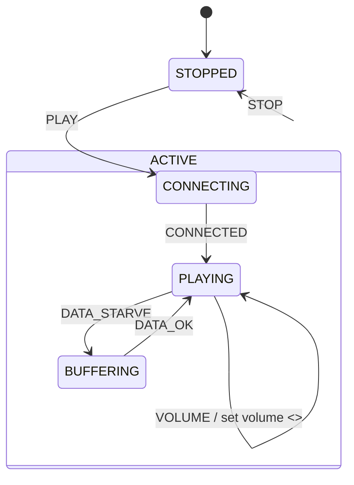

# 第 13c 课：内部转移与外部转移

本课只引入一个概念：**内部转移（Internal）与外部转移（External）**。

13b 已经规定：外部转移先退出旧状态，再跑箭上动作，再进入新状态。本课回答：有些事件 **不该** 退出再进入——音量就是。复用复合和进入 / 退出。不要引入历史、正交、伪状态。

---

## 1. Motivation

播放器在 `PLAYING` 里，用户拧音量。若把 `VOLUME` 做成普通转移：

```
exit PLAYING: stop rendering
action: set volume
entry PLAYING: start rendering
```

画面闪一下，解码器重启，用户只是想小声一点。状态名字没变，代价却是一次完整的离开再回来。

`STOP` 和 `DATA_STARVE` 相反：必须真正离开 `PLAYING`。停止还要离开 `ACTIVE`；缺数据要进入 `BUFFERING`，渲染必须停。

同一台机器、同一个框，两种箭：

- **外部**：走 13b 的顺序，会触发退出 / 进入
- **内部**：人还在这个框里，只跑动作，**不** 退出、**不** 重进

用在哪：播放中改音量 / 字幕、连接中忽略重复的「再连一下」、协议里的心跳保活。本课主例是音量。

---

## 2. Problem Description

同一台 13a/13b 播放器。新事件：`VOLUME`（教学里不带参数，每次把音量加 1 并打印）。

必须同时演示三条：

1. `PLAYING` + `VOLUME`：**内部**。打印 `internal VOLUME: volume=N`。禁止出现 `stop rendering` / `start rendering`
2. `PLAYING` + `DATA_STARVE`：**外部**。`exit PLAYING` → 转移动作 → `entry BUFFERING`
3. 活动中 + `STOP`：**外部**。退出叶子和 `ACTIVE`，进入 `STOPPED`

`CONNECTING` 上的 `VOLUME` 忽略（还没在播）。`BUFFERING` 上的 `VOLUME` 本课也忽略，以免冲淡对比。

---

## 3. Naive Solution

把音量也写成「转移到自己」：

```c
if (state == PLAYING && event == VOLUME) {
	fsm_transition(fsm, STATE_PLAYING, set_volume);
}
```

若 `fsm_transition` 按 13b 实现，LCA 是 `PLAYING` 自己。有的引擎把「目标等于当前」当成自环外部转移：先退出再进入 **同一个** 状态。渲染被重启。这正是要禁止的。

另一种乱法：所有事件都不走退出 / 进入，音量安全了，`STOP` 却关不掉渲染器。

朴素方案缺的是：在图上和代码上 **两种转移**，而不是一种转移加特殊情况。

---

## 4. FSM Solution

定义（本课只需这两句）：

> 外部转移：离开源状态（及需要离开的父状态），再进入目标。走 13b 的顺序。  
> 内部转移：源状态不退出、不重进；只运行动作；当前叶子不变。

自环外部转移（画成从框指向自己的箭，且是外部）**会** 退出再进入。内部转移在 UML 里通常画在框 **内部**，没有出框的箭头。

本课：

```
internal(action):
    action()
    /* current unchanged, no exit, no enter */

external(target, action):
    exit up to LCA
    action()
    enter down to target
    current <- target
```

`VOLUME` 走 `internal`。`STOP`、`DATA_STARVE`、`DATA_OK`、`PLAY`、`CONNECTED` 走 `external`。

架构在 13b 上加一个函数：`fsm_internal`。

---

## 5. State Diagram



Mermaid 很难区分内 / 外。用 ASCII 把内部箭画在框里：

```
+----------------------------------+
| PLAYING                          |
|  entry: start rendering          |
|  exit:  stop rendering           |
|                                  |
|   VOLUME / volume++   (internal) |
+----------------------------------+
        |  ^
        |  | DATA_OK (external)
        v  |
   BUFFERING
```

`VOLUME` 不穿过框的边。`DATA_STARVE` 穿过。`STOP` 穿过 `ACTIVE` 的边。

---

## 6. State Table

| Current State | Event | Guard | Kind | Action | Next State | Entry/Exit |
|---------------|-------|-------|------|--------|------------|------------|
| PLAYING | VOLUME | — | internal | volume++ | PLAYING | **无** |
| PLAYING | DATA_STARVE | — | external | wait data | BUFFERING | exit PLAYING；enter BUFFERING |
| BUFFERING | DATA_OK | — | external | resume | PLAYING | exit BUFFERING；enter PLAYING |
| ACTIVE 任一子 | STOP | — | external | stop session | STOPPED | exit 叶子, ACTIVE；enter STOPPED |
| STOPPED | PLAY | — | external | start session | CONNECTING | exit STOPPED；enter ACTIVE, CONNECTING |
| CONNECTING | CONNECTED | — | external | — | PLAYING | exit CONNECTING；enter PLAYING |
| CONNECTING | VOLUME | — | — | （无） | CONNECTING | 无 |
| BUFFERING | VOLUME | — | — | （无） | BUFFERING | 无 |

读表：`Kind` 是本课新列。下一状态相同 **不足以** 判断是内部：自环外部也会下一状态相同，但会进出。

---

## 7. Event Flow

```
time -->

[ STOPPED ] --PLAY (external)--> [ ACTIVE/CONNECTING ]
    --CONNECTED (external)--> [ ACTIVE/PLAYING ]
    --VOLUME (internal)--> [ ACTIVE/PLAYING ]   volume=1, no exit
    --VOLUME (internal)--> [ ACTIVE/PLAYING ]   volume=2, no exit
    --DATA_STARVE (external)--> [ ACTIVE/BUFFERING ]
        exit PLAYING: stop rendering
    --STOP (external)--> [ STOPPED ]
        exit BUFFERING, exit ACTIVE
```

调试时对照：两次 `VOLUME` 之间不得出现 `stop rendering`。若出现，你把内部做成了自环外部。

---

## 8. Implementation

运行：

```bash
cc -std=c11 -Wall -Wextra -o player_hsm code/c/player_hsm.c && ./player_hsm
c++ -std=c++17 -Wall -Wextra -o player_hsm code/cpp/player_hsm.cpp && ./player_hsm
python3 code/python/player_hsm.py
```

### 伪代码

```
dispatch(VOLUME) when current is PLAYING:
    volume <- volume + 1
    print internal, volume
    return

dispatch(DATA_STARVE) when current is PLAYING:
    external(BUFFERING, wait_data)

dispatch(STOP) when in ACTIVE:
    external(STOPPED, stop_session)
```

C / C++ / Python 见 `code/`。轨迹必须连续出现两行 `internal VOLUME` 且中间没有 `exit PLAYING`，随后 `DATA_STARVE` 才出现 `stop rendering`。

实现要点：

- `fsm_internal` 不得调用 `exit_up` / `enter_down`
- 不要用 `fsm_transition(fsm, STATE_PLAYING, ...)` 实现音量
- `volume` 是 `Fsm` 数据，不是状态
- 自包含，不链 `engine/`

---

## 9. Design Discussion

三种「下一状态还是自己」：

| | 内部转移 | 自环外部转移 | 忽略事件 |
|--|----------|--------------|----------|
| 退出 / 进入 | 否 | 是 | 否 |
| 动作 | 有 | 有 | 无 |
| 本课例子 | VOLUME | （不演示；若演示会重启渲染） | CONNECTING 上的 VOLUME |

什么时候必须外部：

- 要停的资源挂在退出上（渲染、套接字）
- 目标是另一个叶子
- 要离开父盒子（`STOP`）

什么时候必须内部：

- 调整本状态的数据（音量、字幕轨）
- 心跳、统计加一
- 重复请求的「已经在做了」应答，且不能重启工作

替代：

- 音量不用状态机，直接改字段：小程序可以。一旦音量策略依赖「仅 PLAYING 可调」，内部转移把这条规则留在表里
- 把音量做成独立对象：过早拆分；本课仍是一台播放器

取舍：教学音量没有上限和静音键。工业上内部转移里也不要再 `dispatch`，避免重入。

---

## 10. Common Mistakes

初学者：

- `transition(self)` 当内部，渲染闪断
- `STOP` 也写成内部，渲染器永不关
- 在内部转移里改 `current`，把它做成了偷偷摸摸的外部
- 以为「下一状态相同」就是内部

工业上：

- 配置热更新做成外部，整段会话重建
- 心跳做成外部，协议计数器被进入动作清零
- 文档写 internal，代码走自环外部，图和实现分家

---

## 11. Refactoring

13d 会问：离开 `ACTIVE` 再 `PLAY`，应该回到默认的 `CONNECTING`，还是回到离开前的叶子？那是历史，不是内部转移。内部转移从不离开；历史是离开之后怎么回来。

不要在本课给 `ACTIVE` 加 `H`。

---

## 12. Exercise

**容易**

在 `PLAYING` 增加内部事件 `MUTE`：只翻转 `muted` 标志并打印，不得出现渲染进出。

**中等**

`BUFFERING` 上的 `VOLUME` 也改成内部（缓冲时也能调音量）。说明：为什么这仍不该变成外部，以及为什么不必进入 `PLAYING`。

**挑战**

画一张图：同一框上同时有内部 `VOLUME` 和自环外部 `RELOAD`（重载解码器，必须停再开）。用本课的表解释两者打印差异。

---

## 13. Summary

- 内部转移：动作在，退出 / 进入不在，叶子不变
- 外部转移：走 13b 顺序；`STOP` 与 `DATA_STARVE` 都是外部
- 下一状态相同 ≠ 内部；自环外部会重启框上的进入 / 退出
- 音量是数据，用内部转移改；不要重启渲染器

下一课：离开 `ACTIVE` 再回来。新概念是 **浅历史与深历史**。
