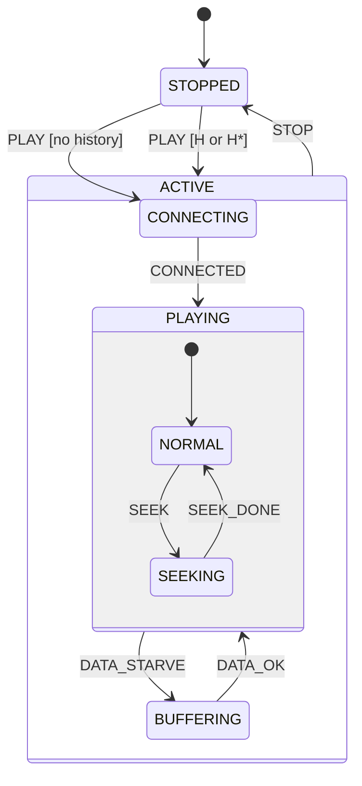

# 第 13d 课：浅历史与深历史

本课只引入一个概念：**历史（History）**——浅历史 `H` 与深历史 `H*`。

13a 的 `PLAY` 总是落到 `CONNECTING`。这是「盒子的默认子状态」。本课问：用户按停止再按播放，应不应该回到离开 `ACTIVE` 之前的那个叶子？

为了让浅 / 深的差别看得见，`PLAYING` 再收一层：`NORMAL` 与 `SEEKING`。复用复合、进入 / 退出。正交和伪状态仍不要。

---

## 1. Motivation

电话打断播放：你在 Seek 进度条中间，会话被停掉。再按播放：

- **无历史**：从 `CONNECTING` 重新握手。安全，慢，进度条状态丢了
- **浅历史 H**：记得 `ACTIVE` 上次的直接孩子是 `PLAYING`（不是 `BUFFERING`），但 **不** 记得 `PLAYING` 里面是 `SEEKING`。回来停在 `PLAYING` 的默认子状态 `NORMAL`
- **深历史 H\***：连 `PLAYING.SEEKING` 一起记。回来还在 Seek

三种都合法，取决于产品。HSM 发明历史，是为了不把「上次在哪」乘进扁平枚举（`LastWasSeekingThenStopped`）。

用在哪：UI 离开再回来、协议暂停后再恢复、播放器中断。本课三种模式都跑同一条「进到 SEEKING 再 STOP 再 PLAY」的轨迹。

---

## 2. Problem Description

结构（相对 13a 多一层）：

```
STOPPED
ACTIVE
  CONNECTING
  PLAYING          （现在也是复合）
    NORMAL
    SEEKING
  BUFFERING
```

事件：`PLAY`、`STOP`、`CONNECTED`、`DATA_STARVE`、`DATA_OK`、`SEEK`、`SEEK_DONE`。

`PLAY` 从 `STOPPED` 回来时，按 `Fsm.mode`：

| 模式 | 行为 |
|------|------|
| 无历史 | 永远进 `CONNECTING` |
| 浅历史 H | 恢复 `ACTIVE` 的直接孩子。若孩子是 `PLAYING`，再进它的 **默认** `NORMAL`，忽略更里层 |
| 深历史 H* | 恢复到离开时的叶子。若当时在 `SEEKING`，回来仍是 `SEEKING` |

实现用两个显式槽，不是完整 UML 引擎：

- `active_hist`：`ACTIVE` 上次的直接孩子（`CONNECTING` / `PLAYING` / `BUFFERING`）
- `playing_hist`：`PLAYING` 上次的直接孩子（`NORMAL` / `SEEKING`）

离开时写入，`PLAY` 时按模式读取。

---

## 3. Naive Solution

扁平机用状态名记住「上次」：

```c
enum { STOPPED_FROM_SEEK, STOPPED_FROM_NORMAL, STOPPED_FROM_BUF, ... };
```

或者一堆布尔 `was_seeking`、`was_buffering`。停止变成许多终点，播放要从每个终点各画一支箭。13a 的爆炸换了一种写法回来。

另一种乱法：只有一个槽，既当浅又当深，浅历史却恢复了 `SEEKING`。图上写 `H`，行为是 `H*`，读者无法对图。

朴素方案缺的是：**按层记忆**。浅只看一层，深沿槽往下走。

---

## 4. FSM Solution

定义：

> 浅历史 H：恢复该复合状态 **上次的直接子状态**。若该子状态自己还是复合，则进入它的默认子状态，不恢复更深层。  
> 深历史 H\*：从该复合状态沿各层历史槽走到 **上次的叶子**。

无历史：进入复合时永远走默认子状态。`ACTIVE` 的默认是 `CONNECTING`；`PLAYING` 的默认是 `NORMAL`。

离开时（退出路径上）写入：

```
exit NORMAL or SEEKING  -> playing_hist <- 这个叶子
exit PLAYING            -> active_hist  <- PLAYING
exit CONNECTING         -> active_hist  <- CONNECTING
exit BUFFERING          -> active_hist  <- BUFFERING
```

`PLAY` 恢复：

```
NONE:    target <- CONNECTING
H:       child <- active_hist or CONNECTING
         if child is PLAYING: target <- NORMAL
         else target <- child
H*:      child <- active_hist or CONNECTING
         if child is PLAYING: target <- playing_hist or NORMAL
         else target <- child
```

然后对 `target` 做一次 13b 的外部转移（从 `STOPPED` 进入）。

架构：`Fsm { state, mode, active_hist, playing_hist }`。不要 `#include` 引擎；引擎里的 `history` 指针是同一想法的可带走写法。

---

## 5. State Diagram



ASCII 把 `H` / `H*` 画在 `ACTIVE` 框里：

```
+-------------------------------------+
| ACTIVE                         H H* |
|                                     |
|  CONNECTING                         |
|                                     |
|  +------------------+               |
|  | PLAYING          |               |
|  |   NORMAL         |               |
|  |   SEEKING        |               |
|  +------------------+               |
|                                     |
|  BUFFERING                          |
+-------------------------------------+
         ^
         | STOP 写下 history
         v
      STOPPED --PLAY--> 按模式恢复或走默认
```

浅：只读 `ACTIVE` 框上的 `H`（一层）。深：读 `H*`，必要时再读 `PLAYING` 的槽。

---

## 6. State Table

| Current | Event | Guard | Action | Next（叶子） |
|---------|-------|-------|--------|--------------|
| STOPPED | PLAY | mode=NONE 或无槽 | — | CONNECTING |
| STOPPED | PLAY | mode=H 且 active_hist=PLAYING | — | NORMAL |
| STOPPED | PLAY | mode=H 且 active_hist=BUFFERING | — | BUFFERING |
| STOPPED | PLAY | mode=H* 且 active_hist=PLAYING 且 playing_hist=SEEKING | — | SEEKING |
| CONNECTING | CONNECTED | — | — | NORMAL |
| NORMAL | SEEK | — | — | SEEKING |
| SEEKING | SEEK_DONE | — | — | NORMAL |
| NORMAL | DATA_STARVE | — | — | BUFFERING |
| BUFFERING | DATA_OK | — | — | NORMAL |
| ACTIVE 任一叶子 | STOP | — | 写历史槽 | STOPPED |

`CONNECTED` 进入 `PLAYING` 的默认 `NORMAL`，不是历史恢复（还没离开过 `ACTIVE`）。

---

## 7. Event Flow

三条对照。准备阶段相同：`PLAY → CONNECTED → SEEK`，叶子在 `SEEKING`，然后 `STOP`。

```
无历史:
    [ SEEKING ] --STOP--> [ STOPPED ] --PLAY--> [ CONNECTING ]

浅历史 H:
    [ SEEKING ] --STOP--> [ STOPPED ] --PLAY--> [ PLAYING/NORMAL ]
    （记得 PLAYING，不记得 SEEKING）

深历史 H*:
    [ SEEKING ] --STOP--> [ STOPPED ] --PLAY--> [ PLAYING/SEEKING ]
```

调试时打印两个槽和模式。若浅历史进了 `SEEKING`，槽用错了。

---

## 8. Implementation

运行：

```bash
cc -std=c11 -Wall -Wextra -o player_hsm code/c/player_hsm.c && ./player_hsm
c++ -std=c++17 -Wall -Wextra -o player_hsm code/cpp/player_hsm.cpp && ./player_hsm
python3 code/python/player_hsm.py
```

### 伪代码

```
record on exit(s):
    if parent(s) is PLAYING: playing_hist <- s
    if parent(s) is ACTIVE:  active_hist <- s
    if s is PLAYING:         active_hist <- PLAYING

resume_leaf(mode):
    if mode is NONE or active_hist empty: return CONNECTING
    if active_hist is PLAYING:
        if mode is H:  return NORMAL
        if mode is H*: return playing_hist or NORMAL
    return active_hist   /* CONNECTING or BUFFERING */

PLAY from STOPPED:
    external(resume_leaf(mode))
```

C / C++ / Python 见 `code/`。`main` 用同一事件序列跑三种模式。轨迹必须出现三行不同的恢复目标：`CONNECTING`、`NORMAL`、`SEEKING`。

实现要点：

- 当前状态仍是叶子（`NORMAL` / `SEEKING`，不是 `PLAYING`）
- 浅历史禁止读取 `playing_hist`
- 进入 / 退出仍按 13b 顺序，恢复是一次外部转移
- 教学用字段，不链 `engine/`；引擎的 `hsm_shallow_history` / `hsm_deep_history` 是同一对函数

---

## 9. Design Discussion

历史与内部转移（13c）：

| | 内部转移 | 历史 |
|--|----------|------|
| 人还在框里吗 | 是 | 否，已经离开过 |
| 改什么 | 当前数据 | 回来时的目标叶子 |
| 音量 | 内部 | 不是历史 |

历史与默认子状态：

- 默认：第一次进入，或无历史
- `H`：默认被「上次的直接孩子」覆盖；孩子内部仍用默认
- `H*`：每一层都可以覆盖默认

什么时候用浅：用户只关心「刚才在播还是在缓冲」，不关心 Seek 半截。什么时候用深：半截工作必须接上（Seek、向导第 3 步、传输偏移）。什么时候不用：安全会话应重新握手——本课的无历史。

替代：

- 上下文里存 `last_leaf` 一个字段：能模拟深历史，图画不出 `H` / `H*` 的分层
- 停止时不拆 `ACTIVE`，只做内部「静音」：那是产品选择，不是历史；历史假定盒子已经退出

取舍：教学槽在 `STOP` 时写入。真实 UML 在每次离开子状态时更新。本课在 `exit_up` 里写槽，两者一致。

---

## 10. Common Mistakes

初学者：

- 浅历史读了 `playing_hist`，`H` 与 `H*` 轨迹相同
- 忘记在退出时写槽，`PLAY` 永远走默认
- 把 `PLAYING` 当成可停靠叶子，历史无法指向「盒子」
- 恢复时不走进入动作，渲染器没开

工业上：

- 深历史恢复到已失效的会话（套接字已关），应先走 `CONNECTING` 再深恢复播放位置——位置是数据，不是状态
- 历史槽在成功路径上不更新，永远回到第一次的叶子

---

## 11. Refactoring

13e 会在 `ACTIVE` 里并排放两列（播放与无线）。历史按区域各记各的，不要把两列乘成一个槽。本课先只有一列，外加 `PLAYING` 内部一层。

不要在本课画虚线区域。

---

## 12. Exercise

**容易**

无历史模式下，从 `BUFFERING` 停止再 `PLAY`。确认仍进 `CONNECTING`，而不是缓冲。

**中等**

浅历史下走 `PLAY → CONNECTED → DATA_STARVE → STOP → PLAY`。目标应是 `BUFFERING`。说明为什么这里浅和深结果相同（`BUFFERING` 没有更深的孩子）。

**挑战**

给 `PLAYING` 再加叶子 `PAUSED`。指出：浅历史从 `PAUSED` 停止再播放，会进 `NORMAL` 还是 `PAUSED`？深历史呢？先写槽，再改代码。

---

## 13. Summary

- 无历史：进入盒子走默认子状态（`ACTIVE` → `CONNECTING`）
- 浅历史 H：恢复直接孩子；孩子若是复合，再走 **它的默认**
- 深历史 H*：沿各层槽恢复到叶子（`PLAYING.SEEKING`）
- 用每层一个槽实现；不要把「上次」乘进扁平枚举

下一课：`ACTIVE` 里两件独立的事同时为真。新概念是 **正交区域**。
