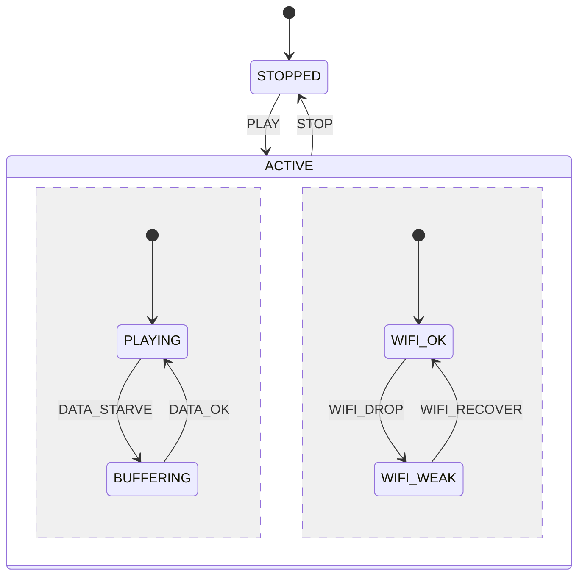

# 第 13e 课：正交区域

本课只引入一个概念：**正交区域（Orthogonal Regions）**——一个盒子里并排两列，各有各的当前子状态。

13a–13d 的 `ACTIVE` 里同一时刻只有一个叶子。本课的 `ACTIVE` 里同时有：播放列（`PLAYING` / `BUFFERING`）和无线列（`WIFI_OK` / `WIFI_WEAK`）。缓冲不会拆掉无线子状态，信号变弱也不会拆掉播放子状态。

必须和第 10 课分开：第 10 课是 **两台对象、两台扁平机、互相投递**。本课是 **一个对象、一个外层状态、两根内层指针**。

---

## 1. Motivation

第 07 课和第 12 课的特征若乘进扁平枚举：

```
PLAYING_WIFI_OK, PLAYING_WIFI_WEAK, BUFFERING_WIFI_OK, BUFFERING_WIFI_WEAK
```

四个名字，`STOP` 四支箭，再加 Seek 再乘一倍。13a 用盒子收 `STOP`；盒子里若仍只许一个叶子，播放和无线还是要排队：一缓冲就假装 Wi-Fi 没了，或一掉信号就假装不在播。

这两件事 **同时为真**，又 **很少同步变化**。正交区域说：

> 外层仍是「活动中」。里面两列各自有当前状态。事件通常只改其中一列。

用在哪：播放 + 网络质量、第 12 课省电与数据面、控制面与数据面并排。本课用播放器 + Wi-Fi 质量，回看第 12 课的直觉，但不实现扫描机。

---

## 2. Problem Description

```
STOPPED
ACTIVE
  区域 A（Playback）: PLAYING | BUFFERING
  区域 B（Network）:  WIFI_OK | WIFI_WEAK
```

事件：

- `PLAY`：进入 `ACTIVE`，两列同时落到默认（`PLAYING` + `WIFI_OK`）
- `DATA_STARVE` / `DATA_OK`：只改区域 A
- `WIFI_DROP` / `WIFI_RECOVER`：只改区域 B
- `STOP`：离开 `ACTIVE`，两列一起停

期望打印：每次事件后同时报 `play=` 和 `net=`。`DATA_STARVE` 之后 `net` 仍是原来的值；`WIFI_DROP` 之后 `play` 仍是原来的值。

本课为了让两列同时亮起来，进入 `ACTIVE` 时不再先停在单独的 `CONNECTING` 叶子（那是 13a 的单列故事）。连接已经发生，焦点在「并排」。

---

## 3. Naive Solution

乘积枚举：

```c
enum { PLAYING_WIFI_OK, PLAYING_WIFI_WEAK, BUFFERING_WIFI_OK, ... };
```

`WIFI_DROP` 要写两行（从两个 PLAYING_* 出发）。漏一行，某种播放局面下信号永远不变。

两台对象（第 10 课手法用在这里）：

```c
Fsm playback;
Fsm wifi;
/* 调用者每次把事件投给两台，或自己记得该投谁 */
```

能跑，而且第 10 课在「接口 vs 邻居」这种 **不同生命期、不同身份** 时是对的。播放器的「活动中」却是 **同一生命期**：停止必须两列一起停。拆成两台对象后，`STOP` 要由调用者同步两台；忘一台，无线质量机还在 `WIFI_WEAK` 里跑。

朴素方案缺的是：外层一个盒子表达「一起活、一起死」，内层两列表达「各自变化」。

---

## 4. FSM Solution

正交区域的定义（本课只需这句）：

> 一个复合状态可以划分成若干区域。进入该复合状态时，每个区域都进入自己的当前子状态。区域之间独立变化，直到离开这个复合状态。

它 **不是**：

- 两台 `Fsm` 对象（第 10 课）
- 一个叶子（13a–13d）
- 线程或真正并行。教学仍是单线程 `dispatch`，一次事件改零个或一个区域

`Fsm`：

```
outer: STOPPED | ACTIVE
play:  PLAYING | BUFFERING     /* 仅 ACTIVE 有意义 */
net:   WIFI_OK | WIFI_WEAK     /* 仅 ACTIVE 有意义 */
```

`STOP` 仍是 13a 的一支父箭：`outer=STOPPED`，两列清空。进入 / 退出（13b）挂在外层和各列自己的叶子上：改 `play` 时不要跑 `exit WIFI_*`。

和第 10 课对照：

| | 第 10 课 OSPF | 本课正交 |
|--|---------------|----------|
| 对象个数 | 2（ISM、NSM） | 1（播放器） |
| 外层状态 | 无共同盒子 | `ACTIVE` |
| 停止 | 接口倒下再 `KILL_NBR` | 一支 `STOP` 同时结束两列 |
| 谁投递 | 一台的动作调用另一台 `dispatch` | 同一 `dispatch` 看事件改哪一列 |
| 适用 | 不同身份、可单独死 | 同一活动里的并列局面 |

---

## 5. State Diagram



`--` 是 Mermaid 里「区域分隔」的习惯画法。ASCII：

```
+--------------------------------------+
| ACTIVE                               |
|  +----------------+ +--------------+ |
|  | Playback       | | Network      | |
|  | PLAYING        | | WIFI_OK      | |
|  | BUFFERING      | | WIFI_WEAK    | |
|  +----------------+ +--------------+ |
+--------------------------------------+
         ^ STOP
         |
      STOPPED
```

两列之间没有箭。不要画 `BUFFERING --> WIFI_WEAK`。

---

## 6. State Table

当前状态写成对 `(play, net)`，仅当 `outer=ACTIVE`。

| Current (play, net) | Event | Guard | Action | Next (play, net) |
|---------------------|-------|-------|--------|------------------|
| STOPPED | PLAY | — | enter ACTIVE, both defaults | (PLAYING, WIFI_OK) |
| (PLAYING, *) | DATA_STARVE | — | exit PLAYING, enter BUFFERING | (BUFFERING, 同) |
| (BUFFERING, *) | DATA_OK | — | exit BUFFERING, enter PLAYING | (PLAYING, 同) |
| (*, WIFI_OK) | WIFI_DROP | — | exit WIFI_OK, enter WIFI_WEAK | (同, WIFI_WEAK) |
| (*, WIFI_WEAK) | WIFI_RECOVER | — | exit WIFI_WEAK, enter WIFI_OK | (同, WIFI_OK) |
| ACTIVE | STOP | — | exit both regions, exit ACTIVE | STOPPED |
| (PLAYING, *) | DATA_OK | — | （无） | 保持 |
| (*, WIFI_OK) | WIFI_RECOVER | — | （无） | 保持 |

`*` 表示「这一列任意」。这正是正交的收益：表行按列写，不按乘积写。

---

## 7. Event Flow

```
time -->

[ STOPPED ]
    --PLAY--> [ ACTIVE | play=PLAYING net=WIFI_OK ]
    --DATA_STARVE--> [ ACTIVE | play=BUFFERING net=WIFI_OK ]
    --WIFI_DROP--> [ ACTIVE | play=BUFFERING net=WIFI_WEAK ]
    --DATA_OK--> [ ACTIVE | play=PLAYING net=WIFI_WEAK ]
    --WIFI_RECOVER--> [ ACTIVE | play=PLAYING net=WIFI_OK ]
    --STOP--> [ STOPPED ]
```

执行顺序要证明两件独立：

1. 缓冲时掉信号：`play` 仍是 `BUFFERING`
2. 弱网时数据恢复：`net` 仍是 `WIFI_WEAK`

---

## 8. Implementation

运行：

```bash
cc -std=c11 -Wall -Wextra -o player_hsm code/c/player_hsm.c && ./player_hsm
c++ -std=c++17 -Wall -Wextra -o player_hsm code/cpp/player_hsm.cpp && ./player_hsm
python3 code/python/player_hsm.py
```

### 伪代码

```
Fsm { outer, play, net }

enter_active:
    outer <- ACTIVE
    play <- PLAYING
    net <- WIFI_OK
    entry ACTIVE, PLAYING, WIFI_OK

dispatch(DATA_STARVE) if outer is ACTIVE and play is PLAYING:
    exit PLAYING
    play <- BUFFERING
    entry BUFFERING
    /* net untouched */

dispatch(WIFI_DROP) if outer is ACTIVE and net is WIFI_OK:
    exit WIFI_OK
    net <- WIFI_WEAK
    entry WIFI_WEAK
    /* play untouched */

dispatch(STOP) if outer is ACTIVE:
    exit play leaf, exit net leaf, exit ACTIVE
    outer <- STOPPED
```

C / C++ / Python 见 `code/`。轨迹必须在 `DATA_STARVE` 后仍打印 `net=WIFI_OK`，在 `WIFI_DROP` 后仍打印 `play=BUFFERING`。

实现要点：

- 一个 `Fsm`，两根区域字段，不要 `Fsm play; Fsm net;`
- 改一列时不要调用另一列的退出
- 打印成对状态，否则看不出正交
- 自包含，不链 `engine/`。引擎仍是单 `current` 叶子；正交用第二根指针扩展，本课手写两字段更清楚

---

## 9. Design Discussion

正交 vs 第 10 课再读一遍：

第 10 课的接口机可以在邻居已死之后仍为 `POINT_TO_POINT`，也可以接口先死再杀邻居。两台机的生命期 **不对齐**，所以是两个对象。

本课两列的生命期 **对齐**：没有「只活动播放、无线列属于另一台播放器」这种故事。`ACTIVE` 是共同外层。

正交 vs 扁平乘积：

- 乘积：事件按组合复制
- 正交：事件按列写，组合由运行时的一对字段表达（第 10 课用两个对象表达组合；本课用一个对象的两个字段）

正交 vs 历史：

- 历史：离开盒子再回来，恢复 **一列** 里上次的深度
- 正交：人不离开盒子，两列同时在
- 两列可以各有各的历史槽；本课不演示，避免一次两概念

替代：

- 继续乘积：四五个组合还能忍，再加一列就炸
- 两台对象 + 调用者同步 `STOP`：能跑，停止路径容易漏
- 真正的两个线程：那是并发，不是正交。正交是图上的并排，调度仍可以是单线程

取舍：教学 Wi-Fi 质量不是第 12 课的扫描机。`WIFI_WEAK` 只表示「活动中信号差」，不触发重新扫描。重新扫描会离开 `ACTIVE`，变成 13a 的父转移，不是区域内部的箭。

---

## 10. Common Mistakes

初学者：

- 做成 `Fsm playback` 和 `Fsm wifi` 两个对象，却称为正交
- `DATA_STARVE` 时把 `net` 重置成默认
- 只打印一列，批改看不见独立性
- 在两列之间画转移（缓冲导致掉线）——那是产品策略，应写成动作去投递 `WIFI_DROP`，不是把两列焊成一张单列图

工业上：

- 正交列越加越多，`dispatch` 变成「所有事件的总开关」，该拆对象时不拆（第 10 课）
- 日志不打成对状态，事故里只看见播放，看不见当时已经弱网

---

## 11. Refactoring

13f 会用伪状态：`PLAY` 上的动态分支、进入两列的叉、两列都就绪时的汇合、以及多支箭画到 `STOPPED` 的合并。本课先把两列跑起来，进入时直接落到默认，不要画叉。

并发隔离（许多播放器实例）仍是第 14 课。正交不是多线程。

---

## 12. Exercise

**容易**

增加区域 A 的 `PAUSED`。`PAUSE` 只改 `play`。确认 `net` 不变。

**中等**

弱网时 `DATA_STARVE`：仍只改 `play`。不要把「弱网所以缓冲」画成两列之间的箭；若要自动缓冲，应在 `WIFI_DROP` 的动作里再投递 `DATA_STARVE`（同一对象、两次处理）。

**挑战**

用第 10 课的两台对象重写本例，列出 `STOP` 时调用者必须做的两步。说明你为什么在「同一活动」里更想用正交，在「接口 vs 邻居」里更想用两台机。

---

## 13. Summary

- 正交：一个外层状态，多列独立当前子状态
- 一列变化不得拆掉另一列
- 不是第 10 课的两台对象；生命期对齐用盒子，生命期不对齐用多机
- 表按列写，不按乘积写

下一课：图上的菱形、叉、汇合。新概念是 **伪状态** Choice / Fork / Join / Junction。
