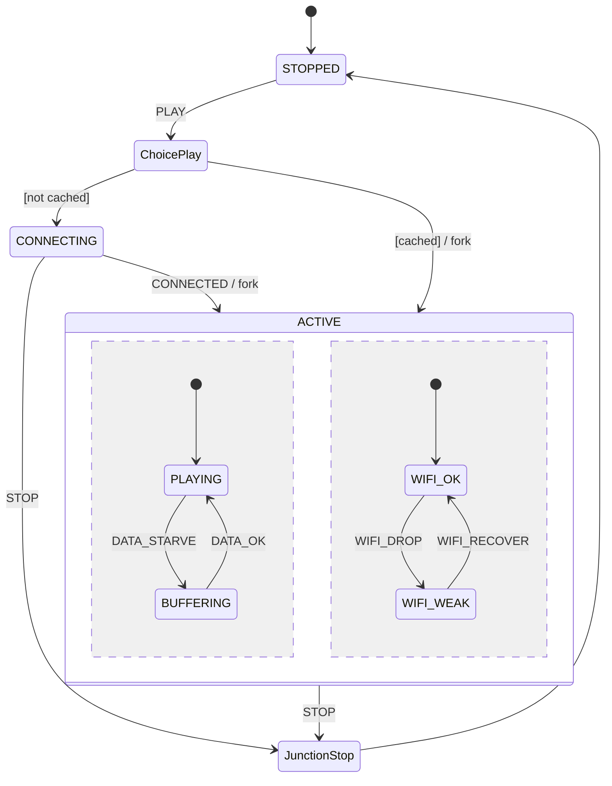

# 第 13f 课：伪状态 —— Choice / Fork / Join / Junction

本课只引入一个概念：**伪状态（Pseudostate）**。它们出现在图上，但 **不是** 机器可以「待着」的局面。当前局面仍然是叶子（外加 13e 的两列）。

四个符号一次讲清，因为它们成套出现：动态分支、画图合并、进入两列、等待两列就绪。主例仍是同一台播放器，并接上 13e 的两列。

并发隔离（许多对象、邮箱）只在本课预告第 14 课，不实现。

---

## 1. Motivation

图上常有四种「不是状态的点」：

- `PLAY` 之后：有缓存就直接播，没有就先连——**运行时**才知道走哪条。这是 **Choice**
- 进入 `ACTIVE` 时两列要一起亮——**Fork**
- 播放列已是 `PLAYING` **并且** 无线列已是 `WIFI_OK`，才对外宣布 `STARTED`——**Join**
- 从 `CONNECTING` 停止、从 `ACTIVE` 停止，两支箭其实去同一个 `STOPPED`——**Junction**（画图合并，没有额外等待）

若把它们画成真状态（`CHOOSING`、`FORKING`、`WAITING_BOTH`），枚举里会出现机器从不停留的名字，调试时「当前状态」会骗人。

伪状态是图的语法，代码里是 `if`、同时赋值、以及「两列都就绪则打印一次」。

---

## 2. Problem Description

结构：

```
STOPPED
CONNECTING              （Choice 的「未缓存」支）
ACTIVE                  （Fork 之后的正交盒子）
  play: PLAYING | BUFFERING
  net:  WIFI_OK | WIFI_WEAK
```

`Fsm.cached`：教学布尔，表示媒体是否已在本地。

必须演示：

1. **Choice**：`PLAY` 时若 `cached` 则进入两列（直接播）；否则进 `CONNECTING`
2. **Fork**：进入 `ACTIVE` 时同时点亮两列。未缓存路径在 `CONNECTED` 时叉开；为了让 Join 看得见，未缓存路径故意把网络列先放到 `WIFI_WEAK`
3. **Join**：仅当 `play==PLAYING` 且 `net==WIFI_OK` 时打印 `join: STARTED`（每段活动一次）
4. **Junction**：`CONNECTING` 上的 `STOP` 与 `ACTIVE` 上的 `STOP` 合并到 `STOPPED`，打印同一句 `junction: STOPPED`，中间没有「等待」

没有真实缓存文件。`main` 先跑 `cached=0`，再跑 `cached=1`。

---

## 3. Naive Solution

四种乱法：

```c
enum { CHOOSING, FORKING, JOIN_WAIT, ... };
```

机器从不在这些名字上停留一个事件周期，日志却显示它们。

把 Choice 写成两个状态 `PLAY_CACHED` / `PLAY_UNCACHED`：`PLAY` 事件被拆成两种用户动作，其实用户只按了一个键。

Join 用 `sleep` 等另一列：第 06 课禁止的阻塞，而且正交列是同一 `dispatch` 里的字段，根本不必睡。

Junction 做成「先进入 `MERGING` 再进 `STOPPED`」：多一个空状态，没有新信息。

朴素方案缺的是：承认这些点 **没有停留语义**。

---

## 4. FSM Solution

四个定义（本课）：

| 伪状态 | 图上 | 运行时 | 本课代码形状 |
|--------|------|--------|--------------|
| Choice | 菱形，出箭带监护 | **进入菱形的那一刻** 算监护 | `if (cached) fork_ok(); else CONNECTING;` |
| Junction | 黑点，多进多出 | 不算监护、不等待，只是箭的接头 | `STOP` 两处调用同一 `to_stopped()` |
| Fork | 短粗杠，一进多出 | 同时进入多个区域 | `play=...; net=...;` 一次完成 |
| Join | 短粗杠，多进一出 | **等到** 各区域到达指定状态 | `if (play ready && net ready) STARTED` |

Choice 与第 04 课 Guard 的差别：监护可以画在任何转移上；Choice 是「多条出路挤在一个决策点」，监护在 **到达该点时** 求值。本课 `cached` 在按 `PLAY` 时读，不是在进入 `STOPPED` 时预先绑死。

Junction 与 Join 的差别：Junction **不等**。Join **等** 各区域。把 Join 画成 Junction，会在另一列尚未就绪时就宣布 `STARTED`。

Fork 与「两次外部转移」：必须在同一次 `dispatch` 里点亮两列，中间不能穿插别的事件。

架构：13e 的 `outer` / `play` / `net`，加上 `cached` 和 `started`（Join 只宣布一次）。

---

## 5. State Diagram



Join 画在 `ACTIVE` 内部：两列都到「就绪」后射出 `STARTED`（本课用打印，不另加叶子）。

ASCII：

```
STOPPED --PLAY--> (C) --[not cached]--> CONNECTING --CONNECTED--> <fork>
                   |                                          |
                   +--[cached]------------------------------->+
                                                              v
                                              +---------------------------+
                                              | ACTIVE                    |
                                              |  PLAYING / BUFFERING      |
                                              |  WIFI_OK / WIFI_WEAK      |
                                              |  <join> both ready        |
                                              |      => STARTED           |
                                              +---------------------------+
                                                              |
CONNECTING --STOP--+                                          |
                   +---- (J) ----> STOPPED                    |
ACTIVE --STOP------+                                          |
```

`(C)` 是 Choice，`(J)` 是 Junction，`<fork>` / `<join>` 是杠。圆角框才是可停留状态。

---

## 6. State Table

| Current | Event | Guard / 伪状态 | Action | Next |
|---------|-------|----------------|--------|------|
| STOPPED | PLAY | Choice `[cached]` | fork 两列（默认就绪） | ACTIVE (PLAYING, WIFI_OK) 然后 Join |
| STOPPED | PLAY | Choice `[not cached]` | — | CONNECTING |
| CONNECTING | CONNECTED | Fork | play=PLAYING, net=WIFI_WEAK | ACTIVE；Join 尚不成立 |
| ACTIVE | WIFI_RECOVER | — | net=WIFI_OK | 同盒子；Join → STARTED |
| CONNECTING | STOP | Junction | — | STOPPED |
| ACTIVE | STOP | Junction | 退出两列 | STOPPED |
| ACTIVE | DATA_STARVE | — | 只改 play | ACTIVE |

Choice 的两行是同一事件、同一源状态，差别只在到达菱形时的监护。不要拆成两个 `PLAY` 事件。

---

## 7. Event Flow

```
time -->  cached=0

[ STOPPED ]
    --PLAY / choice not cached--> [ CONNECTING ]
    --CONNECTED / fork play=PLAYING net=WIFI_WEAK--> [ ACTIVE ]
        （Join 不成立：net 未就绪）
    --WIFI_RECOVER--> [ ACTIVE | WIFI_OK ]
        join: STARTED
    --STOP / junction--> [ STOPPED ]

time -->  cached=1

[ STOPPED ]
    --PLAY / choice cached / fork play=PLAYING net=WIFI_OK--> [ ACTIVE ]
        join: STARTED
    --STOP / junction--> [ STOPPED ]
```

第一条证明 Join **等待**；第二条证明 Choice 的另一支以及 Join 可以立刻成立。两条的 `STOP` 都打 `junction: STOPPED`。

---

## 8. Implementation

运行：

```bash
cc -std=c11 -Wall -Wextra -o player_hsm code/c/player_hsm.c && ./player_hsm
c++ -std=c++17 -Wall -Wextra -o player_hsm code/cpp/player_hsm.cpp && ./player_hsm
python3 code/python/player_hsm.py
```

### 伪代码

```
choice_on_play:
    print choice
    if cached: fork(PLAYING, WIFI_OK); maybe_join()
    else: outer <- CONNECTING

fork(play, net):
    print fork
    enter ACTIVE with those two leaves

maybe_join:
    if play is PLAYING and net is WIFI_OK and not started:
        print join STARTED
        started <- true

to_stopped:          /* junction target */
    print junction
    if in ACTIVE: exit both regions
    go STOPPED
    started <- false
```

C / C++ / Python 见 `code/`。轨迹必须出现单词 `choice`、`fork`、`join`、`junction`，并且未缓存路径上 `STARTED` 出现在 `WIFI_RECOVER` **之后**，不在 `CONNECTED` 当时。

实现要点：

- 伪状态没有 `state = CHOICE`
- Fork 在一次函数里写两列
- Join 是检查，不是 `sleep`
- Junction 是共同函数，不是中间状态
- 自包含，不链 `engine/`

---

## 9. Design Discussion

伪状态与真状态：真状态可以无限期停留（等下一个事件）。伪状态在处理 **当前这个事件** 的过程中就被走完。

Choice 与表驱动监护（第 04、08 课）：表的一格也可以带监护。Choice 适合「同一源、同一事件、多目标」挤在图中央，避免从 `STOPPED` 拉出许多平行箭。代码仍是 `if`。

Fork / Join 与第 10 课：第 10 课两台对象用事件缝协同，没有「同一盒子里的杠」。Fork / Join 属于 **一台对象内部的正交列**。不要用 Join 等待另一台对象——那是协议，应显式事件。

Junction 与 13a 父箭：`ACTIVE --STOP--> STOPPED` 已经是合并。Junction 允许 **再** 把 `CONNECTING --STOP-->` 画到同一个接头，图上少交叉。语义仍是「立即到 `STOPPED`」。

Statechart：本课补齐 13a 对照表里「HSM + 额外零件」的最后一块图上符号。复合、进入 / 退出、内 / 外、历史、正交、伪状态，合在一起才接近 Harel / UML 状态图。教学引擎只带走父指针、进入 / 退出、历史槽；Choice / Fork / Join 保持手写，以免一个通用调度器把本课变成框架说明书。

Actor（第 14 课预告）：

> 分层与伪状态解决的是 **一张图** 怎么画、怎么走。许多播放器同时活着、消息不能直接改对方字段，是 **并发隔离**。下一阶段用邮箱 + 每对象一台机。不要在本课开线程模拟 Fork。

替代：

- 全用手写 `if` 不画伪状态：能跑，图上决策点看不出来
- 生成式工具（SCXML 等）：工业上用，本课禁止当依赖

---

## 10. Common Mistakes

初学者：

- `state = CHOICE`，下一次 `TICK` 还停在菱形上
- `CONNECTED` 时先只设 `play`，等下一次事件再设 `net`——那不是 Fork
- Join 在 `net` 仍是 `WIFI_WEAK` 时打印 `STARTED`
- Junction 写成 Join，`STOP` 还要等无线列
- 用两个线程实现 Fork

工业上：

- Choice 的监护用过期数据（缓存标志在进菱形之前就被别的事件改掉且未重读）
- Join 条件写错成「任一列就绪」
- 图上是 Junction，实现却插入等待

---

## 11. Refactoring

第 13 课到此结束。可带走的骨架在 `engine/`：`parent`、`entry` / `exit`、`history` 槽。各课代码仍然不要 `#include` 它。

第 14 课把「一台机」变成「许多对象，每个有邮箱」。HSM 可以住在一个 Actor 里；Actor 不替代 HSM。

若你想把 Choice 收进表：增加一列监护函数，`PLAY` 两格。那是第 08 课手法，伪状态仍只存在于图。

---

## 12. Exercise

**容易**

把未缓存路径的 Fork 改成 `PLAYING` + `WIFI_OK`。确认 `STARTED` 出现在 `CONNECTED` 当时。说明你为什么弄丢了「Join 会等」的演示。

**中等**

`DATA_STARVE` 使 `play` 离开就绪。`started` 要不要清掉、下一次 `DATA_OK` 要不要再宣布？选一种产品语义并实现，写出你为什么不选另一种。

**挑战**

画一张只含 Junction 与只含 Join 的对照图：三支 `STOP` 合并，对比「两列都到 READY 才对外宣布」。指出哪一张图上的杠有等待语义。

---

## 13. Summary

- 伪状态不可停留；当前局面仍是叶子 / 区域对
- Choice：到达时算监护（有缓存直接播，否则连接）
- Fork：一次进入两列；Join：两列都就绪才 `STARTED`
- Junction：箭的接头，不等待；`STOP` 合并到 `STOPPED`
- 并发隔离是第 14 课，不要用线程冒充 Fork

第 13 课结束。下一阶段：Actor + 邮箱。
