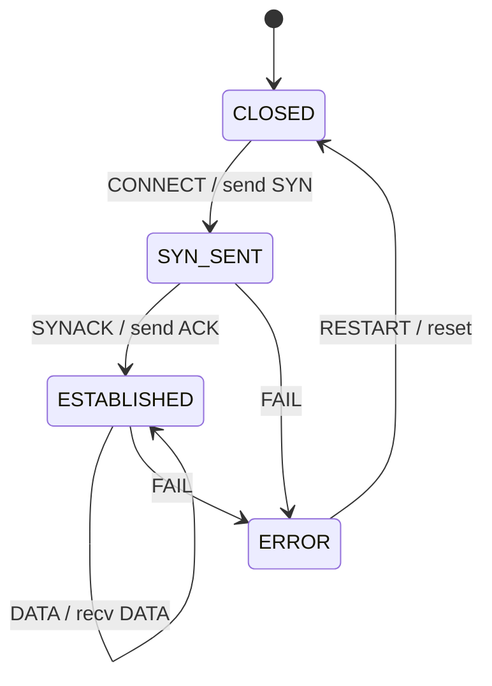

# 第 14a 课：Actor + Mailbox —— 每条连接是一个角色

本课把一组相关名字收成 **一个** 架构观念，不要把它们当成六门新课：

> **每条连接是一个角色（Actor）：隔离的状态 + 自己的邮箱（Mailbox）+ 单线程把它的 FSM 喂进去。**

邮箱就是这个角色的消息队列。调度器是一个很小的事件循环：轮询每个邮箱，每次只取出 **一条** 消息，调用该角色的 `fsm_dispatch`。角色之间 **禁止** 写对方的 `state` 字段，只能 `actor_send`。某一个角色的 FSM 进入 `ERROR` 时，监护者向 **那一个** 邮箱投递 `RESTART`；别的角色继续跑。

这不是 Akka，也不是分布式系统。这是大约五十行的教学运行时。FSM 本身仍是第 08 课那种扁平教学 TCP（再加一个失败态 `ERROR`）。

回顾已经会的：

- 第 08 课：一台连接机，`table[state][event]`
- 第 09 课：一台机前面有一个事件队列；`tick` 入队，循环出队再 `dispatch`
- 第 10 课：两台扁平机互相投递，但动作里 **直接调用** 对方的 `dispatch`（同一调用栈）
- 第 12 课：失败回到熟知状态
- 第 13 课：一台机内部把状态套起来（HSM）

本课新问题不是「格子怎么写」，也不是「状态怎么套」，而是：**N 条连接，每条自己的当前状态，彼此不得伸手去改。**

---

## 1. Motivation

第 08 课的 `main` 只有一台教学 TCP：

```c
Fsm tcp;
fsm_dispatch(&tcp, EVENT_APP_CONNECT);
```

真实连接管理器不是一台机。两条 TCP 会话同时存在：一条在 `ESTABLISHED` 收数据，另一条还在 `SYN_SENT`。若做成：

```c
conns[j].fsm.state = STATE_CLOSED; /* 在处理连接 i 的函数里 */
```

下一次排障你分不清：是对端发了 FIN，还是隔壁连接的代码误改了字段。

第 09 课的队列解决的是「这一台机的输入从哪来」。第 10 课解决的是「两台职责不同的机如何缝在一起」，并且允许 `ism` 的动作直接调用 `nsm_dispatch`。连接管理器的 N 条连接是 **同一类对象的 N 个实例**：每条都该是完整的「状态 + 输入缓冲 + 分发」，而不是再乘出一张「连接A状态 × 连接B状态」的巨表。

线程加互斥锁也能「保护」`state`，但锁把「谁在改」藏进时间片。邮箱把「谁在改」变成一条消息：改 `state` 的只有该角色自己的 `fsm_dispatch`，而且一次只处理一条消息，没有数据竞争。

失败 isolation 是同一观念的推论。连接 A 协议出错，不应 `abort()` 整个进程，也不应把连接 B 的 `state` 清掉。监护者只向 A 的邮箱投 `RESTART`。

用在哪：连接管理器、每路呼叫、每个 GUI 控件、每台设备的影子、每个游戏实体。本课用 **两条教学 TCP 连接**。

---

## 2. Problem Description

### 每个角色要什么

| 零件 | 意思 |
|------|------|
| `Fsm.state` | 这条连接此刻的局面；别的角色不准写 |
| `Mailbox` | 只属于它的消息队列 |
| `fsm_dispatch` | 从自己邮箱取出的那条消息，查自己的转移 |
| 名字 `A` / `B` | 日志用，不是共享内存键 |

两条连接，四态（第 08 课教学 TCP 的主动打开，加上失败态）：

| 状态 | 意思 |
|------|------|
| `CLOSED` | 没有连接 |
| `SYN_SENT` | 已发 SYN，在等 SYN-ACK |
| `ESTABLISHED` | 可以假装收数据 |
| `ERROR` | 这条连接坏了，等监护者重启 |

五个邮箱消息（事件）：

| 消息 | 意思 |
|------|------|
| `CONNECT` | 应用要主动打开（第 08 课的 `APP_CONNECT`） |
| `SYNACK` | 收到 SYN-ACK |
| `DATA` | 已建立后收到一段数据（自环） |
| `FAIL` | 这条连接失败 |
| `RESTART` | 监护者要重启 **这个** 角色 |

### 调度器要什么

单线程，轮询：

1. 看角色 A 的邮箱：有消息就取出 **一条**，`fsm_dispatch`
2. 看角色 B 的邮箱：同样只取一条
3. 有任一邮箱还忙，再来一轮
4. 若某次 `dispatch` 之后 `state == ERROR`，监护者 `actor_send(那一个, RESTART)`——仍然是入队，不是直接写 `state`

不要一次把 A 的邮箱抽干再理 B。那会让消息多的角色饿死消息少的角色。

### 主演示必须跑出来

1. A、B 都 `CONNECT` → `SYNACK` → 都在 `ESTABLISHED`
2. 两边都能 `DATA`，互不影响
3. `FAIL` 给 A，同时 `DATA` 给 B：A 进 `ERROR`，监护者入队 `RESTART`，A 回到 `CLOSED`；B 仍是 `ESTABLISHED` 并处理了那条 `DATA`
4. A 再 `CONNECT` + `SYNACK` 恢复；B 继续 `DATA`

没有真实 socket，没有线程库，没有 Akka。这些代码不能对接真实网络。

---

## 3. Naive Solution

共享数组，谁都可以写：

```c
void
on_fail(int i)
{
	conns[i].fsm.state = STATE_CLOSED;
	/* 顺手把别的也清了「以免不一致」 */
	conns[1 - i].fsm.state = STATE_CLOSED;
}
```

一条连接失败，两条一起死。日志上两条都是 `CLOSED`，你以为发生了一次全局复位。

一把大锁：

```c
pthread_mutex_lock(&all_conns);
fsm_dispatch(&conns[i].fsm, ev);
pthread_mutex_unlock(&all_conns);
```

能避免撕内存，但仍允许「处理 i 的代码读到 j 的 `state` 并按它分支」。隔离是纪律，不是互斥量的副作用。

一台巨机：

```c
enum { A_EST_B_SYN, A_ERR_B_EST, /* 组合爆炸 */ };
```

第 10 课已经禁止用乘积枚举表达两个独立局面。N 条连接更不能乘。

失败就退出进程：

```c
if (event == EVENT_FAIL)
	abort();
```

第 12 课禁止会话失败把进程打死。本课禁止 **一条** 连接失败把 **别的** 连接打死。

朴素方案缺的是：每个实例一份状态、一份输入队列、一份分发；跨实例只许消息；失败只重启出错的那一份。

---

## 4. FSM Solution

把「角色」定义成（本课只需这一句）：

> Actor = 隔离的 `Fsm` + 只属于它的 Mailbox。外界只许 `actor_send`。一个单线程调度器每次从某个邮箱取出一条消息，调用 **该** FSM 的 `fsm_dispatch`。

它 **不是**：

- 第 09 课那种「全进程一个队列、一台 FSM」（那是一个角色的内部）
- 第 10 课那种同步 `other_dispatch`（那会在对方的栈上改 `state`）
- 第 13 课的复合状态（那是一台机内部套盒）
- Akka 的监督层级、远程部署、集群分片

结构：

```
Actor {
    name
    fsm { state }
    mailbox { items, head, count }
}

actor_send(Actor *to, Event)     /* 只入队，不 dispatch */
fsm_dispatch(Fsm *, Event)       /* 只改这一台的 state */
scheduler_run()                  /* 轮询：一角一消息 */
supervisor_on_error(Actor *)     /* 只向出错者 send RESTART */
```

连接 FSM（扁平，主动打开 + 失败）：

```
CLOSED --CONNECT / send SYN--> SYN_SENT --SYNACK / send ACK--> ESTABLISHED
SYN_SENT 或 ESTABLISHED --FAIL--> ERROR --RESTART / reset--> CLOSED
ESTABLISHED --DATA / recv DATA--> ESTABLISHED
```

合法通信：

```c
actor_send(&actors[1], EVENT_DATA);   /* A 想通知 B：入 B 的邮箱 */
/* actors[1].fsm.state = STATE_CLOSED;  禁止 */
```

监护不是第二套状态机语法。它只是调度器在 `dispatch` 之后看了一眼：若是 `ERROR`，发一条普通消息。重启路径仍然走表（本课是 `if`），`state` 仍只在 `fsm_dispatch` 里改。

---

## 5. State Diagram

每条连接自己的图（两份相同的机，不是一张乘积图）：



ASCII 对照：

```
+--------+  CONNECT / send SYN   +----------+  SYNACK / send ACK  +--------------+
| CLOSED | --------------------> | SYN_SENT | ------------------> | ESTABLISHED  |
+--------+                       +----------+                     +--------------+
     ^                            |  FAIL                          |  DATA (stay)
     |                            v                                |  FAIL
     | RESTART / reset       +---------+ <-------------------------+
     +---------------------- | ERROR   |
                             +---------+
```

运行时架构（本课的新图；边是进程内消息，不是套接字）：

```
+------------------+     Event / in-process enqueue      +------------------+
|  main / test     | ----------------------------------> | actor_send()     |
|  (fake peer,     |                                     | (no dispatch)    |
|   fake app)      |                                     +--------+---------+
+------------------+                                              |
                                                                  | Event / mailbox write
                                                                  v
                     +--------------------------------------------+
                     |              Scheduler  (round-robin)      |
                     |         Event / in-process dequeue         |
                     |     one mailbox slot per actor per turn    |
                     +--------------------+-----------------------+
                                          |
              +---------------------------+---------------------------+
              | Event / fsm_dispatch                                  | Event / fsm_dispatch
              v                                                       v
+-------------------------------+                     +-------------------------------+
| Actor A                       |                     | Actor B                       |
| +---------------------------+ |                     | +---------------------------+ |
| | Mailbox (queue, cap 8)    | |  Event / actor_send | | Mailbox (queue, cap 8)    | |
| +-------------+-------------+ |  (never share state)| +-------------+-------------+ |
|               |               | <-----------------> |               |               |
|               v               |                     |               v               |
| +---------------------------+ |                     | +---------------------------+ |
| | Fsm.state  (A only)       | |                     | | Fsm.state  (B only)       | |
| | CLOSED..ERROR             | |                     | | CLOSED..ERROR             | |
| +---------------------------+ |                     | +---------------------------+ |
+-------------------------------+                     +-------------------------------+
              ^
              | Event / in-process RESTART
              | (only if THIS fsm is ERROR)
+-------------+-------------+
| Supervisor                |
| enqueue RESTART to that   |
| actor; do not write state |
+---------------------------+
```

读图：

- 方框 `Fsm.state` 没有横跨 A、B 的箭头。唯一跨角色的箭头标着 `actor_send`
- 调度器画在角色 **外面**：它不持有连接状态，只持有「轮到谁出队」
- 监护者也不写 `state`，只往出错角色的邮箱塞 `RESTART`

---

## 6. State Table

每个角色查同一张表。没有「A 的状态出现在 B 的格子里」这种列。

| Current State | Event | Guard | Action | Next State |
|---------------|-------|-------|--------|------------|
| CLOSED | CONNECT | （无） | send SYN | SYN_SENT |
| SYN_SENT | SYNACK | （无） | send ACK | ESTABLISHED |
| ESTABLISHED | DATA | （无） | recv DATA | ESTABLISHED |
| SYN_SENT | FAIL | （无） | connection failed | ERROR |
| ESTABLISHED | FAIL | （无） | connection failed | ERROR |
| ERROR | RESTART | （无） | reset connection | CLOSED |
| 其余组合 | 任意 | 无格 | ignore | 不变 |

监护规则（不在表里，在调度器里）：

| 观察 | 动作 |
|------|------|
| 某角色 `dispatch` 之后 `state == ERROR` | `actor_send(该角色, RESTART)` |
| 另一角色不是 `ERROR` | 不向它发 `RESTART` |

`CLOSED + DATA`、`ERROR + DATA`、`ESTABLISHED + CONNECT` 都是缺格：忽略。不要把误投递当成失败。

---

## 7. Event Flow

把时间画成一条线。方框里是 **该角色当时的状态**。调度器一轮只给每个非空邮箱一次机会。

```
time -->

A: [ CLOSED ] --CONNECT--> [ SYN_SENT ] --SYNACK--> [ ESTABLISHED ]
B: [ CLOSED ] --CONNECT--> [ SYN_SENT ] --SYNACK--> [ ESTABLISHED ]

         FAIL to A, DATA to B, same scheduler_run

A: [ ESTABLISHED ] --FAIL--> [ ERROR ] --RESTART--> [ CLOSED ]
B: [ ESTABLISHED ] --DATA--> [ ESTABLISHED ]
```

隔离波次里，实际出队顺序（代码跑出来的）：

1. 调度器先看 A：出队 `FAIL` → `ESTABLISHED` 变 `ERROR` → 监护者入队 `RESTART`（还不出队）
2. 同一轮看 B：出队 `DATA` → B 仍是 `ESTABLISHED`
3. 下一轮看 A：出队 `RESTART` → A 回到 `CLOSED`

B 在 A 处于 `ERROR` 的那一段仍然处理了自己的消息。这就是 isolation：失败是 A 邮箱里的事，不是进程里的事。

调试时问两句：这条消息在 **谁的** 邮箱里？出队之后 **哪一台** 的 `state` 变了？

---

## 8. Implementation

同一架构：`Actor { name, Fsm, Mailbox }` + `actor_send` + 轮询 `scheduler_run`。运行时（邮箱、发送、出队、轮询、监护入队）刻意保持很短；连接 FSM 用第 03 课起就熟悉的 `if` / `dispatch`，不把 Akka 搬进来。

运行：

```bash
cc -std=c11 -Wall -Wextra -o actor code/c/actor.c && ./actor
c++ -std=c++17 -Wall -Wextra -o actor code/cpp/actor.cpp && ./actor
python3 code/python/actor.py
```

### 伪代码

```
actors <- [ Actor("A"), Actor("B") ]

actor_send(to, event):
    enqueue to.mailbox

fsm_dispatch(fsm, event):
    lookup (fsm.state, event)
    maybe action
    fsm.state <- next     -- 只写这一台

supervisor_on_error(actor):
    actor_send(actor, RESTART)

scheduler_run:
    while some mailbox nonempty:
        for actor in actors:          -- round-robin
            if dequeue one:
                fsm_dispatch(actor.fsm, that event)
                if actor.fsm.state is ERROR:
                    supervisor_on_error(actor)
```

三份程序打印同一段轨迹。关键几行（隔离波次）：

```
sched: A dequeue FAIL
ESTABLISHED --FAIL--> ERROR
supervisor: restart A (enqueue RESTART)
sched: B dequeue DATA
ESTABLISHED --DATA--> ESTABLISHED
sched: A dequeue RESTART
ERROR --RESTART--> CLOSED
snapshot after FAIL A: A=CLOSED B=ESTABLISHED
```

最后一波之后：`A=ESTABLISHED B=ESTABLISHED`。B 从未进过 `ERROR`。

C / C++ / Python 见 `code/`。

---

## 9. Design Discussion

为什么好：

- 「当前局面」仍然每台机一个字段，第 01 课没有丢
- 跨角色的因果变成邮箱里的消息，日志能复盘「谁给谁发了什么」
- 一次 `dispatch` 只跑一个角色，不需要为 `state` 加锁
- 失败边界与角色边界重合：重启 A 不影响 B 的字段

和前面几课的边界：

| 课 | 队列在哪 | 谁改 `state` |
|----|----------|----------------|
| 09 | 一台 FSM 前面一个队列 | 唯一的 `fsm_dispatch` |
| 10 | 没有每机邮箱；动作里直接调对方 `dispatch` | 对方的 `dispatch`，发生在你的调用栈上 |
| 14a | **每个** Actor 一个 Mailbox | **只** 该 Actor 的 `fsm_dispatch` |

第 10 课的同步投递在两台职责不同、必须立刻看见副作用时很方便（接口一倒，邻居必须马上 `DOWN`）。连接管理器的 N 个同类实例更适合异步入队：发送方不假设对方此刻正在跑哪一条转移。

替代：

- 继续共享 `conns[i].state`：人少、连接少时能跑，一加并发或一加失败恢复就互相踩
- 每连接一线程 + 锁：隔离靠程序员不碰别人的指针，邮箱则把这条纪律写成 API
- 把 N 条连接做成第 13 课那种正交区域：正交区域仍是 **一台** 机的配置，共享同一份事件广播；角色模型是 **多台** 机，事件默认不广播

取舍：本课用单线程轮询，是因为教学要看见「一次一条消息」。工业上可以用线程池，但每个角色仍然 **串行** 消化自己的邮箱——这才是 Actor 的隔离，不是「开了 N 个线程」本身。

不要在本课实现：邮箱优先级、远程序列化、监督树、`become`、类型化 Actor。那些是第 14b 课对照框架时的词汇。这里若去写，五十行运行时会变成假框架，主观念会被淹没。

工业上：连接管理器、信令里的每路呼叫、UI 里每个控件的事件队列，都是「实例 ×（状态 + 邮箱）」。嵌入式上邮箱常常是定长环形缓冲（本课 `MAILBOX_CAP 8`），满了就丢或反压；本课满了打印 `mailbox full` 并丢弃。

---

## 10. Common Mistakes

初学者：

- 在 A 的 `dispatch` 里写 `b->fsm.state = ...`。编译能过，模型已经碎了
- 调度器一次抽干某个邮箱。消息多的连接会让别的连接饿死
- 监护者直接 `fsm_init` 或赋值 `state = CLOSED`。重启必须是一条能打进日志的消息，否则 `ERROR` 态在轨迹里消失
- 把第 09 课的「全进程一个队列」改名为 Mailbox，却仍然只有一台 `Fsm`。没有 N 个隔离的 `state`，就没有 Actor
- `FAIL` 之后 `abort()`，或给所有角色群发 `RESTART`
- 用线程模拟 Actor，却让两个线程同时调用同一台 `fsm_dispatch`

工业上：

- 邮箱无界增长，慢消费者把内存吃光。教学里用小容量提醒你：邮箱是资源
- 「隔离」只写在设计文档里，热路径仍直接改邻居连接的控制块
- 把监督重启当成第 12 课的会话恢复：第 12 课是同一台机回到 `SCANNING`；本课是 **拆掉再初始化这一份角色**。两者可以叠，不要混成一个事件名
- 日志只打状态，不打「从哪个邮箱出队」。多角色排障会猜错是谁的消息

---

## 11. Refactoring

连接 FSM 可以改回第 08 课的表驱动 `table[state][event]`，**不要**因此改 `actor_send` / 调度器。表是一台机内部的事；邮箱是机与机之间的事。

若要让 A 请求 B 关闭：A 的某个动作里 `actor_send(B, CLOSE)`，B 自己 `dispatch`。不要加 `fsm_dispatch(&b->fsm, CLOSE)`——那是退回第 10 课的同步投递。

若已经想写监督树（父角色、One-For-One）：停住。本课监护者只有一种策略：出错的那一个入队 `RESTART`。层级、全兄弟重启、升级给祖先，是第 14b 课对照 Akka / SObjectizer 时才出现的词。

若已经在角色内部套 HSM：可以，但那是第 13 课的概念叠在 Actor **里面**。本课代码保持扁平，好让你看见邮箱，而不是看见历史伪状态。

---

## 12. Exercise

**容易**

给邮箱加上「当前深度」打印：每次 `actor_send` 和每次出队各打一行 `mailbox A depth=N`。确认隔离波次里，A 在入队 `RESTART` 之后、出队之前，深度至少为 1。

**中等**

增加消息 `CLOSE`：`ESTABLISHED + CLOSE → CLOSED`（打印 `send FIN` 即可）。在 `main` 里让 A 在双方都 `ESTABLISHED` 之后 `actor_send(B, CLOSE)`。禁止写 `b->fsm.state`。说明为什么这是合法的跨角色影响。

**挑战**

把轮询改成「每次抽干当前角色的邮箱再换下一个」。构造一组入队，使 B 的 `DATA` 被 A 的一长串消息挡住。然后改回一轮一条，对比 B 的 `DATA` 何时被处理。不要引入线程。

---

## 13. Summary

- 一个 Actor = 隔离的 `state` + Mailbox + 只处理自己消息的 `fsm_dispatch`
- 跨角色只许 `actor_send`；调度器轮询，每次一个邮箱一条消息
- 某角色 `ERROR` 时，监护者只向 **它** 投 `RESTART`；其他角色继续
- 这是教学运行时，不是 Akka。第 09 课的队列是一台机的输入；本课的邮箱是每个实例一份输入
- 连接 FSM 仍是扁平教学 TCP；新东西在「谁拥有这台机、消息怎么到它面前」

下一课：对照 Akka、CAF、XState、SObjectizer，以及整门课的 FSM / HSM / Statechart / Actor 收官。
