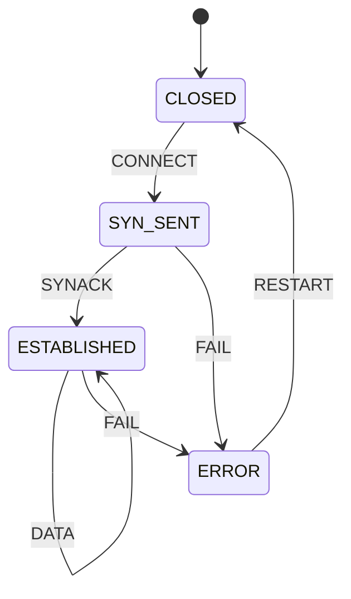

# 第 14b 课：框架对照 —— 同一条管道，四种宿主

本课几乎不写新运行时。第 14a 课已经会：

> 消息入邮箱 → 调度出队 → `fsm_dispatch` → 改这一台的状态。失败则向 **该** 角色发重启消息。

本课只引入一个观念：**工业框架是这条管道的宿主，不是另一套状态机数学。**

对照四份公开材料（不要实现它们，不要把示例当成可链接的工程）：

- **Akka**（JVM）：Actor、Mailbox、监督层级；经典 `FSM` 混入 / Typed `Behaviors`
- **CAF**（C++ Actor Framework）：类型化 Actor、邮箱
- **XState**（JS/TS）：Statechart 解释器；可以 `spawn` 子 Actor。它不是 Akka，但映射得上「每实例一份队列 + 转移」
- **SObjectizer**（C++）：agent、mbox、cooperation

代码只保留一条概念序列的小素描（Python，另有一份可选 C++）。四份框架的「连接 FSM」放在 `examples.md` 里当短伪代码，不能编译，也不该去编译。

本课同时是整门课的收官：把 **FSM、HSM、Statechart、Actor 模型** 放在一张表里，看各自解决什么问题。

---

## 1. Motivation

学完 14a，容易走两个极端：

- 「我已经有 Actor 了」，于是去造监督树、远程部署、集群分片
- 「框架太大」，于是永远手写 `conns[i].state`，把 14a 的纪律丢掉

框架要对照，是因为词汇会骗人。Akka 的 Actor、XState 的 actor、SObjectizer 的 agent，指的都是「带邮箱的隔离对象」，但：

- 有的把 **状态图** 当作一等公民（XState）
- 有的把 **监督层级** 当作一等公民（Akka，SObjectizer 的 cooperation）
- 有的把 **类型化消息与 C++ 性能** 当作一等公民（CAF）
- 第 14a 课把 **最小管道** 当作一等公民，好让你看见 `state` 字段仍在

用在哪：选型、读文档、把第 08 课的连接 FSM 塞进已有运行时。本课不教你安装这些库。

---

## 2. Problem Description

要回答的问题只有三个：

1. 一条连接 FSM（`CLOSED → SYN_SENT → ESTABLISHED`，失败进 `ERROR`）在四个框架里 **住在哪**？
2. 它们是否都遵守同一条管道：`message in → mailbox → dispatch → FSM transition`？
3. 整门课四种模型（扁平 FSM、HSM、Statechart、Actor）各解决哪一类膨胀？

明确不做：

- 不写 Scala/Java/JS 工程
- 不链接 CAF / SObjectizer
- 不实现远程消息、持久化、集群、可视化编辑器
- 不把 XState 说成「JS 版 Akka」

可运行部分：`code/python/sketch.py`（以及可选的 `code/cpp/sketch.cpp`）只演示管道本身，注释里写上四个框架对应的发送 API 名字。

---

## 3. Naive Solution

把框架当新数学：

```
「Akka 的状态和我的 enum 不是一种东西」
「XState 有图，所以不需要邮箱」
「C++ 有 CAF 就不必隔离」
```

结果是：连接表仍被随便写，却多了一层库调用。

或者把 14a 的五十行扩成假框架，在课程里重写邮箱优先级与监督策略。那会再上一门课，而且仍然不是 Akka。

或者用一张「谁最好」的排名表代替对照。没有最好：语言、监督、状态图、部署模型都是列，不是分数。

朴素方案缺的是：同一条管道当行，框架当列；FSM / HSM / Statechart / Actor 当另一张「问题类型」表。

---

## 4. FSM Solution

宿主对照的定义（本课只需这句）：

> 四个框架都在做 14a 的管道。差别是邮箱长什么样、隔离靠什么保证、FSM / 图是否一等公民、失败怎么监督、语言与典型部署是什么。

概念序列（所有对照都指向它）：

```
message in --> mailbox --> dispatch --> FSM transition
```

映射：

| 步骤 | 14a | Akka | CAF | XState | SObjectizer |
|------|-----|------|-----|--------|-------------|
| 消息入 | `actor_send` | `ref.tell` / `ref ! msg` | `self->send` / `anon_send` | `actor.send(event)` | `so_5::send<M>(mbox)` |
| 邮箱 | 每角色环形队列 | 每 Actor mailbox（可有界） | 每 Actor mailbox | 解释器事件队列 | mbox（可一对多） |
| 分发 | `scheduler_run` 一轮一条 | dispatcher 线程取邮箱 | 调度器恢复 Actor | 解释器串行处理 | 调度器投给 agent |
| 转移 | `fsm_dispatch` 改 `state` | `onEvent` / `Behaviors` / `become` | 行为函数 / `become` | 状态图转移 | 事件处理器改成员状态 |

连接 FSM 仍然是第 14a 课那张扁平图。框架不发明第四种 `ESTABLISHED`。

---

## 5. State Diagram

连接 FSM（复习，不是新图）：



管道（本课的主图）：

```
+-----------+   send/tell    +-----------+   dequeue    +------------+   lookup    +-----------+
| producer  | -------------> | Mailbox   | -----------> | dispatch   | ----------> | Fsm.state |
| (app, I/O |  in-process    | (per      |  in-process  | (single    |  in-process | (this     |
|  timer)   |  message       |  actor)   |  message     |  threaded  |  transition |  actor)   |
+-----------+                +-----------+              +------------+             +-----------+
                                  ^
                                  | RESTART (in-process message)
                                  |
                            +-----+------+
                            | supervisor |
                            +------------+
```

不要把四个框架画成四个不同形状的状态机。形状相同，盒子上的产品名不同。

XState 多画一层「图是数据」：

```
+------------------+     send      +------------------+     transition     +------------------+
| event            | ------------> | interpreter      | -----------------> | configuration    |
| (plain object)   |  in-process   | (actor mailbox)  |  in-process        | (statechart)     |
+------------------+               +------------------+                    +------------------+
```

它的「当前局面」可以是一组正交区域（第 13 课），但消息仍然先入队再串行处理。

---

## 6. State Table

### 6.1 四框架宿主

| 列 | Akka (JVM) | CAF (C++) | XState (JS/TS) | SObjectizer (C++) |
|----|------------|-----------|----------------|-------------------|
| **Mailbox** | 每 Actor 一个邮箱；可有界；由 dispatcher 取信 | 每 Actor 一个邮箱；消息类型进模板 | 每 actor / 解释器一个事件队列；默认单线程 | mbox：多生产者单消费者；可匿名、可命名；一个 mbox 可被多个 agent 订阅 |
| **Isolation** | 不共享可变状态；只发消息；`sender`/`self` | 不共享可变状态；类型化 Actor 把协议写进类型 | JS 单线程，隔离是协作式的：约定不改别人的 `context` | agent 不共享；只通过 mbox 通信 |
| **FSM / Statechart** | 经典 `akka.actor.FSM` 混入；Typed 里用 `Behaviors.setup` + `become` / 显式状态 ADT。不是 Harel 全套 Statechart | 无一等状态图；用行为函数或 `become` 编码状态。可自己嵌 14a 的 `enum` | **一等 Statechart**：层次、历史、正交、守卫、动作；`spawn` 子 actor | 无一等状态图；在 agent 事件处理器里手写状态。cooperation 管的是一组 agent 的寿命，不是图 |
| **Supervision** | 监督树；默认 One-For-One；策略 restart / stop / escalate | 可链接 / 监视错误；模型与 Akka 层级不完全相同 | `onError`、调用方处理；不是 Akka 那种父 Actor 重启策略 | cooperation：一组 agent 可被一起重启；比 14a 的单角色 `RESTART` 更接近「兄弟组」 |
| **Language** | Scala / Java（JVM） | C++ | JavaScript / TypeScript | C++ |
| **Typical use** | 后台服务、流、分布式会话 | 原生高性能并发、电信 / 交易类低延迟 | 前端 / 工作流 / 协议 UI；也用于 Node 服务 | 原生事件驱动、软实时、电信风格信令 |
| **Tradeoff** | 生态大、监督与远程成熟；付 JVM 成本与概念面 | 无 JVM、类型化消息；API 与调度模型更陡 | 图是数据、可可视化；**不是** 分布式 Actor 系统，不要拿它去替代集群 | 轻、C++ 可控；社区与资料少于 Akka / CAF |

读表时抓住两处容易混的：

- XState 的 actor ≈ 「带着队列的状态图解释器」。Akka 的 Actor ≈ 「带着队列的隔离对象」，状态图是可选项。
- CAF 与 SObjectizer 都是 C++ Actor / agent 运行时。CAF 强调类型化消息；SObjectizer 强调 mbox 与 cooperation。二者都不会替你画第 13 课的历史伪状态。

### 6.2 课程收官：FSM vs HSM vs Statechart vs Actor

| | 扁平 FSM | HSM | Statechart | Actor 模型 |
|--|----------|-----|------------|------------|
| **解决什么膨胀** | 「现在是什么」没有名字（第 01–08 课） | 状态个数按深度重复：进入 / 退出抄很多遍（第 13 课） | 一台机里还要并发区域、历史、广播（Harel；第 13 课后半） | **对象个数** × 共享内存：N 条连接互相写字段（第 14a 课） |
| **单位** | 一个当前状态 | 嵌套的当前状态 | **配置**（可同时处于多个正交区域） | 一个角色 = 状态 + 邮箱 |
| **并发** | 无 | 无（层次不是并发） | 正交区域 ≈ 一台机内部的并发 | 多角色；**每个邮箱内部串行** |
| **失败** | 写成状态或忽略 | 沿退出链回到外层 | 仍在同一台机的配置里 | 监督重启 **角色**，不是改邻居的字段 |
| **消息** | `dispatch(event)` 直接调用 | 同左 | 事件可广播到配置里的各区域 | 默认 **不** 广播；只进目标邮箱 |
| **本课位置** | 01–12 | 13a–13d | 13e–13f 与 XState | 14a 最小运行时；14b 框架宿主 |

叠法（合法，而且常见）：

```
Actor
  └── 里面是一台 FSM 或 HSM / Statechart
        └── 转移表仍是 table[state][event] 或等价物
```

不合法的混法：用正交区域代替 N 个连接角色（区域共享同一份广播事件）；用 N 个角色代替层次（把 `ESTABLISHED` 的子局面拆成另一个进程级 Actor，只为了少写 entry/exit）。

---

## 7. Event Flow

同一条连接，四种宿主上的时间线相同。变的是 API 名字。

```
time -->

tell CONNECT --> mailbox --> dispatch --> CLOSED --CONNECT--> SYN_SENT
tell SYNACK  --> mailbox --> dispatch --> SYN_SENT --SYNACK--> ESTABLISHED
tell FAIL    --> mailbox --> dispatch --> ESTABLISHED --FAIL--> ERROR
tell RESTART --> mailbox --> dispatch --> ERROR --RESTART--> CLOSED
```

两连接时（复习 14a，框架也应如此）：

```
A: FAIL --> ERROR --> (supervisor RESTART) --> CLOSED
B: DATA --> ESTABLISHED   (never reads A's state)
```

Akka 上监督可能由 **父 Actor** 收到失败信号再 `restart` 子 Actor；14a 是调度器偷看 `ERROR` 后 `actor_send`。管道仍是「重启表现为消息或由运行时重新 `fsm_init`」，不是邻居写字段。

XState 上 `send` 进解释器队列；若 `spawn` 了子 actor，子有自己的队列。不要以为「图里画了两个框」就自动有两个邮箱——没有 `spawn` 的正交区域仍是同一解释器里的配置。

---

## 8. Implementation

不要实现四框架。只运行概念素描：

```bash
python3 code/python/sketch.py
c++ -std=c++17 -Wall -Wextra -o sketch code/cpp/sketch.cpp && ./sketch
```

### 伪代码（管道）

```
tell(actor, event):
    actor.mailbox.append(event)    -- 只入队

drain(actor):
    while mailbox nonempty:
        ev <- popleft
        fsm_dispatch(actor.fsm, ev)  -- 只改这一台
```

`tell` 的注释对应：

```
Akka:        ref.tell(msg)
CAF:         self->send(actor, msg)
XState:      actor.send(event)
SObjectizer: so_5::send<Msg>(mbox)
lesson 14a:  actor_send(to, event)
```

期望输出（节选）：

```
tell conn CONNECT
tell conn SYNACK
dispatch conn CONNECT
CLOSED --CONNECT--> SYN_SENT
dispatch conn SYNACK
SYN_SENT --SYNACK--> ESTABLISHED
...
ERROR --RESTART--> CLOSED
final: CLOSED
```

四框架如何宿主这台连接机：见 `examples.md` 的短伪代码。那些片段 **不是** 本仓库可编译程序。

---

## 9. Design Discussion

为什么对照而不实现：

- 学会管道之后，读文档只问四句：邮箱在哪、谁改状态、图是不是一等公民、失败谁负责
- 真去链 CAF，会把课变成构建系统课
- 伪代码足够判断「连接 FSM 应该是 Actor 的内部，还是全局单例」

选型直觉（不是排名）：

- 已经在 JVM、要监督树与远程：Akka（或它的 Typed 后继思路）
- 已经在 C++、要类型化消息与低开销调度：CAF
- 已经在 C++、要 mbox / cooperation、信令风格：SObjectizer
- 已经在 TS、要图画出来、要层次与正交：XState
- 教学、嵌入式、或只想把纪律写进五十行：14a 运行时

XState 与 Akka 的关键差别：

| | XState | Akka |
|--|--------|------|
| 一等公民 | 状态图（数据） | 隔离对象 + 邮箱 |
| 分布式 | 不是这个产品的目标 | 是成熟路径之一 |
| `spawn` | 从机器里派生解释器 | 从 Actor 里派生 Actor |
| 监督 | 调用方 / 错误动作 | 父 Actor 策略 |

CAF 与 SObjectizer：都让你在 C++ 里做 14a 的事。选 CAF 往往因为 typed actor 与性能故事；选 SObjectizer 往往因为 mbox 可被多个 agent 看到、以及 cooperation 重启组。二者都要你自己决定 FSM 写成 `enum` 还是 `become`。

与第 13 课的关系：HSM / Statechart 回答「一台机内部怎么少抄 entry/exit、怎么表达正交」。Actor 回答「很多台机怎么不共享 `state`」。XState 把前者做强；Akka 把后者做强。可以叠：Akka Actor 内部跑一张状态图（有人用外部图库，Akka 自己的 FSM 混入是轻量版）。

工业上读代码时的信号：

- 看见 `tell` / `send` / `!` 且每个会话一个引用：Actor 宿主
- 看见一张 JSON/JS 机器定义、`interpret` / `createActor`：Statechart 宿主
- 看见 `become`：用行为切换编码状态，可能没有单独的 `enum`
- 看见监督策略配置：失败模型是角色级，不是第 12 课那种同一台机回 `SCANNING`（两者可叠：重启后的新实例再从 `CLOSED` 走恢复）

---

## 10. Common Mistakes

初学者：

- 把 XState 的 actor 当成可以跨机器重启的 Akka Actor
- 在 CAF 里仍用全局 `g_conn.state`，只把发送换成 `send`，隔离为零
- 认为有监督就不需要第 12 课的恢复：监督重建的是对象，会话协议仍要有熟知状态
- 用正交区域模拟两条 TCP 连接（共享事件广播，失败会串）
- 把本课伪代码贴进真实 Akka 工程当实现

工业上：

- 无界邮箱 + 慢消费者（14a 用容量 8 提醒过）
- 监督重启丢失了必须持久的会话标识，对端看到的是「新的一条连接」却复用了旧的日志键
- Statechart 解释器重入：在动作里同步 `send` 又立刻 `dispatch`，把「先入队」破坏掉（好的解释器会把内部 send 仍排到队列尾）
- 选型只看语言：用 XState 做集群分片，或用 Akka 只为了画一张交通灯图

---

## 11. Refactoring

把 14a 的 `fsm_dispatch` 换成第 08 课的表，或换成第 13 课的 HSM：管道函数（`tell` / 出队）不应改变。那就是「Actor 里面住着哪一种图」的重构。

若要把 14a 监护者升级成监督树：父角色持有子引用，子失败发信号给父，父决定 restart/stop。那是向 Akka / SObjectizer 靠拢。不要在 14a 代码里做完再来对照——对照应发生在表上。

若发现连接管理其实只有一条连接：回到第 08 / 09 课，不要为了一张架构图硬套 Actor。

---

## 12. Exercise

**容易**

在纸上把 14a 的 `actor_send` / `mailbox_dequeue` / `fsm_dispatch` 三行，抄成 6.1 表里四个框架的 API 名字。不要写可运行代码。

**中等**

解释：为什么「两条教学 TCP」应该是两个 Actor（或两个 XState `spawn`），而「已建立连接内部的省电」更应该是 HSM / Statechart 的子状态（第 12–13 课），而不是第三个 Actor。给出一条会选错的反例。

**挑战**

只在纸上设计：Akka One-For-One 重启连接 Actor 之后，对端还以为会话活着。你要在 **连接 FSM 里** 补什么事件（提示：第 12 课的熟知状态，或第 08 课的 `CLOSED`）才能和监督模型共存？不要实现 Akka。

---

## 13. Summary

- 四个框架宿主的是同一条管道：消息 → 邮箱 → 分发 → FSM 转移
- 差别在邮箱、隔离保证、图是否一等公民、监督、语言与部署，不在 `ESTABLISHED` 的定义
- XState ≠ Akka：前者状态图强，后者隔离对象与监督强
- 扁平 FSM 管「局面有名字」；HSM 管「层次重复」；Statechart 管「一台机里的正交与历史」；Actor 管「N 个实例不共享 `state`」
- 可以叠：角色里面再放图。不要用乘积状态、共享字段或假框架代替对照

课程到此结束。带着这四张表回头看第 01 课的灯：那一盏灯若变成一千盏，你现在知道该复制的是角色，不是布尔。
