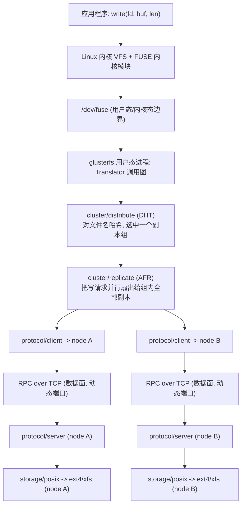

# Lesson 10 - write() 完整生命周期

## 一、本实验目的

这是收官课，目标不是学新知识点，而是**把 Lesson 1-9 的九条独立结论，串成一条完整的、首尾相接的证据链**：从应用程序调用一次 `write()`，到数据真正落在某台机器的磁盘上，中间经过的每一层，我们都已经在前面某一课里用真实实验验证过它的行为。这一课额外做了**一个综合实验**（创建一个同时具备 DHT + AFR 两层的 Distribute-Replicate 卷），把"分布"和"副本"这两个此前分别验证的能力，在同一次写入里同时观察到，作为整条证据链的收尾印证。

## 二、背景知识回顾：九课结论一览

| 课程 | 核心结论 |
|---|---|
| Lesson 1 Peer | 集群成员关系去中心化，对称复制，没有 master 节点 |
| Lesson 2 Brick | Brick 就是普通目录，没有专门磁盘格式 |
| Lesson 3 Volume | Volume 是编译好的 Translator 调用图（volfile），配置也是去中心化复制的 |
| Lesson 4 Client Mount | Client 挂载时问一次路拿到全图，之后直连所有 Brick，不再依赖挂载入口 |
| Lesson 5 DHT | 文件目标 Brick 由文件名哈希算出来，纯本地计算，不查表不问人 |
| Lesson 6 Translator | 一次系统调用在 Translator 图里可能被"扇出"成多个并行请求，再"收拢" |
| Lesson 7 Replica | AFR 把写操作并行扇出给所有副本，Brick 之间没有直接通信 |
| Lesson 8 Self Heal | 恢复依赖 xattr 记的"账"，而不是全量比对 |
| Lesson 9 RPC | 管理面(24007)和数据面(动态端口)是两套独立、可分别失效的 RPC 通道 |

## 三、提出问题（回到课程开头的 12 个问题，逐一给出实验验证过的答案）

1. **What is a Brick？** —— 就是一个普通目录（Lesson 2），被 `gluster volume create` 打上 `trusted.glusterfs.volume-id` 之后"入伙"某个 Volume（Lesson 3）。
2. **What is a Volume？** —— 一份声明式配置（volfile），描述了一张 Translator 调用图，被复制到所有节点本地磁盘（Lesson 3）。
3. **Peer 之间如何维持关系？** —— 对称 Gossip 式复制，`peer probe` 一个节点，关系会扩散给已知的所有其他节点，重启后从本地磁盘恢复，不查任何中心表（Lesson 1）。
4. **Client 如何知道文件在哪个节点？** —— 不是"知道"，是"算出来"：挂载时缓存整张配置图和哈希区间表，之后靠 DHT 一次本地哈希计算确定目标，零网络往返（Lesson 4、5）。
5. **Hash 是如何工作的？** —— 32 位哈希空间被切成若干连续区间分给各 Brick（`trusted.glusterfs.dht` xattr），对文件名做哈希，落在哪个区间就交给哪个 Brick，确定性、无状态（Lesson 5）。
6. **为什么 Gluster 不需要 Metadata Server？** —— 因为"文件在哪"从"需要被记住的状态"变成了"可以随时重新计算的结果"（哈希函数 + 预先划分好的区间表），Lesson 4 还额外验证了"挂载入口"本身也是可替换、无状态依赖的（Lesson 4、5）。
7. **Translator 是什么？为什么这样设计？** —— 进程内可插拔的功能节点，共享统一的 fop 接口，用声明式图串联；一次调用可能被扇出成多个下游并行请求，再收拢结果（Lesson 6）。
8. **Replica 是如何同步数据的？** —— Client 端的 AFR Translator 并行把写操作广播给所有副本 Brick，Brick 之间完全不直接通信（Lesson 7）。
9. **Self Heal 为什么能恢复数据？** —— 依赖写操作时存活副本记的 pending xattr"账"，恢复时只处理真正变化过的部分，不做全量比对（Lesson 8）。
10. **Client 到底和谁通信？** —— 管理面（24007，各节点 `glusterd`）和数据面（各 Brick 独立动态端口的 `glusterfsd`）是两条独立通道，前者故障不影响后者的已有连接（Lesson 9）。
11. **控制面和数据面是怎么分离的？** —— 物理上是两个独立进程、独立监听端口；逻辑上共享同一套底层 RPC 编解码框架（记录标记分帧），业务语义完全不同（Lesson 9）。
12. **一次 write() 的完整旅程是什么样的？** —— 见下面的完整图解，这正是本课要交付的答案。

## 四、实验拓扑：完整技术栈全景

```
Windows
  |
  WSL2 Ubuntu 22.04
  |
  Docker (bridge network: glusterlab-net, 172.28.0.0/24)
  |
  +-- client  (172.28.0.20)  应用程序 + FUSE 挂载点
  +-- node1   (172.28.0.11)  glusterd(24007) + 多个 glusterfsd(动态端口)
  +-- node2   (172.28.0.12)  glusterd(24007) + 多个 glusterfsd(动态端口)
  +-- node3   (172.28.0.13)  glusterd(24007) + 多个 glusterfsd(动态端口)

本课综合实验新建的卷 gv-final: Distribute-Replicate (3组 x 2副本 = 6 Brick)
  组0: node1:/data/brick3  <--副本--> node2:/data/brick3
  组1: node2:/data/brick4  <--副本--> node3:/data/brick4
  组2: node3:/data/brick3  <--副本--> node1:/data/brick4
  DHT 横跨这三组做分布，每一组内部由 AFR 做双副本同步
```

Mermaid 版的分层视图（更适合看清"一次 write() 穿过的层级"）：



## 五、实验步骤（本课唯一的新实验：DHT + AFR 组合验证）

### Step 1：创建一个同时具备"分布"和"副本"的卷

为什么做：Lesson 5 只验证了纯 Distribute，Lesson 7 只验证了纯 Replicate，但生产环境最常见的其实是两者的组合（Distributed-Replicate）——用一次实验同时看到 DHT 选组、AFR 组内复制这两层协同工作。

```bash
for n in node1 node2 node3; do docker exec $n mkdir -p /data/brick3 /data/brick4; done
docker exec node1 gluster volume create gv-final replica 2 \
  node1:/data/brick3 node2:/data/brick3 \
  node2:/data/brick4 node3:/data/brick4 \
  node3:/data/brick3 node1:/data/brick4 \
  force
docker exec node1 gluster volume start gv-final
docker exec client mount -t glusterfs node1:/gv-final /mnt/gluster-final
```

### Step 2：看 volfile，确认图的形状是"DHT 在最上面，下面挂三个 AFR 组"

```bash
docker exec node1 cat /var/lib/glusterd/vols/gv-final/trusted-gv-final.tcp-fuse.vol
```

### Step 3：写一个文件，用 `pathinfo` 验证它只落在一个副本组（2 个 Brick），而不是全部 6 个

```bash
docker exec client bash -c "echo 'final capstone write test' > /mnt/gluster-final/capstone.txt"
docker exec client getfattr -n trusted.glusterfs.pathinfo -e text /mnt/gluster-final/capstone.txt
```

## 六、实验现象

### 现象 1：volfile 精确显示"DHT 叠在 3 个 AFR 组之上"的两层结构

```
volume gv-final-replicate-0
    type cluster/replicate
    subvolumes gv-final-client-0 gv-final-client-1     <- node1+node2 的 brick3

volume gv-final-replicate-1
    type cluster/replicate
    subvolumes gv-final-client-2 gv-final-client-3     <- node2+node3 的 brick4

volume gv-final-replicate-2
    type cluster/replicate
    subvolumes gv-final-client-4 gv-final-client-5     <- node3+node1 的 brick3/brick4

volume gv-final-dht
    type cluster/distribute
    subvolumes gv-final-replicate-0 gv-final-replicate-1 gv-final-replicate-2
```

DHT 的 `subvolumes` 不再是 3 个 `protocol/client`（像 Lesson 3 的 `gv-dist` 那样），而是 3 个 `cluster/replicate`——**这就是 Translator 图"可以任意组合、按图层层嵌套"的直接证据（呼应 Lesson 6）**：DHT 完全不需要知道自己下面接的是单个 Brick 还是一整个副本组，因为 AFR 对上层暴露的接口和普通 Brick 完全一样。（完整 volfile 见 [evidence/02-final-client-volfile.txt](evidence/02-final-client-volfile.txt)）

### 现象 2：一次写入，精确落在一个副本组的两个 Brick 上，不多不少

```
trusted.glusterfs.pathinfo="(<DISTRIBUTE:gv-final-dht>
  (<REPLICATE:gv-final-replicate-1>
    <POSIX(/data/brick4):node3:/data/brick4/capstone.txt>
    <POSIX(/data/brick4):node2:/data/brick4/capstone.txt>))"
```

（见 [evidence/03-pathinfo-final.txt](evidence/03-pathinfo-final.txt)）DHT 对 `capstone.txt` 算了一次哈希，选中了 `replicate-1` 这一组（对应 Lesson 5 的哈希分片逻辑）；AFR 在这一组内部把写操作复制到了 node2 和 node3（对应 Lesson 7 的并行复制逻辑）；node1 上的两个 Brick（属于另外两组）完全没有被写入。**这一行 `pathinfo` 输出，就是 DHT 和 AFR 协同工作、各司其职的浓缩证明。**

## 七、原理分析：一次 write() 的完整旅程

结合全部 9 课的证据，一次 `echo "x" > /mnt/gluster-final/somefile.txt` 触发的完整链路是：

```
[应用层]
  bash 调用 write(fd, "x\n", 2)
        |
[内核层]
  VFS 把这次 write 转发给 FUSE 内核模块
  (因为 /mnt/gluster-final 是 fuse.glusterfs 类型的挂载点 —— Lesson 4)
        |
[FUSE 边界]
  内核通过 /dev/fuse 这个字符设备，把请求原样递给用户态的 glusterfs 进程
  (Lesson 6 strace 证据：readv(7</dev/fuse>) 拿到请求)
        |
[Translator 图 - 性能层，原样透传/短路]
  io-stats -> io-threads -> md-cache -> quick-read -> open-behind -> write-behind
  (Lesson 6：这些层可以被 gluster volume set 动态增删，volfile 会同步变化)
        |
[Translator 图 - DHT]
  对文件名 "somefile.txt" 做哈希，查本地缓存的区间表 (trusted.glusterfs.dht)
  确定目标是哪一个下游子卷 —— 可能是一个 Brick，也可能是一个 AFR 副本组
  (Lesson 5：纯本地计算，不问任何人；create/lookup 类操作还会对全部子卷做一次广播校验)
        |
[Translator 图 - AFR，如果目标是副本组]
  把这次写操作，用"先标记 dirty -> 并行写全部副本 -> 清除 dirty"的三段式事务，
  同时发送给组内每一个 protocol/client 子卷
  (Lesson 7：并行扇出，不是依次串行；Lesson 8：dirty 标记是灾难恢复的账本)
        |
[Translator 图 - protocol/client，每个目标各一份]
  把操作编码成 RPC 请求 (ONC RPC 记录标记分帧)，通过一条早在挂载时
  就已经建立、独立于管理面的 TCP 连接，发到对应 Brick 的动态端口
  (Lesson 4：挂载时问 24007 拿到端口；Lesson 9：这条数据面连接独立于管理面存活)
        |
[网络]
  TCP 传输，多个目标 Brick 的请求几乎同时在路上飞
        |
[Brick 端 - protocol/server]
  用挂载时同一份 volfile 里生成的 username/password 做连接认证
  (Lesson 3：info 文件里那组自动生成的凭证)
        |
[Brick 端 - Translator 图 - 功能层]
  access-control -> locks -> marker -> index -> quota 等等
  (Lesson 3 brick 端 volfile 里看到的那一整条链，本课程没有逐层展开每一个，
   但原理和 client 端一样：都是标准 fop 接口的可插拔节点)
        |
[Brick 端 - storage/posix]
  真正调用本地文件系统的 write() 系统调用，写到 ext4/xfs 上的一个普通文件
  (Lesson 2：Brick 就是普通目录，没有专门磁盘格式)
        |
[回程]
  每个涉及的 Brick 各自返回结果 -> AFR 等全部副本确认、清除 dirty 标记 ->
  DHT 把结果原样上传 -> 各性能层原样上传 -> FUSE 写回 /dev/fuse ->
  内核把结果作为 write() 系统调用的返回值交给应用程序
```

**贯穿全程的核心设计哲学，可以归纳成三条**：

1. **能确定性计算的，就不维护成需要同步的状态**（DHT 的哈希 vs 维护一张文件位置表——Lesson 5）。
2. **能一次性协商好的，就不要每次请求都重新协商**（挂载时一次性拿全图，之后纯本地计算+直连——Lesson 3、4）。
3. **不同职责、不同 SLA 要求的东西，物理上拆开，但底层设施尽量复用**（Translator 图里各个独立节点共享统一 fop 接口——Lesson 6；管理面数据面分离但共享 RPC 框架——Lesson 9）。

这三条原则，几乎可以解释本课程验证过的每一个设计决策。

## 八、继续深入：回看整个架构，最大的取舍是什么？

**GlusterFS 用"预先协商 + 之后纯计算"换来了极致的去中心化，代价是"新鲜度"问题贯穿始终**：

- Lesson 4：挂载时缓存的 volfile 如果集群拓扑变了，不会自动更新。
- Lesson 5：DHT 的区间表如果扩容 Brick，需要 rebalance 才能让新旧数据都符合新的哈希划分。
- Lesson 8：Self Heal 依赖的 pending 账本，如果记账的一方自己也故障，账本就丢了。

**这不是设计缺陷，而是一个一以贯之的、清醒的权衡**：GlusterFS 选择在"扩容/拓扑变化"这种低频事件上支付"需要人工介入触发 rebalance/heal"的成本，来换取"日常读写"这种高频路径上完全无需协调、无需查询任何中心服务的性能——这和数据库里"读多写少就应该多建索引，牺牲写性能换读性能"是同一类工程直觉，只是应用在了"拓扑变化频率 vs 数据读写频率"这个维度上。

如果要用一句话总结 GlusterFS 区别于其他分布式存储（比如依赖 Metadata Server 的 HDFS，或者依赖强一致共识协议的 Ceph）的设计选择，那就是：**它几乎在所有能用"确定性计算"替代"协调/查询"的地方，都做出了这个选择，把复杂度尽可能压缩在"配置变化"这种低频事件里，而不是"数据读写"这种高频路径里。**

## 九、源码位置全景（汇总本课程涉及的所有模块）

```
glusterd/src/                    管理面守护进程：Peer 管理、Volume 配置生成 (Lesson 1、3)
libglusterfs/src/                通用基础设施：xlator/graph 框架、GFID、hashfn (Lesson 1、5、6)
rpc/rpc-lib/src/                 管理面与数据面共用的 RPC 传输层 (Lesson 9)
xlators/mount/fuse/src/          FUSE 桥接层 (Lesson 4、6)
xlators/protocol/client/src/     数据面 client 侧：端口发现、RPC 编码 (Lesson 4、9)
xlators/protocol/server/src/     数据面 server 侧：认证、RPC 解码 (Lesson 9)
xlators/cluster/dht/src/         DHT：哈希计算、layout 管理、rebalance (Lesson 5)
xlators/cluster/afr/src/         AFR：并行复制、pending 标记、Self Heal (Lesson 7、8)
xlators/features/index/src/      Self Heal 用的快速索引 (Lesson 8)
xlators/performance/*/src/       write-behind/quick-read/md-cache 等可插拔性能层 (Lesson 6)
xlators/storage/posix/src/       最底层，直接对接本地文件系统 (Lesson 2)
```

## 十、本实验总结

1. 一次 `write()` 从应用程序到磁盘，完整穿越了 FUSE、若干性能 Translator、DHT、（可能的）AFR、RPC、protocol/server、POSIX 共 7 类层级，每一层都在本课程前面某一课里被单独验证过。
2. DHT 和 AFR 可以自由嵌套组合（DHT 的下游可以是普通 Brick，也可以是一整个 AFR 副本组），这是 Translator"统一 fop 接口、可插拔"这一设计的直接产物。
3. 综合实验证明：一次写入精确落在"一个由 DHT 选中的副本组"内的"全部副本"上，DHT 和 AFR 各自的职责边界清晰、互不越界。
4. GlusterFS 的核心设计哲学可以归纳为三点：能算就不存、能一次性协商就不重复协商、不同职责物理分离但共享底层设施。
5. 这套设计的代价集中体现在"拓扑变化后的滞后与人工介入"（rebalance、heal、重新挂载获取新 volfile），这是刻意的权衡，不是缺陷。

## 十一、思考题（课程终极思考）

1. 如果要把 GlusterFS 的这套架构迁移到"公有云对象存储"场景（而不是本课程用的本地文件系统语义），DHT、AFR、Translator 这几个核心概念哪些还适用，哪些需要重新设计？
2. 本课程全程没有讨论"性能调优"，如果现在要对着这套完整的原理图去做性能优化，你会优先从哪一层入手？为什么？
3. 如果让你重新设计一遍 GlusterFS，会保留"Translator 图"这个核心抽象吗？如果保留，你会如何改进 Lesson 6/8/9 暴露出来的那些边界情况（扇出过程中一方超时、账本丢失、管理面和数据面状态不同步的短暂窗口）？
4. 这十课验证的所有结论，本质上都基于一个假设——三节点、局域网、低延迟、Docker 容器环境。如果换成跨地域、高延迟、不稳定网络的真实生产环境，你认为哪些结论依然成立，哪些会需要重新审视？

## 十二、证据链索引（全课程汇总）

| 课程 | 核心证据目录 |
|---|---|
| Lesson 1 认识 Peer | [lesson01-peer/evidence/](../lesson01-peer/evidence/) |
| Lesson 2 Brick | [lesson02-brick/evidence/](../lesson02-brick/evidence/) |
| Lesson 3 Volume | [lesson03-volume/evidence/](../lesson03-volume/evidence/) |
| Lesson 4 Client Mount | [lesson04-client-mount/evidence/](../lesson04-client-mount/evidence/) |
| Lesson 5 Distributed Hash | [lesson05-distributed-hash/evidence/](../lesson05-distributed-hash/evidence/) |
| Lesson 6 Translator | [lesson06-translator/evidence/](../lesson06-translator/evidence/) |
| Lesson 7 Replica | [lesson07-replica/evidence/](../lesson07-replica/evidence/) |
| Lesson 8 Self Heal | [lesson08-self-heal/evidence/](../lesson08-self-heal/evidence/) |
| Lesson 9 Gluster RPC | [lesson09-gluster-rpc/evidence/](../lesson09-gluster-rpc/evidence/) |
| Lesson 10 本课综合实验 | [evidence/01-create-dist-rep-volume.txt](evidence/01-create-dist-rep-volume.txt)、[evidence/02-final-client-volfile.txt](evidence/02-final-client-volfile.txt)、[evidence/03-pathinfo-final.txt](evidence/03-pathinfo-final.txt) |

---

上一课：[Lesson 9 - Gluster RPC](../lesson09-gluster-rpc/README.md)
课程首页：[00 - 实验环境搭建](../00-environment-setup.md)
